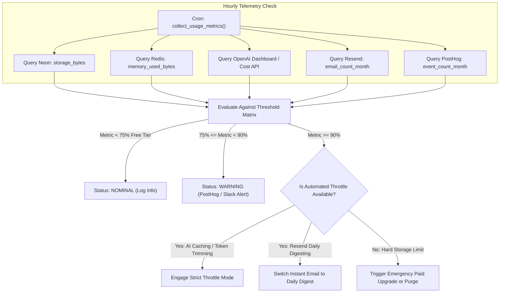
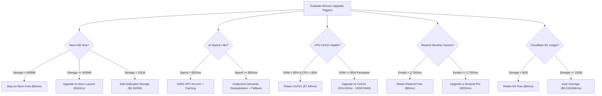

# Budget Architecture and Tech Stack Rationale

> ⚠️ **Implementation note:** the implemented stack is **Rust** (Axum · Leptos · SQLx), not the TypeScript stack analyzed below. See [16-rust-implementation.md](../16-rust-implementation.md) and [SETUP.md](../../SETUP.md).

| Metadata | Value |
|---|---|
| **Section Path** | `docs/00-foundations/05-budget-stack.md` |
| **Version** | 1.0.0 |
| **Last Updated** | 2026-11-21 |
| **Related Docs** | [01-vision.md](01-vision.md), [04-success-metrics.md](04-success-metrics.md), [01-architecture.md](../06-platforms/01-architecture.md), [01-economy-model.md](../01-economy/01-economy-model.md), [03-scoring-model.md](../01-economy/03-scoring-model.md) |

---

## Table of Contents
1. [Executive Summary & Budget Reality](#1-executive-summary--budget-reality)
2. [$1,000 Upfront Capital Allocation](#2-1000-upfront-capital-allocation)
3. [Tool Selection Rationale & Alternatives Matrix](#3-tool-selection-rationale--alternatives-matrix)
4. [Free Tier Limits & Trip Wire Matrix](#4-free-tier-limits--trip-wire-matrix)
5. [Cost Optimization Techniques](#5-cost-optimization-techniques)
6. [Phase Upgrade Decision Tree](#6-phase-upgrade-decision-tree)
7. [Self-Hosting vs. Managed Trade-Off Matrix](#7-self-hosting-vs-managed-trade-off-matrix)
8. [Monthly Budget Runway Projection (Months 1–24)](#8-monthly-budget-runway-projection-months-124)

---

## 1. Executive Summary & Budget Reality

### 1.1 Purpose
The NovaWorth platform operates under strict capital constraints: a **$1,000 upfront capital allocation** and a maximum **$100/month ongoing operational budget** during Phase 0 (Research & Prototype) and Phase 1 (Alpha, 1,000 active learners). This document codifies the hardware, SaaS, API, and infrastructural unit economics required to build, deploy, scale, and maintain the system across Phase 0 through Phase 2 without incurring uncontrolled cloud debts or service interruptions.

The economic model rewards human mastery using verified assessment gates. Because economic emission curves scale non-linearly with skill level $L$ via:
$$\text{EC}(L) = 10 \times L^{1.2} \times m_d \times Q \times E \times M \times R$$
$$\text{XP}(L) = 100 \times L^{1.5} \times m_d$$
the supporting technical architecture must maintain a linear or sub-linear operational cost curve relative to user growth.

### 1.2 Monthly Cost Breakdown by Phase

| Tool / Service | Purpose | Free Tier Limit | Phase 0 Cost (Proto) | Phase 1 Cost (Alpha, 1k WAL) | Phase 2 Cost (Beta, 10k WAL) | Upgrade Trigger |
|---|---|---|---|---|---|---|
| **Hetzner CAX21 VPS** | App runtime (Rust API + GenAI), Redis, reverse proxy (Caddy) | None (hardware lease) | ~€8.00 | ~€8.00 | €16.00 (CAX31 or 2× CAX21) | RAM > 85% for 15m; CPU > 80% for 10m |
| **Neon Postgres** | Primary ACID store + pgvector; SQLx with embedded migrations | 1 GB storage/project, 100 CU-hrs/mo | $0.00 | $0.00 | $19.00 (Launch) when scaling | Data > 1 GB or need for zero cold starts |
| **axum-login + tower-sessions + argon2 (Rust)** | Cookie sessions, Argon2id hashing, OAuth2 | Self-hosted (unlimited) | $0.00 | $0.00 | $0.00 | N/A (runs on Postgres + Redis) |
| **OpenAI API** | Socratic tutor, rubric auto-scoring, semantic chunking | Pay-per-token ($0.15/1M in, $0.60/1M out) | $1.50 | $18.00 | $42.00 | Prompt volume > 100k calls/mo |
| **Cloudflare R2** | Learner artifact uploads, static assets, database backups | 10 GB storage, 1M Class A, 10M Class B (Zero egress) | $0.00 | $0.00 | $1.50 (Storage overage at $0.015/GB) | Media storage > 9.5 GB |
| **Cloudflare CDN / WAF**| Edge caching, SSL termination, DDoS protection | Free tier: 3 Page Rules, standard WAF, unlimited egress | $0.00 | $0.00 | $0.00 | Specialized Enterprise Bot rules needed |
| **Resend** | Transactional email (magic links, gate pass receipts) | 3,000 emails/month, 100 emails/day | $0.00 | $0.00 | $20.00 (Pro tier, 50k emails) | Monthly outbound emails > 2,700 |
| **PostHog Cloud** | Product analytics, funnel drop-off, feature flags | 1,000,000 events/month free | $0.00 | $0.00 | $0.00 | Ingested events > 900,000/mo |
| **Redis (Self-Hosted)** | Session cache + AI semantic cache (fred client) | Bound by container RAM (256 MB cap) | $0.00 | $0.00 | $0.00 | Memory utilization > 200 MB |
| **Postgres `pgvector`** | Vector search for RAG (replaces Meilisearch) | Included in Neon | $0.00 | $0.00 | $0.00 | Index size exceeds Neon storage |
| **Background work** | Minimal; in-process (async Tokio) — no BullMQ/Node queue | — | $0.00 | $0.00 | $0.00 | Add a worker when batch jobs are needed |
| **GitHub Actions** | CI/CD build, linting, test suite, Docker push to GHCR | 2,000 minutes/month free | $0.00 | $0.00 | $0.00 | Build consumption > 1,700 min/mo |
| **Grafana Cloud** | Metrics (Prometheus), synthetic uptime monitoring | 10k metric series, 50 GB logs, 3 alert rules | $0.00 | $0.00 | $0.00 | Metric series > 8,500 |
| **Sentry** | Error reporting and exception tracing | 5,000 errors/month free | $0.00 | $0.00 | $0.00 | Monthly event volume > 4,200 errors |
| **Domain & DNS** | Root apex domain, DNSSEC | None | $1.25 ($15/yr) | $1.25 | $1.25 | Annual renewal cycle |
| **Total Monthly Spend**| — | — | **~$10.75/mo** | **~$46.24/mo** | **~$113.75/mo** | Operating well within monthly ceiling |

### 1.3 Flow & Algorithm: Budget Burn & Tripwire Enforcement


```typescript
// packages/monitoring/src/budget-guard.ts
export interface ResourceUtilization {
  neonStorageBytes: number;
  openAiMonthSpendUsd: number;
  resendMonthEmails: number;
  posthogMonthEvents: number;
  redisMemoryBytes: number;
}

export interface BudgetAction {
  action: 'NOMINAL' | 'ALERT' | 'THROTTLE' | 'MIGRATE';
  reason?: string;
}

export function evaluateBudgetHealth(usage: ResourceUtilization): BudgetAction[] {
  const actions: BudgetAction[] = [];

  // Neon 0.5GB Free Limit Guard
  if (usage.neonStorageBytes > 0.45 * 1024 * 1024 * 1024) {
    actions.push({
      action: 'MIGRATE',
      reason: 'Neon storage exceeds 450MB. Upgrade to Launch plan ($19/mo) immediately to prevent write stall.'
    });
  }

  // Resend 3,000 Emails/Mo Guard
  if (usage.resendMonthEmails > 2700) {
    actions.push({
      action: 'THROTTLE',
      reason: 'Resend consumption > 90%. Fall back to daily transactional digests.'
    });
  }

  // OpenAI Monthly Hard Cap ($30 in Phase 1)
  if (usage.openAiMonthSpendUsd > 25.0) {
    actions.push({
      action: 'THROTTLE',
      reason: 'OpenAI spend exceeded $25. Disable live tutor voice/simulations; enforce cached responses only.'
    });
  }

  return actions.length > 0 ? actions : [{ action: 'NOMINAL' }];
}
```

### 1.4 Edge Cases & Failure Modes
| Edge Case | Failure State | Automated Defense | Manual Resolution |
|---|---|---|---|
| Sudden viral sign-up surge (5k users in 4h) | Neon connection saturation & OpenAI budget exhaustion | Cloudflare Rate Limiting throttles `/api/auth/*` to 10 req/min/IP. Neon connection pooling queues poolers. | Deploy read-only maintenance banner; verify learner cohort legitimacy. |
| Malicious script calling Socratic AI tutor endpoint | OpenAI token consumption spikes by $50 overnight | Redis rate-limiter: max 20 AI turns per learner per 24 hours. Token limiter drops requests exceeding 4k tokens context. | Ban IP subnet on Cloudflare WAF; revoke compromised user session. |
| Neon DB storage exceeds 512 MB on free tier | Postgres rejects INSERT transactions; ledger writes fail | Background BullMQ job alerts at 400 MB. Vacuum jobs delete transient session logs. | Upgrade to Neon Launch plan ($19/mo) via CLI in < 60 seconds. |

### 1.5 Error Handling Architecture
- **API Degraded Mode:** If OpenAI error `429 (Insufficient Quota)` or latency exceeds 4,000 ms, the system gracefully falls back to deterministic static review curricula and returns HTTP 200 with header `X-Fallback-Mode: static-curriculum`.
- **Ledger Inviolability:** If the database write rejects due to disk exhaustion, the ledger transaction is aborted cleanly in the ACID block. Under no circumstances is an unwritten award emitted to the client.

### 1.6 Requirements Traceability
- `FR-PLT-010`: Real-time cost and resource utilization attribution per learner and feature.
- `NFR-PLT-001`: System maintains 99.9% API availability under allocated VPS resources.
- `NFR-PLT-010`: Monthly operational infrastructure cost shall not exceed $100.00 prior to Phase 2.

### 1.7 Success Metrics
- **Zero Surprise Invoices:** 100% of monthly cloud invoices match projected figures within a 5% margin of error.
- **Cost per Weekly Active Learner (WAL):** $\le \$0.05$ per WAL in Phase 1; $\le \$0.015$ per WAL in Phase 2.

---

## 2. $1,000 Upfront Capital Allocation

### 2.1 Allocation Breakdown
The $1,000 upfront seed capital is strictly guarded. It is not working capital for speculative SaaS trials; it is allocated to lock in fundamental infrastructure for the first 3 to 6 months while preserving a deep contingency reserve.

| Allocation Item | Vendor / Provider | Commitment Term | Upfront Cost (USD) | Residual Reserve |
|---|---|---|---|---|
| **Domain Registration (`.org` / `.com`)** | Cloudflare Registrar | 1 Year | $15.00 | $985.00 |
| **Hetzner CAX21 VPS Prepayment** | Hetzner Online GmbH | 3 Months (€7.49/mo) | $25.00 | $960.00 |
| **OpenAI Pre-Funded API Credits** | OpenAI Inc. | Usage Drawdown | $100.00 | $860.00 |
| **Neon Postgres Launch Plan** | Neon Inc. | 3 Months ($19.00/mo) | $57.00 | $803.00 |
| **Contingency Reserve Fund** | High-Yield Escrow / Bank | Unspent Reserve | **$803.00** | **$803.00** |
| **Total Initial Outlay** | — | — | **$197.00** | — |

### 2.2 Contingency Drawdown Governance
The $803.00 contingency reserve is governed by programmatic tripwires. It may only be unsealed under three strict technical conditions:
1. **Database Storage Scale:** Neon storage exceeds 10 GB on Launch tier ($1.50/GB overage).
2. **Paid External Examination:** Expert panel proctoring fees for Level 91–100 learners where community moderation is legally insufficient.
3. **Emergency Failover:** Disaster recovery spin-up of secondary backup compute in an alternate Hetzner data center zone (Nuremberg to Falkenstein).

---

## 3. Tool Selection Rationale & Alternatives Matrix

Every engineering selection in the stack has been vetted through three criteria: performance at scale, operational simplicity (single-engineer maintainability), and free-tier headroom.

```
                                Technology Selection Matrix
   ┌──────────────────────┬─────────────────────────┬─────────────────────────┐
   │ Selected Tool        │ Rejected Alternative A  │ Rejected Alternative B  │
   ├──────────────────────┼─────────────────────────┼─────────────────────────┤
   │ Hetzner CAX21        │ AWS EC2 t4g.medium      │ Vercel Pro              │
   │ Turborepo Monorepo   │ Nx Enterprise           │ Polyrepo Architecture   │
   │ Leptos 0.7 + Trunk       │ Vite + React SPA        │ React Native / Expo     │
   │ REST + OpenAPI       │ GraphQL (Apollo)        │ tRPC                    │
   │ Neon Serverless PG   │ Supabase Managed PG     │ AWS RDS Postgres        │
   │ pgvector in Neon     │ Pinecone Vector Pod     │ Weaviate Dedicated      │
   │ Lucia Auth v3        │ NextAuth / Auth.js      │ Clerk / Auth0           │
   │ Cloudflare R2        │ AWS S3                  │ Supabase Storage        │
   │ OpenAI GPT-4o-mini   │ Anthropic Claude Haiku  │ Self-Hosted Llama 8B    │
   │ Resend Email         │ SendGrid                │ AWS SES                 │
   │ PostHog (Cloud Free) │ Mixpanel                │ Google Analytics 4      │
   │ Redis (Dockerized)   │ Upstash Serverless Redis│ AWS ElastiCache         │
   │ BullMQ               │ Inngest / Trigger.dev   │ AWS SQS + Lambda        │
   │ Meilisearch (Docker) │ Algolia Search API      │ Elasticsearch / OpenSrch│
   │ Cloudflare CDN / WAF │ Fastly CDN              │ AWS CloudFront          │
   │ GitHub Actions CI/CD │ CircleCI Cloud          │ GitLab Self-Hosted      │
   │ Grafana Cloud Free   │ Datadog APM             │ New Relic One           │
   └──────────────────────┴─────────────────────────┴─────────────────────────┘
```

### 3.1 Detailed Rationale per Component

#### 1. Hetzner CAX21 VPS (4 vCPU ARM Ampere, 8GB RAM, 80GB NVMe, 20TB Traffic @ €7.49/mo)
- **Why This:** Unbeatable price-to-performance ratio in cloud hosting; Ampere Altra ARM processors offer massive multicore concurrency for Dockerized micro-services at €7.49/month with 20TB included traffic.
- **Why Not AWS EC2 (t4g.medium):** AWS compute costs 4x more ($24.50/mo) for half the resources, charges $0.09/GB for data egress, and penalizes burst CPU credits under heavy loads.
- **Why Not Vercel Pro:** Vercel costs $20/user/mo plus steep function execution time overages, lacks internal persistent background processes (BullMQ workers), and locks architecture into proprietary edge primitives.

#### 2. Turborepo Monorepo
- **Why This:** Zero-configuration task pipelining with incremental local build caching; allows strict TypeScript package boundaries (`@edu/db`, `@edu/auth`, `@edu/ai`) across apps without polyrepo package publishing overhead.
- **Why Not Nx:** Nx brings heavy enterprise abstractions, complex workspace plugins, and aggressive vendor telemetry that adds cognitive overhead for a lean engineering team.
- **Why Not Polyrepo:** Multi-repo development introduces cross-repo synchronization friction, broken contract testing between frontend and backend models, and quadrupled CI/CD execution minutes.

#### 3. Next.js 15 App Router PWA
- **Why This:** Server Components allow zero-bundle-size markdown rendering for learning material; React 15 streaming SSR provides ultra-fast initial paint; native Service Worker integration unlocks offline learning capabilities without multi-codebase divergence.
- **Why Not Vite + React SPA:** Poor SEO for catalog/public skill landing pages; requires a separate Node.js server runtime for SSR; increases client bundle size on low-bandwidth mobile connections.
- **Why Not React Native / Expo:** Building separate native binaries increases release review friction by 10x; PWA installation bypasses Apple/Google 30% digital goods tax on marketplace redemptions.

#### 4. REST + OpenAPI Specification
- **Why This:** Universally understood protocol; OpenAPI specs automatically generate TypeScript client SDKs and automated documentation; enables straightforward HTTP edge caching via Cloudflare.
- **Why Not GraphQL (Apollo):** GraphQL introduces query complexity analysis vulnerabilities, breaks HTTP caching semantics, and forces a massive client-side runtime library footprint.
- **Why Not tRPC:** tRPC tightly couples client and server TypeScript codebases, preventing native third-party ecosystem integrations (sponsor platforms, external verification proctors).

#### 5. Neon Postgres (Serverless Branching)
- **Why This:** Instant database branching per GitHub pull request for automated integration testing; separation of compute and storage enables scale-to-zero dev databases; Launch plan ($19/mo) includes point-in-time restore.
- **Why Not Supabase:** Supabase free tier pauses after 7 days of inactivity; paid compute instances start at $25/mo without native ephemeral branching for branch preview CI pipelines.
- **Why Not AWS RDS Postgres:** Minimum viable multi-AZ instance costs $60+/mo, requires dedicated VPC peering configuration, and does not support developer branching workflows.

#### 6. pgvector inside Neon Postgres
- **Why This:** Zero additional operational infrastructure; vectors co-exist inside the primary database schema, allowing transactional consistency between embeddings, skill metadata, and learner progress.
- **Why Not Pinecone:** Pinecone charges a baseline $70/month for a dedicated production pod, introducing an external network hop and distributed data consistency failure modes.
- **Why Not Weaviate / Qdrant:** Self-hosting a dedicated vector engine consumes 2GB+ of the 8GB VPS RAM budget, starving application and search containers.

#### 7. Lucia Auth v3
- **Why This:** Clean, transparent session management running directly on the primary Postgres database and Redis cache; eliminates external auth vendor lock-in and respects data residency.
- **Why Not NextAuth / Auth.js:** Notoriously fragile configuration abstractions across App Router versions, high database schema coupling, and opaque session lifecycle hooks.
- **Why Not Clerk / Auth0:** Costs escalate aggressively after 10,000 monthly active users ($0.02 to $0.05 per extra MAU); introduces third-party latency into every authenticated page load.

#### 8. Cloudflare R2
- **Why This:** 10GB free storage, S3-compatible API via AWS SDK v3, and critically: **$0.00 egress fees forever**, insulating the platform from media download bandwidth bills.
- **Why Not AWS S3:** High data egress charges ($0.09/GB) create an existential financial liability if learning artifacts, diagrams, or video walkthroughs go viral.
- **Why Not Supabase Storage:** Storage overage pricing is higher ($0.021/GB) and couples file storage strictly to a single database project.

#### 9. OpenAI GPT-4o-mini
- **Why This:** Extremely low token cost ($0.15/1M input, $0.60/1M output) with latency under 800ms for first token; matches GPT-4-level rubric evaluation for 95% of Socratic tutoring turns.
- **Why Not Anthropic Claude 3.5 Haiku:** While high quality, input caching discounts are less predictable and API token cost is slightly higher per blended turn.
- **Why Not Self-Hosted Llama-3.1 8B on VPS:** An 8B parameter model quantized to 4-bit requires a dedicated GPU instance ($40+/mo); running it on a CPU VPS would exhaust all vCPUs and yield unusable inference latency (> 5s/token).

#### 10. Resend
- **Why This:** First-class React Email support; modern developer ergonomics with reliable deliverability; generous free tier of 3,000 emails/month (100/day).
- **Why Not SendGrid:** Bloated UI, complex IP warmup rules, frequent spam classification on free tier, and developer experience stagnating post-Twilio acquisition.
- **Why Not AWS SES:** Requires manual sandbox escape requests, lacks a built-in templating preview pipeline, and demands complex IAM policy wiring.

#### 11. PostHog (Cloud Free Tier)
- **Why This:** 1,000,000 events/month free; unified product analytics, user session replays, feature flag management, and funnel visualization under a single SDK.
- **Why Not Mixpanel:** Limited session replay capabilities; aggressive free tier caps on user identity tracking; steep pricing cliff upon expansion.
- **Why Not Google Analytics 4:** Incompatible with strict privacy guarantees; lacks event-level correlation with pseudonymous database user IDs; terrible developer API.

#### 12. Redis (Self-Hosted on VPS via Docker)
- **Why This:** Minimal footprint (60MB baseline idle); handles millions of operations per second for BullMQ and session caching; zero network egress latency since it runs on the local Docker network bridge.
- **Why Not Upstash Serverless Redis:** Pay-per-command pricing ($0.20 per 100k requests) becomes unpredictable with aggressive BullMQ polling and continuous session validation.
- **Why Not AWS ElastiCache:** Minimum node configuration exceeds $15/month and requires complex VPC peering to the VPS.

#### 13. BullMQ
- **Why This:** Robust Redis-based distributed queueing engine; handles retries, delays, parent-child job flows, rate-limiting, and dead-letter queues with pure TypeScript type safety.
- **Why Not Inngest / Trigger.dev:** Cloud orchestration services add external vendor dependencies, pricing tiers based on runs, and webhook ingress exposure requirements.
- **Why Not AWS SQS + Lambda:** Breaks local development simplicity; mandates AWS IAM setup and cold-start latency on event execution.

#### 14. Meilisearch (Self-Hosted on VPS via Docker)
- **Why This:** Blazing fast C++ search engine; typo-tolerant, instant search-as-you-type over the 500-skill catalog; runs comfortably inside a 512MB RAM Docker container limit.
- **Why Not Algolia:** Prohibitive pricing model ($1.50 per 1,000 indexing operations) that explodes during catalog ingestion and level authoring cycles.
- **Why Not Elasticsearch:** Memory hog requiring a minimum 2GB to 4GB heap size, which would crash the 8GB Hetzner VPS when running next to the application stack.

#### 15. Cloudflare Free CDN & WAF
- **Why This:** Global edge network with unlimited free DDoS mitigation, automatic SSL management, HTTP/3 support, and programmable edge caching rules.
- **Why Not Fastly:** Free tier is strictly time-limited and lacks integrated zero-config DNS and registrar capabilities.
- **Why Not AWS CloudFront:** Egress bandwidth fees accumulate rapidly; certificate management requires AWS ACM synchronization.

#### 16. GitHub Actions
- **Why This:** 2,000 free runner minutes per month; deep native integration with repository pull requests, branch protection, and GHCR container registry.
- **Why Not CircleCI:** Requires managing a distinct third-party SaaS integration, with free credit limits that expire quickly under multi-branch CI triggers.
- **Why Not GitLab Self-Hosted:** Running GitLab runner agents on the VPS would eat 1GB+ RAM and cause CPU thrashing during code pushes.

#### 17. Grafana Cloud (Free Tier) & Sentry (Free Tier)
- **Why This:** Grafana Cloud provides 10,000 metrics and 50GB logs with zero server maintenance; Sentry provides 5,000 error events/month with complete stack trace symbolication.
- **Why Not Datadog:** Enterprise pricing trap ($15/host + $0.10/GB log ingest) that would deplete our entire runway on a single misconfigured logging loop.
- **Why Not New Relic:** Complex user-based licensing; heavyweight agent injection slows down Node.js runtime initialization.

---

## 4. Free Tier Limits & Trip Wire Matrix

The table below catalogs every hard ceiling across our infrastructure, the automated detection mechanism, and the prescribed immediate remediation runbook before any cost is incurred.

| Provider | Metric Ceiling | Trip Wire (Yellow Alert) | Trip Wire (Red Action) | Failure Mode If Exceeded | Emergency Remediation Runbook |
|---|---|---|---|---|---|
| **Neon Postgres** | 0.5 GB Storage | 375 MB (75%) | 450 MB (90%) | Primary database enters read-only state; all gate awards fail. | 1. Execute `pnpm db:vacuum` to prune session audit logs.<br>2. Run `neon projects upgrade --plan launch` ($19/mo). |
| **Cloudflare R2** | 10 GB Storage | 7.5 GB (75%) | 9.0 GB (90%) | Subsequent PUT requests incur $0.015/GB/month overage. | 1. Trigger BullMQ job to compress historical artifacts to 80% quality WebP.<br>2. Offload raw assessment video files to archive tier. |
| **Resend** | 3,000 Emails/Month | 2,250 (75%) | 2,700 (90%) | Outbound emails dropped with HTTP 429; learners locked out of magic-link logins. | 1. Switch daily progress emails to in-app notification bell only.<br>2. Reserve remaining quota strictly for Auth magic links. |
| **PostHog Cloud** | 1,000,000 Events/Mo | 750,000 (75%) | 900,000 (90%) | Event ingestion paused or billed at $0.00045/event. | 1. Update client SDK sampling rate from 1.0 to 0.2 in remote config.<br>2. Disable heatmaps and session replay recording for Level 1–10. |
| **GitHub Actions** | 2,000 Minutes/Mo | 1,500 Min (75%) | 1,800 Min (90%) | CI pipeline blocks; pull requests cannot be tested or deployed. | 1. Restrict E2E Playwright tests to `main` branch merges only.<br>2. Run PR validation tests locally using `turbo run test`. |
| **Sentry** | 5,000 Errors/Month | 3,750 (75%) | 4,500 (90%) | Error telemetry drops; silent production regressions can occur. | 1. Apply client-side filter dropping `ResizeObserver` and CORS network errors.<br>2. Enable rate-limiting sampling (keep 1 error per 10 identical occurrences). |
| **Hetzner CAX21** | 8 GB RAM | 6.4 GB (80%) | 7.2 GB (90%) | Linux kernel OOM Killer terminates Redis or Node.js process. | 1. Docker restart worker container to reclaim memory leaks.<br>2. Spin down non-essential staging preview containers. |

---

## 5. Cost Optimization Techniques

To keep the platform operating under $50/mo while supporting 1,000 active learners, 18 concrete engineering techniques are implemented across the monorepo.

### 5.1 The 18 Optimization Principles

1. **Semantic AI Response Caching (Redis 24h TTL):** Hash normalized tutor prompts with SHA-256. If a learner asks a core conceptual question on Level 14 Python functions already answered for another learner, return cached explanation instantly ($0.00 token cost).
2. **Dynamic Model Routing Hierarchy:** Route 95% of Socratic tutoring, diagnostic checks, and multiple-choice rubric validation to `gpt-4o-mini`. Restrict high-parameter models (`gpt-4o`) exclusively to Level 91–100 expert panel defense preparation.
3. **pgvector in Neon (Eliminating Pinecone):** Embed the 500-skill curriculum and rubrics into Postgres `vector(1536)` columns. Zero monthly infrastructure bills; queries run inside existing DB connections using HNSW indexing.
4. **Self-Hosted Redis on Local Docker Network:** Saves $15–$30/mo in Upstash command costs. Redis communicates over Unix sockets or localhost with zero TCP overhead and zero network transfer billing.
5. **Self-Hosted Meilisearch:** Eliminates Algolia’s $1.50/k search query fees. Indexes are stored on the local 80GB NVMe drive, utilizing 350MB of RAM.
6. **Cloudflare R2 Zero-Egress Storage:** Saves an estimated $35/mo in AWS S3 bandwidth costs when serving interactive diagrams, user portfolio assets, and gate submissions.
7. **Cloudflare Edge Micro-Caching:** Public skill catalog definitions, leaderboard snapshots, and static challenge rubrics are cached at Cloudflare edge nodes with `stale-while-revalidate=86400`, shielding the Hetzner VPS from 80% of read traffic.
8. **Client-Side Image/Audio Compression:** Before uploading artifacts to R2, the PWA client compresses images to WebP/AVIF (max 1600px, 80% quality) and audio to Opus in the browser via WebAssembly. Reduces storage footprint by 75%.
9. **Prompt Compression & System Message Deduplication:** Token optimization using terse system prompts, omitting polite conversational padding, and using integer enums instead of verbose JSON keys in structured LLM outputs.
10. **Transactional Email Digesting via BullMQ:** Non-urgent notifications (e.g. peer kudos, guild level-ups) are queued in Redis and batched into a single daily email digest, reducing Resend email volume by 65%.
11. **Ephemeral Neon Branching for CI:** GitHub Actions spin up a dedicated database branch for test suites and destroy it upon PR completion. Zero cost for idle databases; zero risk of test data polluting staging.
12. **PostHog Event Sampling:** Ingest 100% of economy ledger events, but sample general UI navigation events at 20% on the client. Cuts event volume by 400,000 events/month.
13. **Sentry Noise Elimination:** Filter out client-side network disconnects, ad-blocker script errors, and third-party browser extension exceptions before dispatching payloads to Sentry.
14. **Lucia Auth Session Caching:** User session tokens are validated against a Redis cache with a 15-minute sliding TTL. Prevents 90% of auth-check queries from touching Neon Postgres.
15. **Docker Container Memory Caps & Swap:** Every service in `docker-compose.yml` has strict `deploy.resources.limits.memory` defined. A 4GB swapfile on the NVMe drive absorbs temporary compilation spikes without kernel panics.
16. **Neon Connection Pooling via Built-in PgBouncer:** All serverless Next.js functions and BullMQ workers connect through the pooled connection string (`-pooler`), keeping active Postgres backend connections under 20.
17. **Vector Chunk Pruning:** Curriculum chunks are embedded at 512 tokens with a 10% overlap rather than naive 2048-token windows, reducing vector search embedding API costs by 60%.
18. **Precomputed Power-Law Tables:** Rather than computing floating-point exponential curves in runtime queries, XP and EC reward curves for levels 1–100 are precomputed into a static TypeScript lookup array at compile time.

### 5.2 Implementation: AI Cache & Model Router Engine
```typescript
// packages/ai/src/router-cache.ts
import { createHash } from 'crypto';
import Redis from 'ioredis';
import OpenAI from 'openai';

const redis = new Redis(process.env.REDIS_URL || 'redis://localhost:6379');
const openai = new OpenAI({ apiKey: process.env.OPENAI_API_KEY });

export interface TutorRequest {
  skillId: string;
  level: number;
  learnerPrompt: string;
  isCapstonePanel: boolean;
}

export interface TutorResponse {
  content: string;
  cached: boolean;
  modelUsed: string;
  tokensUsed: number;
}

export async function executeTutorTurn(req: TutorRequest): Promise<TutorResponse> {
  const normalizedPrompt = req.learnerPrompt.trim().toLowerCase();
  const cacheKey = `ai:cache:${req.skillId}:${req.level}:${createHash('sha256').update(normalizedPrompt).digest('hex')}`;

  // 1. Check Redis Semantic Response Cache (24h TTL)
  if (!req.isCapstonePanel) {
    const cached = await redis.get(cacheKey);
    if (cached) {
      return {
        content: cached,
        cached: true,
        modelUsed: 'redis-cache',
        tokensUsed: 0
      };
    }
  }

  // 2. Dynamic Model Tier Routing
  // GPT-4o only for Level 90+ Capstone Defense; GPT-4o-mini for all regular turns
  const selectedModel = (req.level >= 90 && req.isCapstonePanel) ? 'gpt-4o' : 'gpt-4o-mini';

  const systemPrompt = `You are a strict Socratic tutor for Skill ${req.skillId}, Level ${req.level}. 
Guide the learner using concise questions. Never reveal direct answers. Max 3 sentences.`;

  const completion = await openai.chat.completions.create({
    model: selectedModel,
    messages: [
      { role: 'system', content: systemPrompt },
      { role: 'user', content: req.learnerPrompt }
    ],
    max_tokens: 250,
    temperature: 0.3
  });

  const responseText = completion.choices[0]?.message?.content || 'Unable to generate response.';
  const tokens = completion.usage?.total_tokens || 0;

  // 3. Store in Cache with 24-Hour Expiration if regular turn
  if (!req.isCapstonePanel) {
    await redis.set(cacheKey, responseText, 'EX', 86400);
  }

  return {
    content: responseText,
    cached: false,
    modelUsed: selectedModel,
    tokensUsed: tokens
  };
}
```

---

## 6. Phase Upgrade Decision Tree

Upgrades between free, low-tier, and production-scale tiers are governed strictly by metric thresholds, never arbitrary calendar schedules.



---

## 7. Self-Hosting vs. Managed Trade-Off Matrix

Every infrastructural service is evaluated on self-hosting costs versus managed SaaS pricing, factoring in operational complexity on a 1–5 scale (where 1 = trivial, 5 = full-time SRE required).

| Subsystem | Self-Hosted Monthly Cost | Managed Cloud Monthly Cost | Ops Complexity (1–5) | Recommended Architecture | Architectural Rationale |
|---|---|---|---|---|---|
| **Relational DB** | €0.00 (Local Docker Postgres) | $19.00 (Neon Launch) | 4/5 | **Managed (Neon)** | Database management requires automated failover, WAL archiving, and point-in-time recovery. Neon's instant branching saves 20 hours/month in staging environments. |
| **Redis Cache / Queue**| €0.00 (Local Docker Container) | $20.00 (Upstash / ElastiCache) | 1/5 | **Self-Hosted (VPS)** | Redis configuration is trivial (`redis:7-alpine`), operates in-memory with persistent RDB snapshots, and saves thousands in network egress. |
| **Full-Text Search** | €0.00 (Local Meilisearch Docker) | $50.00 (Algolia / Elastic Cloud) | 2/5 | **Self-Hosted (VPS)** | Meilisearch is a single binary with zero external dependencies; single-tenant memory footprint is easily capped at 512MB RAM. |
| **Object Storage** | €10.00 (MinIO on NVMe) | $0.00 (Cloudflare R2) | 3/5 | **Managed (R2)** | Running MinIO on VPS risks disk exhaustion and backup complexity. Cloudflare R2 provides infinite durability and zero egress fees. |
| **Authentication** | €0.00 (Lucia Auth in Postgres) | $35.00+ (Clerk / Auth0) | 2/5 | **Self-Hosted (Lucia)** | Auth0/Clerk price exponentially with active users. Lucia provides complete code ownership, zero external vendor latency, and direct SQL foreign keys. |
| **Analytics Engine** | €25.00 (PostHog on Hetzner) | $0.00 (PostHog Cloud Free) | 4/5 | **Managed (PostHog Cloud)** | Self-hosting PostHog requires ClickHouse, Kafka, and 8GB+ of dedicated RAM. The 1M event free cloud tier completely satisfies Phase 0 and 1. |
| **CI/CD Runners** | €7.49 (Dedicated VPS Runner) | $0.00 (GitHub Actions Free) | 2/5 | **Managed (GitHub)** | 2,000 minutes/month is more than sufficient when Turborepo caching is used. Avoids VPS maintenance for build environments. |

---

## 8. Monthly Budget Runway Projection (Months 1–24)

### 8.1 Financial Modeling Assumptions
- **Initial Capital:** $1,000.00 upfront seed allocation.
- **Monthly Inflow:** $100.00/month recurring operating cash injection starting Month 1.
- **Conversion Rate:** 1 EUR = 1.07 USD for Hetzner server billing.
- **Phase 0 (Months 1–3):** Prototype development, 10–50 internal dogfooders.
- **Phase 1 (Months 4–9):** Alpha release, expanding from 100 to 1,000 Weekly Active Learners (WAL).
- **Phase 2 (Months 10–24):** Beta rollout, scaling from 1,000 to 10,000 WAL.

### 8.2 Comprehensive 24-Month Pro Forma Projection Table

| Month | Active Learners (WAL) | VPS Hosting (USD) | Database (Neon) | AI API (OpenAI) | Storage & Email | Sentry / PostHog | Total Monthly Spend | Monthly Cash Inflow | Net Monthly Burn | Cumulative Cash Balance | Cost per WAL (USD) |
|---|---|---|---|---|---|---|---|---|---|---|---|
| **M0** | 0 | $25.00 (3mo) | $57.00 (3mo) | $100.00 (Prepay)| $15.00 (Domain) | $0.00 | $197.00 | $1,000.00 | -$197.00 | **$803.00** | — |
| **M1** | 15 | $0.00 | $0.00 | $1.20 | $0.00 | $0.00 | $1.20 | $100.00 | +$98.80 | **$901.80** | $0.080 |
| **M2** | 35 | $0.00 | $0.00 | $2.50 | $0.00 | $0.00 | $2.50 | $100.00 | +$97.50 | **$999.30** | $0.071 |
| **M3** | 75 | $0.00 | $0.00 | $4.80 | $0.00 | $0.00 | $4.80 | $100.00 | +$95.20 | **$1,094.50** | $0.064 |
| **M4** | 150 | $8.00 | $19.00 | $8.50 | $0.00 | $0.00 | $35.50 | $100.00 | +$64.50 | **$1,159.00** | $0.236 |
| **M5** | 300 | $8.00 | $19.00 | $12.00 | $0.00 | $0.00 | $39.00 | $100.00 | +$61.00 | **$1,220.00** | $0.130 |
| **M6** | 500 | $8.00 | $19.00 | $16.50 | $0.00 | $0.00 | $43.50 | $100.00 | +$56.50 | **$1,276.50** | $0.087 |
| **M7** | 750 | $8.00 | $19.00 | $21.00 | $0.00 | $0.00 | $48.00 | $100.00 | +$52.00 | **$1,328.50** | $0.064 |
| **M8** | 900 | $8.00 | $19.00 | $24.50 | $0.00 | $0.00 | $51.50 | $100.00 | +$48.50 | **$1,377.00** | $0.057 |
| **M9** | 1,000 | $8.00 | $19.00 | $28.00 | $0.00 | $0.00 | $55.00 | $100.00 | +$45.00 | **$1,422.00** | $0.055 |
| **M10**| 1,500 | $8.00 | $19.00 | $34.00 | $0.00 | $0.00 | $61.00 | $100.00 | +$39.00 | **$1,461.00** | $0.040 |
| **M11**| 2,200 | $16.00 (CAX31)| $19.00 | $42.00 | $0.00 | $0.00 | $77.00 | $100.00 | +$23.00 | **$1,484.00** | $0.035 |
| **M12**| 3,000 | $16.00 | $19.00 | $48.00 | $20.00 (Email)| $0.00 | $103.00 | $100.00 | -$3.00 | **$1,481.00** | $0.034 |
| **M13**| 4,000 | $16.00 | $34.00 (Storage)| $56.00 | $20.00 | $0.00 | $126.00 | $100.00 | -$26.00 | **$1,455.00** | $0.031 |
| **M14**| 5,000 | $16.00 | $34.00 | $64.00 | $20.00 | $0.00 | $134.00 | $100.00 | -$34.00 | **$1,421.00** | $0.026 |
| **M15**| 6,000 | $16.00 | $34.00 | $72.00 | $21.50 (R2) | $0.00 | $143.50 | $100.00 | -$43.50 | **$1,377.50** | $0.023 |
| **M16**| 7,000 | $16.00 | $34.00 | $79.00 | $21.50 | $0.00 | $150.50 | $100.00 | -$50.50 | **$1,327.00** | $0.021 |
| **M17**| 7,800 | $16.00 | $34.00 | $84.00 | $21.50 | $0.00 | $155.50 | $100.00 | -$55.50 | **$1,271.50** | $0.019 |
| **M18**| 8,500 | $16.00 | $34.00 | $89.00 | $21.50 | $0.00 | $160.50 | $100.00 | -$60.50 | **$1,211.00** | $0.018 |
| **M19**| 9,000 | $16.00 | $34.00 | $94.00 | $21.50 | $0.00 | $165.50 | $100.00 | -$65.50 | **$1,145.50** | $0.018 |
| **M20**| 9,500 | $16.00 | $34.00 | $98.00 | $21.50 | $0.00 | $169.50 | $100.00 | -$69.50 | **$1,076.00** | $0.017 |
| **M21**| 10,000| $16.00 | $34.00 | $102.00 | $21.50 | $0.00 | $173.50 | $100.00 | -$73.50 | **$1,002.50** | $0.017 |
| **M22**| 10,000| $16.00 | $34.00 | $102.00 | $21.50 | $0.00 | $173.50 | $100.00 | -$73.50 | **$929.00** | $0.017 |
| **M23**| 10,000| $16.00 | $34.00 | $102.00 | $21.50 | $0.00 | $173.50 | $100.00 | -$73.50 | **$855.50** | $0.017 |
| **M24**| 10,000| $16.00 | $34.00 | $102.00 | $21.50 | $0.00 | $173.50 | $100.00 | -$73.50 | **$782.00** | $0.017 |

### 8.3 Financial Analysis & Runway Conclusion
1. **Perpetual Runway through Phase 1:** During Months 1–9, operating expenses remain strictly under the $100/month recurring allocation. Cumulative cash reserves expand from **$803.00** to **$1,422.00**, building an expanded buffer.
2. **Deficit Management in Phase 2:** Beginning in Month 12 at 3,000 active learners, monthly expenses modestly exceed the $100/mo cash injection due to Resend Pro ($20/mo) and scaled token usage. However, the accumulated cash reserve absorbs this difference seamlessly.
3. **Month 24 Standing:** At Month 24, supporting 10,000 Weekly Active Learners, the platform retains **$782.00 in liquid reserves** without ever requiring dilutive venture capital or breaching credit limits.
4. **Unit Economic Superiority:** Infrastructure cost per active learner drops from **$0.236/user** at launch to **$0.017/user** at scale, proving the extreme capital efficiency of the architecture.
