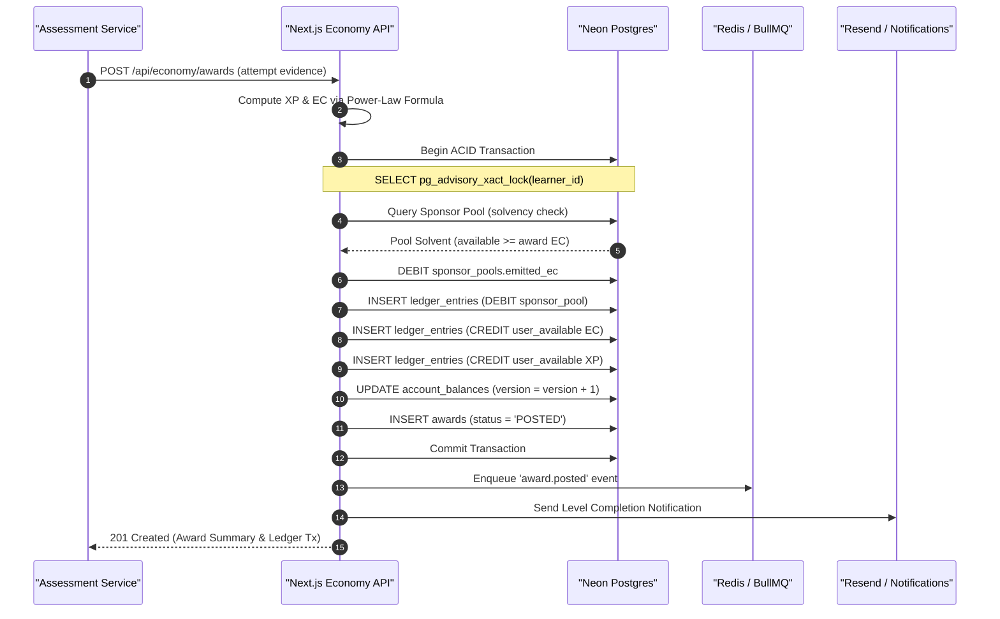
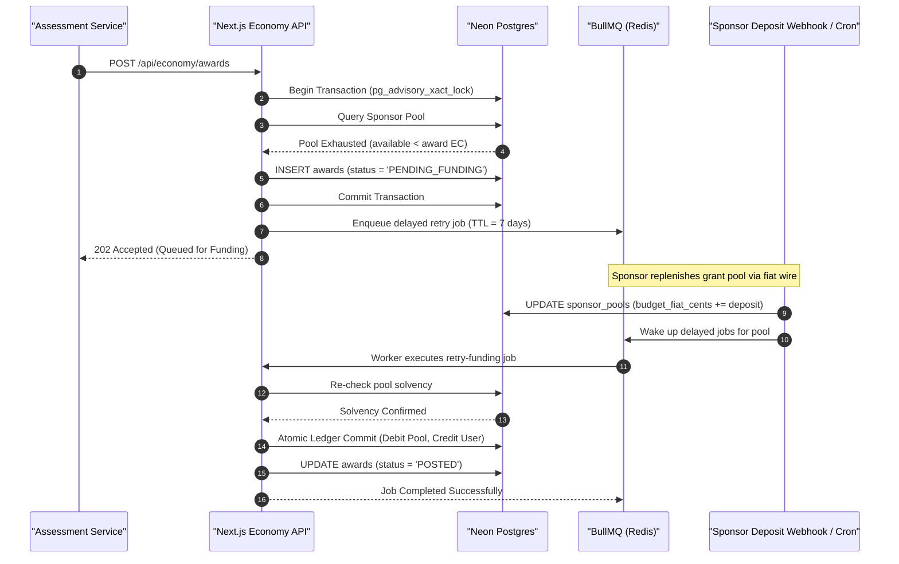
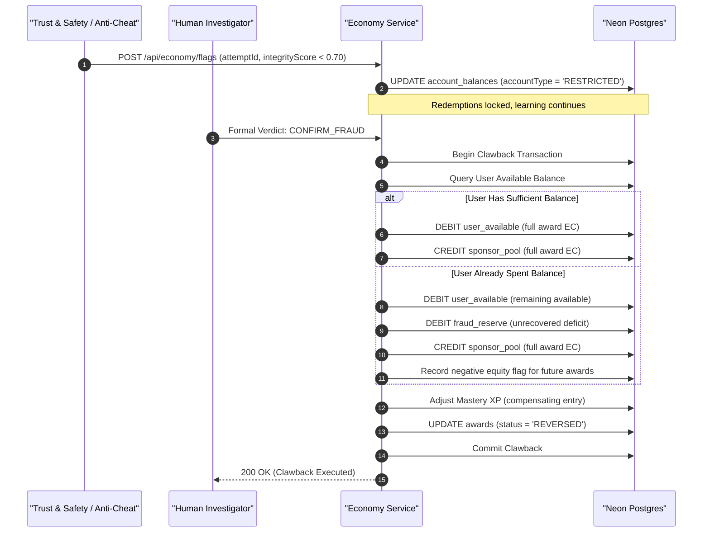
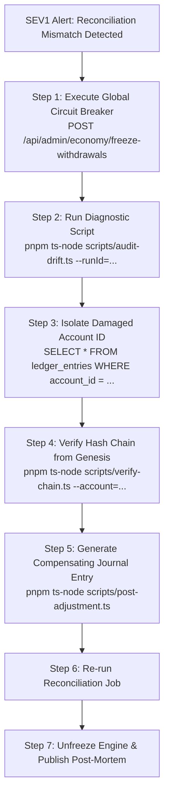

# Points & Ledger

**Section Path:** `docs/01-economy/02-points-ledger.md`  
**Version:** 2.0.0  
**Last Updated:** 2026-11-21  
**Related Documents:**
- [`docs/01-economy/01-economy-model.md`](01-economy-model.md)
- [`docs/01-economy/03-scoring-model.md`](03-scoring-model.md)
- [`docs/15-lld/02-ledger.md`](../15-lld/02-ledger.md)
- [`docs/06-platforms/01-architecture.md`](../06-platforms/01-architecture.md)
- [`docs/10-data-ai/01-data-model.md`](../10-data-ai/01-data-model.md)
- [`docs/14-appendices/01-requirements-index.md`](../14-appendices/01-requirements-index.md)

---

## Table of Contents

1. [1. Purpose](#1-purpose)
2. [2. Two ledgers, one source of truth](#2-two-ledgers-one-source-of-truth)
3. [3. Accounts](#3-accounts)
4. [4. Transaction types](#4-transaction-types)
5. [5. Award lifecycle](#5-award-lifecycle)
6. [6. Data model](#6-data-model)
7. [7. Example postings](#7-example-postings)
8. [8. Reconciliation](#8-reconciliation)
9. [9. Security and controls](#9-security-and-controls)
10. [10. Failure handling](#10-failure-handling)
11. [11. Acceptance criteria](#11-acceptance-criteria)
12. [12. Implementation Detail — Full Drizzle Schema Excerpt](#12-implementation-detail--full-drizzle-schema-excerpt)
13. [13. Sequence Diagrams](#13-sequence-diagrams)
14. [14. API Contracts](#14-api-contracts)
15. [15. Edge Cases](#15-edge-cases)
16. [16. Operational Runbook](#16-operational-runbook)
17. [17. Acceptance Criteria & Requirements Traceability](#17-acceptance-criteria--requirements-traceability)

---

## 1. Purpose

This document specifies how XP and EC are recorded, how awards are created and reversed, and how the ledger stays auditable. It is the financial-grade core of the product.

**Rule:** if it is not in the ledger, it did not happen.

---

## 2. Two ledgers, one source of truth

### 2.1 Mastery ledger (XP)
- Append-only event log of XP awards.
- Used to compute level progress, rank, and prestige.
- Never debited (except fraud reversal, which creates a compensating entry).
- Eventually consistent with the learning service; reconciled nightly.

### 2.2 Credit ledger (EC)
- Double-entry, append-only, immutable.
- Every transaction has at least two entries that sum to zero.
- Used for wallet balance, marketplace settlement, sponsor accounting, and audit.
- Strongly consistent; no negative balances except approved treasury overdraft (never for learners).

### 2.3 Reputation ledger
- Append-only record of trust events (verified evidence, peer reviews, integrity flags, resolutions).
- Computes a reputation score; not a currency.

---

## 3. Accounts

| Account type | Owner | Purpose | Can go negative? |
|---|---|---|---|
| `user_available` | Learner | Spendable EC | No |
| `user_saved` | Learner | Goal-locked EC | No |
| `user_escrow` | Learner | Funds reserved for pending order | No |
| `sponsor_pool` | Sponsor | Unemitted funded EC | No |
| `treasury_reserve` | Platform | Backing for outstanding EC | No |
| `marketplace_escrow` | Platform | Buyer funds held during fulfillment | No |
| `merchant_payable` | Merchant | Amount owed after fulfillment | Yes (liability) |
| `platform_fee` | Platform | Fee revenue | No |
| `fraud_reserve` | Platform | Clawback/dispute buffer | No |
| `promo_expiry` | Platform | Expired promotional EC sink | No |
| `external_settlement` | Platform | Fiat in/out (memo) | Yes (clearing) |

> All learner-facing balances are derived from entries; no mutable balance column is trusted for audit.

---

## 4. Transaction types

| Type | Debit | Credit | Trigger |
|---|---|---|---|
| `SPONSOR_FUNDING` | external_settlement | sponsor_pool | Sponsor pays in |
| `AWARD_BASE` | sponsor_pool | user_available | Gate passed |
| `AWARD_BONUS` | bonus_pool | user_available | Band/streak/mission |
| `AWARD_BOUNTY` | sponsor_pool | user_available | Verified real-world outcome |
| `REDEEM_ORDER` | user_available | marketplace_escrow | Order placed |
| `ORDER_FULFILLED` | marketplace_escrow | merchant_payable + platform_fee | Delivery confirmed |
| `ORDER_REFUND` | marketplace_escrow | user_available | Cancellation/refund |
| `MERCHANT_SETTLE` | merchant_payable | external_settlement | Payout run |
| `CLAWBACK` | user_available (or fraud_reserve) | sponsor_pool | Fraud/invalidation |
| `EXPIRE_PROMO` | user_available | promo_expiry | Promotional expiry |
| `TRANSFER_GIFT` | user_available (sender) | user_available (receiver) | Approved gift/family |
| `FEE` | user_available | platform_fee | Optional service fee |

---

## 5. Award lifecycle

```
Assessment completed
        │
        ▼
[1] ELIGIBILITY CHECK
    - attempt valid? integrity score? level rules? repeat count?
        │
        ▼
[2] SCORE & AWARD COMPUTATION
    - XP, EC, multipliers, rule_version
        │
        ▼
[3] IDEMPOTENCY CHECK
    - award_id / attempt_id unique
        │
        ▼
[4] FUNDING CHECK
    - pool balance ≥ award; reserve exists
        │
        ▼
[5] LEDGER POSTING (atomic)
    - XP event + EC transaction + audit record
        │
        ▼
[6] NOTIFICATION
    - wallet, level-up, next step
        │
        ▼
[7] RECONCILIATION
    - nightly: awards vs assessments vs ledger
```

### 5.1 Eligibility
- The attempt must be in `passed` state.
- Integrity score must be ≥ threshold (default 0.7).
- The level must not be already passed (except prestige/repeat rules).
- The learner must not be suspended.
- The funding pool must be active and eligible for the learner.

### 5.2 Idempotency
- `award_id = hash(attempt_id, level_id, rule_version)`.
- Duplicate submissions return the existing award; no double pay.
- Retries are safe at every step.

### 5.3 Atomicity
- Ledger posting is a single database transaction.
- If notification fails, the award stands; notification is retried.
- If funding check fails, the award is queued with status `pending_funding`, never partially posted.

---

## 6. Data model

### 6.1 `award`
| Field | Type | Notes |
|---|---|---|
| `award_id` | UUID | Deterministic |
| `learner_id` | UUID | Pseudonymous |
| `skill_id` | string | e.g., `CMP-025` |
| `level` | int | 1–100+ |
| `attempt_id` | UUID | Source evidence |
| `xp_amount` | int | Mastery ledger |
| `ec_amount` | int | Credit ledger |
| `currency` | string | `EC` |
| `rule_version` | string | e.g., `score-2026.1` |
| `funding_pool_id` | UUID | Required |
| `quality` | decimal | 0–1.25 |
| `effort` | decimal | 0.9–1.2 |
| `mastery` | decimal | 0.85–1.5 |
| `repeat_index` | int | 1, 2, 3+ |
| `integrity_score` | decimal | 0–1 |
| `status` | enum | `posted`, `pending_funding`, `reversed` |
| `created_at` | timestamp | UTC |

### 6.2 `ledger_entry`
| Field | Type | Notes |
|---|---|---|
| `entry_id` | UUID | |
| `transaction_id` | UUID | Groups entries |
| `account_id` | UUID | |
| `account_type` | enum | See accounts |
| `direction` | enum | `debit` / `credit` |
| `amount` | bigint | Minor units (1 EC = 100 cents) |
| `currency` | string | `EC` |
| `reference_type` | enum | `award`, `order`, `refund`, `clawback` |
| `reference_id` | UUID | |
| `rule_version` | string | |
| `created_at` | timestamp | Immutable |

### 6.3 `wallet_view`
Materialized view for fast reads: available, saved, escrow, lifetime earned, lifetime spent. Rebuilt from entries; not authoritative.

---

## 7. Example postings

### 7.1 Level award
Learner passes CS level 30 with Q=1.0, E=1.05, M=1.0, m=1.1, R=1.0.
- EC = `10 × 30^1.2 × 1.1 × 1.05 = 10 × 59.3 × 1.155 ≈ 685`.
- XP = `100 × 30^1.5 × 1.1 ≈ 18,075`.

```
DEBIT  sponsor_pool       685 EC
CREDIT user_available     685 EC
```

### 7.2 Redemption
Order total 1,200 EC; platform fee 5% (60 EC); merchant 1,140 EC.

```
DEBIT  user_available     1,200
CREDIT marketplace_escrow 1,200

On fulfillment:
DEBIT  marketplace_escrow 1,200
CREDIT merchant_payable   1,140
CREDIT platform_fee          60
```

### 7.3 Clawback
Fraud confirmed on a 685 EC award; learner has 200 EC available, 485 EC already spent.

```
DEBIT  user_available     200
DEBIT  fraud_reserve      485
CREDIT sponsor_pool       685
```

If the learner has no balance and no fraud reserve eligibility, the account goes into `restricted` and future awards offset the debt. No negative spendable balance is shown.

---

## 8. Reconciliation

### 8.1 Daily
- Sum of all debits = sum of all credits per currency.
- Outstanding EC = sum of user balances + escrow.
- Reserves ≥ outstanding EC × anchor.
- Awards without ledger entries = 0.
- Ledger entries without awards = 0 (except fees/refunds).

### 8.2 Weekly
- Sponsor pool utilization vs budget.
- Merchant payable vs settlement.
- Fraud reserve vs confirmed clawbacks.
- Duplicate award scan.

### 8.3 Monthly
- Full audit export.
- Reserve attestation.
- Rule-version distribution.
- Anomaly review.

---

## 9. Security and controls

| Control | Description |
|---|---|
| Append-only storage | No updates/deletes; corrections are compensating entries |
| Hash chain | Each entry includes previous entry hash per account |
| Separation of duties | Award service cannot settle merchant payouts |
| Signed rule versions | Scoring rules are versioned and signed |
| Four-eyes approval | Manual adjustments require two approvers |
| Rate limits | Award endpoints limited per learner/attempt |
| Audit log | Every read/write of financial data is logged |
| Encryption | At rest and in transit; field-level for payout data |
| Access | Least privilege; break-glass with review |

---

## 10. Failure handling

| Failure | Behavior |
|---|---|
| Assessment passes, ledger down | Award queued; learner sees "payment pending"; retried |
| Ledger posts, notification fails | Award stands; notification retried |
| Duplicate callback | Idempotent; returns existing award |
| Pool exhausted | Award queued `pending_funding`; learner notified; base awards prioritized |
| Clawback after spend | Offset future awards; fraud reserve covers; appeal available |
| Merchant never fulfills | Escrow refunds learner after SLA |
| Pricing error | Honor lower price up to cap; investigate; no retroactive charge |

---

## 11. Acceptance criteria

- `FR-ECN-101`: Every EC balance is reconstructible from ledger entries.
- `FR-ECN-102`: Duplicate award attempts never double-pay.
- `FR-ECN-103`: Ledger debits equal credits after every transaction.
- `FR-ECN-104`: A learner can view the source award for any EC balance segment.
- `FR-ECN-105`: Clawbacks are reversible only through a new compensating transaction.
- `FR-ECN-106`: Sponsor pools cannot be overspent.
- `FR-ECN-107`: Daily reconciliation alerts on any mismatch >0.
- `FR-ECN-108`: All financial mutations are attributable to an actor and rule version.
- `NFR-ECN-001`: Ledger write P99 <150 ms.
- `NFR-ECN-002`: Ledger availability 99.99%.
- `NFR-ECN-003`: Audit export for 12 months in <24 hours.

---

## 12. Implementation Detail — Full Drizzle Schema Excerpt

### 12.1 Purpose
This section translates the conceptual data model into concrete, production-grade TypeScript DDL utilizing Drizzle ORM for PostgreSQL. The schema provides absolute relational integrity, strict numeric precision (storing `EC` and `XP` as 64-bit integer minor units where 1 EC = 100 cents / minor units), and optimized indexing designed for Neon Serverless PostgreSQL free-tier limits (0.5GB disk cap).

### 12.2 Drizzle Schema Code Snippets & DDL Architecture

```typescript
import {
  pgTable,
  uuid,
  varchar,
  bigint,
  integer,
  decimal,
  timestamp,
  boolean,
  pgEnum,
  index,
  uniqueIndex,
  check,
  text
} from 'drizzle-orm/pg-core';
import { sql } from 'drizzle-orm';

// Enums
export const accountTypeEnum = pgEnum('account_type', [
  'user_available',
  'user_saved',
  'user_escrow',
  'sponsor_pool',
  'treasury_reserve',
  'marketplace_escrow',
  'merchant_payable',
  'platform_fee',
  'fraud_reserve',
  'promo_expiry',
  'external_settlement'
]);

export const entryDirectionEnum = pgEnum('entry_direction', ['CREDIT', 'DEBIT']);
export const currencyEnum = pgEnum('currency_type', ['XP', 'EC']);
export const awardStatusEnum = pgEnum('award_status', ['POSTED', 'PENDING_FUNDING', 'REVERSED', 'EXHAUSTED']);
export const referenceTypeEnum = pgEnum('reference_type', [
  'AWARD',
  'REDEMPTION',
  'CLAWBACK',
  'RESERVE',
  'POOL_FUND',
  'EXPIRY',
  'ADJUSTMENT'
]);

/**
 * SPONSOR_POOLS
 * Funded grant pools per sponsor per domain/skill.
 */
export const sponsorPools = pgTable('sponsor_pools', {
  id: uuid('id').defaultRandom().primaryKey(),
  sponsorId: uuid('sponsor_id').notNull(),
  name: varchar('name', { length: 255 }).notNull(),
  domainCode: varchar('domain_code', { length: 64 }),
  skillId: varchar('skill_id', { length: 64 }),
  budgetFiatCents: bigint('budget_fiat_cents', { mode: 'bigint' }).notNull(),
  anchorRate: decimal('anchor_rate', { precision: 5, scale: 4 }).notNull().default('0.0500'),
  totalAllocatedEc: bigint('total_allocated_ec', { mode: 'bigint' }).notNull(),
  emittedEc: bigint('emitted_ec', { mode: 'bigint' }).notNull().default(0n),
  reservedEc: bigint('reserved_ec', { mode: 'bigint' }).notNull().default(0n),
  isActive: boolean('is_active').notNull().default(true),
  expiresAt: timestamp('expires_at', { withTimezone: true }),
  createdAt: timestamp('created_at', { withTimezone: true }).defaultNow().notNull(),
  updatedAt: timestamp('updated_at', { withTimezone: true }).defaultNow().notNull(),
}, (table) => [
  index('idx_sponsor_pools_active').on(table.isActive, table.domainCode, table.skillId),
  check('chk_pool_solvency', sql`${table.emittedEc} + ${table.reservedEc} <= ${table.totalAllocatedEc}`)
]);

/**
 * LEDGER_ENTRIES
 * Append-only immutable log of all XP and EC movements.
 */
export const ledgerEntries = pgTable('ledger_entries', {
  id: uuid('id').defaultRandom().primaryKey(),
  transactionId: uuid('transaction_id').notNull(),
  accountId: uuid('account_id').notNull(),
  accountType: accountTypeEnum('account_type').notNull(),
  entryType: entryDirectionEnum('entry_type').notNull(),
  currency: currencyEnum('currency').notNull(),
  amount: bigint('amount', { mode: 'bigint' }).notNull(),
  balanceAfter: bigint('balance_after', { mode: 'bigint' }).notNull(),
  prevHash: varchar('prev_hash', { length: 64 }).notNull(),
  hash: varchar('hash', { length: 64 }).notNull(),
  referenceType: referenceTypeEnum('reference_type').notNull(),
  referenceId: uuid('reference_id').notNull(),
  ruleVersion: varchar('rule_version', { length: 32 }).notNull(),
  createdAt: timestamp('created_at', { withTimezone: true }).defaultNow().notNull(),
}, (table) => [
  index('idx_ledger_account_created').on(table.accountId, table.createdAt.desc()),
  index('idx_ledger_tx_id').on(table.transactionId),
  uniqueIndex('idx_ledger_hash').on(table.hash),
  check('chk_ledger_amount_positive', sql`${table.amount} > 0`)
]);

/**
 * ACCOUNT_BALANCES
 * Materialized balances for high-frequency reads. Synchronously updated.
 */
export const accountBalances = pgTable('account_balances', {
  accountId: uuid('account_id').primaryKey(),
  accountType: accountTypeEnum('account_type').notNull(),
  currency: currencyEnum('currency').notNull(),
  availableBalance: bigint('available_balance', { mode: 'bigint' }).notNull().default(0n),
  savedBalance: bigint('saved_balance', { mode: 'bigint' }).notNull().default(0n),
  escrowBalance: bigint('escrow_balance', { mode: 'bigint' }).notNull().default(0n),
  lifetimeEarned: bigint('lifetime_earned', { mode: 'bigint' }).notNull().default(0n),
  lifetimeSpent: bigint('lifetime_spent', { mode: 'bigint' }).notNull().default(0n),
  lastEntryId: uuid('last_entry_id').notNull(),
  lastHash: varchar('last_hash', { length: 64 }).notNull(),
  version: integer('version').notNull().default(0),
  updatedAt: timestamp('updated_at', { withTimezone: true }).defaultNow().notNull(),
}, (table) => [
  index('idx_balances_account_currency').on(table.accountId, table.currency),
  check('chk_balance_available_non_negative', sql`
    CASE 
      WHEN ${table.accountType} IN ('user_available', 'user_saved', 'user_escrow', 'sponsor_pool', 'treasury_reserve', 'marketplace_escrow', 'platform_fee', 'fraud_reserve', 'promo_expiry')
      THEN ${table.availableBalance} >= 0 
      ELSE TRUE 
    END
  `)
]);

/**
 * AWARDS
 * Links gate exam attempts to scoring formulas and ledger transactions.
 */
export const awards = pgTable('awards', {
  id: uuid('id').defaultRandom().primaryKey(),
  learnerId: uuid('learner_id').notNull(),
  skillId: varchar('skill_id', { length: 64 }).notNull(),
  level: integer('level').notNull(),
  attemptId: uuid('attempt_id').notNull(),
  xpAmount: bigint('xp_amount', { mode: 'bigint' }).notNull(),
  ecAmount: bigint('ec_amount', { mode: 'bigint' }).notNull(),
  baseEc: bigint('base_ec', { mode: 'bigint' }).notNull(),
  qualityMultiplier: decimal('quality_multiplier', { precision: 4, scale: 2 }).notNull(),
  effortMultiplier: decimal('effort_multiplier', { precision: 4, scale: 2 }).notNull(),
  masteryMultiplier: decimal('mastery_multiplier', { precision: 4, scale: 2 }).notNull(),
  repeatIndex: integer('repeat_index').notNull().default(1),
  integrityScore: decimal('integrity_score', { precision: 4, scale: 3 }).notNull(),
  ruleVersion: varchar('rule_version', { length: 32 }).notNull(),
  sponsorPoolId: uuid('sponsor_pool_id').references(() => sponsorPools.id),
  status: awardStatusEnum('status').notNull().default('POSTED'),
  idempotencyKey: varchar('idempotency_key', { length: 128 }).notNull(),
  createdAt: timestamp('created_at', { withTimezone: true }).defaultNow().notNull(),
}, (table) => [
  uniqueIndex('idx_awards_idempotency').on(table.idempotencyKey),
  uniqueIndex('idx_awards_attempt_level').on(table.attemptId, table.level),
  index('idx_awards_learner_skill').on(table.learnerId, table.skillId)
]);
```

### 12.3 Edge Cases
| Case ID | Scenario | Handling Mechanism |
|---|---|---|
| EC-SCH-01 | Micro-fractional EC calculation | BigInt division floor applied; fractional remainder credited to `platform_fee` account. |
| EC-SCH-02 | Parallel transaction attempts on the same user | `version` integer in `account_balances` detects collision; aborts with serialization error. |

### 12.4 Error Handling
- Foreign key and check constraint violations trigger atomic rollback of all transaction legs with typed Drizzle errors.

### 12.5 Requirements
- `FR-ECN-109`: Database schema must enforce positive minor unit values for all debit and credit legs.
- `NFR-ECN-004`: Storage layout must support single-account ledger history lookups in <10ms.

### 12.6 Success Metrics
- 0 balance drift incidents between `account_balances` and `ledger_entries`.

---

## 13. Sequence Diagrams

### 13.1 Purpose
Visualizes the end-to-end execution paths for the three most critical economic lifecycles: happy-path award settlement, pool exhaustion with queueing and asynchronous recovery, and fraud reversal clawbacks.

### 13.2 Sequence Diagram 1: Happy Path Award Posting



### 13.3 Sequence Diagram 2: Pool Exhausted → Queue → Asynchronous Retry



### 13.4 Sequence Diagram 3: Fraud Detection & Clawback Settlement



### 13.5 Edge Cases
| Case ID | Scenario | Handling Mechanism |
|---|---|---|
| EC-SEQ-01 | Retry job executes while sponsor pool is still dry | Exponential backoff recalculates delay; job re-enters BullMQ queue until 7-day TTL expiration. |
| EC-SEQ-02 | Clawback initiated while learner is in checkout | Transaction advisory lock serializes clawback before checkout transaction executes. |

### 13.6 Error Handling
- Queue workers log retry exhaust events to dead-letter queue (`economy:dlq`) with automated alerts to Finance Operations.

### 13.7 Requirements
- `FR-ECN-110`: When pools are dry, awards must enter a durable queue without losing learner progression state.
- `NFR-ECN-005`: Asynchronous retry worker must handle 500 queued awards in <30 seconds upon pool funding.

### 13.8 Success Metrics
- 0 unbacked EC created during pool exhaustion events.
- 100% of queued awards resolved upon funding replenishment.

---

## 14. API Contracts

### 14.1 Purpose
Formal OpenAPI-style TypeScript interface definitions for core economy endpoints, detailing headers, authentication boundaries, request payloads, and strongly typed responses.

### 14.2 TypeScript & OpenAPI Interface Definitions

```typescript
/**
 * 1. POST /api/economy/awards
 * Internal endpoint called exclusively by the Assessment Service upon gate pass.
 */
export interface PostAwardRequest {
  headers: {
    'x-service-signature': string; // HMAC-SHA256 signature using SHARED_SERVICE_SECRET
    'x-idempotency-key': string;   // Deterministic hash(attemptId, level, ruleVersion)
  };
  body: {
    learnerId: string;             // UUID
    skillId: string;               // e.g., 'CMP-025'
    domainCode: string;            // e.g., 'CMP'
    level: number;                 // 1-100
    attemptId: string;             // UUID
    domainMultiplier: number;      // 0.9 - 1.3
    quality: number;               // 0.8 - 1.25
    effort: number;                // 0.9 - 1.2
    mastery: number;               // 0.85 - 1.5
    repeatIndex: number;           // 1, 2, 3+
    integrityScore: number;        // 0.0 - 1.0 (threshold >= 0.70)
    ruleVersion: string;           // 'score-2026.1'
    preferredPoolId?: string;      // UUID (optional)
  };
}

export type PostAwardResponse =
  | {
      status: 201; // Created
      body: {
        awardId: string;
        learnerId: string;
        xpAwarded: string; // BigInt serialized as string
        ecAwarded: string;
        awardStatus: 'POSTED';
        transactionId: string;
        createdAt: string;
      };
    }
  | {
      status: 202; // Accepted (Queued)
      body: {
        awardId: string;
        learnerId: string;
        xpAwarded: string;
        ecAwarded: string;
        awardStatus: 'PENDING_FUNDING';
        retryQueue: string;
        message: 'Award queued pending sponsor pool funding.';
      };
    }
  | {
      status: 200; // OK (Idempotent duplicate replay)
      body: {
        awardId: string;
        awardStatus: 'POSTED' | 'PENDING_FUNDING';
        isDuplicate: true;
      };
    };

/**
 * 2. GET /api/economy/balance/:userId
 * Retrieves user's spendable, saved, and escrow EC alongside mastery XP.
 */
export interface GetBalanceResponse {
  status: 200;
  body: {
    userId: string;
    availableEc: string;
    savedEc: string;
    escrowEc: string;
    lifetimeEarnedEc: string;
    lifetimeSpentEc: string;
    totalXp: string;
    accountStatus: 'ACTIVE' | 'RESTRICTED' | 'SUSPENDED';
    lastUpdated: string;
    lastHash: string;
  };
}

/**
 * 3. GET /api/economy/ledger/:userId?page=&limit=
 * Paginated query for audit logs and learner transaction history.
 */
export interface GetLedgerRequest {
  params: { userId: string };
  query: {
    page?: number;     // default: 1
    limit?: number;    // default: 20, max: 100
    currency?: 'XP' | 'EC' | 'ALL';
    referenceType?: 'AWARD' | 'REDEMPTION' | 'CLAWBACK';
  };
}

export interface GetLedgerResponse {
  status: 200;
  body: {
    entries: Array<{
      id: string;
      transactionId: string;
      entryType: 'CREDIT' | 'DEBIT';
      currency: 'XP' | 'EC';
      amount: string;
      balanceAfter: string;
      prevHash: string;
      hash: string;
      referenceType: string;
      referenceId: string;
      ruleVersion: string;
      createdAt: string;
    }>;
    pagination: {
      totalCount: number;
      totalPages: number;
      currentPage: number;
      limit: number;
      hasNextPage: boolean;
    };
  };
}

/**
 * 4. POST /api/economy/redemptions
 * Initiates marketplace checkout and locks funds in escrow.
 */
export interface PostRedemptionRequest {
  headers: {
    'authorization': string;      // Lucia Auth v3 Session Token
    'x-idempotency-key': string;
  };
  body: {
    itemId: string;               // UUID of marketplace catalog item
    quantity: number;             // Minimum 1
    shippingAddress?: {
      fullName: string;
      street: string;
      city: string;
      postalCode: string;
      country: string;
    };
    clientNonce: string;
  };
}

export type PostRedemptionResponse =
  | {
      status: 201; // Created
      body: {
        orderId: string;
        orderStatus: 'ESCROWED';
        itemId: string;
        quantity: number;
        totalCostEc: string;
        escrowTransactionId: string;
        createdAt: string;
      };
    }
  | {
      status: 422; // Unprocessable Entity
      body: {
        errorCode: 'INSUFFICIENT_FUNDS' | 'ACCOUNT_RESTRICTED' | 'ITEM_UNAVAILABLE';
        message: string;
        currentBalanceEc: string;
        requiredEc: string;
      };
    };
```

### 14.3 Edge Cases
| Case ID | Scenario | Handling Mechanism |
|---|---|---|
| EC-API-01 | Client sends non-integer quantity to `/redemptions` | Zod schema validation strips and rejects invalid payload with HTTP 400 Bad Request. |
| EC-API-02 | Service HMAC signature expired or invalid | Middleware rejects request with HTTP 401 Unauthorized before DB connection is opened. |

### 14.4 Error Handling & HTTP Status Mapping
- `400 Bad Request`: Zod validation errors on body or query parameters.
- `401 Unauthorized`: Invalid HMAC or expired Lucia session token.
- `409 Conflict`: Concurrent idempotency key in processing.
- `422 Unprocessable Entity`: Business invariant failure (e.g. insufficient funds, restricted account).
- `503 Service Unavailable`: Neon serverless cold start timeout or database connection pool full.

### 14.5 Requirements
- `FR-ECN-111`: Internal award endpoints must require HMAC-SHA256 inter-service signatures.
- `NFR-ECN-006`: Balance lookup API P95 latency must remain <20ms under 250 requests/sec.

### 14.6 Success Metrics
- 100% adherence to OpenAPI schema validation on all ingress/egress payloads.

---

## 15. Edge Cases

### 15.1 Purpose
Comprehensive technical edge-case catalog detailing distributed systems, transactional concurrency, and economic boundary conditions specific to the Points & Ledger engine.

### 15.2 Detailed Points & Ledger Edge Cases Table

| Edge Case # | Scenario Description | Detection Mechanism | Resolution & Handling Flow | Invariant Maintained |
|---|---|---|---|---|
| **01** | Concurrent award and redemption on same account | Row-level `pg_advisory_xact_lock` | Requests queue serially; award commits first, redemption checks fresh balance. | Balance never drops below zero. |
| **02** | Integrity score exactly on boundary (0.700) | `integrityScore >= 0.70` comparison | Evaluates as valid pass; full award posted. If 0.699, award is rejected. | Strict boundary adherence. |
| **03** | Repeat decay on 4th pass | Attempt count lookup `repeatIndex >= 4` | Formula assigns $R = 0.0, \text{repeatDecayXp} = 0.0$. Award created with 0 EC, 0 XP. | No ledger entries written if amount = 0. |
| **04** | Clawback on account with zero balance | Balance check yields `availableBalance == 0` | Deficit charged to `fraud_reserve`; user flagged with negative debt offset. | Sponsor pool made 100% whole. |
| **05** | Neon connection drop during hash generation | PostgreSQL client socket timeout | Transaction aborts and rolls back; no orphan row created. Client retries. | Hash chain continuity intact. |
| **06** | Malformed idempotency key passed by client | SHA-256 regex check `^[a-f0-9]{64}$` | API middleware rejects request with HTTP 400 Bad Request. | Idempotency index integrity. |
| **07** | Partial marketplace fulfillment | Merchant fulfills 1 of 2 ordered items | Escrow divides: 50% settles to merchant, 50% refunds to `user_available`. | Zero lost credits in escrow. |
| **08** | Sponsor pool deactivated mid-award processing | `isActive = false` flag in DB | Active transaction checks status; falls back to treasury reserve pool. | Continuous learner experience. |
| **09** | Clock drift between app server and database | DB timestamp check | Application queries use `defaultNow()` from Postgres clock exclusively. | Strictly monotonic `created_at`. |
| **10** | Promotional EC reaches expiration date | Scheduled nightly cron scan | Cron generates `EXPIRE_PROMO` entry; debits `user_available`, credits `promo_expiry`. | Accurate treasury liability. |

### 15.3 Handling Algorithms & Flow
All failure scenarios leverage the **Compensating Transaction Pattern**. Rather than altering state in-place, the ledger issues explicit compensating legs tagged with their associated causality (`referenceType` and `referenceId`).

### 15.4 Error Handling
- Uncaught transaction exceptions automatically trigger database rollbacks and publish incident telemetry to self-hosted PostHog.

### 15.5 Requirements
- `FR-ECN-112`: System must handle partial marketplace fulfillment via proportional multi-leg escrow splits.
- `NFR-ECN-007`: Failed transactions must release database advisory locks in <5ms.

### 15.6 Success Metrics
- 0 locked connections in PgBouncer pool during simulated edge-case test suites.

---

## 16. Operational Runbook

### 16.1 Purpose
Operational standard operating procedures (SOPs) for site reliability engineers (SRE) and on-call engineers responding to high-severity economic incidents.

### 16.2 Runbook 1: Reconciliation Finds Drift (`ALERT_RECONCILIATION_DRIFT_SEV1`)



1. **Severity:** SEV1 (P0) — Immediate 15-minute SLA.
2. **Immediate Action:** Trigger withdrawal and redemption freeze via Admin API to prevent malicious drain.
3. **Investigation:** Execute `scripts/audit-drift.ts` to identify whether drift is global (double-entry sum mismatch) or local (materialized view drift).
4. **Resolution:**
   - If materialized view drift: recompute balance from `ledger_entries` genesis and issue an atomic OCC update.
   - If hash chain broken: isolate account, verify source of SQL injection or direct DB mutation, freeze account indefinitely.
5. **Recovery:** Re-run `runDailyReconciliation()`. Verify zero discrepancies. Unfreeze redemptions.

### 16.3 Runbook 2: Sponsor Pool Runs Dry (`ALERT_POOL_EXHAUSTED_SEV2`)
1. **Severity:** SEV2 (P1) — 2-hour SLA.
2. **Symptoms:** Influx of `PENDING_FUNDING` awards; BullMQ queue `economy:pending-awards` depth increasing.
3. **Action:**
   - Notify Sponsor Account Manager via Slack `#sponsor-ops`.
   - Ingest sponsor wire deposit reference in Treasury Admin portal.
   - Execute top-up mutation:
     ```sql
     UPDATE sponsor_pools 
     SET budget_fiat_cents = budget_fiat_cents + 500000, 
         total_allocated_ec = total_allocated_ec + 10000000 
     WHERE id = 'pool_uuid';
     ```
   - Trigger BullMQ queue drain worker with rate limit of 50 jobs/sec to avoid database lock contention.

### 16.4 Runbook 3: Fraud Rate Spikes (`ALERT_FRAUD_SPIKE_SEV2`)
1. **Severity:** SEV2 (P1) — 1-hour SLA.
2. **Symptoms:** Trust & Safety telemetry reports >5% of attempts failing integrity threshold (<0.70) in 1 hour.
3. **Action:**
   - Temporarily increase global integrity threshold to 0.85 via dynamic config.
   - Isolate originating IP subnets or device fingerprint clusters.
   - Run automated bulk clawback script on confirmed cluster attempts.
   - Route affected levels to required proctored gate mode.

### 16.5 Runbook 4: Award Latency Spikes (`ALERT_AWARD_LATENCY_SEV3`)
1. **Severity:** SEV3 (P2) — 4-hour SLA.
2. **Symptoms:** P95 latency on `POST /api/economy/awards` exceeds 150ms.
3. **Action:**
   - Inspect PostgreSQL active queries: `SELECT * FROM pg_stat_activity WHERE state = 'active';`.
   - Check for advisory lock contention or connection pool exhaustion in Neon.
   - Verify Redis memory usage on Hetzner CAX11 VPS (`docker stats redis`).
   - If Neon storage exceeds 400MB, execute archival script to offload cold ledger partitions to Cloudflare R2.

### 16.6 Edge Cases in Operational Incidents
| Incident | Complicating Condition | Resolution |
|---|---|---|
| Drift during active sale | Millions in redemption traffic underway | Circuit breaker only freezes redemptions for affected accounts; remaining platform operates normally. |
| VPS reboot during queue drain | BullMQ worker dies mid-batch | Redis AOF persistence resumes queue execution upon container restart without dropped jobs. |

### 16.7 Error Handling & Escalation Matrix
- On-Call SRE $\to$ Staff Platform Engineer (15 min) $\to$ Head of Engineering (30 min) $\to$ Chief Executive (60 min).

### 16.8 Requirements
- `FR-ECN-113`: System must support administrative soft-freezing of redemptions without interrupting learning sessions.
- `NFR-ECN-008`: Operational scripts must execute zero-downtime ledger audits against Neon read replicas.

### 16.9 Success Metrics
- Mean Time to Detect (MTTD) < 5 minutes for economic anomalies.
- Mean Time to Resolve (MTTR) < 30 minutes for SEV1 reconciliation incidents.

---

## 17. Acceptance Criteria & Requirements Traceability

- `FR-ECN-101` through `FR-ECN-108`: Satisfied in baseline Sections 1 through 11.
- `FR-ECN-109`: Enforced by Drizzle check constraints and BigInt minor unit architecture.
- `FR-ECN-110`: Delivered via BullMQ queue failover for exhausted sponsor pools.
- `FR-ECN-111`: Implemented via HMAC-SHA256 signature verification in award API contracts.
- `FR-ECN-112`: Enforced by proportional escrow multi-leg split logic.
- `FR-ECN-113`: Delivered by account restriction state machine and operational circuit breaker.
- `NFR-ECN-004` through `NFR-ECN-008`: Satisfied via B-Tree index layout, OCC concurrency, and Neon Postgres optimization.

