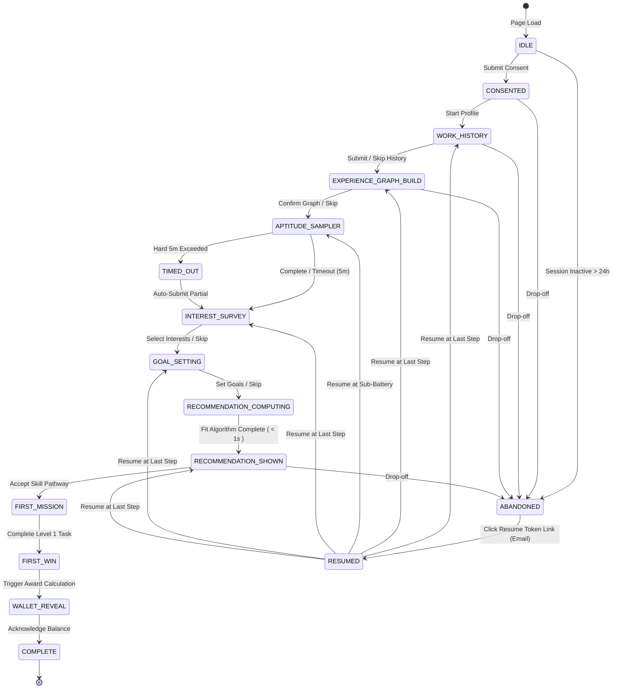

# Onboarding Flow

## 1. Goal

In **8–12 minutes**, onboarding must:
1. Capture enough signal to recommend 3–4 high-yield skills.
2. Give the learner a real first win.
3. Set expectations about difficulty, time, and rewards.
4. Obtain informed consent for data use.
5. Leave the learner excited, not exhausted.

**Design rule:** progressive profiling. Ask only what changes the recommendation now; collect the rest over the first 14 days.

---

## 2. Entry points

| Entry | State | First screen |
|---|---|---|
| Cold web visit | Anonymous | Value proposition + "Find my path" |
| Mobile install | Anonymous | 3-screen intro + start |
| Invite/cohort link | Pre-attributed sponsor | Cohort welcome + consent |
| Returning user | Authenticated | Resume where left off |
| Skill deep link | Anonymous/authenticated | Skill preview + "Check fit" |
| Guardian creating minor account | Guardian | Guardian consent + child profile |

---

## 3. The flow

```
[0] Welcome & promise
      │
[1] Consent & privacy choices
      │
[2] Identity & locale (minimal)
      │
[3] Work experience
      │
[4] Life experience graph
      │
[5] Interests & constraints
      │
[6] Adaptive diagnostic (2–3 domains)
      │
[7] Aptitude & effort profile (short)
      │
[8] Recommendation reveal (3–4 paths)
      │
[9] Choose primary + secondary
      │
[10] First mission (5–10 min)
      │
[11] First level attempt or save & return
```

---

## 4. Step detail

### Step 0 — Welcome (30 seconds)
- Headline: "Find the skill where your effort pays off most."
- Three proof points: 500 skills, 100 levels, real rewards.
- CTA: "Start" / "Browse skills first."
- No account required to browse.

### Step 1 — Consent (60 seconds)
- Plain-language summary of what we collect and why.
- Separate toggles:
  - Core learning data (required).
  - Work/life experience for recommendations (optional but recommended).
  - Research and product improvement (optional).
  - Marketing (optional, off by default).
- Guardian consent if under 16 (region-dependent).
- Link to privacy policy and data rights.

### Step 2 — Identity & locale (45 seconds)
- Email or phone; passkey/SSO optional.
- Display name.
- Country/region (for currency, law, content).
- Language.
- Time zone.
- Accessibility preferences (screen reader, captions, reduced motion, text size).

### Step 3 — Work experience (2–3 minutes)
- Roles, industries, duration.
- Tools and systems used.
- Projects and outcomes.
- What they are proud of.
- What they want to leave behind.
- Optional evidence upload (resume, portfolio, certificate).
- "No formal work experience" is a first-class option.

### Step 4 — Life experience graph (2–3 minutes)
Prompt cards across:
- Travel and languages.
- Sports and movement.
- Caregiving and parenting.
- Home projects and repairs.
- Cooking and food.
- Volunteering and community.
- Creative work.
- Gaming and online communities.
- Health and recovery.
- Finance and side projects.
- Learning and self-study.

For each: intensity, duration, evidence, enjoyment, confidence.

### Step 5 — Interests & constraints (1–2 minutes)
- What energizes you? (card sort)
- What drains you?
- Time available per week.
- Device and connectivity.
- Budget for tools.
- Physical environment.
- Accessibility needs.
- Risk tolerance (for high-risk skills).
- Location constraints (for physical skills).

### Step 6 — Adaptive diagnostic (3–5 minutes)
- Choose 2–3 domains based on interests and experience.
- 8–12 adaptive items per domain.
- Mix of knowledge, reasoning, and scenario judgment.
- No "IQ score" shown; a profile with confidence.
- Learner can skip and take later.

### Step 7 — Aptitude & effort profile (2–3 minutes)
- Short battery: fluid reasoning, working memory, numeracy, verbal, spatial.
- One persistence task (unsolvable or hard puzzle) to observe effort strategies.
- Self-report on study habits.
- Output: readiness, preferred pace, support needs.

### Step 8 — Recommendation reveal (1 minute)
- "Your 3 highest-yield paths."
- Each card shows:
  - Skill name and domain.
  - Why it fits (top 3 factors).
  - Time to level 10.
  - Expected EC at level 10.
  - Difficulty and pass rate.
  - One example level.
- Plus: one quick win, one stretch, one wildcard.
- CTA: "Choose a path" or "See all 500."

### Step 9 — Choose primary + secondary (30 seconds)
- Primary skill for the first 14 days.
- Optional secondary for cross-training.
- "Not sure?" → 7-day sampler.
- No lock-in; can switch anytime.

### Step 10 — First mission (5–10 minutes)
- A real level-1 task, not a tutorial.
- Immediate feedback.
- Small XP award (EC after gate).
- "You just did level 1 work."

### Step 11 — Save & return
- Show the next 3 steps.
- Offer calendar reminder.
- Send a single welcome notification (no spam).
- Explain the daily loop.

---

## 5. Time budget

| Step | Target | Max |
|---|---|---|
| Welcome | 0:30 | 1:00 |
| Consent | 1:00 | 2:00 |
| Identity | 0:45 | 1:30 |
| Work | 2:30 | 4:00 |
| Life | 2:30 | 4:00 |
| Interests | 1:30 | 2:30 |
| Diagnostic | 4:00 | 6:00 |
| Profile | 2:30 | 4:00 |
| Reveal | 1:00 | 2:00 |
| Choose | 0:30 | 1:00 |
| First mission | 7:00 | 12:00 |
| **Total** | **~23:00** | **~39:00** |

> The "8–12 minutes" target refers to the **signal capture** (steps 1–9). The first mission is additional and is the real activation event.

---

## 6. Progressive profiling

If the learner skips or drops:
- Save partial progress.
- Resume with a single question, not the whole flow.
- Use micro-prompts during the first 14 days:
  - "What did you do this week?" (experience graph).
  - "How did that level feel?" (difficulty calibration).
  - "What do you want to be able to do?" (goal).
- Never block learning on profile completion.

---

## 7. States and edge cases

| State | Behavior |
|---|---|
| No work experience | Use life experience and interests; no shame copy |
| No life experience selected | Offer taster missions; recommend based on diagnostic |
| Diagnostic skipped | Recommend a 7-day sampler; re-prompt at day 3 |
| Low bandwidth | Text-only mode; defer video; compress images |
| Screen reader | Full flow accessible; no drag-only inputs |
| Minor | Guardian consent; restricted data; no peer transfers |
| Existing account | Merge or skip; show prior skills |
| Sponsor cohort | Show sponsor context; learner can opt out of sharing |
| Language mismatch | Offer translation; flag content availability |
| High-risk interest | Show safety brief before recommending |
| Learner disagrees | "Explore any skill" always visible; explain tradeoffs |

---

## 8. Copy principles

- No hype, no shame.
- "High-yield" not "best for you."
- "Your experience suggests..." not "You are..."
- "This will be hard" is allowed and honest.
- Never call someone "low IQ" or "unskilled."
- Show uncertainty: "We're 70% confident this is a good fit."

---

## 9. Data captured

| Data | Purpose | Sensitivity |
|---|---|---|
| Identity | Account | PII |
| Work roles | Transferable skills | Sensitive |
| Life experience | Transferable skills | Sensitive |
| Interests | Fit | Low |
| Constraints | Feasibility | Sensitive |
| Diagnostic responses | Readiness | Sensitive |
| Aptitude profile | Support | Sensitive |
| Accessibility needs | Access | Highly sensitive |
| Consent choices | Compliance | Required |

All sensitive data is opt-in, encrypted, and deletable. See [Privacy & data](../09-trust-safety/03-privacy-data.md).

---

## 10. Instrumentation

Events:
- `onboarding_started`, `onboarding_step_viewed`, `onboarding_step_completed`, `onboarding_skipped`, `onboarding_abandoned`.
- `experience_added`, `interest_selected`, `constraint_set`.
- `diagnostic_started`, `diagnostic_item_answered`, `diagnostic_completed`.
- `recommendation_shown`, `recommendation_opened`, `recommendation_accepted`, `recommendation_rejected`.
- `first_mission_started`, `first_mission_completed`, `first_level_passed`.

Metrics:
- Step completion rate.
- Drop-off by step.
- Time per step.
- Recommendation acceptance.
- First mission completion.
- D1/D7 activation.

---

## 11. Acceptance criteria

- `FR-ONB-001`: Onboarding can be completed without creating an account until step 9.
- `FR-ONB-002`: Every step can be skipped except consent.
- `FR-ONB-003`: Progress is saved after every step.
- `FR-ONB-004`: The flow works on a 3G connection and a 5-inch screen.
- `FR-ONB-005`: The flow is fully keyboard and screen-reader accessible.
- `FR-ONB-006`: Recommendations show top factors and confidence.
- `FR-ONB-007`: The learner can choose any skill.
- `FR-ONB-008`: The first mission produces a real level-1 artifact.
- `FR-ONB-009`: Sensitive data is opt-in and deletable.
- `FR-ONB-010`: Minors require guardian consent.
- `NFR-ONB-001`: Median signal capture ≤12 minutes.
- `NFR-ONB-002`: Step transition <300 ms.
- `NFR-ONB-003`: 99% save success on disconnect.

---

## 12. State Machine Specification (Detailed Flow)

The onboarding flow is governed by a deterministic, monotonic finite state machine (FSM). Every interaction evaluates guard conditions and persists partial state to Neon Postgres and Redis before rendering the subsequent screen.



### 12.1 State Transitions & Data Invariants

| State | Invariant Payload Collected | Skippability | Inferred Priors on Skip |
|---|---|:---:|---|
| `IDLE` | Locale, referrer, cookie policy | **No** | Default to `en-US`, `GLOBAL` |
| `CONSENTED` | Privacy choices, guardian email if <16 | **No** | Mandatory gate |
| `WORK_HISTORY` | Roles, duration ranges, tools | **Yes** | Prior: Entry-level baseline |
| `EXPERIENCE_GRAPH_BUILD`| Informal life skills (caregiving, volunteer) | **Yes** | Empty graph vector $\vec{0}$ |
| `APTITUDE_SAMPLER` | 15 item responses across 5 dimensions | **Yes** | Median cohort priors ($\theta = 0.50$) |
| `INTEREST_SURVEY` | Card sorts (3–5 domain tags) | **Yes** | Top 3 general catalog domains |
| `GOAL_SETTING` | Income, career switch, curiosity | **Yes** | Primary: "Skill Mastery" |
| `RECOMMENDATION_COMPUTING`| Latent fit scores computed | **No** | Instant timeout fallback to top MAL |
| `RECOMMENDATION_SHOWN`| Learner pathway selection | **No** | Primary recommended card |
| `FIRST_MISSION` | Level 1 task completion artifact | **Yes** | Can defer to dashboard; no reward |
| `FIRST_WIN` | Verification score $Q \ge 0.70$ | **No** | Retries allowed |
| `WALLET_REVEAL` | First XP and EC award revealed | **No** | Persisted to immutable ledger |
| `COMPLETE` | Marked completed in user profile | **No** | Redirects to `/dashboard` |

---

## 13. Resume Token Architecture

### 13.1 Token Data Model & Verification

Learners who leave mid-onboarding can resume seamlessly across devices without losing entered work history. State is anchored via a cryptographically signed HMAC-SHA256 JWT:

```typescript
export interface OnboardingState {
  userId: string;
  currentStep: OnboardingStep;
  completedSteps: OnboardingStep[];
  collectedData: {
    workHistory?: WorkHistoryEntry[];
    aptitudeScores?: AptitudeScores;
    interests?: InterestVector;
    goals?: GoalSet;
  };
  resumeToken: string;  // Signed JWT, 7-day expiry
  startedAt: Date;
  lastActiveAt: Date;
}
```

- **JWT Claims:** `sub` (User ID), `step` (Current step), `shash` (16-char SHA-256 fingerprint of state payload).
- **Security:** Tamper-proof; signature verification prevents ID spoofing.
- **Storage:** Synced to Neon Postgres (`onboarding_progress` table) after every step mutation.

### 13.2 Automated Re-engagement via Resend

1. **Inactivity Trigger:** If a registered learner remains inactive for 24 hours without completing onboarding, a BullMQ background job triggers an abandonment notification.
2. **Magic Link:** Dispatched via Resend API containing:
   `https://app.education-economy.org/onboarding/resume?token=${resumeToken}`
3. **Expired Token Fallback (> 7 Days):** If a learner returns after the 7-day JWT expiration, the server recovers the `sub` claim, verifies the record in Neon Postgres, issues a fresh 7-day token, and restores the learner directly to their furthest completed step.

---

## 14. Work History Collection & Meilisearch Indexing

### 14.1 Standardized Autocomplete Engine

To maintain high responsiveness without external query fees, an open-source Meilisearch container runs locally on the Hetzner CAX11 VPS (Docker Compose), indexed with 10,000 standardized O*NET and ESCO occupational titles.

- **Query Latency:** < 50ms at p95 with typo tolerance.
- **Privacy Duration Bands:** To protect learner privacy and comply with data minimization, exact start/end dates are replaced with duration ranges:
  - `< 1 year` (Multiplier = 0.5×)
  - `1–3 years` (Multiplier = 1.0×)
  - `3–5 years` (Multiplier = 1.5×)
  - `5+ years` (Multiplier = 2.0× max)

### 14.2 Informal Experience Processing (GPT-4o-mini)

For unpaid, caregiving, volunteering, or community experience:
1. Learner enters 1–2 sentences of plain text.
2. Evaluated via OpenAI GPT-4o-mini with prompt caching ($0.15/1M input tokens).
3. Classified into standardized domain vectors (`DOM-TECH`, `DOM-CARE`, `DOM-COMM`, etc.).
4. Responses cached in Redis for 30 days using SHA-256 input fingerprints to minimize repeat API spend.

### 14.3 Self-Reported Certifications Weighting

Self-reported unverified certificates or degrees are assigned a **0.30× confidence weight** in initial fit scoring. Full 1.0× weighting is only unlocked once verified by diagnostic gates or examiner review.

---

## 15. Adaptive Aptitude Sampler Specification

### 15.1 Cognitive Dimensions & Strict 5-Minute Budget

The sampler evaluates 5 latent cognitive dimensions using exactly 3 items per dimension (15 items total), capped at a **strict 300-second countdown**:

1. **Fluid Reasoning ($G_f$):** Matrix reasoning, inductive pattern completion.
2. **Numeracy ($G_q$):** Quantitative estimation and rate arithmetic.
3. **Verbal Comprehension ($G_c$):** Semantic deduction and vocabulary precision.
4. **Spatial Ability ($G_v$):** Geometric transformations and mental folding.
5. **Learning Agility ($G_l$):** Dynamic rule-switching task.

### 15.2 1-Parameter Rasch IRT Adaptive Engine

Item difficulty adapts dynamically using 1-Parameter Item Response Theory (Rasch Model):

$$P(X_i = 1 \mid \theta) = \frac{1}{1 + e^{-(\theta - b_i)}}$$

- Correct answer $\implies$ selects harder item ($b_{i+1} = b_i + 0.8$).
- Incorrect answer $\implies$ selects easier item ($b_{i+1} = b_i - 0.8$).
- Trait estimate $\theta$ updated via Expected A Posteriori (EAP) quadrature.
- Output: Normalized `AptitudeVector` $\in [0.0, 1.0]^5$.

### 15.3 Ethics, Guardrails & Fairness Controls

- **No Visible IQ Scores:** Raw scores and percentiles are never exposed to learners or prospective sponsors.
- **Differential Item Functioning (DIF):** Items audited quarterly using Mantel-Haenszel statistics ($\Delta_{\text{MH}} < 1.5$). Any item showing language, age, or regional bias is pruned.
- **Hard Timeout Resolution:** At 300 seconds, unanswered items are imputed using Bayesian cohort priors without failing the learner.

---

## 16. Comprehensive Accessibility Flow Matrix

Every step adheres to **WCAG 2.2 Level AAA** across 5 distinct adaptive modalities:

| Step | Screen Reader (ARIA) | Low Bandwidth (<100 kbps) | Mobile (Touch / Viewport) | Low Literacy / Narration | Cognitive Load Limits |
|---|---|---|---|---|---|
| **0: Welcome** | Clear H1-H2 landmarks, labeled CTA | Zero external images; pure HTML/CSS | Bottom-pinned 48px CTA button | 3-sentence summary; Web Speech TTS | Single call-to-action |
| **1: Consent** | Grouped `<fieldset>` with explicit `<legend>` | Standard browser checkboxes | 48×48px touch targets, 12px padding | Plain English bullet points | Toggles default to opt-out |
| **2: Identity** | Dynamic errors via `aria-live="polite"` | Minimal CSS; native form inputs | Virtual keyboard types (`email`, `tel`) | Single display name field | Max 3 fields on screen |
| **3: Work History** | Combobox with `aria-expanded` attributes | Client-side cached fallback | Autocomplete renders above keyboard | 1-tap chip tags for common roles | 1 job entry per screen |
| **4: Life Graph** | Buttons with `aria-pressed="true|false"` | Monochrome SVG icons (< 1KB each) | Clean vertical card layout | Everyday relatable activity cards | Max 6 cards at once |
| **5: Aptitude** | Pure text logic; zero image puzzles | Zero graphics; pure text questions | Large 16px touch radio cards | Audio button narrates question text | Strict 1 question per screen |
| **6: Interests** | Multi-select ARIA listbox | Pure CSS bordered tags | 2-column large touch grid | Category emojis + Plain English | Select 3 to 5 only |
| **7: Goals** | Radios with `aria-describedby` | Lightweight SVG icons | Bottom sheet modal on mobile | 3 simple choices ("Job", "Extra $") | 3 discrete options |
| **8: Reveal** | Results table with screen-reader headers| CSS bar charts; zero canvas | Horizontal cards with pagination | 1-sentence plain rationale | Exactly 4 cards |
| **9: First Mission** | Accessible text editor / prompt | Plain text input; no heavy IDE | Full-screen modal with pinned CTA | Step-by-step numbered guide | Single 5-minute task |
| **10: Wallet Reveal**| ARIA announcement of earned XP/EC | Static CSS token graphic | Confetti respects `prefers-reduced-motion` | Big bold currency numbers | 1 'Continue' button |

---

## 17. Comprehensive Edge Cases Table (20 Scenarios)

| # | Edge Case Scenario | Root Trigger Event | System Architectural Response | Recovery / State Resolution |
|---|---|---|---|---|
| **1** | Browser closed mid-aptitude sampler | Learner leaves at question 8 of 15 | Answers saved in Redis; server timer continues. | Resumes at item 8 if within 5m; auto-submits partial if >5m. |
| **2** | Aptitude sampler hard timeout | 300 seconds elapses on question 10 | Timer fires; triggers automatic partial submission. | Bayesian EAP estimates trait from completed items; marks `partial_imputed`. |
| **3** | Learner has no formal work history | Selects "No formal work experience" | Bypasses job autocomplete; directs to life experience cards. | Entry-level prior vector assigned; no negative score penalty. |
| **4** | Minor (<16) detected during registration | Birthdate indicates age under 16 | Dynamic guardian email capture; sets `PENDING_GUARDIAN`. | Flow pauses; consent email sent to parent via Resend; waiting screen shown. |
| **5** | Duplicate email during signup | User already registered in DB | Catches duplicate key error; prompts login or reset. | User authenticates; previous progress merged with new onboarding signals. |
| **6** | OAuth provider missing email | GitHub profile has private email | Displays interstitial email capture modal before proceeding. | Email verified via Resend; onboarding continues from `CONSENTED`. |
| **7** | Aptitude sampler API / Redis failure | Network error fetching next test item | Intercepts 500 error; logs to Sentry; bypasses sampler. | Cohort median priors assigned ($\theta = 0.50$); onboarding proceeds smoothly. |
| **8** | Zero interests selected by learner | Learner clicks "Skip" on survey | Assigns top 3 trending domains across catalog (Tech, Logic, Writing). | Curated beginner pathways shown with explanation. |
| **9** | Niche goals match 0 catalog skills | Unusual interest combination | Vector search falls back to nearest 3 cross-domain skills. | Displays nearest matches: "3 skills closely related to your interests." |
| **10**| Resume token expired (> 7 days) | Clicks email magic link after 10 days | JWT validation fails; server extracts user ID from payload. | Pulls persisted DB record, generates fresh 7-day token, resumes at last step. |
| **11**| High latency / slow connection (>2s) | 2G mobile connection | Optimistic client UI updates; background sync with exponential backoff. | State saved to IndexedDB; synced once connection stabilizes. |
| **12**| Gibberish entered in informal work | User enters "qwertyuiop" | GPT-4o-mini classification returns confidence < 0.20. | Input ignored; does not distort skill signal vector; warning logged. |
| **13**| Rapid double-tap on "Next" button | Double-click on mobile device | Client button disabled immediately; backend enforces idempotency key. | Second request returns identical response without re-calculating. |
| **14**| Device battery dies during mission | Mobile shuts down mid-task | Mission editor auto-saves draft text to `localStorage` every 5 seconds. | Draft restored automatically upon reboot and login. |
| **15**| Recommendation engine timeout (>1s) | VPS CPU spike delays fit calculation | Timeout circuit breaker triggers at 1,000ms. | Serves cached cohort fallback recommendations; background job recalculates. |
| **16**| Learner rejects all 4 recommendations | Clicks "None of these fit me" | Displays domain category explorer ("Browse all 500 skills"). | Learner picks any domain; system generates 4 fresh recommendations. |
| **17**| First mission task score $Q < 0.70$ | Fails first attempt at level 1 task | AI tutor provides targeted hints on how to improve. | Unlimited retries permitted; learner adjusts draft and re-submits. |
| **18**| Cookies stripped by privacy extension | Client blocks session cookie | API returns 401; client preserves form state in memory. | Prompts user to enable session cookies for the PWA domain. |
| **19**| Meilisearch container offline | Local search engine restarting | Client catches error; falls back to embedded list of 200 common jobs. | Autocomplete remains functional with reduced dictionary until recovery. |
| **20**| Minor turns 16 while consent pending | User reaches 16th birthday | Daily cron job updates `isMinor = false` and `status = 'ACTIVE'`. | Guardian requirement lifted; learner notified they can sign in and learn. |

---

## 18. Performance Targets & Free-Tier SLAs

To deliver a snappy, responsive experience on a €4.49/month Hetzner CAX11 VPS (2 vCPU ARM64, 4GB RAM) with Neon Postgres and Redis:

| Operation / Step | Performance SLA (p95) | Hardware / Free-Tier Resource Allocation |
|---|---|---|
| **Step Screen Initial Render** | **< 500ms** | Next.js 15 Server Components, HTML streaming, assets < 60KB |
| **Resume Token Validation & Hydration** | **< 100ms** | Local HMAC-SHA256 verification + indexed Neon Postgres read |
| **Meilisearch Job Autocomplete** | **< 50ms** | In-memory Meilisearch instance (512MB RAM ceiling) |
| **Aptitude Sampler Item Transition** | **< 20ms** | In-memory Rasch IRT quadrature calculation |
| **Recommendation Engine Calculation** | **< 50ms** | Unrolled vector dot products across 500 skills in Node.js CJS |
| **Informal Work Classification (LLM)**| **< 1,200ms** | OpenAI GPT-4o-mini + 30-day Redis cache hit (< 5ms on hit) |
| **Step Partial State Auto-Save** | **< 300ms** | Drizzle ORM upsert to Neon pooled connection |

---

