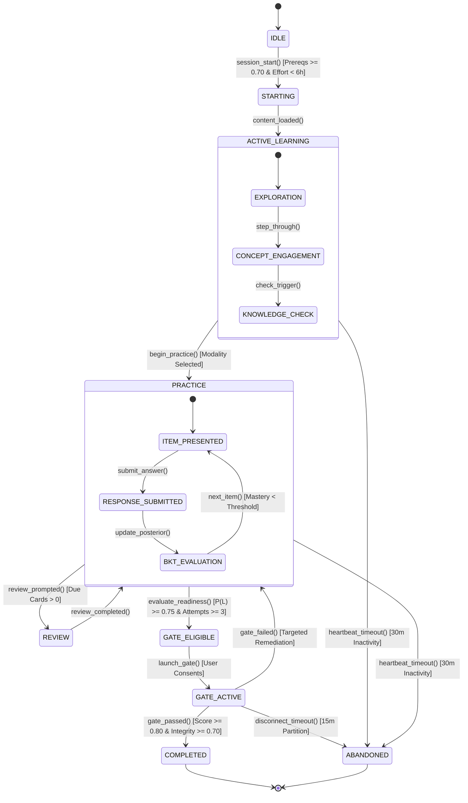

# Learning Engine

**Document Path:** `docs/04-learning/01-learning-engine.md`  
**Version:** 1.1.0  
**Last Updated:** 2026-11-21  
**Status:** Approved Architecture Baseline  
**Related Documents:**
- [Adaptive Path & Spaced Repetition](07-adaptive-spaced.md)
- [Level Gate](08-level-gate.md)
- [Learning Engine LLD](../15-lld/03-learning-engine.md)
- [Gate Flow LLD](../15-lld/04-gate-flow.md)
- [Scoring Model](../01-economy/03-scoring-model.md)

---

## Table of Contents
1. [Purpose](#1-purpose)
2. [Core objects](#2-core-objects)
3. [The session loop](#3-the-session-loop)
4. [Next-best-action](#4-next-best-action)
5. [Modality selection](#5-modality-selection)
6. [Mastery model](#6-mastery-model)
7. [Difficulty calibration](#7-difficulty-calibration)
8. [Content selection](#8-content-selection)
9. [State machine](#9-state-machine)
10. [Offline and sync](#10-offline-and-sync)
11. [Accessibility](#11-accessibility)
12. [Telemetry](#12-telemetry)
13. [Requirements](#13-requirements)
14. [Bayesian Knowledge Tracing (BKT) Mathematical Formulations](#14-bayesian-knowledge-tracing-bkt-mathematical-formulations)
15. [Detailed Session State Machine](#15-detailed-session-state-machine)
16. [Modality Routing Decision Matrix](#16-modality-routing-decision-matrix)
17. [Operational Edge Cases & Mitigations](#17-operational-edge-cases--mitigations)
18. [Performance & Latency Targets](#18-performance--latency-targets)

---

## 1. Purpose

The learning engine orchestrates everything between "I chose a skill" and "I passed the gate." It decides what the learner sees next, in which format, at what difficulty, and why.

It is not a playlist. It is a **mastery-guided system** with a knowledge graph, a learner model, and a content graph.

---

## 2. Core objects

| Object | Description |
|---|---|
| **Skill graph** | 500 skills with prerequisite/amplifier/combine edges |
| **Level graph** | 100 levels per skill with prerequisites and outcomes |
| **Concept graph** | Atomic ideas within levels and their dependencies |
| **Content graph** | Explanations, examples, practice, media, assessments |
| **Learner model** | Mastery estimates, preferences, constraints, history |
| **Session plan** | The next 10–60 minutes of learning |
| **Evidence store** | Attempts, artifacts, rubric scores, provenance |

---

## 3. The session loop

```
[1] RESUME
    - load learner state, review queue, last session
        │
[2] DIAGNOSE
    - what is due? what is weak? what is next?
        │
[3] PLAN
    - pick objective, modality, difficulty, duration
        │
[4] LEARN
    - explanation, example, worked problem
        │
[5] PRACTICE
    - retrieval, application, feedback
        │
[6] REFLECT
    - summarize, connect, schedule review
        │
[7] UPDATE
    - mastery estimate, next step, telemetry
        │
[8] GATE (when ready)
    - summative assessment, award
```

### 3.1 Session types
| Type | Duration | Use |
|---|---|---|
| Micro | 2–5 min | Review, one concept, habit |
| Standard | 20–30 min | Learn + practice |
| Deep | 45–90 min | Applied task, project |
| Assessment | 15–120 min | Gate, diagnostic |
| Simulation | 30–180 min | Role-play, live-fire |

---

## 4. Next-best-action

The engine chooses among:
1. **Review** due items (spaced repetition).
2. **Repair** a weak prerequisite.
3. **Learn** the next concept.
4. **Practice** a fragile skill.
5. **Apply** in a project.
6. **Assess** when mastery is likely.
7. **Rest** when fatigue or diminishing returns.

### 4.1 Priority score
```
priority = 0.30 × due_urgency
         + 0.25 × prerequisite_gap
         + 0.20 × goal_alignment
         + 0.15 × readiness
         + 0.10 × learner_preference
         - fatigue_penalty
```

### 4.2 Readiness
```
readiness = mastery_of_prerequisites × content_availability × time_fit
```
If readiness <0.6, the engine offers a bridge or a lower level.

### 4.3 Fatigue
- Detect long sessions, error spikes, slower responses.
- Suggest a break or a 2-minute review.
- Never push through fatigue for EC.

---

## 5. Modality selection

| Objective | Best modality | Fallback |
|---|---|---|
| Declarative knowledge | Text + examples | Video |
| Procedural skill | Demonstration + practice | Sim |
| Interpersonal skill | Role-play | Video + rubric |
| Operational judgment | Simulation | Case study |
| Physical skill | Video + observed practice | Sim |
| Creative skill | Studio + critique | Portfolio |
| Retention | Retrieval quiz | Spaced review |

### 5.1 Learner preference
- Ask once, then infer from behavior.
- Respect accessibility needs.
- Offer a different format if stuck.
- Never require video for a gate.

### 5.2 Content parity
Every level must have:
- A text path.
- A practice path.
- An assessment path.
Video and sims are enhancements, not dependencies.

---

## 6. Mastery model

### 6.1 Per concept
- Bayesian Knowledge Tracing (BKT) for fine-grained mastery.
- Slip and guess parameters per item type.
- Decay over time; review resets.

### 6.2 Per level
- Weighted combination of concept mastery, applied task, and gate score.
- Confidence interval.
- "Ready for gate" when predicted pass probability ≥0.75.

### 6.3 Per skill
- Level progress + evidence quality + transfer performance.
- Used for recommendations and prestige.

---

## 7. Difficulty calibration

Target success rate: **70–85%** during practice.

| Success rate | Action |
|---|---|
| >90% | Increase difficulty or skip ahead |
| 80–90% | Slightly harder |
| 70–80% | Optimal |
| 50–70% | Add scaffolding |
| <50% | Diagnose prerequisite gap; step back |

### 7.1 Hint policy
- Hints are always available.
- Using a hint reduces the practice score, not the gate score.
- The engine tracks hint dependence.
- Too many hints triggers a prerequisite review.

---

## 8. Content selection

### 8.1 Ranking
```
content_score = relevance × quality × freshness × modality_fit × diversity
```
- Relevance: aligns with objective and learner level.
- Quality: expert rating, learner outcomes, dispute rate.
- Freshness: last reviewed, version.
- Diversity: avoid repeating the same example.
- Modality fit: preference and accessibility.

### 8.2 Anti-repetition
- No identical example twice in a session.
- Rotate contexts.
- Introduce deliberate variation.

---

## 9. State machine

```
NOT_STARTED → LEARNING → PRACTICING → READY_FOR_GATE
     ↑            │            │              │
     └────────────┴────────────┘              ▼
          REVIEW ←──────────────────── GATE_FAILED
                                          │
                                          ▼
                                       GATE_PASSED → NEXT_LEVEL
```

- `READY_FOR_GATE` requires mastery ≥0.75 and all prerequisites.
- `GATE_FAILED` returns to `PRACTICING` with a targeted plan.
- `GATE_PASSED` awards XP/EC and unlocks the next level.

---

## 10. Offline and sync

- Download a level pack: text, practice, 1 assessment variant.
- Queue attempts and artifacts locally.
- Sync with conflict resolution (server wins on assessment).
- Offline gates are allowed only for low-stakes levels and are re-validated on sync.
- No offline high-stakes gates.

---

## 11. Accessibility

- Every session works with keyboard, screen reader, and captions.
- Adjustable text size, contrast, motion.
- Audio-first mode.
- Extended time.
- Alternative input for practical tasks.
- No modality is mandatory if inaccessible.

---

## 12. Telemetry

Events:
- `session_started`, `session_ended`, `session_abandoned`.
- `content_viewed`, `content_completed`.
- `practice_attempted`, `practice_feedback_viewed`.
- `hint_used`, `review_completed`.
- `gate_started`, `gate_passed`, `gate_failed`.

Metrics:
- Session completion.
- Time to mastery.
- Hint dependence.
- Modality effectiveness.
- Review adherence.
- Frustration signals.

---

## 13. Requirements

- `FR-LRN-001`: The engine always presents a next-best action.
- `FR-LRN-002`: Every level has text, practice, and assessment paths.
- `FR-LRN-003`: Practice targets 70–85% success.
- `FR-LRN-004`: Prerequisite gaps trigger remediation.
- `FR-LRN-005`: Hints are always available.
- `FR-LRN-006`: The engine detects fatigue and suggests rest.
- `FR-LRN-007`: Sessions work offline for levels 1–10.
- `FR-LRN-008`: Every session ends with a clear next step.
- `FR-LRN-009`: Modality choice respects accessibility.
- `FR-LRN-010`: The engine explains why it chose the next action.
- `NFR-LRN-001`: Session plan generation <500 ms.
- `NFR-LRN-002`: Content loads in <1 s on 3G.
- `NFR-LRN-003`: Offline sync success ≥99%.

---

## 14. Bayesian Knowledge Tracing (BKT) Mathematical Formulations

### 14.1 Theoretical Framework
Bayesian Knowledge Tracing models concept acquisition as a two-state Markov chain where learner mastery $L$ is a latent binary variable: $L=1$ (Mastered) or $L=0$ (Unmastered). Four fundamental parameters govern belief updates over sequence $n$:

- **$P(L_0)$ (Initial Mastery Prior):** Base probability that the learner already possesses concept mastery prior to instruction. Derived from diagnostic placement tests or calibrated domain defaults.
- **$P(T)$ (Transition / Learning Rate):** Probability that an unmastered state transitions to mastered following a practice opportunity: $P(L_n = 1 \mid L_{n-1} = 0)$.
- **$P(S)$ (Slip Probability):** Probability of making an error despite possessing mastery: $P(\text{Incorrect}_n \mid L_n = 1)$.
- **$P(G)$ (Guess Probability):** Probability of answering correctly without possessing mastery: $P(\text{Correct}_n \mid L_n = 0)$.

### 14.2 Posterior Update Formulation
When a learner attempts an item testing concept $C$, the observation $O_n \in \{\text{correct}, \text{incorrect}\}$ updates belief $P(L_{n-1})$ via Bayes' theorem:

#### Evidence Likelihood (Denominator):
$$P(\text{Correct}_n) = P(L_{n-1}) \cdot (1 - P(S)) + (1 - P(L_{n-1})) \cdot P(G)$$
$$P(\text{Incorrect}_n) = P(L_{n-1}) \cdot P(S) + (1 - P(L_{n-1})) \cdot (1 - P(G))$$

#### Posterior Given Evidence:
If correct:
$$P(L_n \mid \text{correct}) = \frac{P(L_{n-1}) \cdot (1 - P(S))}{P(L_{n-1}) \cdot (1 - P(S)) + (1 - P(L_{n-1})) \cdot P(G)}$$

If incorrect:
$$P(L_n \mid \text{incorrect}) = \frac{P(L_{n-1}) \cdot P(S)}{P(L_{n-1}) \cdot P(S) + (1 - P(L_{n-1})) \cdot (1 - P(G))}$$

#### Knowledge Transition Step:
Accounting for learning during the practice opportunity:
$$P(L_n) = P(L_n \mid O_n) + (1 - P(L_n \mid O_n)) \cdot P(T)$$

### 14.3 Calibrated Domain Baselines
To maintain statistical validity across the 500 skills in the catalog, default BKT parameters are anchored by domain characteristics:

| Domain Category | $P(L_0)$ | $P(T)$ | $P(S)$ | $P(G)$ | Gate Readiness Threshold |
|---|---|---|---|---|---|
| **Cognitive / Computing** | $0.15$ | $0.18$ | $0.08$ | $0.20$ | $P(L) \ge 0.75$ |
| **Procedural / Culinary** | $0.10$ | $0.14$ | $0.10$ | $0.15$ | $P(L) \ge 0.75$ |
| **Health / Applied Bio** | $0.12$ | $0.15$ | $0.06$ | $0.18$ | $P(L) \ge 0.80$ |
| **Interpersonal / Comm** | $0.15$ | $0.15$ | $0.15$ | $0.20$ | $P(L) \ge 0.75$ |
| **Creative / Design** | $0.20$ | $0.12$ | $0.12$ | $0.25$ | $P(L) \ge 0.75$ |

Degeneracy bounds are strictly enforced: $P(S) \le 0.20$ and $P(G) \le 0.30$. If mathematical estimates exceed these bounds, the system clamps values to prevent inversion of learning feedback.

---

## 15. Detailed Session State Machine

### 15.1 State Machine Specification
The learning engine runtime maintains active session states across client interactions, strictly governing transitions, guards, and persistent checkpoints.



### 15.2 State Transition & Persistence Table

| State Transition | Guard Condition | Actions Triggered | Persistence Store |
|---|---|---|---|
| `IDLE` $\to$ `STARTING` | User authorized, prerequisites $\ge 0.70$ | Allocate session UUID, lock user mutex | Redis (`SETNX session:lease:{uid}`) |
| `STARTING` $\to$ `ACTIVE_LEARNING` | Content bundle hydrated from R2 | Record session row, set status `ACTIVE` | Neon Postgres + Redis |
| `ACTIVE_LEARNING` $\to$ `PRACTICE` | Intro concepts marked completed | Select first practice item via adaptive algorithm | Redis (`HSET session:{id}`) |
| `PRACTICE` $\to$ `PRACTICE` | Answer payload validated | Insert attempt record, calculate BKT update | Neon Postgres (`practice_attempts`) |
| `PRACTICE` $\to$ `REVIEW` | SM-2 cards due $\ge 1$ | Inject spaced repetition queue into session | Redis (`LPUSH review_queue:{id}`) |
| `REVIEW` $\to$ `PRACTICE` | Spaced cards cleared | Update card intervals and ease factors | Neon Postgres (`review_cards`) |
| `PRACTICE` $\to$ `GATE_ELIGIBLE` | $P(L) \ge 0.75$, empirical count $\ge 3$ | Unlock gate launch button in PWA UI | Neon Postgres (`mastery_states`) |
| `GATE_ELIGIBLE` $\to$ `GATE_ACTIVE` | User confirms launch & safety rules | Lock practice items, spawn gate attempt | Neon Postgres (`gate_attempts`) |
| `GATE_ACTIVE` $\to$ `COMPLETED` | Gate pass saga executes successfully | Post XP/EC awards, unlock next level | Neon Postgres (ACID Ledger) |
| Any $\to$ `ABANDONED` | Inactivity timer expires ($30\text{ min}$) | Release Redis lease, save partial seconds | Neon Postgres (`learning_sessions`) |

---

## 16. Modality Routing Decision Matrix

The engine dynamically matches pedagogical modalities to learner readiness, cognitive load, and level band objectives:

| Learner / Curriculum Context | Selected Primary Modality | Fallback Modality | Pedagogical Rationale |
|---|---|---|---|
| **New Concept, Initial Encounter ($P(L) < 0.20$)** | Text Explanation + Examples | Audio Transcript | Establishes declarative scaffolding without extraneous cognitive load. |
| **New Concept, High Visual Affinity Profile** | Interactive SVG / Concept Map | Structured Text | Provides spatial schema grounding and mental model mapping. |
| **Formative Practice ($0.20 \le P(L) < 0.60$)** | Retrieval Quiz (5–8 Items) | Worked Solutions | Exercises active retrieval practice to strengthen neural recall pathways. |
| **Applied Mastery (Levels 20–79, Procedural)** | Interactive Simulator Sandbox | Structured Case Study | Promotes near-transfer execution in authentic, sandboxed runtimes. |
| **Applied Mastery (Levels 20–79, Interpersonal)** | AI Role-Play Simulation | Branching Dialogue Script | Exercises contextual nuance and responsive conversational judgment. |
| **Gate Readiness Verification ($P(L) \ge 0.75$)** | Calibrated Summative Quiz Bank | Mini-Oral Check | Evaluates boundary compliance across full concept coverage. |
| **Divergent Error Streak ($\ge 3$ Fails, $P(L) < 0.40$)**| AI Socratic Tutor Dialogue | Worked Walkthrough | Intervenes to diagnose root-cause conceptual misconceptions. |
| **Low-Bandwidth / Offline Profile (Levels 1–10)** | Compressed Markdown Text | Offline Mini-Quiz | Ensures zero-barrier accessibility on constrained mobile connections. |

---

## 17. Operational Edge Cases & Mitigations

| Edge Case ID | Scenario Description | Detection Mechanism | System Action & Recovery Mitigation | Durability State |
|---|---|---|---|---|
| **EC-ENG-001** | Session interrupted mid-quiz item submission | Client network disconnect before response | Client queries active lease on reconnect; resubmits with idempotency token; server eliminates duplicate writes. | Redis preserves attempt state; single Neon record. |
| **EC-ENG-002** | BKT divergence (stuck below $0.50$ after 20 attempts) | `total_attempts >= 20 && p_learn < 0.50` | Engine pauses standard practice, locks concept, and triggers AI Socratic diagnostic dialogue. | Concept flagged `REMEDIATION_REQUIRED`. |
| **EC-ENG-003** | Item bank exhausted for current target difficulty | Query returns 0 items in $[0.8 D, 1.2 D]$ | Expands window to $[0.7 D, 1.3 D]$; relaxes 72h exposure filter, picking item with lowest total exposure. | Fallback event logged to PostHog. |
| **EC-ENG-004** | Prerequisite completed concurrently on another device | Read-committed isolation hook | Session validator refreshes prerequisite cache on transition; immediately unlocks blocked paths. | Neon Postgres state authoritative. |
| **EC-ENG-005** | User switches skill mid-session | New `STARTING` request with different `skill_id` | Previous session auto-marked `ABANDONED`; active practice seconds saved; new session spawned. | Prior session closed with partial seconds. |
| **EC-ENG-006** | Offline client sync conflict | Version vector mismatch on reconnect | Server takes precedence on summative gates; formative practice attempts are merged append-only. | Attempts merged into `practice_attempts`. |
| **EC-ENG-007** | Concurrent sessions on desktop and mobile | Redis distributed lock `SETNX session:lease:{uid}` | Second device prompted with HTTP 409 Conflict: "Active session in progress. Transfer here?" | Previous lease revoked upon transfer. |
| **EC-ENG-008** | Rapid-fire bot clicking ($< 1000\text{ ms}$ per item) | Item duration telemetry $< 1000\text{ ms}$ | Flag attempt as bot/guess; elevate slip probability $P(S)$; trigger CAPTCHA verification challenge. | Attempt marked `is_flagged = true`. |
| **EC-ENG-009** | Timezone crossing across UTC midnight | Device clock shifts local date | System anchors all daily effort calculations to server-side UTC epoch; prevents duplicate 6-hour caps. | `utc_date` anchored to UTC. |
| **EC-ENG-010** | AI Tutor API latency spike / timeout ($> 15\text{ s}$) | OpenAI GPT-4o-mini gateway timeout | Engine gracefully degrades to static pre-compiled markdown text explanation and worked problem. | Fallback telemetry emitted to PostHog. |
| **EC-ENG-011** | Neon Postgres cold start delay ($> 1000\text{ ms}$) | Health probe connection latency | Content served directly from Redis/R2 cache; database writes enqueued in Redis write-through buffer. | Writes asynchronously flushed to Neon. |
| **EC-ENG-012** | Client submits invalid or corrupted concept ID | Schema validation failure | Rejects request with HTTP 400 Bad Request; logs malformed payload to Sentry/PostHog. | Zero state modification. |
| **EC-ENG-013** | Database storage threshold alert (Neon 0.5GB tier) | Storage monitor webhook at 90% | BullMQ worker runs archiving routine: moves aged `practice_attempts` ($> 90\text{ days}$) to Cloudflare R2 Parquet. | Storage footprint reclaimed in Neon. |
| **EC-ENG-014** | Spaced review card scheduled into the past | System clock sync drift | Sanity validator sets `next_review_at = MAX(next_review_at, NOW() + interval)`. | Validated timestamp saved. |
| **EC-ENG-015** | Learner exhausts all 3 hints on single item | Hint counter $\ge 3$ | Item recorded as incorrect for BKT; worked step-by-step solution displayed to learner. | $P(L)$ updated as false; hints logged. |
| **EC-ENG-016** | Redis Docker container crash on Hetzner VPS | Connection refusal exception | Engine degrades to direct Neon Postgres reads and writes; emits critical operational alert. | Core ACID guarantees preserved in Neon. |
| **EC-ENG-017** | Numerical NaN generated in BKT calculation | Floating point zero division | Sanitizer catches `NaN`, logs warning, and restores posterior to previous known valid checkpoint $P(L_{n-1})$. | Previous valid state preserved. |
| **EC-ENG-018** | Learner attempts gate when mastery is $0.7499$ | Strict boundary guard | Rejects gate entry; displays UI indicator requiring exactly 1 additional successful retrieval practice item. | Gate entry blocked. |
| **EC-ENG-019** | Simulator webhook fails to report completion | Simulator timeout ($30\text{ min}$) | Session enters `ABANDONED` status; learner prompted to retry sandbox task without losing prior progress. | Session cleanly closed. |
| **EC-ENG-020** | Overwhelming review card accumulation ($> 100$) | Inactive learner returns | Review queue capped dynamically at 30 cards per day, prioritized by overdue severity; prevents cognitive panic. | Backlog deferred smoothly across days. |

---

## 18. Performance & Latency Targets

To ensure smooth PWA responsiveness on constrained 3G/4G connections and low-cost Hetzner ARM hardware, the Learning Engine enforces strict service level objectives (SLOs):

| Operation / Pipeline Stage | Target Latency (p95) | Target Latency (p99) | Optimization & Architectural Strategy |
|---|---|---|---|
| **Session Initialization** | $< 200\text{ ms}$ | $< 350\text{ ms}$ | Session state cached in Redis; asynchronous hydration of user profile. |
| **Adaptive Item Selection** | $< 50\text{ ms}$ | $< 100\text{ ms}$ | Item metadata indexed in memory/Redis; candidate sampling window pre-indexed in Postgres. |
| **BKT Closed-Form Update** | $< 5\text{ ms}$ | $< 10\text{ ms}$ | Pure mathematical evaluation in Node.js runtime; non-blocking memory state update. |
| **Spaced Review Queue Build** | $< 100\text{ ms}$ | $< 250\text{ ms}$ | Pre-aggregated nightly BullMQ cron job; single indexed query on `next_review_at`. |
| **Prerequisite Subtree Validation** | $< 80\text{ ms}$ | $< 150\text{ ms}$ | Recursive CTE executed against indexed adjacency list; results cached in Redis for 15 minutes. |
| **Heartbeat Ingestion & Autosave** | $< 50\text{ ms}$ | $< 80\text{ ms}$ | Writes directly to Redis ephemeral hash; batched flush to Postgres every 60 seconds. |
| **Neon Cold-Start Mitigation** | $< 300\text{ ms}$ | $< 800\text{ ms}$ | Connection pooling via Neon PgBouncer; pre-warmed connection keep-alives every 4 minutes. |

