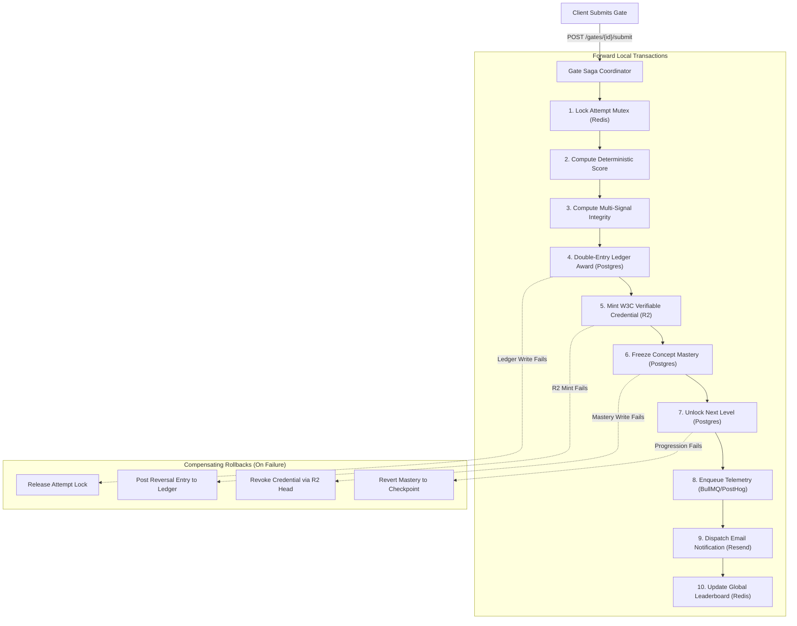
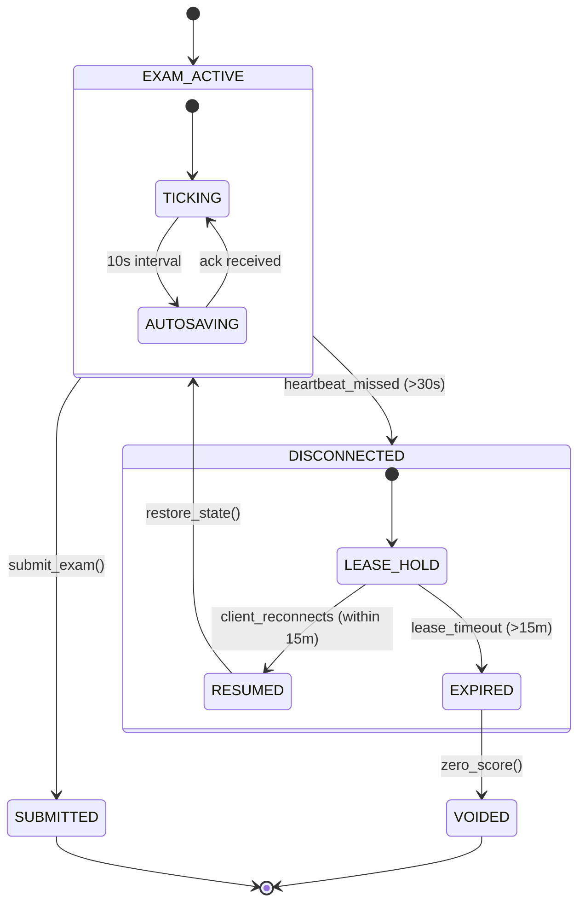

# Level Gate

**Document Path:** `docs/04-learning/08-level-gate.md`  
**Version:** 1.1.0  
**Last Updated:** 2026-11-21  
**Status:** Approved Architecture Baseline  
**Related Documents:**
- [Learning Engine](01-learning-engine.md)
- [Gate Exams](../05-assessment/03-gate-exams.md)
- [Gate Flow LLD](../15-lld/04-gate-flow.md)
- [Points & Ledger](../01-economy/02-points-ledger.md)
- [Scoring Model](../01-economy/03-scoring-model.md)
- [Integrity & Anti-Cheat](../09-trust-safety/01-integrity-anti-cheat.md)

---

## Table of Contents
1. [Purpose](#1-purpose)
2. [Preconditions](#2-preconditions)
3. [Gate composition](#3-gate-composition)
4. [Flow](#4-flow)
5. [Scoring](#5-scoring)
6. [Integrity](#6-integrity)
7. [Decision and award](#7-decision-and-award)
8. [Retakes](#8-retakes)
9. [Appeals](#9-appeals)
10. [Credentials](#10-credentials)
11. [Edge cases](#11-edge-cases)
12. [Requirements](#12-requirements)
13. [Distributed Saga Architecture for Gate Execution](#13-distributed-saga-architecture-for-gate-execution)
14. [Multi-Signal Integrity Score Computation Algorithm](#14-multi-signal-integrity-score-computation-algorithm)
15. [Disconnect, Heartbeat & Recovery Lifecycle](#15-disconnect-heartbeat--recovery-lifecycle)
16. [Retake & Remediation Policy Engine](#16-retake--remediation-policy-engine)
17. [Formal Appeals Workflow & Evidence Packaging](#17-formal-appeals-workflow--evidence-packaging)
18. [Operational Performance Targets & SLAs](#18-operational-performance-targets--slas)

---

## 1. Purpose

The gate is the moment a level becomes real. It is the only path to XP and EC. It must be:
- **Fair:** aligned to the outcome, accessible, calibrated.
- **Hard:** it protects the meaning of the level.
- **Transparent:** the learner knows the criteria.
- **Secure:** cheating is expensive and detectable.
- **Appealing:** a failed gate produces a clear path forward.

---

## 2. Preconditions

A learner can attempt a gate when:
- All prerequisites are at ≥0.7 mastery.
- Practice mastery is ≥0.75 with confidence.
- Required artifacts are submitted.
- Safety brief is acknowledged (high-risk).
- Integrity prerequisites are met (ID, device, proctoring tier).
- The learner explicitly confirms readiness.

The system may recommend waiting, but the learner can override with a warning (except safety gates).

---

## 3. Gate composition

| Band | Knowledge | Applied | Oral/transfer | Artifact | Panel |
|---|---|---|---|---|---|
| 1–10 | 60% | 40% | 0% | 0% | No |
| 11–20 | 45% | 40% | 10% | 5% | No |
| 21–30 | 35% | 40% | 10% | 15% | No |
| 31–40 | 25% | 40% | 10% | 25% | No |
| 41–50 | 20% | 35% | 15% | 30% | No |
| 51–60 | 15% | 30% | 20% | 35% | No |
| 61–70 | 10% | 25% | 25% | 40% | Sample |
| 71–80 | 5% | 20% | 30% | 45% | Yes |
| 81–90 | 0% | 15% | 35% | 50% | Yes |
| 91–100 | 0% | 10% | 40% | 50% | Yes |

---

## 4. Flow

```
[1] READINESS CHECK
      │
[2] BRIEF (what, how long, criteria, integrity)
      │
[3] CONSENT & ENVIRONMENT CHECK
      │
[4] ASSESSMENT
      │
[5] AUTO-SCORE + INTEGRITY
      │
[6] HUMAN REVIEW (if required)
      │
[7] DECISION
      ├── PASS → award XP/EC → unlock next level → credential
      └── FAIL → feedback → plan → retake window
```

### 4.1 Timing
| Band | Duration |
|---|---|
| 1–10 | 15–30 min |
| 11–20 | 30–45 min |
| 21–30 | 45–60 min |
| 31–40 | 60–90 min |
| 41–50 | 90–120 min |
| 51–60 | 2–3 h |
| 61–70 | 3–4 h |
| 71–80 | 1–2 days |
| 81–90 | 2–5 days |
| 91–100 | 2–6 weeks (panel) |

---

## 5. Scoring

### 5.1 Knowledge
- ≥80% pass.
- ≥95% distinction.
- Item-level feedback after submission.

### 5.2 Applied
- Rubric average ≥2.5/4.
- No critical criterion <2.
- Safety criterion must be ≥3 for high-risk skills.

### 5.3 Oral/transfer
- ≥3/4 on explanation and transfer.
- Human or AI+human at level 40+.

### 5.4 Artifact
- ≥3/4 on all critical criteria.
- Provenance verified.
- Panel at level 80+.

### 5.5 Overall
```
pass = knowledge_pass
     AND applied_pass
     AND oral_pass (if required)
     AND artifact_pass (if required)
     AND integrity_score ≥ threshold
```

No compensation across critical criteria.

---

## 6. Integrity

| Tier | Controls |
|---|---|
| Open (1–20) | Randomized items, time limits, analytics |
| Monitored (21–50) | Webcam/screen check, behavioral signals |
| Proctored (51–80) | Live/recorded proctor, ID, secure browser |
| Panel (81–100) | Human panel, oral defense, artifact review |

### 6.1 Integrity score
- 0–1, weighted across identity, device, behavior, provenance, review.
- <0.5 invalid.
- 0.5–0.69 held for review.
- 0.7–0.84 award + sample.
- ≥0.85 normal.

### 6.2 Rules
- No gate answers from the tutor.
- No external help.
- AI use only where declared.
- Screen sharing/remote control blocked where legal.
- Accommodations do not lower integrity requirements.

---

## 7. Decision and award

### 7.1 Pass
- XP and EC computed by the scoring model.
- Award posted atomically to the ledger.
- Next level unlocked.
- Credential issued (verifiable).
- Wallet and progress updated.
- Share option (private by default).

### 7.2 Fail
- No EC.
- Partial XP for legitimate effort (up to 25%).
- Specific feedback: what was missing, what to practice.
- A 7-day plan.
- Retake window: 3 attempts/24h; 7-day cooldown after 3 failures.
- Human support offer.

### 7.3 Borderline
- 75–79% knowledge or 2.4 applied → "near pass."
- Optional oral recheck within 72h.
- Human reviewer decides.

---

## 8. Retakes

| Situation | Policy |
|---|---|
| First fail | Retry after 24h |
| Second fail | Retry after 72h + targeted plan |
| Third fail | 7-day cooldown + human check-in |
| Fourth+ | Requires remediation plan approval |
| Passed | Repeat allowed for learning; EC decays |

Retakes use different items and, at high levels, different scenarios.

---

## 9. Appeals

1. Learner appeals within 14 days.
2. Evidence packet assembled.
3. New reviewer.
4. Decision within 7 days.
5. If upheld, award posted.
6. If rejected, written rationale + next steps.
7. Second appeal for level 80+ or bans.

---

## 10. Credentials

- Verifiable credential (W3C VC) issued on pass.
- Contains skill, level, date, evidence hash, integrity tier.
- Public verification endpoint.
- Revocable on fraud.
- Portable/exportable.
- Expiry only for "current" badges, not the credential.

---

## 11. Edge cases

| Case | Behavior |
|---|---|
| Disconnect mid-gate | Resume within 15 min; else void and retry |
| Power outage | Same as disconnect |
| Accessibility accommodation | Applied; construct unchanged |
| Suspected cheating | Hold award; review; appeal |
| Duplicate submission | Idempotent; no double award |
| Pool exhausted | Award queued; learner notified |
| Panel tie | Third reviewer decides |
| Minor | Guardian notified of pass/fail only |
| Language issue | Oral clarification allowed |

---

## 12. Requirements

- `FR-ASM-101`: A gate cannot start without prerequisites and consent.
- `FR-ASM-102`: Every gate has a published rubric.
- `FR-ASM-103`: Every gate uses randomized items.
- `FR-ASM-104`: Integrity score is computed for every gate.
- `FR-ASM-105`: No award below integrity threshold.
- `FR-ASM-106`: Failed gates produce a specific plan.
- `FR-ASM-107`: Retake policy is enforced.
- `FR-ASM-108`: Appeals are reviewed by a new reviewer.
- `FR-ASM-109`: Passed gates issue a verifiable credential.
- `FR-ASM-110`: High-stakes gates require human review.
- `NFR-ASM-101`: Gate autosave every 10 s.
- `NFR-ASM-102`: Resume after disconnect within 15 min.
- `NFR-ASM-103`: Results within 24 h (auto) / 7 days (panel).

---

## 13. Distributed Saga Architecture for Gate Execution

### 13.1 Why Distributed Sagas are Mandatory
A passed gate marks the definitive transition where academic proficiency translates into platform currency (EC) and permanent credentialing. This operation crosses heterogeneous boundaries:
- **Neon Postgres:** ACID updates to user mastery, progression locks, and double-entry ledger journals.
- **Cloudflare R2:** Cryptographic storage of W3C Verifiable Credentials and audit logs.
- **Redis Cache:** Distributed mutex locks and leaderboard updates.
- **External APIs:** Resend email notifications and PostHog event queues.

Because Two-Phase Commit (2PC) is non-viable across serverless databases and third-party REST endpoints, the system implements an **Orchestrated Saga Pattern**. If any step fails, backward **compensating transactions** undo previous side effects in reverse sequence to guarantee eventual consistency.



---

## 14. Multi-Signal Integrity Score Computation Algorithm

### 14.1 Behavioral Signals & Dynamic Weightings
The integrity score $I \in [0.0, 1.0]$ combines hardware binding, identity verification, timing telemetry, and behavioral analytics. Weights dynamically adapt to the gate's integrity tier:

| Signal Dimension | Variable Name | Open (1–20) | Monitored (21–50) | Proctored (51–80) | Panel (81–100) |
|---|---|---|---|---|---|
| **Identity Verification** | $s_{\text{id}}$ | $0.10$ | $0.20$ | $0.25$ | $0.30$ |
| **Device Fingerprint Binding** | $s_{\text{dev}}$ | $0.15$ | $0.15$ | $0.15$ | $0.10$ |
| **ML Behavioral Anomaly** | $s_{\text{beh}}$ | $0.15$ | $0.20$ | $0.20$ | $0.10$ |
| **Reading / Answering Speed** | $s_{\text{time}}$ | $0.20$ | $0.15$ | $0.10$ | $0.05$ |
| **Tab Blur / Focus Loss** | $s_{\text{foc}}$ | $0.25$ | $0.15$ | $0.10$ | $0.05$ |
| **Clipboard Paste Frequency** | $s_{\text{pst}}$ | $0.15$ | $0.15$ | $0.10$ | $0.05$ |
| **Artifact Git / Keystroke Provenance**| $s_{\text{prov}}$ | $0.00$ | $0.00$ | $0.10$ | $0.35$ |
| **Total Tier Weight** | — | **1.00** | **1.00** | **1.00** | **1.00** |

### 14.2 TypeScript Implementation
```typescript
export interface IntegritySignals {
  identityVerified: boolean;
  deviceBound: boolean;
  behavioralAnomaly: number;  // 0.0 (normal) to 1.0 (anomalous)
  timingAnomaly: number;      // Deviation from expected reading speed
  itemOrderDeviation: number; // Erratic skipping score
  pasteEvents: number;        // Raw clipboard paste count
  focusLossCount: number;     // Window blur count
  provenanceScore: number;    // Git commit authenticity (0.0 to 1.0)
  peerSimilarity: number;     // Cohort response correlation
}

export function computeIntegrityScore(signals: IntegritySignals, level: number): number {
  let w = { id: 0.10, dev: 0.15, beh: 0.15, time: 0.20, foc: 0.25, pst: 0.15, prov: 0.00 };

  if (level >= 81) {
    w = { id: 0.30, dev: 0.10, beh: 0.10, time: 0.05, foc: 0.05, pst: 0.05, prov: 0.35 };
  } else if (level >= 51) {
    w = { id: 0.25, dev: 0.15, beh: 0.20, time: 0.10, foc: 0.10, pst: 0.10, prov: 0.10 };
  } else if (level >= 21) {
    w = { id: 0.20, dev: 0.15, beh: 0.20, time: 0.15, foc: 0.15, pst: 0.15, prov: 0.00 };
  }

  const sId = signals.identityVerified ? 1.0 : 0.0;
  const sDev = signals.deviceBound ? 1.0 : 0.2;
  const sBeh = Math.max(0, 1.0 - signals.behavioralAnomaly);
  const sTime = Math.max(0, 1.0 - signals.timingAnomaly);
  const sFoc = Math.exp(-0.4 * signals.focusLossCount);
  const sPst = Math.exp(-0.6 * signals.pasteEvents);
  const sProv = Math.min(Math.max(signals.provenanceScore, 0.0), 1.0);

  let composite = 
    w.id * sId +
    w.dev * sDev +
    w.beh * sBeh +
    w.time * sTime +
    w.foc * sFoc +
    w.pst * sPst +
    w.prov * sProv;

  // Harsh penalty for direct collusion with concurrent attempts
  if (signals.peerSimilarity > 0.90) {
    composite *= 0.50;
  }

  return Number(Math.min(Math.max(composite, 0.0), 1.0).toFixed(4));
}
```

---

## 15. Disconnect, Heartbeat & Recovery Lifecycle

### 15.1 Session Continuity State Machine
To accommodate unstable mobile connectivity without compromising exam integrity, the server maintains an ephemeral Redis session buffer with a strictly enforced 15-minute resumption lease:



### 15.2 Sequence of Disconnect Recovery
```mermaid
sequenceDiagram
    autonumber
    actor Learner as PWA Client
    participant Server as Next.js API
    participant Cache as Redis Lease Buffer
    participant DB as Neon Postgres

    Learner->>Server: Client Heartbeat (every 30s)
    Server->>Cache: EXPIRE gate:attempt:{id} 900
    Note over Learner,Server: Client drops connection (power/network)
    Server->>Server: Heartbeat Timeout Triggered (>30s)
    Server->>DB: Flag attempt status = 'PAUSED_DISCONNECTED'
    
    alt Reconnects within 15 Minutes
        Learner->>Server: POST /gates/{id}/resume
        Server->>Cache: GET gate:attempt:{id}
        Cache-->>Server: Return cached answers & elapsed seconds
        Server-->>Learner: HTTP 200 (Restore session exactly where left off)
        Server->>DB: Flag attempt status = 'IN_PROGRESS'
    else Inactivity Exceeds 15 Minutes
        Cache->>Cache: TTL expires; key deleted
        Learner->>Server: POST /gates/{id}/resume
        Server-->>Learner: HTTP 410 Gone (Session Expired & Voided)
        Server->>DB: Mark attempt = 'VOID_EXPIRED'; Retake cooldown starts
    end
```

---

## 16. Retake & Remediation Policy Engine

### 16.1 Progressive Cooldown & Remediation Thresholds
To prevent brute-force item harvesting, failing a gate triggers tiered cooldown windows and specific remediation gates:

```typescript
export interface AttemptRecord {
  attemptId: string;
  completedAt: Date;
  score: number;
  isPassed: boolean;
}

export interface RetakePolicy {
  canRetake: boolean;
  attemptNumber: number;
  cooldownHours: number;
  cooldownExpiresAt: Date;
  requiresRemediationPlan: boolean;
  requiresHumanCheckIn: boolean;
}

export function getRetakePolicy(history: AttemptRecord[]): RetakePolicy {
  const sorted = [...history].sort((a, b) => b.completedAt.getTime() - a.completedAt.getTime());
  const failStreak = sorted.findIndex((att) => att.isPassed);
  const failureCount = failStreak === -1 ? sorted.length : failStreak;

  const lastAttempt = sorted[0];
  const attemptNumber = failureCount + 1;

  let cooldownHours = 24;
  let requiresRemediationPlan = false;
  let requiresHumanCheckIn = false;

  if (failureCount === 1) {
    cooldownHours = 24;  // 1st fail: 24h cooldown
  } else if (failureCount === 2) {
    cooldownHours = 72;  // 2nd fail: 72h cooldown + targeted plan
    requiresRemediationPlan = true;
  } else if (failureCount === 3) {
    cooldownHours = 168; // 3rd fail: 7-day cooldown + mentor check-in
    requiresRemediationPlan = true;
    requiresHumanCheckIn = true;
  } else if (failureCount >= 4) {
    cooldownHours = 336; // 4th+ fail: 14-day cooldown + formal plan approval
    requiresRemediationPlan = true;
    requiresHumanCheckIn = true;
  }

  const cooldownExpiresAt = new Date(lastAttempt.completedAt.getTime() + cooldownHours * 3600 * 1000);
  const canRetake = new Date() >= cooldownExpiresAt;

  return {
    canRetake,
    attemptNumber,
    cooldownHours,
    cooldownExpiresAt,
    requiresRemediationPlan,
    requiresHumanCheckIn,
  };
}
```

---

## 17. Formal Appeals Workflow & Evidence Packaging

Any learner who fails a level gate has the right to appeal within 14 calendar days. The platform guarantees independent, double-blind human re-evaluation:

```mermaid
sequenceDiagram
    autonumber
    actor Learner as Learner
    participant API as Assessment API
    participant R2 as Cloudflare R2
    participant Reviewer as Independent Reviewer
    participant Saga as GateSagaCoordinator

    Learner->>API: POST /gates/{id}/appeal (Submission text + evidence)
    API->>API: Verify window (<= 14 days from decision)
    API->>R2: Generate Presigned Evidence Bundle (Keystrokes, Video, Rubrics)
    API->>Reviewer: Enqueue Double-Blind Review Job (SLA: 7 days)
    
    Note over Reviewer: Independent Reviewer inspects evidence package
    
    alt Appeal Upheld (Pass Verdict)
        Reviewer->>API: POST /appeals/{id}/verdict (UPHELD)
        API->>Saga: executePassSaga() [Awards EC/XP, Issues Credential]
        API-->>Learner: Notification: Appeal Upheld; Next Level Unlocked
    else Appeal Rejected (Fail Maintained)
        Reviewer->>API: POST /appeals/{id}/verdict (REJECTED + Rationale)
        API-->>Learner: Notification: Appeal Denied; Remediation Pointers Provided
    end
```

---

## 18. Operational Performance Targets & SLAs

To ensure auditability, low costs on Hetzner CAX11 hardware, and fair learner experience, Level Gate operations enforce the following SLAs and performance budgets:

| Operation / Pipeline Step | Target Latency / SLA | Architecture Strategy & Cost Control |
|---|---|---|
| **High-Frequency Autosave** | $< 100\text{ ms}$ (p95) | Written directly to local Hetzner Redis buffer; flushed to Postgres every 60s. |
| **Deterministic Score Evaluation** | $< 50\text{ ms}$ (p95) | Evaluated in-memory via pure functions; zero database roundtrips during computation. |
| **Integrity Score Calculation** | $< 2.0\text{ s}$ (p95) | Client signals aggregated asynchronously; ML anomaly model runs via lightweight inference. |
| **Saga Double-Entry Award Posting** | $< 500\text{ ms}$ (p95) | Single ACID Postgres transaction spanning wallet and sponsor pool ledger tables. |
| **W3C Credential Minting & R2 Push** | $< 1.5\text{ s}$ (p95) | ECDSA signing via Node.js crypto; saved to Cloudflare R2 with zero egress bandwidth charges. |
| **Auto-Graded Gate Results** | $< 5\text{ seconds}$ | Immediate feedback upon exam submission for Levels 1–50. |
| **AI Rubric Assessment (Practical)** | $< 60\text{ minutes}$ | Enqueued via BullMQ; evaluated using OpenAI GPT-4o-mini ($0.15/1M input tokens). |
| **Expert Panel Scheduling (Level 80+)**| $< 7\text{ calendar days}$ | Automated dispatch to qualified examiner pool; calendar ICS generation. |
| **Panel Oral Defense & Verdict** | $< 14\text{ calendar days}$ | Completed oral defense and published rubric consensus. |
| **Appeals Decision SLA** | $< 7\text{ calendar days}$ | Mandatory review deadline for independent senior examiners. |

