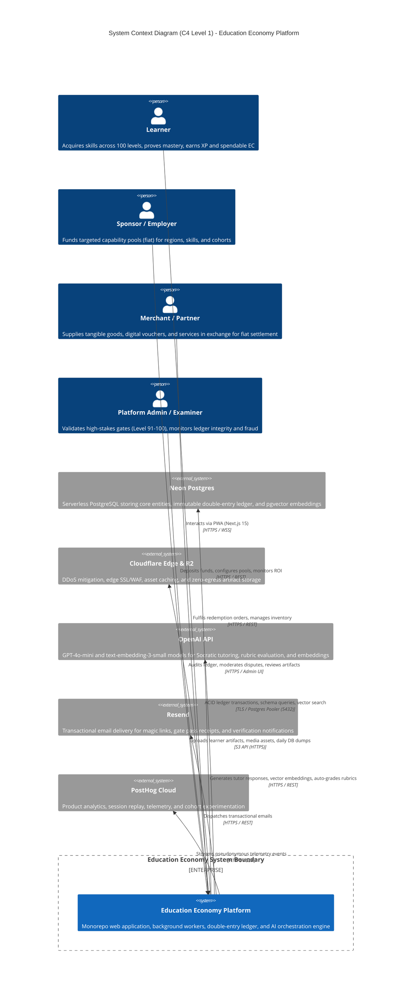
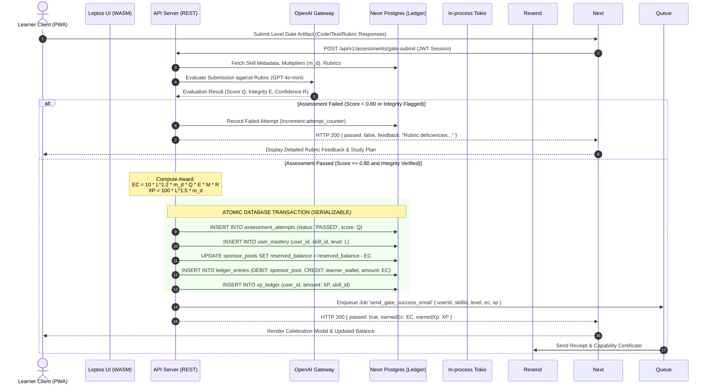
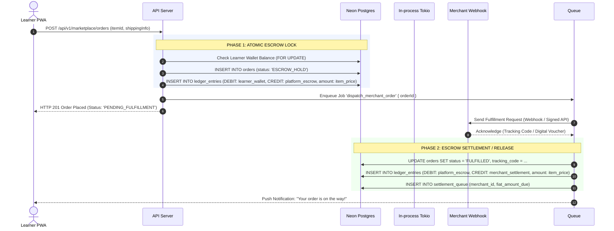
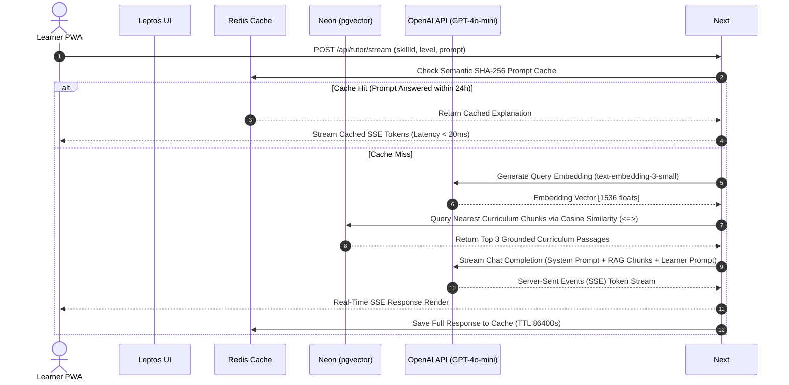
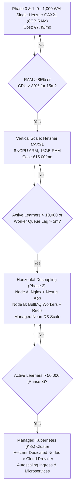

# System Architecture Specification

> ⚠️ **Implementation note:** the codebase is implemented in **Rust** (Axum · Leptos · SQLx). See [16-rust-implementation.md](../16-rust-implementation.md) for the authoritative map and [SETUP.md](../../SETUP.md) for run/deploy. The Next.js/Drizzle stack details in this document are superseded.

| Metadata | Value |
|---|---|
| **Section Path** | `docs/06-platforms/01-architecture.md` |
| **Version** | 2.0.0 |
| **Last Updated** | 2026-11-21 |
| **Related Docs** | [05-budget-stack.md](../00-foundations/05-budget-stack.md), [01-economy-model.md](../01-economy/01-economy-model.md), [02-points-ledger.md](../01-economy/02-points-ledger.md), [03-scoring-model.md](../01-economy/03-scoring-model.md), [07-local-dev-guide.md](07-local-dev-guide.md), [08-deployment-guide.md](08-deployment-guide.md) |

---

## Table of Contents
1. [System Context (C4 Level 1)](#1-system-context-c4-level-1)
2. [Container Architecture (C4 Level 2)](#2-container-architecture-c4-level-2)
3. [Subsystem & Service Responsibilities](#3-subsystem--service-responsibilities)
4. [Core Transactional Data Flows](#4-core-transactional-data-flows)
   - [4.1 Gate Assessment & Economic Award Emission](#41-gate-assessment--economic-award-emission)
   - [4.2 Marketplace Redemption & Two-Phase Escrow](#42-marketplace-redemption--two-phase-escrow)
   - [4.3 Socratic AI Tutor Streaming Turn](#43-socratic-ai-tutor-streaming-turn)
5. [Technology Stack Specification](#5-technology-stack-specification)
6. [Network Topology & Perimeter Security](#6-network-topology--perimeter-security)
7. [Docker Compose Architecture & Resource Budgets](#7-docker-compose-architecture--resource-budgets)
8. [Disaster Recovery & Business Continuity](#8-disaster-recovery--business-continuity)
9. [Scaling Strategy & Lifecycle Milestones](#9-scaling-strategy--lifecycle-milestones)
10. [Security Architecture & Threat Mitigation](#10-security-architecture--threat-mitigation)
11. [Non-Functional Requirements (NFR) Benchmark](#11-non-functional-requirements-nfr-benchmark)

---

## 1. System Context (C4 Level 1)

### 1.1 Purpose
The Education Economy system transforms learning into an economically rewarded, verifiable proof of human capability. External actors interact with the unified platform to acquire skills, fund educational pools, supply redemption items, or govern system integrity.

### 1.2 C4 Context Diagram


### 1.3 Edge Cases & Error Handling
| Boundary Edge Case | Impact | System Reaction | Recovery Procedure |
|---|---|---|---|
| Neon database transient partition | All stateful operations fail | Connection pool retries with exponential backoff (3 attempts over 5s). | Read-only mode activated on API; returns HTTP 503 with Retry-After header. |
| OpenAI rate-limiting (HTTP 429) | Tutor and auto-grader stall | Fall back to pre-authored static hints and cached rubric evaluations. | Queue prompt in BullMQ for asynchronous grading retry when capacity clears. |
| Cloudflare R2 transient upload timeout | Learner portfolio submission fails | Client generates signed local SHA-256 hash; retries upload with exponential backoff. | S3 client aborts multipart upload; alerts user to retry without loss of entered form data. |

### 1.4 Requirements & Metrics
- `FR-PLT-001`: Strong consistency and double-entry balancing for all ledger operations.
- `NFR-PLT-001`: 99.9% platform availability for learning paths.
- **Metric:** Zero unbacked EC tokens emitted across all external boundary interactions.

---

## 2. Container Architecture (C4 Level 2)

### 2.1 Purpose
The platform is deployed onto a single **Hetzner CAX21 VPS** (4 vCPU ARM Ampere, 8GB RAM, 80GB NVMe) orchestrated via Docker Compose. All microservices communicate over an isolated internal Docker bridge network (`edu-internal`), with only Nginx exposing ports to the public internet via Cloudflare.

### 2.2 C4 Container Diagram
```mermaid
graph TD
    subgraph "External World & Edge"
        LearnerClient["Learner PWA Client (Mobile/Desktop)"]
        CloudflareEdge["Cloudflare Edge (WAF, SSL, Free CDN)"]
    end

    subgraph "Hetzner CAX21 VPS (Docker Compose Runtime: 8GB RAM Budget)"
        NginxProxy["nginx (Reverse Proxy & SSL Termination)<br/>[Ports: 80, 443 | RAM Limit: 128MB]"]
        NextApp["ui (Leptos 0.7 static, Trunk build)"]
        ApiServer["api-server (REST / OpenAPI Backend)<br/>[Port: 4000 internal | RAM Limit: 1536MB]"]
        Worker["background work (in-process Tokio — no BullMQ)"]
        RedisContainer["redis (sessions + AI cache)<br/>[Port: 6379 internal | RAM Limit: 256MB]"]
        MeiliContainer["search (Neon pgvector — no Meilisearch)"]
        Prometheus["monitoring (PostHog — planned)"]
        GrafanaAgent["metrics (optional)"]
    end

    subgraph "External Cloud Infrastructure"
        NeonDB[("Neon Postgres Serverless<br/>[ACID Ledger, pgvector, Branching]")]
        CloudflareR2[("Cloudflare R2 Object Store<br/>[Zero Egress Artifacts & DB Dumps]")]
        OpenAIAPI["OpenAI API<br/>[GPT-4o-mini / Embeddings]"]
        ResendAPI["Resend Email API"]
        PostHogCloud["PostHog Cloud Telemetry"]
    end

    LearnerClient -->|HTTPS / Port 443| CloudflareEdge
    CloudflareEdge -->|Origin Pull (TLS 1.3)| NginxProxy

    NginxProxy -->|Proxy / | NextApp
    NginxProxy -->|Proxy /api/v1/*| ApiServer

    NextApp -->|Internal HTTP| ApiServer
    NextApp -->|Session Validation| RedisContainer
    NextApp -->|Postgres Query Pooler| NeonDB

    ApiServer -->|Enqueue Async Jobs| RedisContainer
    ApiServer -->|Read/Write Operations| NeonDB
    ApiServer -->|Search Queries| MeiliContainer
    ApiServer -->|LLM Inference & RAG| OpenAIAPI
    ApiServer -->|Emit Analytics| PostHogCloud

    Worker -->|Consume Queue Jobs| RedisContainer
    Worker -->|Execute Ledger Compensations| NeonDB
    Worker -->|Sync Catalog Documents| MeiliContainer
    Worker -->|Dispatch Emails| ResendAPI
    Worker -->|Upload Nightly Backups| CloudflareR2

    Prometheus -->|Scrape /metrics| NextApp
    Prometheus -->|Scrape /metrics| ApiServer
    Prometheus -->|Scrape /metrics| RedisContainer
    GrafanaAgent -->|Remote Write Metrics| ExternalGrafana["Grafana Cloud (Free Tier)"]
```

---

## 3. Subsystem & Service Responsibilities

| Service Name | Primary Architectural Responsibility | Primary Data Store | API Surface / Protocols | Target SLO |
|---|---|---|---|---|
| **`caddy`** | TLS termination (auto Let's Encrypt), static UI serving + SPA fallback, reverse proxy | — | HTTP/1.1+2 (80, 443) | 99.9% availability |
| **`ui`** (Leptos 0.7) | Client-side WASM SPA — landing, login, register, dashboard | — (calls `api` / `genai`) | static `trunk build` output + `/index.html` | served by Caddy |
| **`api`** (Axum 0.8) | Auth (+OAuth + lockout), economy ledger, marketplace, social, health | Neon Postgres + Redis | REST `/auth/*`, `/economy/*`, `/social/*`, `/health` (`:4000`) | 99.9%; p95 < 150 ms |
| **`genai`** (Axum 0.8) | Budget-gated OpenAI gateway (`crates/ai`) — guardrails, semantic cache, per-user daily caps | — (calls OpenAI) | REST `/generate/*` (`:5000`) | 99.5% |
| **`redis`** | Session/cache store used by auth + AI semantic cache | in-memory + AOF | RESP (`:6379`, internal) | 99.9% |

---

## 4. Core Transactional Data Flows

### 4.1 Gate Assessment & Economic Award Emission

#### Purpose
Enforce rigorous proof of capability before issuing permanent XP and spendable EC. Calculates award amounts using the canonical power-law formulas:
$$\text{EC}(L) = 10 \times L^{1.2} \times m_d \times Q \times E \times M \times R$$
$$\text{XP}(L) = 100 \times L^{1.5} \times m_d$$

#### Sequence Flow Diagram


#### Reference pseudocode (TypeScript) — Rust implementation in `crates/assessment/src/gate_saga.rs`
```typescript
// packages/db/src/services/gate-evaluator.ts
import { db } from '../client';
import { sql } from 'drizzle-orm';

export interface GateAwardInput {
  userId: string;
  skillId: string;
  level: number;
  domainMultiplier: number;  // m_d (e.g., 1.0 to 1.5)
  scoreQuality: number;      // Q (0.80 to 1.20)
  integrityMultiplier: number; // E (0.0 to 1.0)
  modalityMultiplier: number;  // M (e.g., 1.0 text, 1.2 interactive/sim)
  reviewMultiplier: number;    // R (1.0 automated, 1.3 peer/panel verified)
  sponsorPoolId: string;
}

export interface GateAwardResult {
  earnedEc: number;
  earnedXp: number;
  transactionId: string;
}

export async function processGatePass(input: GateAwardInput): Promise<GateAwardResult> {
  const { userId, skillId, level, domainMultiplier, scoreQuality, integrityMultiplier, modalityMultiplier, reviewMultiplier, sponsorPoolId } = input;

  if (integrityMultiplier < 0.80) {
    throw new Error('INTEGRITY_VIOLATION: Score rejected below safety threshold.');
  }

  // Canonical Power-Law Calculations
  // EC(L) = 10 * L^1.2 * m_d * Q * E * M * R
  const baseEc = 10 * Math.pow(level, 1.2);
  const earnedEc = Math.round((baseEc * domainMultiplier * scoreQuality * integrityMultiplier * modalityMultiplier * reviewMultiplier) * 100) / 100;

  // XP(L) = 100 * L^1.5 * m_d
  const earnedXp = Math.round(100 * Math.pow(level, 1.5) * domainMultiplier);

  // Atomic Serializable Execution to Prevent Ledger Race Conditions
  return await db.transaction(async (tx) => {
    // 1. Verify sponsor pool solvency
    const [pool] = await tx.execute(
      sql`SELECT available_balance FROM sponsor_pools WHERE id = ${sponsorPoolId} FOR UPDATE`
    );

    if (!pool || Number(pool.available_balance) < earnedEc) {
      throw new Error('POOL_INSOLVENT: Sponsor pool has insufficient backed funds.');
    }

    // 2. Debit Sponsor Pool
    await tx.execute(
      sql`UPDATE sponsor_pools 
          SET available_balance = available_balance - ${earnedEc},
              emitted_balance = emitted_balance + ${earnedEc}
          WHERE id = ${sponsorPoolId}`
    );

    // 3. Double-Entry General Ledger Entries
    const txId = `tx_${Date.now()}_${Math.random().toString(36).substring(2, 9)}`;
    
    // Debit Sponsor Pool Account
    await tx.execute(
      sql`INSERT INTO ledger_entries (id, transaction_group, account_type, account_id, entry_type, amount, currency)
          VALUES (${txId + '_deb'}, ${txId}, 'SPONSOR_POOL', ${sponsorPoolId}, 'DEBIT', ${earnedEc}, 'EC')`
    );

    // Credit Learner Wallet Account
    await tx.execute(
      sql`INSERT INTO ledger_entries (id, transaction_group, account_type, account_id, entry_type, amount, currency)
          VALUES (${txId + '_crd'}, ${txId}, 'LEARNER_WALLET', ${userId}, 'CREDIT', ${earnedEc}, 'EC')`
    );

    // 4. Record Permanent Non-Spendable Mastery XP
    await tx.execute(
      sql`INSERT INTO xp_records (user_id, skill_id, level, xp_awarded)
          VALUES (${userId}, ${skillId}, ${level}, ${earnedXp})`
    );

    return { earnedEc, earnedXp, transactionId: txId };
  });
}
```

---

### 4.2 Marketplace Redemption & Two-Phase Escrow

#### Purpose
Governs the redemption of earned Education Credits for tangible goods, digital vouchers, and services without currency leakage or fraudulent double-spending.

#### Sequence Flow Diagram


---

### 4.3 Socratic AI Tutor Streaming Turn

#### Purpose
Delivers personalized pedagogical guidance with sub-second time-to-first-token while enforcing budget constraints and content boundaries.

#### Sequence Flow Diagram


---

## 5. Technology Stack Specification

| Architecture Layer | Technology | Exact Version | Purpose in Platform | Monthly Cost | Evaluated Alternative | Justification for Selection |
|---|---|---|---|---|---|---|
| **Operating System** | Ubuntu Linux | 24.04 LTS (ARM64) | Host OS on Hetzner CAX21 VPS | €0.00 | Debian 12 / Alpine | Long-term ARM64 security backports. |
| **Language** | Rust | 1.82+ (edition 2021) | Memory-safe, single-binary services | €0.00 | Go / TypeScript | Compile-time safety, zero runtime overhead. |
| **HTTP Framework** | Axum (+ Tower, tower-http) | 0.8 / 0.4 / 0.7 | REST API + middleware | €0.00 | Actix-web | Tokio-native, ergonomic extractors. |
| **UI** | Leptos + Leptos Router + Leptos Meta | 0.7 | Client-side WASM SPA (built with Trunk) | €0.00 | Yew / SvelteKit | Fine-grained reactivity, Rust end-to-end. |
| **Database Access** | SQLx | 0.9 | Async Postgres + embedded migrations | €0.00 | Diesel / SeaORM | Runtime queries; `migrate!` embeds schema. |
| **Database Engine** | Neon PostgreSQL (+ pgvector) | 16/17 | Serverless primary datastore | Free (1 GB) | AWS RDS / Supabase | Branching + scale-to-zero free tier. |
| **Auth** | argon2 + oauth2 + axum-login + tower-sessions | 0.5 / 5.0 / 0.18 / 0.14 | Argon2id hashing, OAuth, cookie sessions, lockout | €0.00 | Auth0 / Clerk | Self-hosted, no vendor lock-in. |
| **AI Inference** | OpenAI `gpt-4o-mini` / `text-embedding-3-small` (via reqwest) | — | Tutoring, explanations, embeddings; budget-gated | usage-based | Claude / Groq | Lowest cost per token of reasoning. |
| **Cache** | Redis (fred client) | 7 / 9 | Session + AI semantic cache | €0.00 (local) | — | Sub-millisecond local access. |
| **Email** | Resend (reqwest) | — | Transactional email | Free (3k/mo) | SES / SendGrid | Simple API, good deliverability. |
| **Object Storage** | Cloudflare R2 | S3 API | Artifacts, media, backups | Free (10 GB) | AWS S3 | Zero egress fees. |
| **Reverse Proxy** | Caddy | 2 | Auto-HTTPS + static UI + reverse proxy | €0.00 | nginx / Traefik | Automatic Let's Encrypt, tiny config. |
| **Edge CDN / WAF** | Cloudflare Free Tier | — | DDoS shielding, DNS, caching | €0.00 | Fastly | Best-in-class free edge. |
| **CI/CD** | GitHub Actions + GHCR | — | Test → build → push image → SSH deploy | Free | GitLab CI | Native to GitHub. |

---

## 6. Network Topology & Perimeter Security

### 6.1 Topology Architecture
```
  INTERNET (Learners, Sponsors, Merchants)
      │
      ▼
  [Cloudflare Anycast Global Edge]
      │ - DDoS Attack Mitigation & Layer 7 WAF
      │ - SSL/TLS 1.3 Termination (Client to Cloudflare)
      │ - Full Strict SSL (Cloudflare to Origin)
      │ - Header Injection: CF-Connecting-IP, CF-Ray
      ▼
  [Hetzner CAX21 VPS Firewall (UFW)]
      │ - Inbound Port 22 (SSH): Restricted to Admin Static IP or Rate-Limited
      │ - Inbound Port 80 (HTTP): Redirects immediately to HTTPS
      │ - Inbound Port 443 (HTTPS): Only accepts traffic from Cloudflare IP ranges
      │ - ALL OTHER INBOUND PORTS BLOCKED (Drop silently)
      ▼
  [Docker Virtual Bridge Network: 'edu-internal' (172.28.0.0/16)]
      │
      ├── caddy (Listens on host 0.0.0.0:80, 0.0.0.0:443)
      │     │
      │     ├── API: /auth/*, /economy/*, /social/*, /api/*
      │     └── GenAI: /generate/*
      │
      ├── api:4000 (Axum REST API — internal only)
      ├── genai:5000 (Axum AI gateway — internal only)
      ├── redis:6379 (Bound strictly to edu-internal bridge)
      ├── redis:6379 (Bound strictly to edu-internal bridge)
      ├── (Meilisearch removed — search via Neon pgvector)
      └── (monitoring: PostHog planned)
```

### 6.2 Port Exposure & Binding Rules
- **Publicly Accessible:** Ports `80` (HTTP redirect) and `443` (Caddy TLS).
- **Administration:** Port `22` (OpenSSH), protected by Public Key Authentication only (Password auth disabled).
- **Isolated Containers:** Redis (`6379`), the API (`4000`), and GenAI (`5000`) **NEVER** publish ports to `0.0.0.0` in production. They bind exclusively to the internal Docker network and are reachable only through Caddy.

---

## 7. Docker Compose Architecture & Resource Budgets

### 7.1 VPS Memory & CPU Allocation (8GB RAM CAX21 Budget)

| Container Service | Base Image | Memory Limit (`mem_limit`) | Memory Reservation | CPU Share / Quota | Primary Volume Mount | Health Check Endpoint |
|---|---|---|---|---|---|---|
| **`caddy`** | `caddy:2-alpine` | 128 MB | 64 MB | 0.25 vCPU | `./Caddyfile`, `./services/ui/dist:/srv/www:ro` | `GET /` returns 200 |
| **`api`** | built (`debian:bookworm-slim`) | 512 MB | 256 MB | 1.00 vCPU | — | `GET /health` |
| **`genai`** | built (`debian:bookworm-slim`) | 384 MB | 192 MB | 0.75 vCPU | — | `GET /health` |
| **`redis`** | `redis:7-alpine` | 256 MB | 128 MB | 0.25 vCPU | `redisdata:/data` | `redis-cli ping` |
| **Host System & OS** | Ubuntu 24.04 | ~1.7 GB (reserved) | N/A | Host reserve | Host root NVMe | — |
| **TOTALS** | — | **~3 GB** | **~1 GB** | **2.25 vCPU** | — | Total system protected against OOM |

---

## 8. Disaster Recovery & Business Continuity

### 8.1 Recovery Objectives
- **Recovery Point Objective (RPO):** $< 5 \text{ minutes}$ for double-entry financial ledger and user credentials; $< 24 \text{ hours}$ for ephemeral search indexes and session caches.
- **Recovery Time Objective (RTO):** $< 30 \text{ minutes}$ to rebuild the entire operational VPS stack from raw code repository and offsite backups.

### 8.2 Backup Strategy Matrix

| Asset Class | Backup Engine | Storage Target | Frequency | Retention Schedule | Verification Drill |
|---|---|---|---|---|---|
| **Neon Postgres DB** | Neon Native PITR + `pg_dump` | Neon WAL Storage + Cloudflare R2 | Continuous WAL + Daily at 02:00 UTC | 7-day continuous PITR; 30-day R2 dumps | Weekly automated test restore to Neon branch |
| **Learner Media & Artifacts**| Cloudflare R2 Replication | Cloudflare Secondary Bucket | Real-time write replication | Infinite / Versioned | Automated checksum audit via GitHub Actions |
| **Hetzner VPS Entire Disk** | Hetzner Snapshot API | Hetzner Snapshot Vault (€0.0119/GB/mo)| Weekly (Sundays at 04:00 UTC) | 4 rolling weekly snapshots | Monthly spin-up of test rescue instance |
| **Application Configuration**| Git Repository + GitHub Secrets | GitHub Private Repository | On every git commit | Complete revision history | Pull request diff review |

### 8.3 VPS Catastrophic Failure Recovery Runbook
If the primary Hetzner CAX21 hardware encounters unrecoverable failure:
1. **Spin Up Replacement Compute:** Deploy a new CAX21 VPS in Falkenstein/Nuremberg using the Hetzner Cloud Console (`< 3 minutes`).
2. **Execute Bootstrap Script:** Run repository `scripts/server-init.sh` to install Docker, UFW, fail2ban, and clone repository (`< 5 minutes`).
3. **Populate Secrets:** Inject environment variables from GitHub Secrets vault using `scripts/deploy-env.sh` (`< 2 minutes`).
4. **Pull Images & Start Containers:** Execute `docker compose -f docker-compose.prod.yml up -d` (`< 5 minutes`).
5. **Re-Index Meilisearch:** Trigger BullMQ job `reindex_all_skills` from Neon Postgres primary data (`< 4 minutes`).
6. **Update DNS:** Point Cloudflare DNS apex record `@` to the new Hetzner IPv4 address (`< 1 minute`). Total Downtime: $< 20 \text{ minutes}$.

---

## 9. Scaling Strategy & Lifecycle Milestones



---

## 10. Security Architecture & Threat Mitigation

### 10.1 Layered Defense Model
1. **Edge WAF & DDoS Shield:** Cloudflare Free Tier blocks OWASP Top 10 automated attack vectors, inspects bot reputation scores, and enforces HTTP rate-limiting on sensitive auth endpoints.
2. **Network Layer Firewall (UFW):** Host iptables reject all incoming packets on all ports except 22, 80, and 443. Docker bridge networks are isolated from host networking.
3. **SSH Hardening:** Standard password authentication is purged (`PasswordAuthentication no`); root login is disabled; authentication requires Ed25519 cryptographic keys.
4. **Intrusion Prevention (fail2ban):** Monitors `/var/log/auth.log` and Nginx access logs. Automatically bans IP addresses for 24 hours upon 5 consecutive failed SSH attempts or 401/403 API flooding.
5. **Database Security:** Neon connection requires TLS (`sslmode=require`). All SQL interactions leverage Drizzle ORM parameterized queries, rendering SQL injection impossible.
6. **Cross-Origin Resource Sharing (CORS):** Strict CORS headers restrict credentialed browser requests exclusively to `https://educationeconomy.org` and verified staging preview subdomains.

---

## 11. Non-Functional Requirements (NFR) Benchmark

| Requirement Code | Technical Metric Description | Strict Quantitative Threshold | Telemetry Measurement Method | Alert Trigger Condition |
|---|---|---|---|---|
| `NFR-PLT-001` | Core API System Availability | $\ge 99.90\%$ uptime monthly | Grafana Cloud Synthetic Probes (60s check) | Availability $< 99.90\%$ over rolling 24h |
| `NFR-PLT-002` | API Server Response Latency | p95 $< 300\text{ ms}$; p99 $< 500\text{ ms}$ | Prometheus histogram `http_request_duration_seconds`| p95 $> 300\text{ ms}$ for 5 consecutive minutes |
| `NFR-PLT-003` | Socratic AI Tutor Time-to-First-Token | p90 $< 1,500\text{ ms}$ | Next.js Server-Timing Header `tutor_first_token` | p90 $> 2,000\text{ ms}$ for 10 minutes |
| `NFR-PLT-004` | Financial Ledger Write Duration | p99 $< 150\text{ ms}$ | Database transaction timing histogram | p99 $> 250\text{ ms}$ for 3 minutes |
| `NFR-PLT-005` | Search Catalog Query Latency | p95 $< 50\text{ ms}$ | Meilisearch `/indexes/skills/stats` telemetry | p95 $> 100\text{ ms}$ for 10 minutes |
| `NFR-PLT-006` | PWA Lighthouse Performance Score | $\ge 90 / 100$ on mobile emulation | GitHub Actions Lighthouse CI on merge to `main` | Performance score $< 90$ blocks deployment |
| `NFR-PLT-007` | Ledger Disaster Recovery RPO | RPO $< 5\text{ minutes}$ | Neon WAL replication lag gauge | Replication lag $> 300\text{ seconds}$ |
| `NFR-PLT-008` | Disaster Recovery Rebuild RTO | RTO $< 30\text{ minutes}$ | Quarterly manual disaster failover drill | Recovery clock exceeds 30 minutes |
| `NFR-PLT-009` | Maximum Host Memory Utilization | RAM $\le 85\%$ of 8,192 MB | Prometheus `node_memory_MemAvailable_bytes` | System available memory $< 1,200\text{ MB}$ for 5m |
| `NFR-PLT-010` | Monthly Infrastructure Operating Cost | $\le \$100.00\text{ USD}$ per month | Hourly automated billing aggregation script | Projected monthly run rate $> \$90.00\text{ USD}$ |
