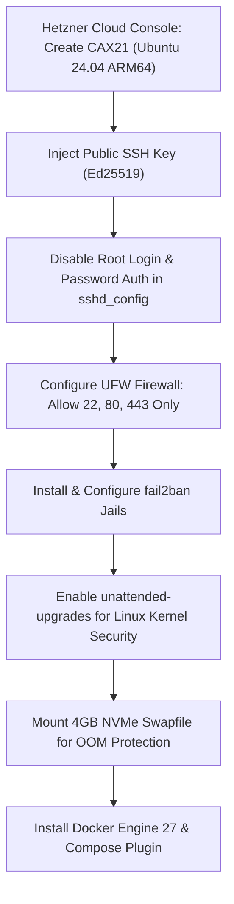
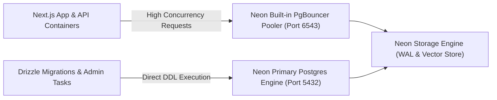
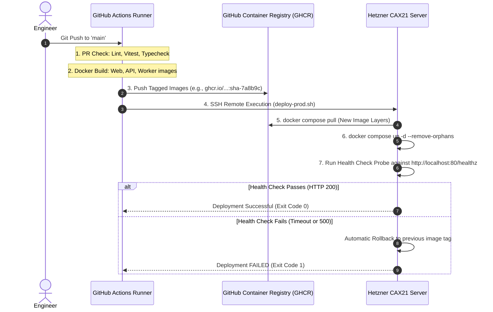
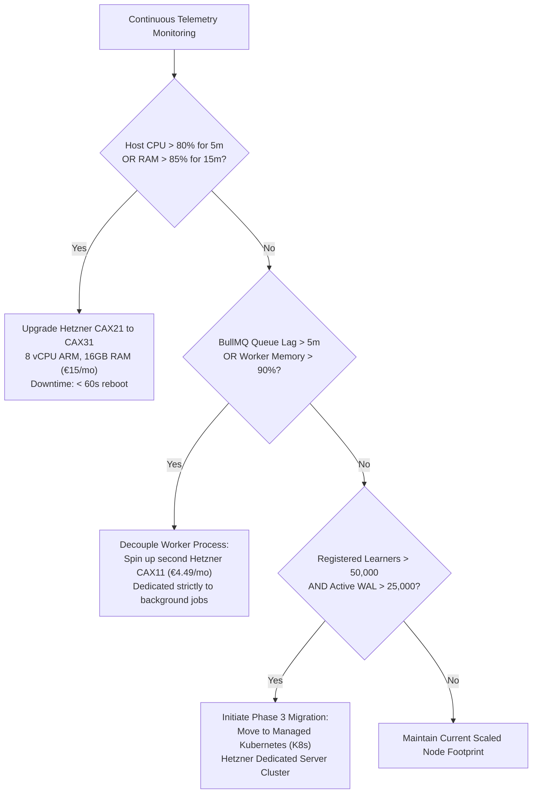

# Production Deployment & Infrastructure Runbook

> ⚠️ **Implementation note:** the codebase deploys as a **Rust** (Axum · Leptos) Docker stack behind Caddy. See [16-rust-implementation.md](../16-rust-implementation.md) and the up-to-date runbook [SETUP.md](../../SETUP.md). The Next.js deployment steps in this document are superseded.

| Metadata | Value |
|---|---|
| **Section Path** | `docs/06-platforms/08-deployment-guide.md` |
| **Version** | 1.0.0 |
| **Last Updated** | 2026-11-21 |
| **Related Docs** | [01-architecture.md](01-architecture.md), [05-budget-stack.md](../00-foundations/05-budget-stack.md), [07-local-dev-guide.md](07-local-dev-guide.md), [01-requirements-index.md](../14-appendices/01-requirements-index.md) |

---

## Table of Contents
1. [Server Provisioning & Host Hardening (Hetzner CAX21)](#1-server-provisioning--host-hardening-hetzner-cax21)
2. [Production Docker Compose Architecture](#2-production-docker-compose-architecture)
3. [Cloudflare Edge, DNS, WAF & Caching Configuration](#3-cloudflare-edge-dns-waf--caching-configuration)
4. [Neon Serverless Postgres Production Connectivity](#4-neon-serverless-postgres-production-connectivity)
5. [Cloudflare R2 Object Storage Infrastructure](#5-cloudflare-r2-object-storage-infrastructure)
6. [Automated CI/CD Deployment Pipeline (GitHub Actions)](#6-automated-cicd-deployment-pipeline-github-actions)
7. [Production Secret Management & Key Rotation](#7-production-secret-management--key-rotation)
8. [Monitoring, Observability & Alerting Architecture](#8-monitoring-observability--alerting-architecture)
9. [Automated Backup Strategy & Disaster Recovery Runbook](#9-automated-backup-strategy--disaster-recovery-runbook)
10. [Production Rollback Procedure & Incident Protocol](#10-production-rollback-procedure--incident-protocol)
11. [Infrastructure Scaling Triggers & Decision Tree](#11-infrastructure-scaling-triggers--decision-tree)

---

## 1. Server Provisioning & Host Hardening (Hetzner CAX21)

### 1.1 Purpose
Establishes the bare-metal provisioning and OS-level hardening runbook for the **Hetzner CAX21 VPS** (4 vCPU ARM Ampere, 8GB RAM, 80GB NVMe SSD @ €7.49/mo) hosted in the Falkenstein (FSN1) data center.

### 1.2 Host Hardening Flow Diagram


### 1.3 Step-by-Step Server Provisioning Runbook

```bash
#!/usr/bin/env bash
# scripts/server-provision.sh - Run as root upon initial Hetzner deployment
set -euo pipefail

echo "🔒 [1/7] Updating Base System Packages..."
apt-get update && apt-get upgrade -y
apt-get install -y ufw fail2ban unattended-upgrades curl git htop iotop ca-certificates gnupg

echo "👤 [2/7] Creating Dedicated Deploy User ('edu-deploy')..."
id -u edu-deploy &>/dev/null || adduser --disabled-password --gecos "" edu-deploy
usermod -aG sudo edu-deploy
mkdir -p /home/edu-deploy/.ssh
cp /root/.ssh/authorized_keys /home/edu-deploy/.ssh/
chown -R edu-deploy:edu-deploy /home/edu-deploy/.ssh
chmod 700 /home/edu-deploy/.ssh
chmod 600 /home/edu-deploy/.ssh/authorized_keys

echo "🛡️ [3/7] Hardening OpenSSH Server..."
cat << 'EOF' > /etc/ssh/sshd_config.d/99-hardened.conf
Port 22
PermitRootLogin no
PasswordAuthentication no
KbdInteractiveAuthentication no
X11Forwarding no
MaxAuthTries 3
ClientAliveInterval 300
ClientAliveCountMax 2
EOF
systemctl restart ssh

echo "🧱 [4/7] Configuring UFW Firewall..."
ufw default deny incoming
ufw default allow outgoing
ufw allow 22/tcp comment 'SSH Administration'
ufw allow 80/tcp comment 'HTTP ACME Challenge & Redirect'
ufw allow 443/tcp comment 'HTTPS Reverse Proxy'
ufw --force enable

echo "🚨 [5/7] Configuring fail2ban Intrusion Defense..."
cat << 'EOF' > /etc/fail2ban/jail.local
[DEFAULT]
bantime = 24h
findtime = 10m
maxretry = 5

[sshd]
enabled = true
port = 22
mode = aggressive
EOF
systemctl restart fail2ban

echo "💾 [6/7] Creating 4GB NVMe Swapfile for OOM Safety..."
if [ ! -f /swapfile ]; then
    fallocate -l 4G /swapfile
    chmod 600 /swapfile
    mkswap /swapfile
    swapon /swapfile
    echo '/swapfile none swap sw 0 0' >> /etc/fstab
    sysctl vm.swappiness=10
    echo 'vm.swappiness=10' >> /etc/sysctl.conf
fi

echo "🐳 [7/7] Installing Docker Engine 27 & Compose Plugin..."
install -m 0755 -d /etc/apt/keyrings
curl -fsSL https://download.docker.com/linux/ubuntu/gpg -o /etc/apt/keyrings/docker.asc
chmod a+r /etc/apt/keyrings/docker.asc
echo "deb [arch=arm64 signed-by=/etc/apt/keyrings/docker.asc] https://download.docker.com/linux/ubuntu noble stable" > /etc/apt/sources.list.d/docker.list
apt-get update
apt-get install -y docker-ce docker-ce-cli containerd.io docker-buildx-plugin docker-compose-plugin
usermod -aG docker edu-deploy

echo "✅ Hetzner CAX21 Host Hardening Complete. Ready for Deployment."
```

### 1.4 Edge Cases & Host Error Handling
| Threat / Edge Case | Failure Mode | Host Protection Mechanism | Operational Remediation |
|---|---|---|---|
| SSH Brute-Force Botnet | System CPU spike & port exhaustion | `fail2ban` detects 5 failed attempts within 10m; drops IP via iptables for 24h. | Unban false-positive IP via `fail2ban-client unbanip <IP>`. |
| Out of Memory (OOM) Spike | Linux kernel kills primary Node.js process | 4GB NVMe swapfile absorbs compilation/spike memory pressure; Docker memory limits enforce ceilings. | Investigate Prometheus memory graphs; restart affected container. |
| Automatic Kernel Upgrade | Server requires reboot post-patch | `unattended-upgrades` applies security patches at 03:00 UTC; auto-reboot enabled only if required. | Docker daemon configured with `"live-restore": true` to minimize downtime. |

---

## 2. Production Docker Compose Architecture

### 2.1 Purpose
Orchestrates all containerized microservices within strict memory and CPU budgets tailored to the Hetzner CAX21 (8,192 MB RAM maximum).

### 2.2 Production Manifest (`docker/docker-compose.prod.yml`)
```yaml
version: "3.9"

services:
  # ----------------------------------------------------------------------------
  # 1. NGINX REVERSE PROXY & SSL TERMINATION
  # ----------------------------------------------------------------------------
  nginx:
    image: nginx:1.26-alpine
    container_name: edu_nginx
    restart: unless-stopped
    ports:
      - "80:80"
      - "443:443"
    volumes:
      - ./nginx/nginx.prod.conf:/etc/nginx/nginx.conf:ro
      - ./nginx/ssl:/etc/nginx/ssl:ro
      - nginx_logs:/var/log/nginx
    networks:
      - edu-internal
    deploy:
      resources:
        limits:
          cpus: "0.25"
          memory: 128M
        reservations:
          memory: 64M
    healthcheck:
      test: ["CMD-SHELL", "wget -q -O /dev/null http://localhost:80/healthz || exit 1"]
      interval: 10s
      timeout: 3s
      retries: 3

  # ----------------------------------------------------------------------------
  # 2. NEXT.JS 15 APP ROUTER PWA (SSR & RSC)
  # ----------------------------------------------------------------------------
  next-app:
    image: ghcr.io/education-economy/edu-web:${IMAGE_TAG:-latest}
    container_name: edu_web
    restart: unless-stopped
    expose:
      - "3000"
    env_file:
      - .env.prod
    environment:
      - NODE_ENV=production
      - PORT=3000
    networks:
      - edu-internal
    deploy:
      resources:
        limits:
          cpus: "1.50"
          memory: 2048M
        reservations:
          memory: 1024M
    healthcheck:
      test: ["CMD-SHELL", "wget -q -O /dev/null http://localhost:3000/api/health || exit 1"]
      interval: 15s
      timeout: 5s
      retries: 3
    depends_on:
      redis:
        condition: service_healthy

  # ----------------------------------------------------------------------------
  # 3. REST & OPENAPI BACKEND ENGINE
  # ----------------------------------------------------------------------------
  api-server:
    image: ghcr.io/education-economy/edu-api:${IMAGE_TAG:-latest}
    container_name: edu_api
    restart: unless-stopped
    expose:
      - "4000"
    env_file:
      - .env.prod
    environment:
      - NODE_ENV=production
      - PORT=4000
    networks:
      - edu-internal
    deploy:
      resources:
        limits:
          cpus: "1.00"
          memory: 1536M
        reservations:
          memory: 768M
    healthcheck:
      test: ["CMD-SHELL", "wget -q -O /dev/null http://localhost:4000/healthz || exit 1"]
      interval: 15s
      timeout: 5s
      retries: 3
    depends_on:
      redis:
        condition: service_healthy

  # ----------------------------------------------------------------------------
  # 4. BULLMQ ASYNCHRONOUS WORKER
  # ----------------------------------------------------------------------------
  worker:
    image: ghcr.io/education-economy/edu-worker:${IMAGE_TAG:-latest}
    container_name: edu_worker
    restart: unless-stopped
    env_file:
      - .env.prod
    environment:
      - NODE_ENV=production
    networks:
      - edu-internal
    deploy:
      resources:
        limits:
          cpus: "0.75"
          memory: 1024M
        reservations:
          memory: 512M
    depends_on:
      redis:
        condition: service_healthy

  # ----------------------------------------------------------------------------
  # 5. REDIS (QUEUES, SESSIONS, AI RESPONSE CACHE)
  # ----------------------------------------------------------------------------
  redis:
    image: redis:7.4-alpine
    container_name: edu_redis
    restart: unless-stopped
    command: ["redis-server", "--appendonly", "yes", "--maxmemory", "400mb", "--maxmemory-policy", "allkeys-lru"]
    volumes:
      - redis_prod_data:/data
    networks:
      - edu-internal
    deploy:
      resources:
        limits:
          cpus: "0.25"
          memory: 512M
        reservations:
          memory: 256M
    healthcheck:
      test: ["CMD", "redis-cli", "ping"]
      interval: 10s
      timeout: 3s
      retries: 3

  # ----------------------------------------------------------------------------
  # 6. MEILISEARCH (FULL-TEXT CATALOG & RUBRIC SEARCH)
  # ----------------------------------------------------------------------------
  meilisearch:
    image: getmeili/meilisearch:v1.10
    container_name: edu_meilisearch
    restart: unless-stopped
    environment:
      - MEILI_ENV=production
      - MEILI_MASTER_KEY=${MEILISEARCH_MASTER_KEY}
      - MEILI_NO_ANALYTICS=true
    volumes:
      - meili_prod_data:/meili_data
    networks:
      - edu-internal
    deploy:
      resources:
        limits:
          cpus: "0.25"
          memory: 512M
        reservations:
          memory: 256M
    healthcheck:
      test: ["CMD-SHELL", "curl -f http://localhost:7700/health || exit 1"]
      interval: 15s
      timeout: 5s
      retries: 3

  # ----------------------------------------------------------------------------
  # 7. PROMETHEUS METRICS SCRAPER
  # ----------------------------------------------------------------------------
  prometheus:
    image: prom/prometheus:v2.54.1
    container_name: edu_prometheus
    restart: unless-stopped
    volumes:
      - ./prometheus/prometheus.yml:/etc/prometheus/prometheus.yml:ro
      - prom_prod_data:/prometheus
    networks:
      - edu-internal
    deploy:
      resources:
        limits:
          cpus: "0.25"
          memory: 256M
        reservations:
          memory: 128M

volumes:
  redis_prod_data:
  meili_prod_data:
  prom_prod_data:
  nginx_logs:

networks:
  edu-internal:
    driver: bridge
    ipam:
      config:
        - subnet: 172.28.0.0/16
```

---

## 3. Cloudflare Edge, DNS, WAF & Caching Configuration

### 3.1 DNS Architecture
- **Apex Record (`@`):** Type `A` pointing to Hetzner CAX21 IPv4, **Proxy Status: Proxied (Orange Cloud)**.
- **Wildcard (`*`):** Type `CNAME` pointing to `educationeconomy.org`, **Proxied**.
- **DNSSEC:** Enabled on Cloudflare Registrar with SHA-256 DS records.

### 3.2 Cloudflare WAF & Security Rules
1. **SSL/TLS Encryption Mode:** **Full (Strict)**. Nginx on Hetzner serves a Cloudflare Origin Certificate (15-year validity).
2. **Minimum TLS Version:** **TLS 1.3** enforced; weak ciphers disabled.
3. **Web Application Firewall (WAF) Managed Rules:** Cloudflare Managed Ruleset enabled with sensitivity set to *Medium*.
4. **Rate Limiting Rule 1 (`/api/auth/*`):** Maximum 10 requests per minute per IP address. Action: *Managed Challenge*.
5. **Rate Limiting Rule 2 (`/api/v1/tutor/stream`):** Maximum 30 requests per minute per learner session token. Action: *Block (HTTP 429)*.

### 3.3 Page Rules & Edge Caching Matrix
| URL Pattern | Cache Level | Edge TTL | Browser TTL | Purge Strategy |
|---|---|---|---|---|
| `*educationeconomy.org/_next/static/*` | Cache Everything | 30 Days | 30 Days (Immutable) | Automated on GitHub Actions release |
| `*educationeconomy.org/api/v1/catalog/*`| Cache Everything | 24 Hours | 1 Hour (`stale-while-revalidate`) | BullMQ worker emits purge API call upon skill edit |
| `*educationeconomy.org/api/v1/ledger/*` | Bypass Cache | 0 Seconds | No Store (`no-cache`) | Never cached (Strict ACID requirement) |
| `*educationeconomy.org/api/v1/auth/*`   | Bypass Cache | 0 Seconds | No Store | Never cached |

---

## 4. Neon Serverless Postgres Production Connectivity

### 4.1 Connection Architecture
Production workloads utilize Neon's **Launch Plan ($19.00/month)** to ensure zero cold-start latencies and dedicated compute.



### 4.2 Production Connection Pool Tuning
```typescript
// packages/db/src/client.ts
import { neon, neonConfig } from '@neondatabase/serverless';
import { drizzle } from 'drizzle-orm/neon-http';
import * as schema from './schema';

neonConfig.fetchConnectionCache = true;

// Use pooled connection string in production to eliminate connection saturation
const connectionString = process.env.NODE_ENV === 'production' 
  ? process.env.DATABASE_POOLED_URL! 
  : process.env.DATABASE_URL!;

if (!connectionString) {
  throw new Error('FATAL: DATABASE_URL is not defined in runtime environment.');
}

const sql = neon(connectionString);
export const db = drizzle(sql, { schema });
```

---

## 5. Cloudflare R2 Object Storage Infrastructure

### 5.1 Storage Architecture
Cloudflare R2 provides S3-compatible object storage with **$0.00 data egress fees**.
- **Public Bucket (`edu-media-prod`):** Stores static skill diagrams, public author avatars, and badge imagery. Served via Cloudflare CDN caching.
- **Private Bucket (`edu-artifacts-prod`):** Stores learner portfolio submissions, proctoring snapshots, and automated database dumps. Strictly inaccessible via public URL; accessed only via HMAC-signed presigned URLs with a 15-minute expiration.

### 5.2 R2 Presigned Upload URL Generator
```typescript
// packages/storage/src/presigner.ts
import { S3Client, PutObjectCommand } from '@aws-sdk/client-s3';
import { getSignedUrl } from '@aws-sdk/s3-request-presigner';

const r2 = new S3Client({
  region: 'auto',
  endpoint: `https://${process.env.R2_ACCOUNT_ID}.r2.cloudflarestorage.com`,
  credentials: {
    accessKeyId: process.env.R2_ACCESS_KEY_ID!,
    secretAccessKey: process.env.R2_SECRET_ACCESS_KEY!
  }
});

export async function generateArtifactUploadUrl(userId: string, skillId: string, level: number, fileExtension: string) {
  const fileKey = `submissions/${userId}/${skillId}_L${level}_${Date.now()}.${fileExtension}`;
  
  const command = new PutObjectCommand({
    Bucket: process.env.R2_BUCKET_NAME || 'edu-artifacts-prod',
    Key: fileKey,
    ContentType: fileExtension === 'pdf' ? 'application/pdf' : 'image/webp'
  });

  // Presigned URL valid for exactly 15 minutes (900 seconds)
  const uploadUrl = await getSignedUrl(r2, command, { expiresIn: 900 });
  return { uploadUrl, fileKey };
}
```

---

## 6. Automated CI/CD Deployment Pipeline (GitHub Actions)

### 6.1 Purpose
Delivers continuous integration and zero-downtime deployment from GitHub commits directly to the Hetzner CAX21 VPS using the GitHub Container Registry (GHCR).

### 6.2 Pipeline Workflow Diagram


### 6.3 Complete GitHub Actions Workflow (`.github/workflows/deploy.yml`)
```yaml
name: Production Deployment Pipeline

on:
  push:
    branches: [ main ]

jobs:
  validate:
    runs-on: ubuntu-latest
    steps:
      - uses: actions/checkout@v4
      - uses: pnpm/action-setup@v3
        with:
          version: 9.12.0
      - uses: actions/setup-node@v4
        with:
          node-version: 20
          cache: 'pnpm'
      - run: pnpm install --frozen-lockfile
      - run: pnpm lint
      - run: pnpm typecheck
      - run: pnpm test:unit

  build-and-push:
    needs: validate
    runs-on: ubuntu-latest
    permissions:
      contents: read
      packages: write
    steps:
      - uses: actions/checkout@v4
      - uses: docker/setup-buildx-action@v3
      - uses: docker/login-action@v3
        with:
          registry: ghcr.io
          username: ${{ github.actor }}
          password: ${{ secrets.GITHUB_TOKEN }}

      - name: Build and Push Web App Image
        uses: docker/build-push-action@v5
        with:
          context: .
          file: ./apps/web/Dockerfile
          platforms: linux/arm64
          push: true
          tags: |
            ghcr.io/${{ github.repository }}/edu-web:latest
            ghcr.io/${{ github.repository }}/edu-web:${{ github.sha }}

  deploy:
    needs: build-and-push
    runs-on: ubuntu-latest
    steps:
      - name: Deploy via SSH to Hetzner CAX21
        uses: appleboy/ssh-action@v1.0.3
        with:
          host: ${{ secrets.HETZNER_VPS_IP }}
          username: edu-deploy
          key: ${{ secrets.HETZNER_SSH_PRIVATE_KEY }}
          script: |
            cd /home/edu-deploy/edu-economy
            echo "IMAGE_TAG=${{ github.sha }}" > .env.deploy
            docker compose -f docker/docker-compose.prod.yml pull
            docker compose -f docker/docker-compose.prod.yml up -d --remove-orphans
            
            # Health check probe
            sleep 10
            if curl -f http://localhost:80/healthz; then
              echo "✅ Deployment Verified Healthy."
            else
              echo "🚨 Health Check FAILED. Executing Rollback..."
              docker compose -f docker/docker-compose.prod.yml rollback
              exit 1
            fi
```

---

## 7. Production Secret Management & Key Rotation

### 7.1 Secret Storage Hierarchy
1. **Source of Truth:** Master encrypted secrets reside in **GitHub Repository Secrets**.
2. **Host Injection:** Secrets are securely transferred to `/home/edu-deploy/edu-economy/.env.prod` with permissions restricted to `chmod 600`.
3. **Container Injection:** Docker Compose reads `.env.prod` and passes specific environment keys into container runtimes without writing to images.

### 7.2 Key Rotation Cadence & Runbook
- **Auth Secrets (`AUTH_SECRET`):** Rotated every 90 days. Changing the secret invalidates active sessions, triggering re-login via magic links.
- **Database Credentials:** Rotated via the Neon Console. Zero-downtime rotation: generate second user $\to$ update `.env.prod` $\to$ restart containers $\to$ drop old user.
- **OpenAI API Key:** Rotated bi-annually or immediately upon suspected leakage.

---

## 8. Monitoring, Observability & Alerting Architecture

### 8.1 Metrics Pipeline
1. **Container Exporters:** Nginx, Redis, and Node.js expose `/metrics` Prometheus endpoints on the `edu-internal` network.
2. **Prometheus:** Scrapes targets every 15 seconds, storing metrics locally in a 24-hour circular buffer.
3. **Grafana Agent:** Forwards filtered metric series to **Grafana Cloud Free Tier** (under the 10,000 active series limit).

### 8.2 Production Alert Rules
```yaml
# prometheus/alerts.yml
groups:
  - name: ProductionSLOs
    rules:
      - alert: HighApiLatencyP95
        expr: histogram_quantile(0.95, sum(rate(http_request_duration_seconds_bucket[5m])) by (le)) > 0.500
        for: 5m
        labels:
          severity: warning
        annotations:
          summary: "API p95 latency exceeded 500ms for 5 minutes."

      - alert: HighHttpErrorRate
        expr: sum(rate(http_requests_total{status=~"5.."}[5m])) / sum(rate(http_requests_total[5m])) > 0.01
        for: 3m
        labels:
          severity: critical
        annotations:
          summary: "HTTP 5xx error rate is above 1.0%."

      - alert: HostDiskSpaceRunningLow
        expr: (node_filesystem_avail_bytes{mountpoint="/"} / node_filesystem_size_bytes{mountpoint="/"}) < 0.20
        for: 10m
        labels:
          severity: critical
        annotations:
          summary: "Host root NVMe has less than 20% available disk space."
```

---

## 9. Automated Backup Strategy & Disaster Recovery Runbook

### 9.1 Automated Daily Database Backup Script
```bash
#!/usr/bin/env bash
# scripts/nightly-backup.sh - Executed daily at 02:00 UTC via cron
set -euo pipefail

BACKUP_DATE=$(date +"%Y%m%d_%H%M%S")
BACKUP_FILE="/tmp/edu_db_${BACKUP_DATE}.sql.gz"

echo "📦 [1/3] Executing pg_dump from Neon Primary..."
pg_dump "${DATABASE_URL}" | gzip > "${BACKUP_FILE}"

echo "☁️ [2/3] Uploading Encrypted Dump to Cloudflare R2..."
aws s3 cp "${BACKUP_FILE}" "s3://edu-backups-prod/db/${BACKUP_DATE}.sql.gz" \
  --endpoint-url "https://${R2_ACCOUNT_ID}.r2.cloudflarestorage.com"

echo "🧹 [3/3] Cleaning up temporary local file..."
rm -f "${BACKUP_FILE}"
echo "✅ Database Backup Complete: ${BACKUP_DATE}.sql.gz"
```

### 9.2 Exact Database Restore Procedure
To restore a snapshot into an empty database or staging branch:
```bash
# 1. Download desired dump from Cloudflare R2
aws s3 cp s3://edu-backups-prod/db/20261121_020000.sql.gz ./restore.sql.gz \
  --endpoint-url "https://${R2_ACCOUNT_ID}.r2.cloudflarestorage.com"

# 2. Decompress and pipe directly into Neon database connection
gunzip -c ./restore.sql.gz | psql "${TARGET_DATABASE_URL}"

# 3. Re-run catalog indexer to sync Meilisearch with restored state
pnpm --filter @edu/worker job:reindex-search
```

---

## 10. Production Rollback Procedure & Incident Protocol

### 10.1 Rollback Sequence
If a bad release escapes staging and breaches error guardrails:

```bash
# Step 1: SSH into production Hetzner host
ssh edu-deploy@${HETZNER_VPS_IP}
cd /home/edu-deploy/edu-economy

# Step 2: Identify previous stable container image SHA
docker images ghcr.io/education-economy/edu-web --format "{{.Tag}} {{.CreatedAt}}"

# Step 3: Roll back to previous image tag
export IMAGE_TAG="previous-stable-sha"
docker compose -f docker/docker-compose.prod.yml up -d

# Step 4: If database migrations broke backwards compatibility:
pnpm --filter @edu/db drizzle-kit drop-migration
```

### 10.2 User Status Communication Protocol
1. **Minor Incident (Degraded AI Tutor):** Display in-app toast: *"AI Tutor is currently operating in offline mode with static hints."*
2. **Major Incident (Ledger Write Lock):** Cloudflare activates Custom Error Page (HTTP 503): *"Education Economy ledger maintenance in progress. Your earned balances and progress are safe. Back online shortly."*

---

## 11. Infrastructure Scaling Triggers & Decision Tree


