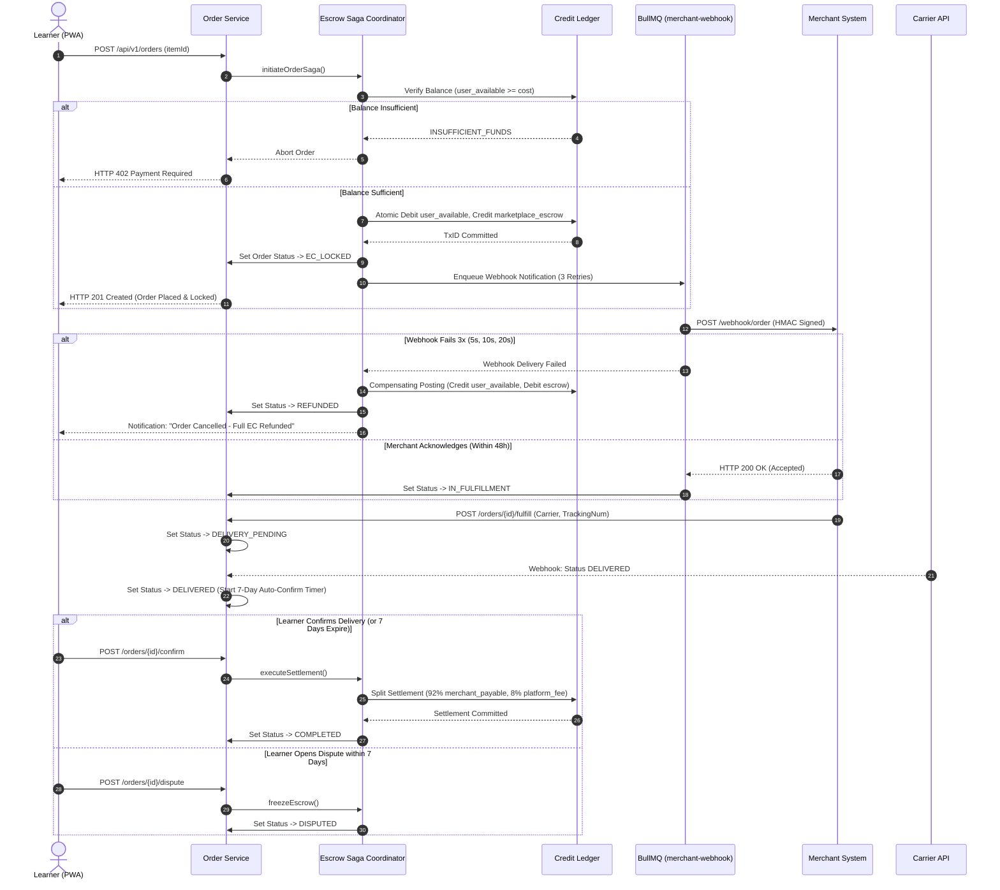
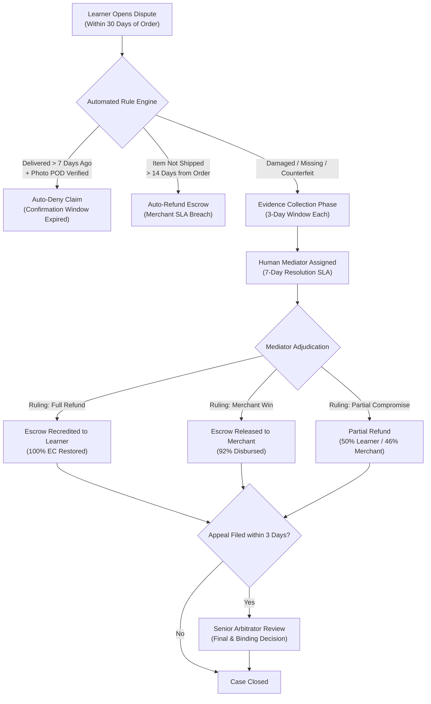

# Marketplace Overview

**Title:** NovaWorth Marketplace Architecture and Settlement Overview  
**Section Path:** `docs/08-marketplace/01-marketplace-overview.md`  
**Version:** 1.1.0  
**Last Updated:** 2026-11-21  
**Status:** Approved for Implementation  
**Related Documents:**
- `docs/01-economy/02-points-ledger.md` (Double-entry credit ledger)
- `docs/01-economy/06-marketplace-economics.md` (Marketplace macro-reserves and anti-inflation)
- `docs/08-marketplace/04-fulfillment-disputes.md` (Fulfillment SLAs and customer support)
- `docs/15-lld/08-marketplace-escrow.md` (Low-Level Design: Marketplace & Escrow System)

---

## Table of Contents
1. [Purpose](#1-purpose)
2. [Principles](#2-principles)
3. [Categories](#3-categories)
   - [3.1 Restricted Items](#31-restricted)
4. [Learner Flow](#4-learner-flow)
   - [4.1 States](#41-states)
5. [Escrow Principles](#5-escrow)
6. [Regional Model](#6-regional-model)
7. [Fraud and Abuse Controls](#7-fraud-and-abuse)
8. [High-Level Metrics](#8-metrics)
9. [Baseline Requirements](#9-requirements)
10. [Escrow Distributed Saga Flow](#10-escrow-distributed-saga-flow)
    - [10.1 Purpose](#101-purpose)
    - [10.2 Sequence Flow Diagram](#102-sequence-flow-diagram)
    - [10.3 Saga Execution & Compensating Logic](#103-saga-execution--compensating-logic)
    - [10.4 Edge Cases](#104-edge-cases)
    - [10.5 Error Handling](#105-error-handling)
    - [10.6 Requirements](#106-requirements)
    - [10.7 Success Metrics](#107-success-metrics)
11. [Regional Anchor Pricing & Purchasing Power Parity](#11-regional-anchor-pricing--purchasing-power-parity)
    - [11.1 Purpose](#111-purpose)
    - [11.2 Regional Pricing Anchor Table](#112-regional-pricing-anchor-table)
    - [11.3 Price Computation & Anti-Arbitrage Logic](#113-price-computation--anti-arbitrage-logic)
    - [11.4 Edge Cases](#114-edge-cases)
    - [11.5 Error Handling](#115-error-handling)
    - [11.6 Requirements](#116-requirements)
    - [11.7 Success Metrics](#117-success-metrics)
12. [Dispute Resolution Architecture](#12-dispute-resolution-architecture)
    - [12.1 Purpose](#121-purpose)
    - [12.2 Resolution Flowchart](#122-resolution-flowchart)
    - [12.3 Automated Decision Engine](#123-automated-decision-engine)
    - [12.4 Edge Cases](#124-edge-cases)
    - [12.5 Error Handling](#125-error-handling)
    - [12.6 Requirements](#126-requirements)
    - [12.7 Success Metrics](#127-success-metrics)
13. [Merchant Rating & Health Protocol](#13-merchant-rating--health-protocol)
    - [13.1 Purpose](#131-purpose)
    - [13.2 Rating Formulation & CSAT Calculation](#132-rating-formulation--csat-calculation)
    - [13.3 Auto-Suspension & Recovery Rules](#133-auto-suspension--recovery-rules)
    - [13.4 Edge Cases](#134-edge-cases)
    - [13.5 Error Handling](#135-error-handling)
    - [13.6 Requirements](#136-requirements)
    - [13.7 Success Metrics](#137-success-metrics)
14. [Comprehensive Marketplace Edge Cases Matrix](#14-comprehensive-marketplace-edge-cases-matrix)

---

## 1. Purpose

The marketplace turns verified learning into real-world consequence. It must be useful, fair, safe, and operationally reliable — not an infinite bazaar.

**Promise:** "Learn something real, earn credits, get something you actually need."

---

## 2. Principles

1. **Essentials first.** Food, hygiene, transport, utilities, basic tools.
2. **No pay-to-win.** Money cannot buy XP, levels, passes, or prestige.
3. **Transparent pricing.** Same price for everyone in a region.
4. **Funded promises.** Every EC is backed by reserves.
5. **Curated catalog.** Reliability over breadth.
6. **Local first.** Regional partners and baskets.
7. **Dignity.** Redemption is private.
8. **Safety.** Restricted categories are banned.

---

## 3. Categories

| Category | Examples | Cap |
|---|---|---|
| Essentials | Groceries, hygiene, transit, utilities | Region-specific |
| Tools & devices | Laptop, phone, headphones, tools | 1 major/quarter |
| Services | Repairs, tutoring, care, home | 2–4/month |
| Experiences | Museums, events, travel, sports | 1–2/month |
| Learning upgrades | Exam fees, mentorship, sims | Uncapped |
| AI services | Tutor credits, agent runs | Usage-based |
| Status/cosmetic | Profile themes, banners | Cosmetic only |

### 3.1 Restricted
- Alcohol, tobacco, gambling, weapons, adult content.
- Crypto, cash equivalents, speculative products.
- Prescription drugs, medical devices (without review).
- Exam answer services, cheating tools.
- Anything illegal in the region.

---

## 4. Learner flow

```
Wallet → Redeem
→ Category → Item
→ Price + fees + ETA
→ Confirm → Escrow
→ Fulfillment → Delivery
→ Confirm → Rate
```

### 4.1 States
| State | Behavior |
|---|---|
| Insufficient EC | Savings goal + estimate |
| Out of stock | Waitlist with ETA |
| Address required | Form + validation |
| Minor | Guardian approval |
| High-value | Extra verification |
| Dispute | Support case |

---

## 5. Escrow

- EC is held in escrow on order.
- Merchant is paid after confirmed fulfillment.
- Refund returns EC to wallet.
- Dispute freezes escrow.
- No merchant access to learner funds.

---

## 6. Regional model

| Region | Anchor | Essentials basket | Partners |
|---|---|---|---|
| US/EU | $0.05 | Groceries, transit, utilities | Local chains |
| India | $0.02 | Staples, transit, mobile | Local kirana |
| Brazil | $0.03 | Groceries, transport | Local |
| Kenya | $0.02 | Staples, mobile money | Local |
| Philippines | $0.02 | Groceries, transport | Local |

Prices are localized; EC is global.

---

## 7. Fraud and abuse

| Risk | Control |
|---|---|
| Fake orders | Address verification, device checks |
| Self-redemption | Merchant-employee checks |
| Collusion | Graph analysis |
| Chargebacks | Escrow, reserves |
| Counterfeits | Vetted partners, audits |
| Account takeover | MFA, anomaly detection |

---

## 8. Metrics

| Metric | Target |
|---|---|
| Redemption success | ≥97% |
| Fulfillment <7 days | ≥90% |
| CSAT | ≥4.3/5 |
| Dispute rate | <3% |
| Refund time | <5 days |
| Fraud loss | <1% of EC |
| Essentials coverage | ≥1.2× demand |
| Waitlist accuracy | ±20% ETA |

---

## 9. Requirements

- `FR-MKT-101`: Every price is public and versioned.
- `FR-MKT-102`: EC is held in escrow until fulfillment.
- `FR-MKT-103`: Refunds return EC to wallet.
- `FR-MKT-104`: Essentials have caps and priority.
- `FR-MKT-105`: Restricted categories are blocked.
- `FR-MKT-106`: Minors require guardian approval.
- `FR-MKT-107`: Waitlists show ETA.
- `FR-MKT-108`: Every order has a dispute path.
- `FR-MKT-109`: No personalized pricing.
- `FR-MKT-110`: No cash-out.
- `NFR-MKT-101`: Catalog search <300 ms.
- `NFR-MKT-102`: Order placement <2 s.
- `NFR-MKT-103`: 99.9% order API availability.

---

## 10. Escrow Distributed Saga Flow

### 10.1 Purpose
The Escrow Saga coordinates asynchronous operations across the double-entry credit ledger, external merchant webhooks, carrier logistics APIs, and learner confirmation interfaces without distributed deadlocks or orphan balances.

### 10.2 Sequence Flow Diagram



### 10.3 Saga Execution & Compensating Logic
- **Step 1: Balance Validation**: Synchronous read against Neon Postgres ledger view. If funds are insufficient, no write is initiated.
- **Step 2: Atomic Escrow Lock**: Debit `user_available`, Credit `marketplace_escrow`.
- **Step 3: Merchant Webhook Dispatch**: Queued via BullMQ. If partner fails to accept within 48 hours, compensating transaction reverses the lock.
- **Step 4: Fulfillment & Carrier Sync**: Tracking number is validated against carrier APIs.
- **Step 5: Settlement**: Upon delivery confirmation (explicit or 7-day auto-confirm), the locked balance is split:
  $$\text{Merchant Share} = \lfloor \text{Locked EC} \times 0.92 \rfloor$$
  $$\text{Platform Fee} = \text{Locked EC} - \text{Merchant Share}$$

### 10.4 Edge Cases
- **Simultaneous Cancellation and Delivery**: Learner clicks cancel while carrier webhook registers delivery. Order status is protected by optimistic concurrency versioning; carrier delivery takes precedence.
- **Ledger Connection Loss During Split**: Redis job retries using idempotency key `settle-{orderId}`; ledger prevents duplicate credits.

### 10.5 Error Handling
- Failed saga steps dispatch alarms to the dead-letter queue (`escrow-saga-dlq`) and auto-trigger matching compensating refunds when recoverable.

### 10.6 Requirements
- `FR-MKT-111`: Every escrow debit must execute as an immutable double-entry ledger transaction.
- `FR-MKT-112`: If merchant fails to acknowledge an order within 48 hours, escrow must auto-refund to the learner.

### 10.7 Success Metrics
- Escrow locking transaction failure rate: $< 0.01\%$.
- Average saga completion duration: $< 5$ minutes from learner checkout to merchant acknowledgment.

---

## 11. Regional Anchor Pricing & Purchasing Power Parity

### 11.1 Purpose
Because Education Credits (EC) measure rigorous cognitive effort and skill acquisition, the base reward formula is invariant across borders:
$$EC(L) = 10 \times L^{1.2} \times m_d \times Q \times E \times M \times R$$

To prevent severe inequality in redemption utility, regional anchor rates peg EC purchasing power to local economic baselines without permitting digital cross-border arbitrage.

### 11.2 Regional Pricing Anchor Table

| Region Code | Geographic Coverage | Anchor Rate (USD / EC) | 1,000 EC Purchasing Power | Typical Essentials Basket Equivalent |
|---|---|:---:|:---:|---|
| `US_EU` | United States, European Union, UK, Canada | **$0.050** | **$50.00 USD** | 1 month public transit pass or grocery staple box |
| `INDIA` | India, South Asia | **$0.020** | **$20.00 USD** (~₹1,660 INR) | 2 weeks groceries (rice, dal, cooking oil) + mobile data |
| `SSA` | Sub-Saharan Africa (Kenya, Nigeria, Ghana) | **$0.020** | **$20.00 USD** (~2,600 KES) | Solar utility recharge + mobile money staples |
| `SEA` | Southeast Asia (Philippines, Vietnam, Indonesia) | **$0.025** | **$25.00 USD** (~1,400 PHP) | 2 weeks transit + grocery staples |
| `LATAM` | Latin America (Brazil, Colombia, Mexico) | **$0.030** | **$30.00 USD** (~150 BRL) | 1 month utility voucher + transit card recharge |

### 11.3 Price Computation & Anti-Arbitrage Logic

```typescript
export interface RegionalPriceResult {
  ecPrice: number;
  allowed: boolean;
  reason?: string;
}

export function computeRegionalItemPrice(
  itemUsdCost: number,
  learnerRegion: 'US_EU' | 'INDIA' | 'SSA' | 'SEA' | 'LATAM',
  itemAllowedRegions: string[]
): RegionalPriceResult {
  if (!itemAllowedRegions.includes(learnerRegion)) {
    return {
      ecPrice: 0,
      allowed: false,
      reason: `Item fulfillment is restricted in your verified region (${learnerRegion}).`,
    };
  }

  const ANCHOR_RATES: Record<string, number> = {
    US_EU: 0.05,
    INDIA: 0.02,
    SSA: 0.02,
    SEA: 0.025,
    LATAM: 0.03,
  };

  const rate = ANCHOR_RATES[learnerRegion] ?? 0.05;
  const calculatedEc = Math.ceil(itemUsdCost / rate);

  return {
    ecPrice: calculatedEc,
    allowed: true,
  };
}
```

### 11.4 Edge Cases
- **Regional Anchor Rate Adjustments**: When exchange rates fluctuate, anchor rate revisions apply only to newly created orders. Existing orders maintain the rate locked in `orders.regional_anchor_rate`.
- **Learner Relocation**: Relocating to a new country requires verified residential documentation. Until approved, catalog redemptions remain locked to the registered country.

### 11.5 Error Handling
- Attempted checkout from an unverified region returns `403 Forbidden: REGIONAL_FULFILLMENT_LOCKED`.

### 11.6 Requirements
- `FR-MKT-113`: Catalog display prices must compute dynamically using verified profile country anchor rates.
- `FR-MKT-114`: Cross-border physical deliveries are blocked at checkout.

### 11.7 Success Metrics
- Cross-border arbitrage leakage: 0%.
- Price calculation latency: P99 $< 10\text{ ms}$.

---

## 12. Dispute Resolution Architecture

### 12.1 Purpose
The Dispute Resolution Architecture provides a fair, transparent, and auditable mediation pipeline that balances learner protection with merchant solvency.

### 12.2 Resolution Flowchart



### 12.3 Automated Decision Engine
- **Auto-Refund Condition**: Order is in `IN_FULFILLMENT` or `DELIVERY_PENDING` without valid tracking for $> 14\text{ calendar days}$.
- **Auto-Deny Condition**: Carrier API confirms physical delivery with photo Proof of Delivery (POD) and learner contested $> 7\text{ days}$ post-delivery.
- **Evidence Window**: Both parties have exactly 72 hours (3 calendar days) to upload photos, serial numbers, or police reports to Cloudflare R2 before mediator evaluation.

### 12.4 Edge Cases
- **Merchant Non-Response**: If merchant fails to upload evidence within 72 hours, dispute auto-resolves as `FULL_REFUND` to the learner.
- **Unboxing Video Requirement**: High-value tools ($> 500\text{ EC}$) require photo/video evidence from the learner to initiate damaged-in-transit disputes.

### 12.5 Error Handling
- Disputed orders freeze escrow release flags in the database, preventing any batch settlement from liquidating funds while contested.

### 12.6 Requirements
- `FR-MKT-115`: Disputes must be submitted within 30 days of initial order creation.
- `FR-MKT-116`: Unresolved human mediation cases must escalate to senior review if not settled within 7 days.

### 12.7 Success Metrics
- Average dispute resolution duration: $< 4.5$ calendar days.
- Learner dispute appeal rate: $< 5\%$.

---

## 13. Merchant Rating & Health Protocol

### 13.1 Purpose
To maintain a high-trust marketplace, partner performance is continuously evaluated against automated customer satisfaction, fulfillment speed, and dispute thresholds.

### 13.2 Rating Formulation & CSAT Calculation

A merchant’s rolling 30-day composite health score $H_{\text{merchant}}$ is calculated as:

$$H_{\text{merchant}} = (\text{CSAT} \times 0.40) + (\text{Fulfillment Rate} \times 0.35) + ((1 - \text{Dispute Rate}) \times 0.25)$$

Where:
- $\text{CSAT}$: Average learner rating on completed orders ($1.0 \le \text{CSAT} \le 5.0$, normalized to $0.0 - 1.0$ by dividing by 5.0)
- $\text{Fulfillment Rate}$: Ratio of orders shipped within category SLA to total accepted orders
- $\text{Dispute Rate}$: Contested dispute cases divided by total completed orders

### 13.3 Auto-Suspension & Recovery Rules
- **Suspension Ceiling**: If rolling CSAT drops below **3.5 / 5.0** or rolling dispute rate exceeds **10%**, the system:
  1. Sets all merchant catalog items to `isActive: false`.
  2. Freezes pending payouts in `merchant_payable`.
  3. Sends automated alert via Resend to the partner operations team.
- **Reinstatement**: Requires resolving outstanding disputes and completing an operational audit with platform management.

### 13.4 Edge Cases
- **Low-Volume Statistical Skew**: New merchants with fewer than 10 total orders are exempt from automated suspension; flags trigger manual human review instead.

### 13.5 Error Handling
- Health score evaluation jobs run nightly via BullMQ. Failed score calculations alert the DevOps channel and preserve previous active states.

### 13.6 Requirements
- `FR-MKT-117`: Any merchant exceeding a 10% rolling dispute rate must be auto-suspended within 60 seconds of nightly score calculation.
- `FR-MKT-118`: Suspended merchants cannot accept new orders or withdraw payable funds until audited.

### 13.7 Success Metrics
- Marketplace-wide merchant dispute rate: $< 2.5\%$.
- Merchant SLA adherence rate: $\ge 95\%$.

---

## 14. Comprehensive Marketplace Edge Cases Matrix

The following table documents **16 critical operational edge cases** across order placement, fulfillment, escrow, and settlement:

| # | Scenario | Root Cause | System Behavior & Mitigation | Financial / Ledger Impact |
|---|---|---|---|---|
| **1** | **EC Balance Equals Item Cost** | Learner has exactly 500 EC; item costs 500 EC. | Transaction proceeds without restriction. Available balance drops to exactly 0 EC. No float or buffer required. | Debit 500 EC `user_available`, Credit 500 EC `marketplace_escrow`. |
| **2** | **Merchant Webhook Failure** | Partner server offline or returning HTTP 5xx. | BullMQ retries 3 times (5s, 10s, 20s). If still failing, alerts staff via Resend. Order stays in `EC_LOCKED` up to 48h before auto-cancel. | If cancelled, refund saga re-credits `user_available`. |
| **3** | **Learner Banned Mid-Escrow** | Student caught using AI proctoring bypass during active order. | Active escrow is frozen (`DISPUTED`). Physical shipments recalled if possible. Escrow held until academic investigation concludes. | If fraud proven, refund cancelled; EC seized to `fraud_reserve`. |
| **4** | **Item Depleted Post-Order** | Concurrency race causes stock out at physical warehouse. | Merchant marks order `REJECTED_OUT_OF_STOCK`. Order status transitions to `REFUNDED`. | Full refund transaction credited back to learner `user_available`. |
| **5** | **Merchant Bankruptcy** | Partner ceases business operations mid-fulfillment. | Platform absorbs fulfillment loss from `treasury_reserve`. Pending orders auto-refunded to learners in EC. | Escrow returned to learners; unrecoverable costs debited from treasury. |
| **6** | **Anchor Rate Change Mid-Order** | Platform updates India rate from $0.02 to $0.025 while in transit. | Price is immutable at checkout. Order persists historical rate locked in `orders.regional_anchor_rate`. | No retroactive ledger adjustment. |
| **7** | **Minor Order > 500 EC** | Learner under 18 attempts high-tier redemption. | Order placed in `PENDING_GUARDIAN_APPROVAL`. Guardian has 48h to approve via email/app link. | Escrow not debited until guardian explicitly approves. |
| **8** | **Rapid Double-Click Checkout** | Learner taps "Place Order" button twice rapidly. | API enforces client-generated `Idempotency-Key` header. Second request returns cached original response. | Single escrow debit; zero duplicate charges. |
| **9** | **Carrier Destroys Item** | Carrier tracking API marks package `DAMAGED_DESTROYED`. | System transitions order directly to `REFUNDED` and prompts merchant to submit commercial carrier insurance claim. | Escrow fully refunded to learner `user_available`. |
| **10**| **Counterfeit Item Received** | Partner ships unauthentic hardware to learner. | Dispute filed under `COUNTERFEIT`. Order frozen. Senior mediator requires supplier invoices. If fake, merchant banned. | Full refund to learner; merchant payable penalized. |
| **11**| **Carrier Reuses Tracking Code** | Courier tracking number shows delivery from prior year. | Fulfillment service checks scan timestamp against `order.created_at`. Outdated scans are rejected. | Order remains in `IN_FULFILLMENT` awaiting valid scan. |
| **12**| **Learner Refuses Delivery** | Recipient declines package at door; returned to sender. | Courier webhook logs RTS. Upon receipt by merchant, learner refunded minus actual shipping costs. | Partial refund: Credit learner net balance, Credit merchant restocking fee. |
| **13**| **Digital Key Revocation** | Third-party software vendor revokes voucher 5 days post-delivery. | Learner files dispute within 30-day window. Escrow already settled, so platform debits merchant future payable balance. | Debit `merchant_payable`, Credit `user_available`. |
| **14**| **Dispute After Auto-Confirm** | Learner returns from trip on Day 10 (after 7-day window closed). | Standard dispute closed. Case handled via exception queue. If legitimate carrier error, platform covers from `fraud_reserve`. | Platform absorbs loss; merchant settlement remains intact. |
| **15**| **Split Courier Shipments** | Order ships in 2 separate boxes via different carriers. | `fulfillment_events` logs multiple tracking records. Auto-confirm timer triggers only after *all* packages reach `DELIVERED`. | Escrow held until final package confirmed delivered. |
| **16**| **Platform Fee Rounding Discrepancy** | Order cost 105 EC: 92% is 96.6 EC; 8% is 8.4 EC. | Floating point math banned. Calculated via integer floor: Merchant gets $\lfloor 105 \times 0.92 \rfloor = 96$ EC; Fee gets $105 - 96 = 9$ EC. | Debits: 105 EC. Credits: 96 + 9 = 105 EC. Ledger perfectly balanced. |

---
