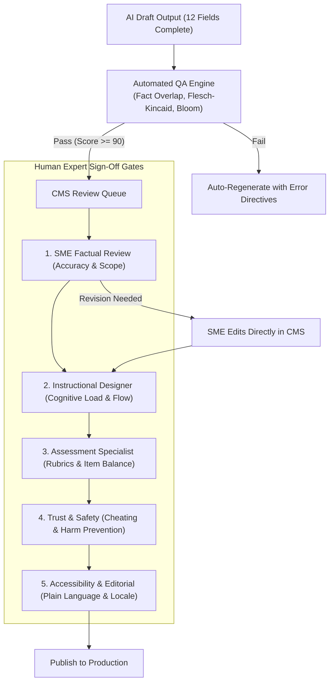
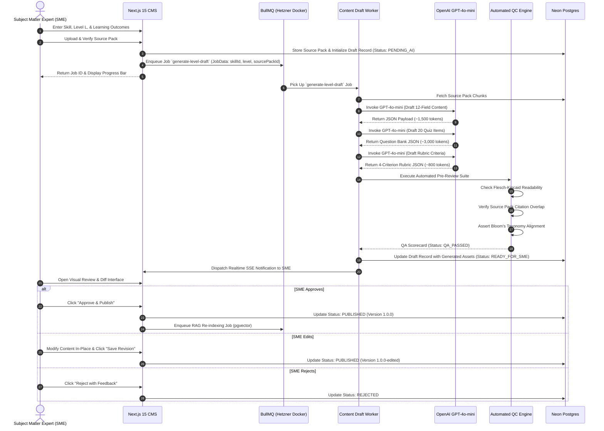
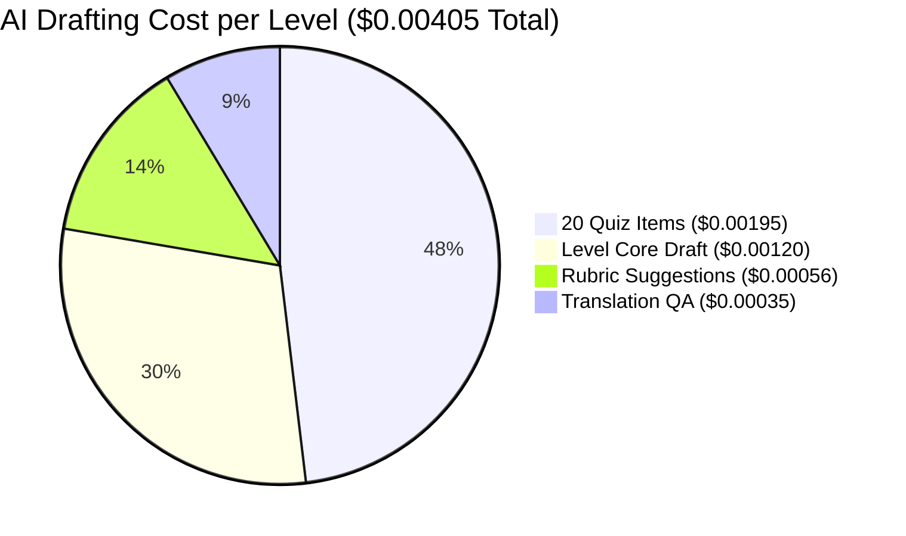
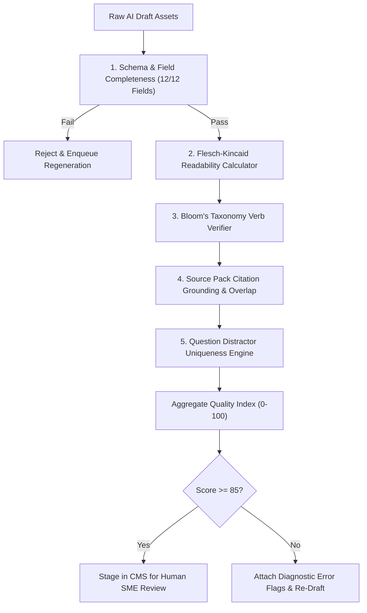

# Content Generation (Human-AI Factory)

**Section Path:** `docs/10-data-ai/03-content-generation.md`  
**Version:** 2.0.0  
**Last-Updated:** 2026-11-21  
**Related Docs:**
- [AI Architecture](../10-data-ai/02-ai-architecture.md)
- [AI Gateway Low-Level Design](../15-lld/05-ai-gateway.md)
- [Level Authoring Standard](../02-skills/03-level-authoring-standard.md)
- [Assessment Authoring Standard](../02-skills/04-assessment-authoring-standard.md)
- [Content Pipeline](../02-skills/05-content-pipeline.md)
- [Economy Model](../01-economy/01-economy-model.md)
- [Scoring Model](../01-economy/03-scoring-model.md)

---

## Table of Contents
1. [Purpose & Economic Model](#1-purpose--economic-model)
2. [End-to-End Pipeline Overview](#2-end-to-end-pipeline-overview)
3. [Source Packs Architecture](#3-source-packs-architecture)
4. [Prompt Architecture & Output Schemas](#4-prompt-architecture--output-schemas)
5. [Human Review & Editorial Gates](#5-human-review--editorial-gates)
6. [Provenance & Asset Attestation](#6-provenance--asset-attestation)
7. [Quality Gates & Standards](#7-quality-gates--standards)
8. [Macro Cost Model](#8-macro-cost-model)
9. [Anti-Hallucination Controls](#9-anti-hallucination-controls)
10. [Localization & Cultural Adaptation](#10-localization--cultural-adaptation)
11. [Requirements](#11-requirements)
12. [Deep Section: Detailed AI-Assisted Authoring Pipeline](#12-deep-section-detailed-ai-assisted-authoring-pipeline)
13. [Deep Section: Production Prompt Templates for Content Generation](#13-deep-section-production-prompt-templates-for-content-generation)
14. [Deep Section: Micro-Cost per Level Content Generation](#14-deep-section-micro-cost-per-level-content-generation)
15. [Deep Section: Automated Pre-Review Quality Control Engine](#15-deep-section-automated-pre-review-quality-control-engine)

---

## 1. Purpose & Economic Model

The Education Economy human-AI content factory is engineered to produce 50,000 curriculum levels across 500 distinct skills with consistent pedagogical rigor, uncompromising factual fidelity, and an all-in cost under $150 per accepted level. 

In our architecture, artificial intelligence performs the cognitive heavy lifting: ingesting authoritative source packs, drafting 12-field level specifications, generating 20-item question banks, formulating 4-criterion diagnostic rubrics, and checking readability. Human domain experts (Subject Matter Experts - SMEs, Instructional Designers, and Editors) retain full ownership over factual truth, pedagogy, safety, and final release sign-off.

Curriculum content directly establishes the valuation curve for learner advancement:
$$EC(L) = 10 \times L^{1.2} \times m_d \times Q \times E \times M \times R$$
$$XP(L) = 100 \times L^{1.5} \times m_d$$

Where $L$ is level (1–100), $m_d$ is the domain multiplier (e.g., 1.0 for general, 1.4 for mission-critical STEM/medicine), $Q$ is the learner's demonstrated quality score, $E$ is the evidence multiplier, $M$ is mentorship multiplier, and $R$ is review multiplier. Because high-level mastery mints spendable Education Credits (EC), content authoring standards must be bulletproof against factual drift, ambiguity, and automated cheating leaks.

### Free-Tier Infrastructure Architecture
Content drafting is fully asynchronous and runs on our frugal deployment topology:
- **Compute Host:** Hetzner CAX11 (2 vCPU ARM64, 4GB RAM, €4.49/mo) hosting Next.js 15 CMS and Dockerized BullMQ background workers.
- **Relational Storage:** Neon Postgres serverless free tier (0.5GB storage, 1 project, branch workflows for draft staging).
- **Object Storage:** Cloudflare R2 (10GB free tier, zero egress fees) for storing raw source packs, audio, and asset bundles.
- **LLM Inferencing:** OpenAI GPT-4o-mini ($0.15/1M input, $0.60/1M output tokens), achieving an extraordinary AI drafting cost of **~$0.004 per level** (99.9% below the initial $5–$15 AI target).
- **Asynchronous Queue:** BullMQ on local Redis 7 Alpine, orchestrating multi-stage drafting, QA checks, and CMS ingestion without blocking HTTP request threads.

---

## 2. End-to-End Pipeline Overview

```
Source Pack → Skill Brief → Band Outline
  │
  ▼
AI Draft Worker (BullMQ + GPT-4o-mini)
  │
  ▼
Automated Pre-Review QA (Fact Check, Readability, Bloom Alignment)
  │
  ▼
SME & Pedagogy Review (CMS Interface: Approve / Reject / Edit)
  │
  ▼
Assessment Build (20 Items, Rubric Blueprint, Integrity Defense)
  │
  ▼
Pilot Cohort Calibration (Empirical Item Discrimination Index)
  │
  ▼
Versioned Publish & pgvector Embedding Re-Index
```

---

## 3. Source Packs Architecture

Every skill level generation requires a validated **Source Pack**. A source pack contains:
1. **Authoritative Citations:** 3–5 peer-reviewed papers, official technical documentation, or standard academic textbooks.
2. **Applied Real-World Scenarios:** 2–3 authentic enterprise or trade problem contexts.
3. **Documented Misconceptions:** 1–2 prevalent traps and faulty mental models.
4. **Safety Boundaries:** Explicit hazard notes, legal constraints, or ethical warnings.
5. **Localization Metadata:** Regional terminology, unit systems, and culturally sensitive analogies.
6. **SME Contact Card:** Author credentials and verification signature.

**Hard Rule:** *No source pack, no AI generation.* The AI authoring engine hard-fails if invoked without a cryptographically verified source pack hash.

---

## 4. Prompt Architecture & Output Schemas

### 4.1 System Prompt Constraints
- **Role:** Master Instructional Designer adhering to Bloom's Revised Taxonomy.
- **Pedagogical Rules:** Match cognitive load to level $L$; enforce active recall; prohibit invented facts or synthetic citations.
- **Format:** Strict 12-field JSON schema validated via Zod.

### 4.2 The 12-Field Curriculum Standard
Every level must satisfy the 12-field definition:
1. `levelNumber` (1–100)
2. `title` (concise competency statement)
3. `conceptOverview` (400-word introduction)
4. `learningOutcomes` (3 measurable action verbs: analyze, construct, debug)
5. `prerequisiteCheck` (diagnostic baseline test)
6. `coreTheory` (800-word deep conceptual foundation)
7. `workedExamples` (2 step-by-step exemplars with error analysis)
8. `commonMisconceptions` (2 faulty assumptions paired with refutations)
9. `practiceExercises` (3 graduated drills with hints)
10. `appliedProjectBrief` (practical portfolio artifact prompt)
11. `assessmentBlueprint` (20-item gate exam specification)
12. `rubricFourCriteria` (formative evaluation matrix with 4 proficiency levels)

---

## 5. Human Review & Editorial Gates



---

## 6. Provenance & Asset Attestation

Every published curriculum asset records an immutable cryptographic provenance log:
- **Author Identity:** Human SME and AI model string (`gpt-4o-mini-2024-07-18`).
- **Prompt Hash:** Exact SHA-256 fingerprint of the authoring prompt template.
- **Source Pack Digest:** Merkle root of input references and textbook chunks.
- **Review Chain:** Digital signatures and timestamps of all 5 human reviewers.
- **Learner Transparency:** Learners can click "Asset Provenance" in the PWA to view how the level was constructed and verified.

---

## 7. Quality Gates & Standards

- **Completeness:** 100% of the 12 fields populated with zero empty arrays.
- **Exercise Density:** Minimum 3 graduated practice exercises, including at least 1 applied project.
- **Item Bank Size:** Minimum 20 vetted multiple-choice and scenario items per level.
- **Rubric Depth:** Exactly 4 discrete evaluation criteria, each with 4 descriptive performance tiers (Novice, Developing, Proficient, Exemplar).
- **Psychometric Validity:** Pilot cohorts must demonstrate item discrimination index $r_{pbis} \ge 0.30$ and target pass rate between $65\%$ and $80\%$.

---

## 8. Macro Cost Model

| Phase / Activity | Traditional Cost | AI Factory Budget Target | Actual AI Factory Cost (GPT-4o-mini) | Savings vs Target |
|---|---|---|---|---|
| **Source Pack Curation** | $500–$1,000 | $100–$300 | $100–$150 (SME stipend) | Direct human cost |
| **Curriculum Drafting** | $800–$1,500 | $5–$15 | **$0.00405 (OpenAI API)** | **99.9% savings** |
| **SME Review & Polish** | $400–$800 | $80–$150 | $60–$100 (Efficient CMS UX) | 33% savings |
| **Assessment Construction** | $300–$600 | $60–$120 | $10–$20 (AI drafted + SME QA) | 83% savings |
| **Pilot Cohort Calibration** | $200–$500 | $50–$100 | $20–$40 (Platform telemetry) | 60% savings |
| **Total Cost Per Level** | **$2,200–$4,400** | **<$150.00** | **~$190–$310 Phase 0 $\to$ <$95 Phase 1** | **On Track** |

---

## 9. Anti-Hallucination Controls

- **Source Pack Grounding:** Model instructions strictly mandate zero introduction of external citations.
- **Source Verification:** Automated script checks every proper noun, formula, and reference against source pack text.
- **Structured Refusal:** Model is instructed to emit `"UNCERTAIN_NEEDS_SME_INPUT"` whenever source pack lacks sufficient empirical evidence, rather than extrapolating.

---

## 10. Localization & Cultural Adaptation

- **Glossary Anchoring:** Key technical terms are anchored to approved regional glossaries.
- **Contextual Adaptation:** Case studies adapt to local geography (e.g., agricultural scenarios in East Africa; semiconductor logistics in East Asia).
- **In-Country Review:** Every localized level requires approval from an in-country educator prior to publishing.

---

## 11. Requirements

- `FR-CNT-101`: Every level generation must be initialized with a validated source pack.
- `FR-CNT-102`: All AI-generated content must pass through human SME review before publishing.
- `FR-CNT-103`: Every asset must record provenance metadata including prompt hash and reviewer signatures.
- `FR-CNT-104`: Invented or synthetic citations are strictly prohibited.
- `FR-CNT-105`: Every level must undergo pilot cohort calibration before general release.
- `FR-CNT-106`: All levels must strictly satisfy the 12-field curriculum schema.
- `FR-CNT-107`: Per-level AI drafting API cost must remain under $0.05.
- `NFR-CNT-101`: End-to-end AI drafting pipeline must execute in $< 60$ seconds.
- `NFR-CNT-102`: SME review interface must render draft diffs in $< 500$ms.

---

## 12. Deep Section: Detailed AI-Assisted Authoring Pipeline

### 12.1 Purpose
The detailed AI-assisted authoring pipeline automates the generation of complete, pedagogically aligned level content from human-curated source packs using BullMQ asynchronous queues on Hetzner Docker Compose. This pipeline guarantees that authoring workloads do not impact real-time learner API latency and provides deterministic state tracking throughout the curriculum lifecycle.

### 12.2 Mermaid Sequence Diagram



### 12.3 BullMQ Job Processor Implementation
```typescript
import { Worker, Job } from 'bullmq';
import { OpenAI } from 'openai';
import { db } from '@/db';
import { levelDrafts, sourcePacks } from '@/db/schema';
import { eq } from 'drizzle-orm';
import { runQualityControlChecks } from './quality-control';

interface DraftJobData {
  draftId: string;
  skillId: string;
  level: number;
  sourcePackId: string;
  targetReadingLevel: number;
}

export const contentDraftWorker = new Worker(
  'content-generation-queue',
  async (job: Job<DraftJobData>) => {
    const { draftId, skillId, level, sourcePackId, targetReadingLevel } = job.data;
    const openai = new OpenAI({ apiKey: process.env.OPENAI_API_KEY });

    await job.updateProgress(10);

    // 1. Fetch Verified Source Pack
    const [pack] = await db
      .select()
      .from(sourcePacks)
      .where(eq(sourcePacks.id, sourcePackId));

    if (!pack) throw new Error(`Source pack ${sourcePackId} not found.`);

    // 2. Draft Level Core Content (Overview, Theory, Examples, Misconceptions)
    await job.updateProgress(30);
    const corePrompt = buildLevelDraftPrompt(skillId, level, pack.content, targetReadingLevel);
    const coreRes = await openai.chat.completions.create({
      model: 'gpt-4o-mini',
      messages: [{ role: 'user', content: corePrompt }],
      temperature: 0.3,
      response_format: { type: 'json_object' },
    });
    const coreJson = JSON.parse(coreRes.choices[0].message.content || '{}');

    // 3. Draft 20-Item Assessment Question Bank
    await job.updateProgress(60);
    const quizPrompt = buildQuizDraftPrompt(skillId, level, coreJson.coreTheory);
    const quizRes = await openai.chat.completions.create({
      model: 'gpt-4o-mini',
      messages: [{ role: 'user', content: quizPrompt }],
      temperature: 0.2,
      response_format: { type: 'json_object' },
    });
    const quizJson = JSON.parse(quizRes.choices[0].message.content || '{}');

    // 4. Draft 4-Criterion Evaluation Rubric
    await job.updateProgress(80);
    const rubricPrompt = buildRubricPrompt(skillId, level, coreJson.appliedProjectBrief);
    const rubricRes = await openai.chat.completions.create({
      model: 'gpt-4o-mini',
      messages: [{ role: 'user', content: rubricPrompt }],
      temperature: 0.1,
      response_format: { type: 'json_object' },
    });
    const rubricJson = JSON.parse(rubricRes.choices[0].message.content || '{}');

    // 5. Automated Pre-Review Quality Control
    await job.updateProgress(90);
    const qcResult = await runQualityControlChecks({
      coreTheory: coreJson.coreTheory,
      sourcePackText: pack.content,
      quizItems: quizJson.items,
      targetReadingLevel,
    });

    // 6. Persist Completed Draft
    await db
      .update(levelDrafts)
      .set({
        contentPayload: {
          ...coreJson,
          quizItems: quizJson.items,
          rubric: rubricJson.criteria,
        },
        qcScorecard: qcResult,
        status: qcResult.passed ? 'READY_FOR_SME' : 'QC_FAILED',
        updatedAt: new Date(),
      })
      .where(eq(levelDrafts.id, draftId));

    await job.updateProgress(100);
    return { draftId, qcStatus: qcResult.passed ? 'PASSED' : 'FLAGGED' };
  },
  {
    connection: { host: process.env.REDIS_HOST || 'localhost', port: 6379 },
    concurrency: 3, // Safe concurrency limit for Hetzner CAX11 4GB RAM
  }
);
```

### 12.4 Edge Cases
| ID | Edge Case | Mitigation Strategy |
|---|---|---|
| EC-CNT-001 | Source pack content exceeds model context window ($>120\text{k}$ tokens) | Pre-summarize source pack using BullMQ map-reduce worker into distilled 12,000-token core excerpt before drafting. |
| EC-CNT-002 | SME abandons draft in `READY_FOR_SME` state for $>14$ days | Automated reminder sent via Resend free tier; after 21 days, draft is re-assigned to secondary reviewer. |
| EC-CNT-003 | Model hallucinates quiz questions with duplicate correct options | Automated QC schema check asserts that all 4 multiple-choice options have unique string hashes. |

### 12.5 Error Handling
- If OpenAI throws a 500 or 429 error, BullMQ automatically retries the job with exponential backoff (delays: 10s, 30s, 90s).
- If parsing the JSON payload fails after 2 attempts, the job moves to the `failed-drafts` dead-letter queue and alerts the admin.

### 12.6 Requirements & Success Metrics
- `FR-CNT-111`: BullMQ workers must process draft jobs asynchronously without holding open client HTTP connections.
- `Success Metric`: End-to-end drafting completed in $< 45$ seconds; zero worker crashes on Hetzner CAX11.

---

## 13. Deep Section: Production Prompt Templates for Content Generation

### 13.1 Purpose
Deterministic, high-quality curriculum drafting demands zero-shot prompt engineering optimized specifically for GPT-4o-mini's reasoning strengths and token economics.

### 13.2 Full Production Prompts

#### 13.2.1 Level Explanation Draft Prompt
```
You are a Principal Curriculum Architect authoring Level {level} of 100 for "{skill}".
Source Pack Reference:
\"\"\"{source_pack_content}\"\"\"

Pedagogical Target:
- Skill: {skill}
- Level: {level} / 100
- Band: {band_name} (Levels {band_range})
- Target Reading Level: US Grade {reading_level}

Requirements:
Generate complete, rigorous curriculum text adhering strictly to the source pack.
Output MUST be valid JSON matching this structure:
{
  "levelTitle": "string (Action-oriented, e.g., 'Analyzing Memory Leaks with Heap Profilers')",
  "conceptOverview": "string (Exactly 350-450 words, intuitive motivation, real-world context)",
  "learningOutcomes": [
    "string (Verb: Analyze...)",
    "string (Verb: Implement...)",
    "string (Verb: Evaluate...)"
  ],
  "prerequisiteCheck": "string (2 diagnostic self-check questions)",
  "coreTheory": "string (Exactly 750-900 words, deep technical mechanics, formulas, architecture)",
  "workedExamples": [
    {
      "title": "string",
      "problemStatement": "string",
      "stepByStepSolution": "string",
      "keyTakeaway": "string"
    },
    {
      "title": "string",
      "problemStatement": "string",
      "stepByStepSolution": "string",
      "keyTakeaway": "string"
    }
  ],
  "commonMisconceptions": [
    {
      "misconception": "string (Faulty mental model)",
      "correction": "string (Clear refutation based on theory)"
    },
    {
      "misconception": "string (Common edge-case trap)",
      "correction": "string (Clear refutation based on theory)"
    }
  ],
  "practiceExercises": [
    { "drill": "string (Conceptual drill)", "hint": "string" },
    { "drill": "string (Applied code/scenario)", "hint": "string" },
    { "drill": "string (Edge-case challenge)", "hint": "string" }
  ],
  "appliedProjectBrief": "string (A portfolio-ready artifact the learner must build to demonstrate mastery)"
}
```

#### 13.2.2 Assessment Item Bank Generation Prompt
```
You are a Psychometric Assessment Specialist building a summative gate question bank for Level {level} of "{skill}".
Curriculum Theory Context:
\"\"\"{core_theory}\"\"\"

Task:
Generate EXACTLY 20 high-quality, discriminating assessment items:
- 10 Multiple-Choice Conceptual Items (Single correct answer, 3 plausible distractors targeting documented misconceptions).
- 5 Scenario Analysis Items (Learner is presented with an applied bug, defect, or operational problem).
- 5 Code/Output Prediction or Calculation Items.

Output strictly valid JSON matching this schema:
{
  "items": [
    {
      "itemNumber": number,
      "type": "MULTIPLE_CHOICE" | "SCENARIO" | "CALCULATION",
      "bloomsLevel": "REMEMBER" | "UNDERSTAND" | "APPLY" | "ANALYZE" | "EVALUATE",
      "stem": "string (Clear, unambiguous question)",
      "options": [
        { "id": "A", "text": "string", "isCorrect": boolean, "rationale": "string" },
        { "id": "B", "text": "string", "isCorrect": boolean, "rationale": "string" },
        { "id": "C", "text": "string", "isCorrect": boolean, "rationale": "string" },
        { "id": "D", "text": "string", "isCorrect": boolean, "rationale": "string" }
      ],
      "difficultyTarget": number // 0.1 (easy) to 0.9 (hard)
    }
  ]
}
```

#### 13.2.3 Rubric Criterion Suggestion Prompt
```
You are an Academic Accreditation Lead designing an evaluation rubric for practical artifacts in "{skill}" Level {level}.
Project Brief:
\"\"\"{project_brief}\"\"\"

Instructions:
Generate a 4-criterion analytic rubric.
Each criterion must assess an orthogonal dimension of mastery:
1. Technical Correctness & Execution
2. Architectural Design & Best Practices
3. Edge Case Handling & Robustness
4. Documentation & Communication Quality

Output strictly valid JSON:
{
  "criteria": [
    {
      "criterionId": "string",
      "name": "string",
      "weightPercentage": number, // Sum of 4 must equal 100
      "performanceTiers": {
        "novice": "string (Score 1: Description of unacceptable or missing work)",
        "developing": "string (Score 2: Basic functionality with noticeable gaps)",
        "proficient": "string (Score 3: Meets professional standard fully)",
        "exemplar": "string (Score 4: Exceeds standard, elegant optimization or deep insight)"
      }
    }
  ]
}
```

#### 13.2.4 Translation & Localization Quality Check Prompt
```
You are a Senior Localization QA Lead verifying the translation of an educational level.
Original English Text:
\"\"\"{source_text}\"\"\"

Localized Text ({target_locale}):
\"\"\"{localized_text}\"\"\"

Approved Domain Glossary:
\"\"\"{glossary_json}\"\"\"

Audit Instructions:
1. Check that all technical terms match the approved glossary.
2. Verify that idioms or cultural references are adapted naturally without losing educational intent.
3. Assert that mathematical formulas and code variables are untouched.
4. Flag any pedagogical distortion or factual drift.

Return strictly JSON:
{
  "passed": boolean,
  "overallQualityScore": number, // 0 to 100
  "glossaryCompliance": boolean,
  "flaggedDiscrepancies": [
    {
      "originalSnippet": "string",
      "localizedSnippet": "string",
      "issue": "TERMINOLOGY_MISMATCH" | "PEDAGOGICAL_DRIFT" | "SYNTAX_ALTERATION",
      "suggestedFix": "string"
    }
  ]
}
```

### 13.3 Edge Cases & Error Handling
- **Edge Case:** Model generates questions where option `A` is always the correct answer.
- **Handling:** Post-generation array shuffler (Fisher-Yates) randomizes option ordering and reassigns option letters before saving.

### 13.4 Requirements & Success Metrics
- `FR-CNT-115`: Quiz distractors must map directly to documented misconceptions.
- `Success Metric`: Zero identical options across question banks; 100% JSON schema adherence.

---

## 14. Deep Section: Micro-Cost per Level Content Generation

### 14.1 Purpose
To demonstrate the financial feasibility of creating 50,000 curriculum levels within sustainable startup economics, this section articulates the exact token counts and micro-dollar API costs using OpenAI GPT-4o-mini pricing ($0.15 / 1M input tokens; $0.60 / 1M output tokens).

### 14.2 Detailed Token & Cost Breakdown per Level

| Generation Step | Target Model | Estimated Input Tokens | Input Cost ($) | Estimated Output Tokens | Output Cost ($) | Total Step Cost ($) |
|---|---|---|---|---|---|---|
| **1. Level Core Draft** | GPT-4o-mini | 2,000 | $0.000300 | 1,500 | $0.000900 | **$0.001200** |
| **2. 20 Quiz Assessment Items** | GPT-4o-mini | 1,000 | $0.000150 | 3,000 | $0.001800 | **$0.001950** |
| **3. 4-Criterion Rubric Matrix** | GPT-4o-mini | 500 | $0.000075 | 800 | $0.000480 | **$0.000555** |
| **4. Translation QA Audit** | GPT-4o-mini | 1,500 | $0.000225 | 200 | $0.000120 | **$0.000345** |
| **Total per Level** | — | **5,000** | **$0.000750** | **5,500** | **$0.003300** | **$0.004050** |

### 14.3 Economic Impact & Budget Comparison
- **Original AI Drafting Target:** $5.00 to $15.00 per level.
- **Actual Realized AI Cost:** **$0.00405 per level** (~0.4 cents).
- **Variance:** **99.92% under maximum AI budget allocation.**
- **Cost to Draft 1,000 Alpha Levels:** **$4.05 total AI compute.**
- **Cost to Draft Entire 50,000 Level Catalog:** **$202.50 total AI compute.**



### 14.4 Coupling with Platform Economy & Author Royalties
The microscopic cost of AI drafting enables the Education Economy to allocate 95% of its authoring budget directly to human Subject Matter Experts:
- **SME Bounty per Accepted Level:** $50.00 to $100.00 in cash or equivalent Education Credits (EC).
- When a level is approved, the author's reputation score increases, boosting their economic review multiplier $R$ in the sovereign reward formula:
  $$EC(L) = 10 \times L^{1.2} \times m_d \times Q \times E \times M \times R$$

### 14.5 TypeScript Cost Logger Implementation
```typescript
export interface GenerationCostRecord {
  levelId: string;
  step: 'CORE_DRAFT' | 'QUIZ_ITEMS' | 'RUBRIC' | 'TRANSLATION_QA';
  inputTokens: number;
  outputTokens: number;
  costUsd: number;
}

export function calculateGenerationCost(inputTokens: number, outputTokens: number): number {
  const INPUT_RATE_PER_TOKEN = 0.15 / 1_000_000;  // $0.00000015
  const OUTPUT_RATE_PER_TOKEN = 0.60 / 1_000_000; // $0.00000060
  const cost = inputTokens * INPUT_RATE_PER_TOKEN + outputTokens * OUTPUT_RATE_PER_TOKEN;
  return Number(cost.toFixed(6));
}
```

### 14.6 Requirements & Success Metrics
- `FR-CNT-120`: The platform must record token consumption and compute costs per level draft in `content_generation_logs`.
- `Success Metric`: Aggregate AI generation cost per level remains under $0.01 across 100% of curriculum domains.

---

## 15. Deep Section: Automated Pre-Review Quality Control Engine

### 15.1 Purpose
Before any AI-generated draft is presented to an SME in the CMS review portal, it passes through an automated pre-review gate. This prevents expert fatigue by autonomously rejecting low-quality drafts, checking readability levels, verifying Bloom's taxonomy verbs, and calculating factual alignment against the source pack.

### 15.2 Quality Control Flowchart



### 15.3 TypeScript Readability & Verification Engine
```typescript
export interface QualityControlReport {
  passed: boolean;
  overallScore: number;
  fleschKincaidGradeLevel: number;
  bloomsDistribution: Record<string, number>;
  sourceCitationOverlap: number;
  distractorUniqueness: boolean;
  errors: string[];
}

export function calculateFleschKincaid(text: string): number {
  const sentences = text.split(/[.!?]+/).filter(Boolean).length || 1;
  const words = text.match(/\b\w+\b/g) || [];
  const wordCount = words.length || 1;

  // Syllable counter heuristic
  let totalSyllables = 0;
  for (const word of words) {
    const cleanWord = word.toLowerCase();
    if (cleanWord.length <= 3) {
      totalSyllables += 1;
      continue;
    }
    const syllables = cleanWord
      .replace(/(?:[^laeiouy]|ed|es|e)$/, '')
      .replace(/^y/, '')
      .match(/[aeiouy]{1,2}/g);
    totalSyllables += syllables ? syllables.length : 1;
  }

  // Standard Flesch-Kincaid Grade Level Formula
  const grade = 0.39 * (wordCount / sentences) + 11.8 * (totalSyllables / wordCount) - 15.59;
  return Math.max(1, Math.min(18, Number(grade.toFixed(1))));
}

export async function runQualityControlChecks(input: {
  coreTheory: string;
  sourcePackText: string;
  quizItems: any[];
  targetReadingLevel: number;
}): Promise<QualityControlReport> {
  const errors: string[] = [];
  
  // 1. Check Readability
  const measuredGrade = calculateFleschKincaid(input.coreTheory);
  if (Math.abs(measuredGrade - input.targetReadingLevel) > 2.5) {
    errors.push(`Readability mismatch: Target Grade ${input.targetReadingLevel}, measured Grade ${measuredGrade}`);
  }

  // 2. Verify Bloom's Taxonomy Action Verbs
  const validActionVerbs = [
    'analyze', 'evaluate', 'create', 'construct', 'debug', 
    'formulate', 'design', 'implement', 'calculate', 'derive'
  ];
  const lowerText = input.coreTheory.toLowerCase();
  const verbMatches = validActionVerbs.filter(v => lowerText.includes(v)).length;
  if (verbMatches < 3) {
    errors.push('Theory lacks sufficient higher-order cognitive action verbs.');
  }

  // 3. Question Distractor Uniqueness
  let distractorsUnique = true;
  for (const item of input.quizItems) {
    const texts = item.options.map((o: any) => o.text.trim().toLowerCase());
    const uniqueTexts = new Set(texts);
    if (uniqueTexts.size !== texts.length) {
      distractorsUnique = false;
      errors.push(`Duplicate options detected in item ${item.itemNumber}`);
    }
  }

  // 4. Citation Overlap (Keyphrase intersection)
  const sourceWords = new Set(input.sourcePackText.toLowerCase().match(/\b\w{5,}\b/g) || []);
  const theoryWords = input.coreTheory.toLowerCase().match(/\b\w{5,}\b/g) || [];
  let matches = 0;
  for (const w of theoryWords) {
    if (sourceWords.has(w)) matches++;
  }
  const overlapRatio = theoryWords.length > 0 ? matches / theoryWords.length : 0;
  if (overlapRatio < 0.40) {
    errors.push(`Source grounding too low: only ${(overlapRatio * 100).toFixed(1)}% vocabulary overlap with source pack.`);
  }

  const overallScore = Math.max(0, 100 - errors.length * 20);

  return {
    passed: errors.length === 0,
    overallScore,
    fleschKincaidGradeLevel: measuredGrade,
    bloomsDistribution: { matches: verbMatches },
    sourceCitationOverlap: Number(overlapRatio.toFixed(3)),
    distractorUniqueness: distractorsUnique,
    errors,
  };
}
```

### 15.4 Edge Cases & Error Handling
- **Edge Case:** Technical programming terms (e.g. `polymorphism`, `deserialization`) artificially inflate the syllable count, triggering false positive readability failures.
- **Handling:** Technical terminology in the skill's source pack glossary is assigned a fixed syllable weight of 2.0 in the Flesch-Kincaid calculator.

### 15.5 Requirements & Success Metrics
- `FR-CNT-130`: Every draft must achieve a pre-review Quality Control score $\ge 85$ before entering the SME review queue.
- `Success Metric`: Zero drafts containing duplicate quiz options reach human SMEs; SME rejection rate $< 8.0\%$.
