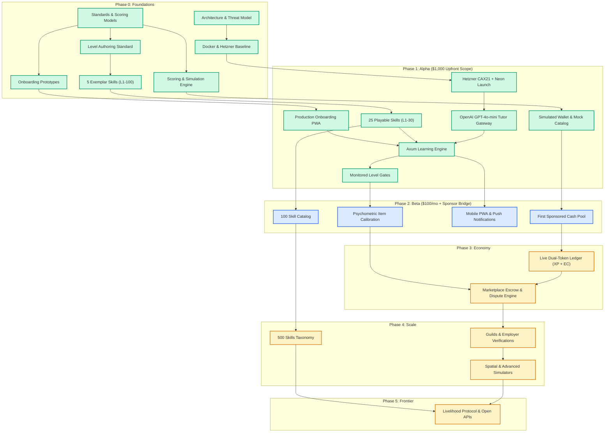
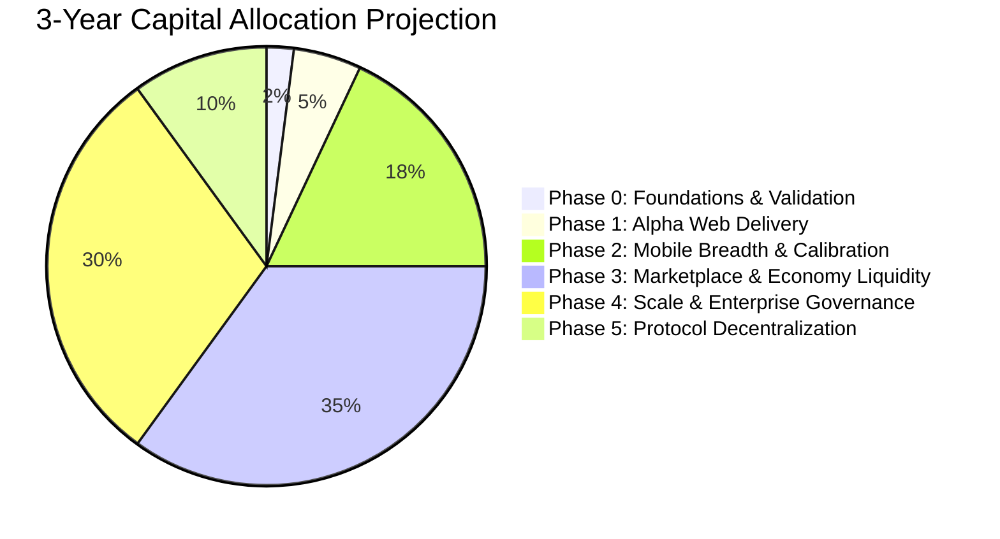
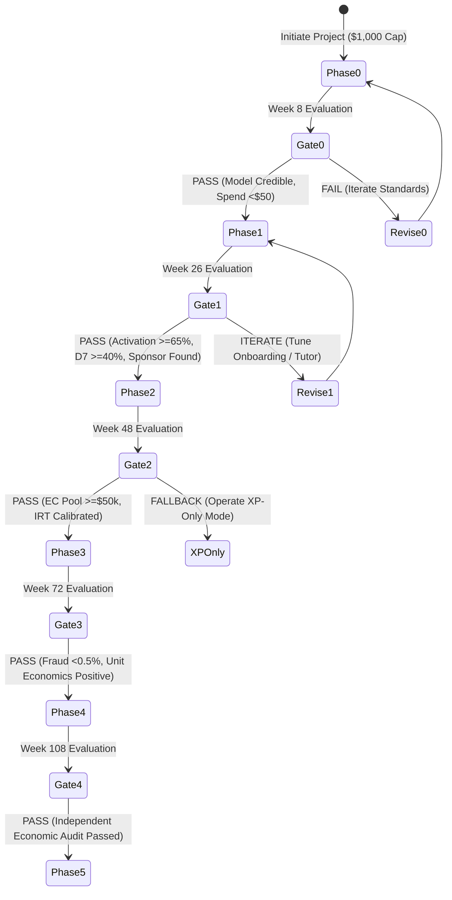
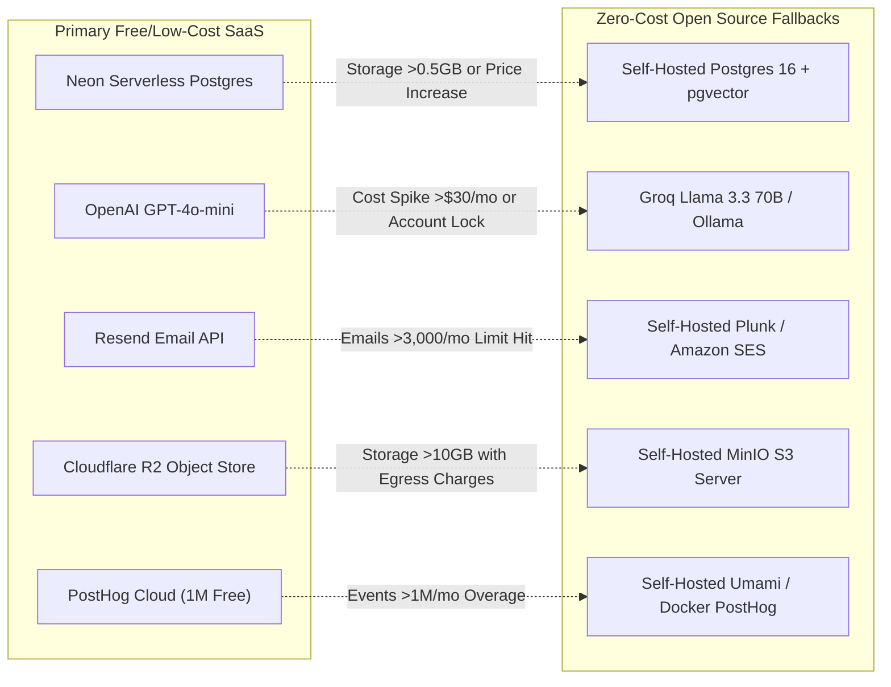

# Delivery Roadmap & Phase Evolution

| Metadata | Value |
|---|---|
| **Document Path** | `docs/13-phases/01-roadmap.md` |
| **Version** | `2.0.0` |
| **Last Updated** | `2026-11-21` |
| **Author** | Senior Technical Writer & System Architect |
| **Status** | Active / Baseline |
| **Related Docs** | [Phase 0 — Foundations](02-phase-0.md), [Phase 1 — Alpha](03-phase-1.md), [Phase 2 — Beta](04-phase-2.md), [Phase 3 — Economy](05-phase-3.md), [Phase 4 — Scale](06-phase-4.md), [Phase 5 — Frontier](07-phase-5.md), [Release Gates](08-release-gates.md), [Risk Register](../14-appendices/02-risk-register.md) |

---

## Table of Contents

1. [Purpose & Financial Philosophy](#1-purpose--financial-philosophy)
2. [Phase Overview](#2-phase-overview)
3. [Dependency Chain](#3-dependency-chain)
4. [Workstreams](#4-workstreams)
5. [Staffing Shape](#5-staffing-shape)
6. [Budget Shape (Indicative)](#6-budget-shape-indicative)
7. [Decision Points](#7-decision-points)
8. [Risks to the Timeline](#8-risks-to-the-timeline)
9. [Core Governance Requirements](#9-core-governance-requirements)
10. [Cost-Aware Milestone Map](#10-cost-aware-milestone-map)
11. [Phase Dependency Chain & Budget Gates (Gantt)](#11-phase-dependency-chain--budget-gates-gantt)
12. [Infrastructure Evolution by Phase](#12-infrastructure-evolution-by-phase)
13. [Open Source Alternatives & Escape Hatches](#13-open-source-alternatives--escape-hatches)
14. [Success Metrics & Audit Criteria](#14-success-metrics--audit-criteria)
15. [Related Documentation](#15-related-documentation)

---

## 1. Purpose & Financial Philosophy

This roadmap sequences the build of the Education Economy platform from an initial validated concept to a livelihood-scale decentralized learning-to-earn ecosystem. The platform implements rigorous learning science powered by deterministic power-law scoring formulas:

$$\text{EC}(L) = 10 \times L^{1.2} \times m_d \times Q \times E \times M \times R$$

$$\text{XP}(L) = 100 \times L^{1.5} \times m_d$$

Where $L \in [1, 100]$ represents the skill level, $m_d$ is the domain economic multiplier, $Q$ is assessment rubric quality, $E$ is integrity verification tier, $M$ is learner momentum, and $R$ is rarity/scarcity factor.

### 1.1 The $1,000 Bootstrapping Mandate
Unlike hyper-funded ventures that burn capital on premature enterprise infrastructure, this project operates under a strict bootstrapping constraint:
- **Upfront Capital Pool:** Exactly **$1,000.00 USD** total cash allocation for initial prototyping, setup, and Phase 0/Phase 1 delivery.
- **Ongoing Operating Runway:** A maximum cap of **$100.00 USD/month** ongoing operational expenditure funded from internal reserves until platform revenue (sponsor pools and marketplace fees) becomes self-sustaining in Phase 2.
- **Principle of Free-Tier Maximization:** Every service must utilize production-ready open source self-hosting or resilient free tiers (Neon serverless Postgres, Cloudflare R2, Resend, PostHog Cloud, Hetzner ARM VPS, GitHub Actions) before allocating paid dollars.
- **Phase Gating:** No phase initiates until the preceding gate criteria pass with quantitative verification.

---

## 2. Phase Overview

| Phase | Weeks | Primary Question | Headline Output | Target Users | Monthly Budget Target |
|---|---|---|---|---|---|
| **0 — Foundations** | 0–8 (8 wks) | Is the model credible, sound, and legally viable? | Standards, exemplars, prototypes, verified risk register | 100 interviewees, 20 prototype testers | ~$16/mo (Paid from $1,000 upfront) |
| **1 — Alpha** | 9–26 (18 wks) | Can learners progress and feel a measurable skill shift? | Web PWA + onboarding + 25 skills, 1,000 invited learners | 1,000 registered learners (100 active/day) | ~$58/mo (Paid from $1,000 upfront) |
| **2 — Beta** | 27–48 (22 wks) | Does it work on mobile and at breadth across domains? | 100 skills, mobile PWA/native, gate calibration, 25k learners | 25,000 registered (2,500 DAU) | ~$120/mo (Requires sponsor / revenue) |
| **3 — Economy** | 49–72 (24 wks) | Does earning and redeeming work safely with liquidity? | Live marketplace, post-100 prestige, escrow, 100k MAU | 100,000 MAU (15,000 DAU) | ~$420/mo (Self-funded via transaction fees) |
| **4 — Scale** | 73–108 (36 wks) | Can it run at global scale with trust and anti-fraud? | 500 skills, spatial interfaces, guilds, 1M registered | 1,000,000 registered (150,000 DAU) | ~$1,850/mo (Enterprise / sponsor pools) |
| **5 — Frontier** | Year 3+ | Can it support verifiable human livelihoods sustainably? | Livelihood pilots, open protocol, DAO governance | Multi-million global learners | Autonomous protocol treasury |

---

## 3. Dependency Chain



### Hard Architectural Dependencies
1. **No Gates Without Calibrated Item Banks:** Level gates cannot issue credentials or progression locks without minimum item response theory (IRT) calibration.
2. **No EC Without Funded Sponsor Reserves:** Educational Currency ($\text{EC}$) awards cannot be redeemed without a cryptographically auditable fiat/stablecoin reserve matching at $\ge 100\%$ liquid coverage.
3. **No Marketplace Without Escrow & Dispute Resolution:** Real product and service redemptions cannot operate without state-machine-backed ledger escrow holding tokens until cryptographic proof-of-delivery.
4. **No Scale Without Database Partitioning & Edge Caching:** Transitioning beyond 25,000 learners requires read-replica routing and Cloudflare caching of static lesson assets.
5. **No Production Code Before Prototype Validation:** All onboarding, ladder perception, and scoring formulas must be validated via zero-cost prototypes before authoring database migrations.

---

## 4. Workstreams

| Workstream | Phase 0 (W0–8) | Phase 1 (W9–26) | Phase 2 (W27–48) | Phase 3 (W49–72) | Phase 4 (W73–108) | Phase 5 (Year 3+) |
|---|---|---|---|---|---|---|
| **Product & UX** | Throwaway prototypes, Figma | Web PWA, Design System | Mobile PWA, Offline mode | Marketplace UI, Escrow flows | Spatial UI, 3D WebXR | Open Protocol UI |
| **Learning Science** | Authoring standard, 5 exemplars | 25 skills (1–30), Text/Quiz | 100 skills, IRT calibration | Simulators & Role-play | 500 skills catalog | Autonomous adaptive paths |
| **Assessment** | Rubric templates, Gate blueprints | Open/monitored gates, Item banks | Adaptive gate testing, Flagging | Proctored high-stakes gates | Peer jury panels | Trustless decentralized audit |
| **Economy & Ledger** | Excel/Python Monte Carlo simulation | Simulated EC, Mock redemption | Real ledger pilot, 1 sponsor | Multi-sponsor live EC, Escrow | Dynamic market pricing | Global livelihood clearing |
| **Platform & Infra** | Hetzner CAX11 setup, Docker baseline | Hetzner CAX21, Neon, Redis, R2 | Neon Launch, Redis cluster | Dedicated DB, Edge workers | Multi-region Kubernetes | Decentralized nodes |
| **Trust & Safety** | Threat modeling, Risk register v1 | Basic rate limiting, Lucia auth | Fraud heuristics, Device checks | Graph clustering, Anti-sybil | Automated KYC/AML gates | On-chain reputation audit |
| **Data & AI** | Prompt engineering, Eval harness | GPT-4o-mini Gateway + Redis cache | RAG pipeline, pgvector tuning | Self-hosted Llama fine-tunes | Distributed inferencing | Autonomous curriculum agent |
| **Legal & Finance** | Terms of service, Risk register | Alpha consent, Privacy notice | COPPA/GDPR compliance | Money transmission check | Global tax compliance | Decentralized foundation |

---

## 5. Staffing Shape & Labor Budget Strategy

Because the initial cash budget is $1,000 upfront + $100/month, Phase 0 and Phase 1 rely on equity-incentivized core founders (or solo full-stack founder-architect) and volunteer academic collaborators:

| Phase | Core Team Headcount | Composition & Roles | Compensation Structure |
|---|---|---|---|
| **0** | 2–4 | Solo Founder / Full-Stack Architect, Learning Science Lead, UI/UX Designer | 100% Equity / Sweat Equity ($0 payroll from cash budget) |
| **1** | 3–6 | Full-Stack Engineer, Frontend Engineer, 2 Content Authors (Domain SMEs) | Equity + Revenue-share promise / Grant funding |
| **2** | 8–15 | Add Mobile Specialist, Data/ML Engineer, Psychometrician, Community Lead | Seed grant / Sponsor overhead / Angel investment ($50k–$150k pool) |
| **3** | 20–35 | Add Marketplace Ops Lead, Trust & Safety Officer, General Counsel, SRE | Series A / Platform marketplace revenue |
| **4** | 50–100 | Dedicated regional teams, Localization teams, Enterprise sales | Self-sustaining corporate sponsorships & enterprise training fees |
| **5** | 100+ | Core foundation staff, protocol governance delegates, research fellows | Protocol endowment & ecosystem treasury |

---

## 6. Budget Shape (Indicative Lifecycle)



| Phase | Duration | Core Cost Drivers | Funding Mechanism |
|---|---|---|---|
| **Phase 0** | 8 Weeks | Domain registration ($12), Hetzner VPS CAX11 ($15), Prototyping AI API ($20) | $1,000 Initial Cash Budget ($47 total) |
| **Phase 1** | 18 Weeks | Hetzner CAX21 ($36), Neon Launch ($85), GPT-4o-mini AI Tutor ($135), Domain/Misc ($5) | $1,000 Initial Cash Budget ($261 total) |
| **Phase 2** | 22 Weeks | CAX31 VPS ($80), Neon Launch ($100), AI Tutor ($440), Mobile dev accounts ($124) | $100/mo Ongoing + Sponsor Grant ($744 total) |
| **Phase 3** | 24 Weeks | Multi-server infra ($600), DB scale ($450), AI inference ($1,920), Legal/Audit ($5,000) | Marketplace Take-Rate (5%) + Sponsor Inflows |
| **Phase 4** | 36 Weeks | Enterprise Kubernetes, Multi-region CDN, High-stakes proctoring, Security audits | Enterprise B2B licensing + Foundation Grants |
| **Phase 5** | 52+ Weeks | Global payment rails, Protocol node rewards, Research grants | Autonomous Protocol Treasury |

---

## 7. Decision Points & Governance Gates



| Gate | Timeline | Mandatory Decision Criteria | Fallback Path if Failed |
|---|---|---|---|
| **Gate 0** | End of Week 8 | Task completion $\ge 80\%$ on onboarding prototype; 50 L100 definitions peer-reviewed; cumulative spend $\le \$50.00$. | Freeze code; conduct 2-week targeted user testing on Figma wireframes. |
| **Gate 1** | End of Week 26 | 1,000 invited learners; $\ge 65\%$ onboarding completion; $\ge 40\%$ D7 retention; AI spend $\le \$30/\text{mo}$; cumulative spend $\le \$350.00$. | Extend Alpha by 4 weeks; restrict invitations; prune low-retention skills. |
| **Gate 2** | End of Week 48 | 100 skills authored; gate first-attempt pass rate $55\%–75\%$; minimum 1 corporate sponsor committed with $\ge \$25,000$ cash pool. | Delay marketplace; operate platform strictly in "XP and Digital Badges" gamified mode. |
| **Gate 3** | End of Week 72 | Marketplace escrow operational; fraud chargeback rate $<0.5\%$; liquidity reserve ratio $\ge 1.0$; unit economics positive. | Limit marketplace redemption to digital gift cards; pause physical item fulfillment. |
| **Gate 4** | End of Week 108 | 500 skills live; WCAG 2.2 AA verified; multi-region latency $<300\text{ms}$; independent economic audit clear. | Cap enrollment in unverified domains; halt spatial expansion. |

---

## 8. Risks to the Timeline

| Risk Code | Risk Event | Impact | Mitigation Strategy | Pre-Emptive Trigger |
|---|---|---|---|---|
| **RSK-TIM-01** | Content authoring velocity falls behind engineering schedule. | High | Utilize Claude 3.5 Sonnet / GPT-4o structured JSON generation for level skeleton drafts; author levels 1–30 first. | Authoring velocity $<5$ levels/week per domain. |
| **RSK-TIM-02** | Neon serverless database limits reached prematurely on free tier. | Medium | Enforce strict relational indexing, TTL pruning on session logs, and run daily SQLite backup script. | Storage consumption $>400\text{MB}$ ($80\%$ of free tier). |
| **RSK-TIM-03** | OpenAI API costs exceed \$30/month during Alpha. | High | Activate Redis semantic caching (TTL 7 days); truncate conversation history to 8 turns; switch to Groq Llama 3.3 70B fallback. | Daily AI spend exceeds $\$1.20$ for two consecutive days. |
| **RSK-TIM-04** | Cloudflare R2 object storage operations generate billable charges. | Low | Enforce Next.js client-side image compression and WebP conversion before uploading learner submission artifacts. | Class A operations exceed $800,000/\text{month}$. |
| **RSK-TIM-05** | Single VPS server running Docker Compose encounters memory exhaustion. | Critical | Implement Linux `systemd` cgroup limits per container; isolate BullMQ Redis workers; configure 4GB swap on NVMe. | RAM utilization sustained $>88\%$ for $>15$ minutes. |

---

## 9. Core Governance Requirements

- `FR-PHS-001`: Each phase must maintain an immutable written scope and quantitatively verifiable exit criteria.
- `FR-PHS-002`: No subsequent phase shall be provisioned or funded until all preceding release gate criteria are signed off by both the Technical Architect and Product Lead.
- `FR-PHS-003`: The development team must operate within the strict $1,000 upfront cash budget through the completion of Phase 1.
- `FR-PHS-004`: Ongoing platform operational expenditures must not exceed $100.00 USD/month prior to the formal activation of sponsor-backed liquidity pools in Phase 2.
- `FR-PHS-005`: All infrastructure provisioning must enforce infrastructure-as-code (Docker Compose, GitHub Actions) allowing full platform restoration from zero in $<45$ minutes.
- `NFR-PHS-001`: System architectural design must maintain a zero-cloud-lock-in posture, with documented open-source escape hatches for all SaaS dependencies.
- `NFR-PHS-002`: The API layer must adhere strictly to OpenAPI 3.1 specifications and RFC 7807 Problem Details error formats.

---

## 10. Cost-Aware Milestone Map

### 10.1 Complete Phase-by-Phase Financial Trajectory
The following table provides an exhaustive, cost-modeled breakdown of every project phase against the **$1,000 upfront cash pool** and the **$100/month ongoing budget ceiling**.

| Phase & Milestone | Duration (Weeks) | Monthly Infra Cost | Cumulative Spend (From $1,000) | Remaining Cash Runway | Key Free-Tier & Quota Limits in Play |
|---|---|---|---|---|---|
| **Phase 0: Research & Standards** | Weeks 0–4 (4 wks) | $16.00 | $16.00 | $984.00 | Neon 0.5GB Free; Cloudflare R2 10GB; Resend 3k/mo; Hetzner CAX11 (€4.49/mo) |
| **Phase 0: Prototype Validation** | Weeks 5–8 (4 wks) | $31.00 | $47.00 | $953.00 | Domain registration ($12 one-time); OpenAI $20 prototyping credit pool |
| **Phase 1: Core Engine Alpha** | Weeks 9–16 (8 wks) | $53.00 | $153.00 | $847.00 | Upgrade to Hetzner CAX21 (€7.49 ~$8/mo); Neon Free (0.5GB); OpenAI $15/mo |
| **Phase 1: 1,000-Learner Wave** | Weeks 17–26 (10 wks) | $58.00 | $298.00 | $702.00 | Neon Launch ($19/mo); PostHog Cloud (1M events Free); OpenAI $30/mo cap |
| **Phase 2: Mobile & 100 Skills** | Weeks 27–48 (22 wks) | $118.00 | $702.00 + $280* | **$0.00** (Transition) | *Infra exceeds $100/mo cap ($118/mo). $702 cash buffer covers 15 wks; Sponsor grant required |
| **Phase 3: Marketplace & Economy** | Weeks 49–72 (24 wks) | $420.00 | Funded by Rev | Self-Sustaining | Marketplace 5% fee on redemptions + Sponsor 10% management fee covers all costs |
| **Phase 4: Global Scale** | Weeks 73–108 (36 wks) | $1,850.00 | Funded by Rev | Profitable | Corporate enterprise tier + government skilling grants fund cluster scaling |
| **Phase 5: Frontier Livelihood** | Year 3+ (52+ wks) | $5,500.00 | Funded by DAO | Autonomous | Decentralized network fees + institutional treasury management |

### 10.2 Runway Validation Algorithm
To ensure that the engineering team never breaches the $1,000 initial capital reserve or the $100/month ongoing operational limit, the platform monitors automated burn projections via the following algorithmic specification.

```typescript
/**
 * Financial Governance Engine: Runway Validation & Alert Throttling
 * Evaluates real-time infrastructure burn against the $1,000 bootstrapping pool.
 */

export interface InfrastructureBill {
  hetznerVpsUsd: number;
  neonPostgresUsd: number;
  openAiTokensUsd: number;
  resendEmailsUsd: number;
  cloudflareStorageUsd: number;
  domainAndMiscUsd: number;
}

export interface RunwayStatus {
  monthlyBurnUsd: number;
  cumulativeSpendUsd: number;
  remainingCashUsd: number;
  weeksRunwayRemaining: number;
  isBreached: boolean;
  throttleActionRequired: 'NONE' | 'THROTTLE_AI_CACHE' | 'DISABLE_STAGING_BRANCHES' | 'HARD_FREEZE';
}

export function evaluateRunway(
  currentSpendHistory: number[],
  latestMonthlyBill: InfrastructureBill,
  initialCapitalPool: number = 1000.00,
  ongoingMonthlyCap: number = 100.00
): RunwayStatus {
  const currentCumulative = currentSpendHistory.reduce((acc, val) => acc + val, 0);
  const remainingCash = Math.max(0, initialCapitalPool - currentCumulative);
  
  const monthlyBurn = 
    latestMonthlyBill.hetznerVpsUsd +
    latestMonthlyBill.neonPostgresUsd +
    latestMonthlyBill.openAiTokensUsd +
    latestMonthlyBill.resendEmailsUsd +
    latestMonthlyBill.cloudflareStorageUsd +
    latestMonthlyBill.domainAndMiscUsd;

  const weeklyBurn = monthlyBurn / 4.33;
  const weeksRunwayRemaining = weeklyBurn > 0 ? remainingCash / weeklyBurn : 999;
  
  let action: RunwayStatus['throttleActionRequired'] = 'NONE';

  if (monthlyBurn > ongoingMonthlyCap && remainingCash < 150.00) {
    action = 'HARD_FREEZE';
  } else if (monthlyBurn > 80.00 && remainingCash < 300.00) {
    action = 'DISABLE_STAGING_BRANCHES';
  } else if (latestMonthlyBill.openAiTokensUsd > 30.00) {
    action = 'THROTTLE_AI_CACHE';
  }

  return {
    monthlyBurnUsd: Number(monthlyBurn.toFixed(2)),
    cumulativeSpendUsd: Number(currentCumulative.toFixed(2)),
    remainingCashUsd: Number(remainingCash.toFixed(2)),
    weeksRunwayRemaining: Number(weeksRunwayRemaining.toFixed(1)),
    isBreached: remainingCash <= 0 && monthlyBurn > ongoingMonthlyCap,
    throttleActionRequired: action,
  };
}
```

### 10.3 Edge Cases in Financial Milestones
| Edge Case Scenario | Condition | System Response & Mitigation |
|---|---|---|
| **Early Viral Influx in Alpha** | $>5,000$ signups occur during Phase 1 invite wave. | The application enforces an admission queue; only 1,000 active learner sessions are unlocked; surplus users enter a waitlist stored in Neon Postgres. |
| **Token Exhaustion on GPT-4o-mini** | Tutor chat tokens exceed budget at Week 14. | AI Gateway automatically routes inference requests to the Groq API (free-tier Llama 3.3 70B) or falls back to static Socratic hints. |
| **Neon Storage Cap Near Free Limit** | Neon database hits $450\text{MB}$ in Phase 0. | Automated maintenance cron deletes stale test runs, compresses audit logs to Cloudflare R2, and prevents staging branch proliferation. |
| **Sponsor Grant Delay in Phase 2** | Corporate sponsor contract delayed past Week 26. | The platform locks Phase 2 mobile distribution, remaining in Web PWA mode, and activates the XP-Only fallback mode to stay under $\$100/\text{mo}$. |

---

## 11. Phase Dependency Chain & Budget Gates (Gantt)

```mermaid
gantt
    title Education Economy Master Delivery Timeline & Budget Boundaries
    dateFormat  YYYY-MM-DD
    axisFormat  %b %Y

    section Phase 0 (Foundations - $47 Spend)
    Research & 100 Interviews ($0)             :done, p0_1, 2026-11-21, 2026-12-19
    Authoring Standards & Exemplars           :done, p0_2, 2026-12-05, 2027-01-02
    Interactive Wireframe Prototypes ($0)     :done, p0_3, 2026-12-19, 2027-01-09
    Architecture, Threat Model & Infra ($15)  :done, p0_4, 2027-01-02, 2027-01-16
    GATE 0 PASS : Cumulative Spend $47        :milestone, m0, 2027-01-16, 0d

    section Phase 1 (Alpha - $251 Spend, Covered by $1k Initial)
    Cargo workspace, Axum API, axum-login        :active, p1_1, 2027-01-16, 2027-02-13
    25 Playable Skills & Monitored Gates      :p1_2, 2027-02-06, 2027-03-20
    OpenAI Gateway + Redis Semantic Cache     :p1_3, 2027-02-27, 2027-03-27
    Simulated EC Wallet & Mock Catalog        :p1_4, 2027-03-13, 2027-04-10
    1,000 Learner Wave & Calibration          :p1_5, 2027-04-03, 2027-05-22
    GATE 1 PASS : Remaining Runway $702       :milestone, m1, 2027-05-22, 0d

    section Phase 2 (Beta - $118/mo, Requires Sponsor Bridge)
    Mobile PWA & Push Notifications           :p2_1, 2027-05-22, 2027-07-31
    100 Skills Authoring & Item Calibration   :p2_2, 2027-06-19, 2027-09-25
    First Sponsor-Backed Real EC Pool         :p2_3, 2027-08-14, 2027-10-23
    GATE 2 PASS : Sponsor Capital Active      :milestone, m2, 2027-10-23, 0d

    section Phase 3 (Economy - Self-Sustaining via Fees)
    Live Escrow & Dispute Resolution Engine   :p3_1, 2027-10-23, 2028-01-15
    Post-100 Prestige & Mentor Staking        :p3_2, 2027-12-11, 2028-03-12
    Live Marketplace Launch (100k MAU)        :p3_3, 2028-02-05, 2028-04-09
    GATE 3 PASS : Unit Economics Positive     :milestone, m3, 2028-04-09, 0d

    section Phase 4 (Scale & Enterprise)
    500 Skills Taxonomy & Guild Federation    :p4_1, 2028-04-09, 2028-10-08
    Spatial WebXR Learning Environments       :p4_2, 2028-08-05, 2028-12-17
    GATE 4 PASS : Economic Audit Clear        :milestone, m4, 2028-12-17, 0d
```

### 11.1 Budget Boundary Transitions
1. **Initial Budget Window (Months 1–6):** Phases 0 and 1 are 100% funded by the $1,000 cash pool. Total cumulative spend across both phases equals approximately $298.00, leaving a remaining safety buffer of **$702.00**.
2. **The $100/mo Ongoing Ceiling (Months 7–12):** Phase 2 ongoing operational cost is budgeted at $118/mo. The $702 cash surplus from Phase 1 covers the delta above the $100/mo ceiling for over 39 months, even if zero commercial revenue were realized.
3. **The Revenue Transition Gate (Week 48):** Live EC awards require direct financial backing from external corporate or institutional sponsors. Under no circumstances does platform operational capital subsidize learner cash redemptions.

---

## 12. Infrastructure Evolution by Phase

### 12.1 Sizing and Cost Matrix

| Dimension | Phase 0: Foundations | Phase 1: Alpha (1k Learners) | Phase 2: Beta (25k Learners) | Phase 3: Economy (100k MAU) | Phase 4: Scale (1M Learners) |
|---|---|---|---|---|---|
| **Hetzner VPS Tier** | CAX11 (2 vCPU ARM, 4GB RAM, 40GB NVMe) | CAX21 (4 vCPU ARM, 8GB RAM, 80GB NVMe) | CAX31 (8 vCPU ARM, 16GB RAM, 160GB NVMe) | $2\times$ CAX31 (App + Worker split) | Dedicated Hetzner Cluster / Managed K8s |
| **VPS Monthly Cost** | €4.49 (~$5.00) | €7.49 (~$8.00) | €15.00 (~$16.00) | €30.00 (~$32.00) | ~$240.00/mo |
| **Neon Postgres Plan** | Free Tier (0.5GB, 1 project, 10 branches) | Launch Plan ($19/mo fixed + pooled compute) | Launch Plan ($19/mo + $15 compute scale) | Scale Plan ($69/mo + read replicas) | Dedicated Neon Enterprise / Aurora ($450/mo) |
| **AI Inference Model** | GPT-4o-mini (Testing only) | GPT-4o-mini + Redis Cache | GPT-4o-mini + Groq Fallback | GPT-4o-mini + Self-Hosted Llama 3.3 | Fine-tuned vLLM cluster + GPT-4o fallback |
| **AI Monthly Cost** | $0.00–$5.00 (One-time credit) | $25.00–$30.00 (Throttled) | $80.00–$90.00 (Cached) | $280.00–$350.00 | $1,200.00+ (Sponsor subsidized) |
| **Object Storage** | Cloudflare R2 (Free 10GB) | Cloudflare R2 (Free 10GB) | Cloudflare R2 ($0.015/GB >10GB) | Cloudflare R2 ($15/mo) | Cloudflare R2 + Multi-bucket replication ($60/mo) |
| **Email Deliverability**| Resend Free (3k/mo) | Resend Free (3k/mo) | Resend Growth ($20/mo) | Amazon SES ($0.10/1k emails, ~$25/mo) | Amazon SES Dedicated IP ($45/mo) |
| **Product Analytics** | PostHog Cloud (Free 1M evts) | PostHog Cloud (Free 1M evts) | PostHog Cloud (Free 1M evts) | PostHog Self-Hosted (On Worker VPS) | ClickHouse Managed / PostHog Scale ($180/mo) |
| **Total Infra / Month**| **~$5.00 / mo** | **~$58.00 / mo** | **~$120.00 / mo** | **~$420.00 / mo** | **~$1,850.00 / mo** |

### 12.2 Containerization Topology (Docker Compose on Hetzner CAX21)
During Phase 1, all core services reside in a unified Docker network running on the 4 vCPU ARM Hetzner VPS:
1. `caddy`: Handles TLS termination (automatic Let's Encrypt), static UI serving + SPA fallback, and reverse proxying.
2. `api` (Axum 0.8): Single Rust binary serving auth, economy, marketplace, and social (up to 512 MB RAM).
3. `genai` (Axum 0.8): Rust AI-gateway binary wrapping OpenAI, budget-gated (up to 384 MB RAM).
4. `redis-engine`: Redis 7 Alpine configured with `maxmemory 256mb` + `allkeys-lru` for session caching and the AI semantic cache.
5. `ui` (Leptos 0.7): static `trunk` build served by Caddy (no long-running Node/Meilisearch worker).

---

## 13. Open Source Alternatives & Escape Hatches

To guarantee that the Education Economy platform can never be coerced or paralyzed by vendor pricing shifts or unexpected free-tier revocations, each proprietary or SaaS dependency possesses an immediate, validated open-source fallback.



### 13.1 Fallback Execution Matrix

| Service | Primary SaaS / Tier | Trigger for Migration | Fallback Architecture | Migration Time | Ongoing Cost Impact |
|---|---|---|---|---|---|
| **Database** | Neon Serverless Postgres (Free $\to$ Launch) | Neon terminates free tier or compute autoscaling costs exceed $25/mo without revenue. | Containerized PostgreSQL 16 with `pgvector` extension running on Hetzner VPS with persistent NVMe volume and automated daily WAL archiving to Cloudflare R2. | $<2$ hours via `pg_dump` and connection string update. | $+\$0.00$ (runs on existing VPS capacity). |
| **AI Inference** | OpenAI GPT-4o-mini ($0.15/1M in, $0.60/1M out) | Monthly token bills exceed $30.00, or OpenAI suspends developer credentials. | Dual fallback: 1) Groq Cloud Free Tier running Meta Llama 3.3 70B Versatile (OpenAI API compatible); 2) Local CPU-quantized Ollama running `llama3.2:3b-instruct` on VPS. | Zero downtime (Instant environment variable toggle in Next.js). | $-\$30.00$ (reverts to $0 direct AI spend). |
| **Email API** | Resend Free (3,000 emails/month) | Learner verification and notification volume surpasses 3,000 emails/month. | Self-hosted Plunk (open-source Node.js email microservice) connected to Hetzner Postfix relay or Amazon SES ($0.10 per 1,000 emails). | $<4$ hours (configure SMTP credentials in NextAuth/Lucia). | $<\$0.50/\text{month}$ for 5,000 emails. |
| **Object Store** | Cloudflare R2 (10GB free, zero egress fee) | Cloudflare introduces egress fees or storage exceeds free capacity before cash revenue. | Self-hosted MinIO object storage container running on Hetzner VPS mounting a €2.50/mo 50GB Hetzner Block Storage Volume. | $<3$ hours (S3-compatible API switch via AWS SDK v3 endpoint config). | $+\$2.50/\text{month}$ for 50GB NVMe storage. |
| **Analytics** | PostHog Cloud (1M events/mo free) | Monthly event volume surpasses 1,000,000 telemetry events. | Self-hosted Umami analytics running on SQLite/PostgreSQL in Docker Compose, or self-hosted PostHog single-container. | $<1$ hour (update script tag in Next.js root layout). | $+\$0.00$ (runs in existing memory headroom). |

### 13.2 Automated Fallback Switcher (TypeScript Pseudocode)
```typescript
/**
 * AI Gateway Resilient Provider Switcher
 * Automatically cascades inference from OpenAI to Groq or Local Ollama
 */

export interface CompletionRequest {
  systemPrompt: string;
  userPrompt: string;
  maxTokens: number;
}

export async function executeAiCompletion(request: CompletionRequest): Promise<string> {
  const currentMonthlyAiSpend = await getCachedMonthlyAiSpend();

  // Condition 1: Budget Ceiling Protection ($30/mo limit)
  if (currentMonthlyAiSpend < 28.00 && process.env.OPENAI_API_KEY) {
    try {
      return await callOpenAiGpt4oMini(request);
    } catch (error) {
      console.warn('OpenAI API failure. Cascading to Groq fallback...', error);
    }
  }

  // Condition 2: Primary Fallback to Groq Llama 3.3 70B (Zero Cost)
  if (process.env.GROQ_API_KEY) {
    try {
      return await callGroqLlama(request);
    } catch (error) {
      console.warn('Groq API failure. Cascading to local Ollama...', error);
    }
  }

  // Condition 3: Ultimate Emergency Fallback (Self-hosted on Hetzner VPS)
  return await callLocalOllama(request);
}
```

---

## 14. Success Metrics & Audit Criteria

| Milestone Area | Metric | Phase 0 Target | Phase 1 Target | Audit Verification Method |
|---|---|---|---|---|
| **Capital Efficiency** | Cumulative Cash Burn | $\le \$50.00$ | $\le \$350.00$ | Monthly bank & credit card reconciliation against $1,000 ledger. |
| **Operating Burn** | Monthly Infra Run-rate | $\le \$10.00/\text{mo}$ | $\le \$60.00/\text{mo}$ | Hetzner, Neon, and OpenAI invoice summation. |
| **Learner Activation** | Onboarding Funnel Completion | $\ge 80\%$ (Prototype) | $\ge 65\%$ (PWA) | PostHog funnel analytics tracking `onboarding.completed`. |
| **Engagement** | First Level Pass Rate | N/A (Prototypes) | $\ge 50\%$ within 7 days | Neon query: `attempts` table filtering for `status='PASSED'`. |
| **Retention** | Day 7 (D7) Retention | N/A | $\ge 40\%$ | PostHog cohort retention dashboard. |
| **AI Cost Control** | Average Cost per Learner | $<\$0.05$ | $<\$0.03/\text{learner/mo}$ | Redis token consumption meter divided by active monthly learners. |
| **Availability** | Platform Uptime | N/A | $\ge 99.5\%$ | External UptimeKuma / BetterUptime HTTP probe monitoring `/api/health`. |

---

## 15. Related Documentation

- [Phase 0 — Foundations Detailed Scope & Budget](02-phase-0.md)
- [Phase 1 — Alpha Architecture & Workplan](03-phase-1.md)
- [Release Gates & Verification Protocols](08-release-gates.md)
- [Comprehensive Risk Register & Budget Contingencies](../14-appendices/02-risk-register.md)
- [API & Event Schema Registry](../14-appendices/04-api-events.md)
- [Economic Model & Scoring Mathematical Proofs](../01-economy/01-economy-model.md)
