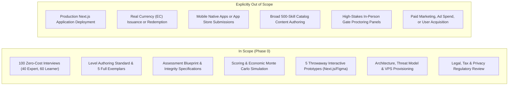
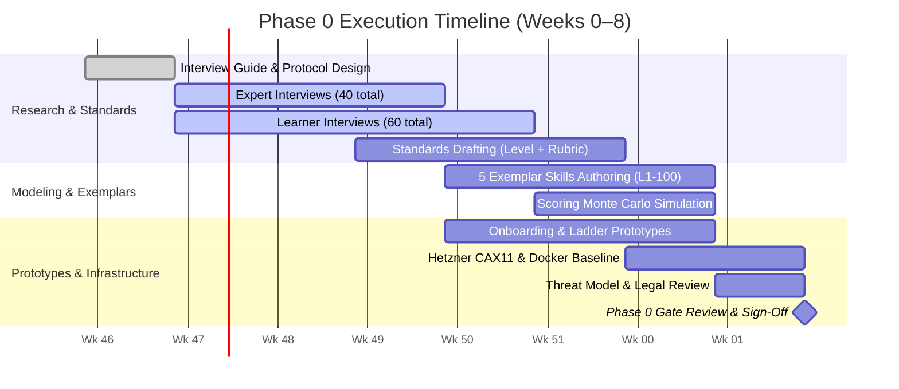
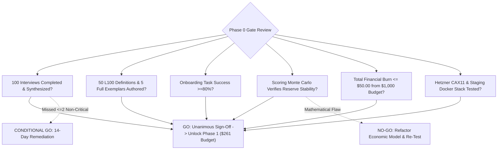
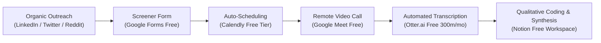

# Phase 0 — Foundations Specification (Weeks 0–8)

| Metadata | Value |
|---|---|
| **Document Path** | `docs/13-phases/02-phase-0.md` |
| **Version** | `2.0.0` |
| **Last Updated** | `2026-11-21` |
| **Author** | Senior Technical Writer & System Architect |
| **Status** | Active / Baseline |
| **Budget Envelope** | **$47.00 USD** from $1,000 Upfront Cash Pool ($953.00 Remaining) |
| **Related Docs** | [Delivery Roadmap](01-roadmap.md), [Phase 1 — Alpha](03-phase-1.md), [Release Gates](08-release-gates.md), [Scoring Model](../01-economy/03-scoring-model.md), [Taxonomy](../02-skills/01-taxonomy.md) |

---

## Table of Contents

1. [Primary Question & Scope](#1-primary-question--scope)
2. [Phase 0 Deliverables](#2-phase-0-deliverables)
3. [Workplan & Timeline](#3-workplan--timeline)
4. [Research Strategy & Methodology](#4-research-strategy--methodology)
5. [Core Standards Baseline](#5-core-standards-baseline)
6. [Interactive Prototypes Specification](#6-interactive-prototypes-specification)
7. [Exit Criteria & Governance Gate](#7-exit-criteria--governance-gate)
8. [Core Requirements Matrix](#8-core-requirements-matrix)
9. [Pre-Existing Risk Mitigations](#9-pre-existing-risk-mitigations)
10. [Exact Tooling for Phase 0](#10-exact-tooling-for-phase-0)
11. [Phase 0 Cost Breakdown (from $1,000 Budget)](#11-phase-0-cost-breakdown-from-1000-budget)
12. [Phase 0 Developer Setup Checklist](#12-phase-0-developer-setup-checklist)
13. [Phase 0 Prototypes — Deep Implementation Guide](#13-phase-0-prototypes--deep-implementation-guide)
14. [Phase 0 Zero-Dollar Research Execution Plan](#14-phase-0-zero-dollar-research-execution-plan)
15. [Related Documentation](#15-related-documentation)

---

## 1. Primary Question & Scope

### 1.1 The Central Hypothesis
**Is the model credible, scientifically sound, mathematically stable, and legally viable enough to justify building production software?**

Phase 0 is dedicated to research, architectural standards, mathematical simulation, and high-fidelity throwaway prototypes. **No production code is written in Phase 0.** The primary output is systemic confidence: establishing that the 100-level mastery ladder is intuitive to diverse learners, the dual-token economic formulas do not induce hyperinflation or demotivation, the diagnostic onboarding accurately predicts entry competence, and the regulatory posture across major target jurisdictions is clean.

### 1.2 Boundary Definitions



---

## 2. Phase 0 Deliverables

| # | Deliverable | Primary Owner | Acceptance Criteria |
|---|---|---|---|
| **D0-01** | 40 Expert Qualitative Interviews | Learning Science Lead | Verifiable transcripts, affinity maps, signed synthesis report covering psychometrics and domain ladders. |
| **D0-02** | 60 Learner Demographic Interviews | User Research Lead | Comprehensive user segment profiles covering career switchers, frontline workers, students, and low-bandwidth learners. |
| **D0-03** | 50 Validated Level-100 Definitions | Domain Specialists | External peer review confirming each level-100 definition matches autonomous expert practice. |
| **D0-04** | 5 Fully Authored Exemplar Skills | Content Architect | Complete 1–100 ladders authored for Computer Science, Cooking, Health, Communication, and Logical Reasoning. |
| **D0-05** | Level & Assessment Standard v1.0 | Learning Science Lead | 12-field level schema, IRT blueprint, and 4-tier rubric standard formally approved. |
| **D0-06** | Scoring Simulation & Integrity Engine | System Architect | 100,000-learner synthetic Monte Carlo simulation verifying currency reserve stability across 24 simulated months. |
| **D0-07** | Onboarding PWA Prototype | UI/UX Designer | Static Next.js prototype validated with $\ge 80\%$ unassisted task completion across 20 test subjects. |
| **D0-08** | Recommendation Algorithm Harness | Data Engineer | TypeScript test harness confirming skill match sanity across 30 synthetic learner archetypes. |
| **D0-09** | Architecture Spec & Threat Model | Technical Architect | Docker Compose baseline, STRIDE security review, database schema, and failover runbooks completed. |
| **D0-10** | Legal, Tax & Privacy Risk Register | General Counsel | Written opinion confirming compliance with COPPA, GDPR, and anti-gambling/sweepstakes legislation in US, UK, and EU. |
| **D0-11** | Phase 1 Engineering Master Plan | Technical Architect | Detailed workplan, Docker Compose specs, OpenAPI contracts, and itemized Alpha budget approved. |

---

## 3. Workplan & Timeline



---

## 4. Research Strategy & Methodology

### 4.1 Expert Cohorts (40 In-Depth Interviews)
- **Psychometricians & Cognitive Scientists (8):** Assessment validity, item difficulty calibration, IRT 2-parameter logistic models, and cheat-resistance.
- **Domain Practitioners (12):** Senior professionals across software engineering, culinary arts, healthcare, corporate communication, and formal logic.
- **Labor Economists (6):** Market pricing for verified competencies, employer trust indicators, and skill portability.
- **Game Economists & Tokenomics Experts (6):** Dual-token incentive structures, preventing MUD/hyperinflation, velocity sinks, and behavioral habit loops.
- **Trust & Safety / Safeguarding Officers (4):** Child online protection, anti-collusion, and account security.
- **Accessibility (a11y) Specialists (4):** Screen reader navigation, cognitive load reduction, low-bandwidth constraints, and WCAG 2.2 AA conformance.

### 4.2 Learner Cohorts (60 Longitudinal Interviews)
Recruitment distributed across 8 distinct demographic cohorts to prevent early-adopter bias:
1. Career Switchers (12)
2. Frontline / Blue-Collar Shift Workers (10)
3. University & Vocational Students (10)
4. Parental Returners to the Workforce (8)
5. Full-time Family Caregivers (6)
6. Rural / Constrained-Bandwidth Users (6)
7. Disabled Learners (Neurodivergent & Motor-Impaired) (4)
8. High-Skilled Mid-Career Upskillers (4)

---

## 5. Core Standards Baseline

During Phase 0, ten fundamental platform standards are formalized to prevent catastrophic downstream refactoring:
1. **Level Schema Standard:** The strict 12-field JSON specification defining learning objectives, prerequisite vectors, conceptual units, and exit gates.
2. **Mastery Band Archetypes:** Operational definitions for Novice (1–20), Practitioner (21–40), Specialist (41–60), Expert (61–80), and Master (81–100).
3. **Assessment Blueprint Standard:** Taxonomy of item types (multiple choice, code execution, role-play dialogue, artifact submission).
4. **Scoring Formulas:** Deterministic mathematical power laws governing progression:
   $$\text{EC}(L) = 10 \times L^{1.2} \times m_d \times Q \times E \times M \times R$$
   $$\text{XP}(L) = 100 \times L^{1.5} \times m_d$$
5. **Integrity Tier Framework:** Classification of gate assessments into Tier 0 (Open), Tier 1 (Monitored Session), Tier 2 (Asynchronous Verified Artifact), and Tier 3 (Proctored Live Panel).
6. **Credential Metadata Schema:** W3C Verifiable Credential compliant JSON-LD format with cryptographic assertion hashes.
7. **Accessibility Baseline:** Zero blocking WCAG 2.2 AA defects, keyboard navigation, high-contrast mode, and $<150\text{KB}$ page budget.
8. **Recommendation Factor Weights:** Multi-objective scoring balancing learner interest ($0.35$), market demand ($0.30$), foundational gap filling ($0.25$), and completion momentum ($0.10$).
9. **Content Provenance & License Policy:** Strict open-access and creative commons lineage tracking for all curriculum text and media.
10. **Data Privacy & Ephemeral Session Rules:** Automated 30-day anonymization of telemetric interaction logs.

---

## 6. Interactive Prototypes Specification

| Prototype | Architecture | Verification Hypothesis | Success Threshold |
|---|---|---|---|
| **1. Onboarding Flow** | Next.js Static Export (Tailwind, no backend) | Learners complete skills discovery and diagnostic profiling in $<5$ minutes without drop-off. | $\ge 80\%$ unassisted task completion across 20 test subjects. |
| **2. Mastery Ladder UI** | Next.js PWA + Mock JSON | Learners intuitively understand the 1–100 progression ladder and unlock gates. | $\ge 90\%$ comprehension of prerequisite relationships. |
| **3. Level Gate Exam** | Next.js + Neon Free Postgres | Learners perceive the 5-item diagnostic gate as fair, rigorous, and rewarding. | $\ge 75\%$ trust rating; $<5\%$ reporting test anxiety paralysis. |
| **4. Dual-Token Wallet** | React Client Component | Learners clearly distinguish between non-transferable XP and redeemable simulated EC. | Zero confusion between XP and EC recorded in post-test interview. |
| **5. Recommender Engine** | TypeScript CLI + Jest Harness | Algorithm outputs 3 logically ordered skills based on 5 user inputs. | $\ge 85\%$ relevance agreement by domain expert panel. |

---

## 7. Exit Criteria & Governance Gate



---

## 8. Core Requirements Matrix

- `FR-PHS-101`: The research protocol must cover a minimum of 8 distinct demographic learner cohorts.
- `FR-PHS-102`: The Level Authoring Standard must be signed off by Learning Science before scaling authoring.
- `FR-PHS-103`: The mathematical scoring formulas must undergo 100,000-iteration synthetic Monte Carlo simulation before promising any real or simulated monetary rewards.
- `FR-PHS-104`: Onboarding interactive prototypes must achieve $\ge 80\%$ unassisted task completion on mobile viewports.
- `FR-PHS-105`: A formal STRIDE threat model must evaluate all potential ledger exploitation and prompt-injection vectors.
- `FR-PHS-106`: Legal and privacy compliance reviews must explicitly evaluate United States, United Kingdom, and European Union regulatory boundaries.
- `FR-PHS-107`: Exactly 5 exemplar skills must be authored across 5 divergent domain archetypes.
- `FR-PHS-108`: Cumulative financial expenditure across all Phase 0 activities must not exceed $50.00 USD.
- `NFR-PHS-101`: Prototype web pages must render interactive within $<2.0$ seconds on simulated 3G mobile network throttling.
- `NFR-PHS-102`: All interview audio recordings and transcripts must be encrypted at rest and scheduled for permanent deletion within 90 days of gate sign-off.

---

## 9. Pre-Existing Risk Mitigations

| Risk | Likelihood | Impact | Preventive Mitigation Strategy |
|---|---|---|---|
| **Standards Over-Engineering** | High | Medium | Enforce strict 2-week timebox on schema debates; adopt proven 80/20 standards (JSON Schema, W3C VC). |
| **Research Sampling Bias** | Medium | High | Utilize multi-channel screener criteria filtering out tech enthusiasts and prioritizing frontline workers. |
| **Economic Hyperinflation in Sim** | Medium | Critical | Introduce dynamic difficulty adjustments ($m_d$) and token velocity dampening factors. |
| **Early Regulatory Ambiguity** | Low | Critical | Structure Educational Currency ($\text{EC}$) in Phase 0 and 1 strictly as closed-loop promotional credits with zero fiat cash-out. |

---

## 10. Exact Tooling for Phase 0

To enforce the $1,000 upfront capital constraint, Phase 0 tooling is selected with surgical precision, utilizing resilient free tiers and low-cost development instances.

| Tool / Provider | Operational Purpose | Plan & Financial Cost | Setup Time | Exact Configuration Notes |
|---|---|---|---|---|
| **Hetzner Cloud VPS** | Baseline host for Docker testing, reverse proxy, and preview environments | **CAX11 (2 vCPU ARM, 4GB RAM, 40GB NVMe)**: €4.49/mo (~$5.00/mo) | 15 mins | Debian 12 minimal install; UFW firewall enabled; Docker Engine + Compose v2 installed; SSH key authentication only. |
| **Cloudflare DNS & CDN** | Domain nameserver management, SSL/TLS termination, DDoS protection | **Free Plan ($0.00)** | 10 mins | Full (Strict) SSL mode; proxy enabled; security level High; WebSockets enabled for future realtime channels. |
| **Neon Postgres** | Serverless relational database with database branching for staging/dev | **Free Tier (0.5GB storage, 1 project, 10 branches) ($0.00)** | 5 mins | Postgres 16 instance; `pgvector` extension enabled; primary branch `main`, staging branch `dev-stage-0`. |
| **Cloudflare R2** | S3-compatible object storage for prototype assets and research audio dumps | **Free Tier (10GB storage, zero egress fees) ($0.00)** | 5 mins | Bucket created with CORS policy restricted to development origins; AWS SDK v3 client configuration. |
| **OpenAI API** | Synthetic learner generation, prototype prompt testing, rubric evaluation | **Pay-as-you-go ($20.00 pre-funded pool)** | 5 mins | GPT-4o-mini endpoint (`$0.15/1\text{M}$` in, `$0.60/1\text{M}$` out); hard spending limit set to \$20.00 in OpenAI dashboard. |
| **Resend** | Transactional email delivery for magic links and test notifications | **Free Tier (3,000 emails/month, 100/day) ($0.00)** | 10 mins | Domain DKIM and SPF records validated via Cloudflare DNS; test API keys provisioned. |
| **GitHub & Actions** | Turborepo monorepo hosting, issue tracking, and CI/CD automation | **Free Plan (2,000 CI/CD minutes/month) ($0.00)** | 10 mins | Monorepo scaffolding; automated ESLint, TypeScript check, and Jest unit tests on PR. |
| **PostHog Cloud** | Product analytics, session replay, and onboarding funnel measurement | **Free Tier (1,000,000 events/month) ($0.00)** | 5 mins | Next.js client initialization via `@posthog/js`; EU cloud region selected for GDPR compliance. |
| **Sentry** | Frontend exception tracking and prototype error monitoring | **Developer Free Tier (5,000 errors/month) ($0.00)** | 5 mins | Next.js SDK integrated; sourcemap uploading configured via GitHub Actions. |
| **Meilisearch** | Fast typo-tolerant search engine for skills catalog testing | **Self-Hosted in Docker ($0.00)** | 10 mins | Single container running on Hetzner CAX11 with persistent Docker volume; indexed with 5 exemplar skills. |

---

## 11. Phase 0 Cost Breakdown (from $1,000 Budget)

The complete financial expenditure for the entire 8-week Phase 0 delivery cycle totals **$47.00 USD**, preserving **$953.00 USD** for Phase 1 Alpha engineering.

| Item | Specification & Quantity | Total Cost | Capital Source |
|---|---|---|---|
| **Hetzner CAX11 VPS** | 3 months allocation (Month 1, Month 2, + 1 month buffer) @ €4.49/mo | **$15.00** | Initial $1,000 Bootstrapping Pool |
| **Custom Domain Name** | 1-year registration (.com / .org via Cloudflare Registrar) | **$12.00** | Initial $1,000 Bootstrapping Pool |
| **OpenAI Prototyping Pool**| API credits for synthetic Monte Carlo learners & prompt tuning | **$20.00** | Initial $1,000 Bootstrapping Pool |
| **Neon Serverless Postgres**| 1 Project, 0.5GB Storage, branching workflow | **$0.00** | Free Tier |
| **GitHub Monorepo & Actions**| Turborepo, Issue tracking, CI/CD automated test runs | **$0.00** | Free Tier |
| **Cloudflare R2 Object Store**| 10GB S3-compatible storage, Zero egress fees | **$0.00** | Free Tier |
| **Resend Transactional Email**| 3,000 emails/month capacity | **$0.00** | Free Tier |
| **Meilisearch Search Engine**| Containerized on Hetzner CAX11 VPS | **$0.00** | Self-Hosted Open Source |
| **PostHog Cloud Analytics** | 1,000,000 telemetry events/month | **$0.00** | Free Tier |
| **User Research & Interviews**| 100 remote interviews via free tools (Calendly, Meet, Otter) | **$0.00** | Sweat Equity / Organic Outreach |
| **Total Phase 0 Expenditure**| **Full 8-Week Foundations Cycle** | **$47.00** | **$953.00 Remaining Runway** |

---

## 12. Phase 0 Developer Setup Checklist

The following sequential checklist must be fully verified and executed before authoring application logic:

- [ ] **Infrastructure & Server Provisioning**
  - [ ] Hetzner Cloud account created, 2FA enabled, and personal SSH ed25519 public key uploaded.
  - [ ] CAX11 server provisioned in Falkenstein/Nuremberg datacenter running Debian 12 ARM64.
  - [ ] Non-root `deploy` user created with `sudo` privileges.
  - [ ] `ufw` firewall configured to block all incoming traffic except ports `22` (SSH), `80` (HTTP), and `443` (HTTPS).
  - [ ] Fail2ban installed and configured with 5-attempt threshold on SSH daemon.
- [ ] **DNS & Edge Network**
  - [ ] Domain name purchased via Cloudflare Registrar; nameservers pointed to Cloudflare.
  - [ ] DNS A-records configured for `api.domain.com`, `app.domain.com`, and `staging.domain.com` pointing to VPS IP.
  - [ ] Cloudflare SSL/TLS configured to "Full (Strict)" with Universal SSL certificate enabled.
- [ ] **Code Repository & Monorepo Scaffold**
  - [ ] GitHub repository initialized with Turborepo monorepo architecture (`apps/web`, `packages/api`, `packages/db`, `packages/ui`).
  - [ ] `.gitignore` configured to prevent accidental leakage of `.env`, `.env.local`, and SSH credentials.
  - [ ] GitHub Actions CI workflow authored for automated linting (`pnpm lint`), type checking (`pnpm typecheck`), and unit tests (`pnpm test`).
  - [ ] GitHub repository secrets populated: `NEON_DATABASE_URL`, `OPENAI_API_KEY`, `RESEND_API_KEY`, `CLOUDFLARE_R2_SECRET`.
- [ ] **Persistence & Cloud Services**
  - [ ] Neon project created; production connection string and staging branch string verified via `psql`.
  - [ ] `pgvector` extension enabled on Neon instance (`CREATE EXTENSION IF NOT EXISTS vector;`).
  - [ ] Cloudflare R2 bucket `educonomy-prototype-artifacts` created; access key ID and secret access key generated.
  - [ ] OpenAI developer account established; spending limit hard-capped at \$20.00; API key provisioned.
  - [ ] Resend account created; DNS TXT and MX records verified for transactional email delivery.
  - [ ] PostHog Cloud EU project initialized; client-side public API token secured.
  - [ ] Sentry developer project initialized; DSN environment variable saved.
- [ ] **Local & Staging Container Runtime**
  - [ ] Docker Engine and Docker Compose v2 installed on both local development machines and Hetzner VPS.
  - [ ] Multi-container `docker-compose.yml` authored containing Nginx, Node.js App, Redis, and Meilisearch.
  - [ ] Deployment verification script executed: `docker compose up -d` verifies clean health checks across all containers.

---

## 13. Phase 0 Prototypes — Deep Implementation Guide

To maximize insight while expending zero production engineering overhead, Phase 0 constructs 5 isolated, throwaway prototypes.

### 13.1 Prototype 1: Onboarding & Diagnostic Funnel
- **Objective:** Validate whether prospective learners can articulate their prior experience, complete a 3-step diagnostic assessment, and receive a credible skill recommendation in $<5$ minutes.
- **Tech Stack:** Next.js 15 App Router static export, Tailwind CSS, Framer Motion for micro-interactions, PostHog telemetry. Zero database dependencies (state maintained in React Context / LocalStorage).
- **Test Protocol:** 20 diverse subjects observed over Google Meet screenshares. The tester is instructed: *"Find a new skill to advance your career and complete the entry questionnaire."*
- **Target Metric:** $\ge 80\%$ unassisted task completion rate with zero critical drop-offs.

### 13.2 Prototype 2: Scoring Model & Monte Carlo Simulation
- **Objective:** Mathematically verify that the dual-token formulas for Educational Currency ($\text{EC}$) and Experience Points ($\text{XP}$) remain economically stable under varying learner progression velocities without causing currency hyperinflation or pool exhaustion.
- **Formulas Implemented:**
  $$\text{EC}(L) = 10 \times L^{1.2} \times m_d \times Q \times E \times M \times R$$
  $$\text{XP}(L) = 100 \times L^{1.5} \times m_d$$
- **Tech Stack:** TypeScript simulation harness, Jest test runner, Node.js CLI with CSV export for spreadsheet cross-validation.

```typescript
/**
 * Economic Scoring Prototype Engine
 * Mathematical implementation of power-law reward progression formulas.
 */

export interface ScoringParameters {
  level: number;              // L in [1, 100]
  domainMultiplier: number;   // m_d in [0.8, 1.5]
  rubricQuality: number;      // Q in [0.7, 1.0]
  integrityTier: number;      // E in [1.0, 1.3]
  momentumMultiplier: number; // M in [1.0, 1.25]
  rarityFactor: number;       // R in [1.0, 2.0]
}

export interface ProgressionAward {
  level: number;
  xpEarned: number;
  ecEarned: number;
  cumulativeXp: number;
  cumulativeEc: number;
}

export function calculateLevelAward(params: ScoringParameters): { xp: number; ec: number } {
  const { level, domainMultiplier, rubricQuality, integrityTier, momentumMultiplier, rarityFactor } = params;

  if (level < 1 || level > 100) {
    throw new Error('Level must be bounded between 1 and 100 inclusive.');
  }

  // XP(L) = 100 * L^1.5 * m_d
  const xp = Math.round(100 * Math.pow(level, 1.5) * domainMultiplier);

  // EC(L) = 10 * L^1.2 * m_d * Q * E * M * R
  const ec = Math.round(
    10 * Math.pow(level, 1.2) * domainMultiplier * rubricQuality * integrityTier * momentumMultiplier * rarityFactor
  );

  return { xp, ec };
}

export function runSyntheticProgressionSimulation(
  targetLevel: number,
  params: Omit<ScoringParameters, 'level'>
): ProgressionAward[] {
  const results: ProgressionAward[] = [];
  let cumXp = 0;
  let cumEc = 0;

  for (let L = 1; L <= targetLevel; L++) {
    const { xp, ec } = calculateLevelAward({ level: L, ...params });
    cumXp += xp;
    cumEc += ec;
    results.push({
      level: L,
      xpEarned: xp,
      ecEarned: ec,
      cumulativeXp: cumXp,
      cumulativeEc: cumEc,
    });
  }

  return results;
}
```

### 13.3 Prototype 3: Recommendation Engine Test Harness
- **Objective:** Test skill graph proximity calculations and ranking logic against 30 synthetic learner profile vectors.
- **Tech Stack:** Standalone TypeScript module implementing cosine similarity between learner experience vectors and skill prerequisite vectors, combined with market demand weights.
- **Validation:** Independent review by 3 domain experts confirming that recommendations are pedagogically sound and avoid premature difficulty leaps.

### 13.4 Prototype 4: Level Page & Mastery Ladder UI
- **Objective:** Evaluate learner perception of the 100-level mastery ladder, conceptual prerequisites, and milestone gates.
- **Tech Stack:** Next.js PWA rendering mock JSON data for the Computer Science (Python) exemplar skill.
- **Evaluation:** Accessibility audit using Lighthouse and axe-core; screen reader verification using NVDA/VoiceOver.

### 13.5 Prototype 5: Gate Exam & Integrity Flow
- **Objective:** Test user comprehension and anxiety response during a simulated level-gate assessment.
- **Tech Stack:** Minimal Next.js app connected to the Neon Postgres free tier. Evaluates happy-path question delivery, client-side answer evaluation, and immediate simulated award presentation.
- **Test Protocol:** 5 non-technical users tested on entry-level digital literacy concepts.

---

## 14. Phase 0 Zero-Dollar Research Execution Plan

Conducting 100 qualitative research interviews (40 expert, 60 learner) with zero cash budget requires strict process engineering utilizing free tiers.



### 14.1 Zero-Cost Tool Configuration
1. **Participant Outreach (Cost: $0.00):**
   - Direct messaging to academic researchers, psychometricians, and industry engineers via LinkedIn, X (Twitter), and relevant subreddits (`r/learnprogramming`, `r/adulteducation`, `r/instructionaldesign`).
   - Community partnerships with non-profit vocational training networks for frontline and career-switcher recruitment.
2. **Screener & Demographics (Cost: $0.00):**
   - Google Forms with conditional branching logic filtering respondents across demographic quotas, device accessibility, and learning history.
3. **Automated Scheduling (Cost: $0.00):**
   - Calendly Free Tier (1 event type, 30-minute interview slots) integrated with Google Calendar.
4. **Video Conferencing (Cost: $0.00):**
   - Google Meet (free 60-minute 1-on-1 calls) featuring automatic browser-based screen sharing and audio capture.
5. **Transcription & Synthesis (Cost: $0.00):**
   - Otter.ai Free Tier (300 minutes/month free transcription) rotated across 2 core team accounts; whisper.cpp local speech-to-text processing for overflow audio.
   - Qualitative tagging and thematic analysis conducted in an unlimited Notion Free Team Workspace.
6. **Total Direct Research Cash Expenditure:** **$0.00 USD**.

---

## 15. Related Documentation

- [Delivery Roadmap & Phase Evolution](01-roadmap.md)
- [Phase 1 — Alpha Engineering Master Plan](03-phase-1.md)
- [Release Gates & Verification Protocols](08-release-gates.md)
- [Comprehensive Risk Register & Budget Contingencies](../14-appendices/02-risk-register.md)
- [API & Event Architecture](../14-appendices/04-api-events.md)
- [Level Authoring Standards](../02-skills/03-level-authoring-standard.md)
