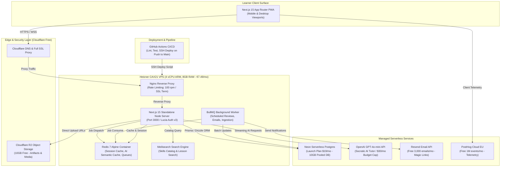
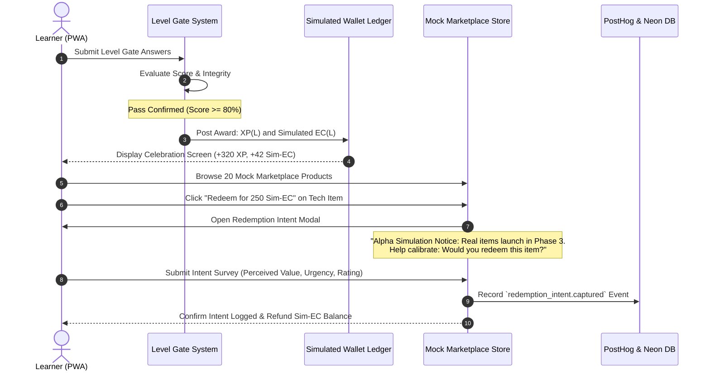
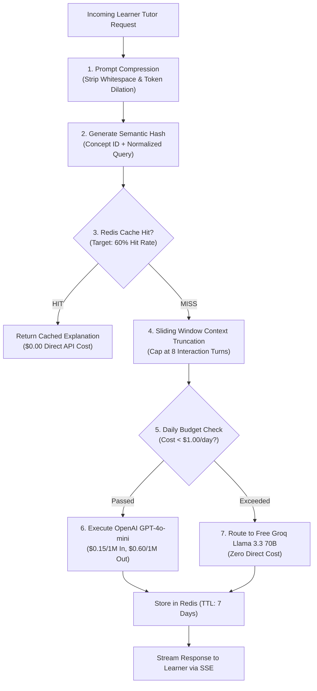

# Phase 1 — Alpha Engineering Master Plan (Weeks 9–26)

| Metadata | Value |
|---|---|
| **Document Path** | `docs/13-phases/03-phase-1.md` |
| **Version** | `2.0.0` |
| **Last Updated** | `2026-11-21` |
| **Author** | Senior Technical Writer & System Architect |
| **Status** | Active / Baseline |
| **Budget Envelope** | **~$58.00 USD/month** (18-Week Phase 1 Burn: ~$261.00 USD from $953.00 Remaining Reserve) |
| **Target Scale** | 1,000 Registered Invite-Only Learners (100 Daily Active Learners) |
| **Related Docs** | [Delivery Roadmap](01-roadmap.md), [Phase 0 — Foundations](02-phase-0.md), [Release Gates](08-release-gates.md), [AI Tutor Architecture](../04-learning/02-ai-tutor.md), [Risk Register](../14-appendices/02-risk-register.md) |

---

## Table of Contents

1. [Primary Question & Scope](#1-primary-question--scope)
2. [Phase 1 Deliverables](#2-phase-1-deliverables)
3. [Original Workplan](#3-original-workplan)
4. [Curriculum & Content Plan](#4-curriculum--content-plan)
5. [Technical Scope Baseline](#5-technical-scope-baseline)
6. [Measurement & Telemetry Plan](#6-measurement--telemetry-plan)
7. [Exit Criteria & Alpha Gate](#7-exit-criteria--alpha-gate)
8. [Core Requirements Matrix](#8-core-requirements-matrix)
9. [Pre-Existing Operational Risks](#9-pre-existing-operational-risks)
10. [Phase 1 Technical Architecture (What Actually Gets Built)](#10-phase-1-technical-architecture-what-actually-gets-built)
11. [Phase 1 Cost Breakdown (Monthly, 1,000 Learners)](#11-phase-1-cost-breakdown-monthly-1000-learners)
12. [Phase 1 Development Workplan (Exact Week-by-Week)](#12-phase-1-development-workplan-exact-week-by-week)
13. [Phase 1 EC Simulation (Fake Economy & Intent Engine)](#13-phase-1-ec-simulation-fake-economy--intent-engine)
14. [Phase 1 AI Cost Optimization ($30/Month Ceiling Strategy)](#14-phase-1-ai-cost-optimization-30month-ceiling-strategy)
15. [Related Documentation](#15-related-documentation)

---

## 1. Primary Question & Scope

### 1.1 The Central Hypothesis
**Can real learners make sustained, measurable progress through the 100-level curriculum and subjectively perceive a genuine shift in their practical capabilities?**

Alpha is an invite-only web progressive web application (PWA) operating 25 playable skills. It establishes the baseline mechanics of diagnostic onboarding, conceptual instruction, adaptive practice, and high-integrity level gates. **No real currency is paid out in Phase 1.** Educational Currency ($\text{EC}$) is simulated as a promotional balance, while Experience Points ($\text{XP}$) drive non-monetary progression status.

### 1.2 Boundary Definitions
- **In Scope:**
  - Next.js 15 App Router PWA deployed on a single Hetzner CAX21 ARM VPS.
  - Lucia Auth v3 session authentication backed by Neon Serverless Postgres.
  - 25 playable skills (5 full 1–100 exemplars; 20 skills with levels 1–30 + complete outline).
  - AI Tutor v1 powered by OpenAI GPT-4o-mini with Redis semantic caching.
  - Interactive gate assessment engine with Tier 1 (Open / Monitored) integrity checks.
  - Simulated EC wallet with a 20-item mock redemption marketplace catalog.
  - PostHog Cloud event instrumentation and RFC 7807 problem details error handling.
- **Out of Scope:**
  - Native iOS and Android application store deployments.
  - Real fiat money or cryptocurrency transfers, payouts, or sponsor deposits.
  - Multi-region database replication or automated failover clusters.
  - Spatial, VR, or 3D WebXR lesson environments.
  - Multilingual localization beyond English.

---

## 2. Phase 1 Deliverables

| # | Deliverable | Primary Owner | Acceptance Criteria |
|---|---|---|---|
| **D1-01** | Production Learner PWA | Full-Stack Lead | 1,000 invited learners onboarded; Lighthouse Performance $\ge 90$; PWA installable. |
| **D1-02** | Diagnostic Onboarding Engine | Frontend Lead | $\ge 65\%$ completion rate from invite redemption to first skill enrollment. |
| **D1-03** | Skill Recommender v1 | Data Engineer | $\ge 45\%$ acceptance rate for the top 3 recommended learning paths. |
| **D1-04** | 25 Playable Skills Curriculum | Content Lead | 1,100 authored levels across 5 exemplars (1–100) and 20 skills (1–30). |
| **D1-05** | AI Tutor Gateway v1 | Backend Engineer | Groundedness $\ge 95\%$; zero gate leakages; monthly OpenAI spend $\le \$30.00$. |
| **D1-06** | Level Gate Assessment System | Psychometrician | First-attempt pass rate calibrated to $55\%–75\%$; instant rubric scoring. |
| **D1-07** | Simulated Wallet & Mock Store | Product Lead | Clear visual separation of XP vs. simulated EC; intent telemetry active on 20 items. |
| **D1-08** | Conversational Role-Play Engine | Frontend Engineer | 10 interactive branching soft-skill scenarios with automated grading. |
| **D1-09** | Moderation & Support Desk | Community Lead | First-response resolution time $<4$ hours for user-submitted tickets. |
| **D1-10** | Comprehensive Instrumentation | Data Analyst | All core funnel events streaming to PostHog; North Star metric queryable. |

---

## 3. Original Workplan

| Weeks | Focus Area | Headline Target |
|---|---|---|
| **9–11** | Platform skeleton, Lucia auth, Neon database models | Auth + profile flows operational |
| **10–13** | Onboarding PWA, diagnostic graph, experience nodes | Profiling funnel passes QA |
| **12–15** | Learning engine, concept viewer, quiz practice engine | Interactive lessons functional |
| **14–17** | Level gate system, timer, open-tier integrity checks | Exam submission & grading live |
| **15–18** | AI tutor gateway, guardrails, Redis semantic cache | Socratic tutor answers queries |
| **17–20** | 25 skills authoring, item bank imports | 1,100 levels playable |
| **19–21** | Recommender engine v1 integration | Dynamic home feed active |
| **20–22** | Dual-token wallet, mock marketplace store | Simulated EC awards functional |
| **21–23** | Soft-skill role-play simulator engine | Conversational engine complete |
| **22–24** | Performance hardening, WCAG 2.2 audit, load test | P95 latency $<400\text{ms}$ at 100 concurrent |
| **24–25** | Invite Wave 1: 100 friendly learners | Qualitative bug hunting & fixes |
| **25–26** | Invite Wave 2: 900 general cohort learners | Psychometric calibration & metrics gate |

---

## 4. Curriculum & Content Plan

| Content Entity | Quantity | Authoring Standard & Specifications |
|---|---|---|
| **Skills Playable** | 25 | 5 complete 1–100 exemplars; 20 skills authored levels 1–30 with level 31–100 outlines. |
| **Total Authored Levels** | 1,100 | $5 \times 100 + 20 \times 30 = 1,100$ discrete levels adhering to 12-field schema. |
| **Assessment Items** | 22,000+ | Minimum 20 calibrated multiple-choice, code-eval, or text-input items per level. |
| **Role-Play Scenarios** | 10 | Interactive branch scenarios covering negotiation, active listening, and conflict de-escalation. |
| **Conceptual Units** | 3,300+ | 3 text/diagram micro-units per level ($<500$ words each) optimized for low bandwidth. |

---

## 5. Technical Scope Baseline

- **Application Tier:** Rust Cargo workspace — Axum 0.8 REST API (`api`) + AI gateway (`genai`) + Leptos 0.7 client-side UI (Trunk), one container per service.
- **Database Tier:** Neon Serverless PostgreSQL via SQLx 0.9 (runtime queries + embedded migrations) with `pgvector`.
- **Cache:** Redis 7 (local dev / prod container) via the `fred` client; sessions cached in Postgres via `tower-sessions`.
- **Object Storage:** Cloudflare R2 bucket (S3-compatible) for learner artifacts and media.
- **Reverse proxy / TLS:** Caddy (automatic Let's Encrypt) instead of nginx.
- **Service Level Objective (SLO):** $\ge 99.5\%$ platform availability across the 18-week Alpha cycle.

---

## 6. Measurement & Telemetry Plan

### 6.1 North Star & Funnel Metrics
- **Velocity of Mastery Growth per Weekly Active Learner (VMG-WAL):** Target $\ge 1.2$ levels completed per active learner per week.
- **Onboarding Funnel Completion:** Target $\ge 65\%$ conversion from registration to completion of Level 1.
- **First Level Passed $\le 7$ Days:** Target $\ge 50\%$ of registered cohort.
- **Retention:** Day 7 (D7) retention $\ge 40\%$; Day 30 (D30) retention $\ge 25\%$.
- **Gate Calibrated Pass Rate:** $55\%–75\%$ first-attempt pass rate across all 25 skills.

### 6.2 Safety & Integrity Guardrails
- **Assessment Integrity Flag Rate:** $<3.0\%$ of submissions flagged for suspicious anomaly patterns.
- **Appeals Overturn Rate:** $<5.0\%$ of rejected gate submissions overturned on human audit.
- **Accessibility Defects:** Exactly 0 blocking WCAG 2.2 AA defects.
- **AI Tutor Hallucination & Harm:** $<0.1\%$ harmful outputs; groundedness audit $\ge 95\%$.

---

## 7. Exit Criteria & Alpha Gate

| Metric / Milestone | Target | Verification Method |
|---|---|---|
| **Registered Invited Learners** | 1,000 | Neon database `users` table count. |
| **Onboarding Completion** | $\ge 65\%$ | PostHog funnel analysis. |
| **D7 Cohort Retention** | $\ge 40\%$ | PostHog retention matrix. |
| **D30 Cohort Retention** | $\ge 25\%$ | PostHog retention matrix. |
| **Gate First-Attempt Pass Rate** | $55\%–75\%$ | SQL analysis of `gate_attempts` table. |
| **Net Promoter Score (NPS)** | $\ge 40$ | In-app survey prompt upon passing Level 5. |
| **Monthly Infrastructure Burn** | $\le \$60.00/\text{mo}$ | Hetzner, Neon, and OpenAI billing invoices. |
| **AI Tutor Groundedness** | $\ge 95\%$ | 100-sample automated RAG evaluation benchmark. |

---

## 8. Core Requirements Matrix

- `FR-PHS-201`: Alpha access must be strictly restricted to pre-generated invite tokens.
- `FR-PHS-202`: All 25 skills must provide end-to-end playability without dead-end missing levels.
- `FR-PHS-203`: Level gate evaluations must execute against immutable rubric versions.
- `FR-PHS-204`: All Educational Currency ($\text{EC}$) awards in Phase 1 must be visibly labeled as "Simulated Promotional Credits".
- `FR-PHS-205`: The AI Tutor system prompt must forbid revealing direct answers to gate exam items.
- `FR-PHS-206`: Core lesson views must achieve full interactivity on 3G network connections ($<1.5\text{MB}$ total bundle).
- `FR-PHS-207`: All interactive UI components must comply with WCAG 2.2 AA keyboard navigation.
- `FR-PHS-208`: Every learning interaction must emit an RFC-compliant event to PostHog.
- `FR-PHS-209`: Support tickets submitted via in-app feedback must trigger an automated Slack/Email alert.
- `FR-PHS-210`: User feedback surveys must be triggered at Levels 1, 5, 10, and 20.
- `NFR-PHS-201`: P95 API response time must remain $<400\text{ms}$ under 100 concurrent learner sessions.
- `NFR-PHS-202`: System uptime must meet or exceed $99.5\%$ excluding scheduled maintenance windows.

---

## 9. Pre-Existing Operational Risks

| Risk Event | Likelihood | Impact | Mitigation Strategy |
|---|---|---|---|
| **Content Authoring Bottleneck** | High | High | Stagger skill release; publish levels 1–10 first, then 11–20, then 21–30. |
| **Assessment Difficulty Imbalance** | Medium | High | Weekly psychometric item difficulty re-balancing based on real pass curves. |
| **AI Tutor Prompt Injection** | Medium | Medium | Wrap user prompts in strict delimiters; validate output against regex safety rules. |
| **Learner Churn Post-Onboarding** | High | Critical | Automated re-engagement transactional emails at Day 2, Day 4, and Day 7 via Resend. |

---

## 10. Phase 1 Technical Architecture (What Actually Gets Built)

The Phase 1 architecture is engineered to run reliably on a single cost-effective Hetzner ARM VPS paired with specialized serverless backends, eliminating DevOps overhead while staying within the $1,000 budget.



### 10.1 Service Container Sizing on Hetzner CAX21 (8GB Total RAM)
- `nginx`: 64MB RAM limit, minimal CPU overhead.
- `next-app`: 2.5GB RAM hard ceiling (`--max-old-space-size=2048`), Node.js 20 LTS standalone build.
- `worker`: 1.5GB RAM hard ceiling for BullMQ asynchronous job execution.
- `redis`: 1.0GB RAM hard ceiling (`maxmemory 1gb`, `maxmemory-policy allkeys-lru`).
- `meilisearch`: 512MB RAM hard ceiling (`MEILI_MAX_INDEXING_MEMORY=512MB`).
- **OS & Headroom:** 2.4GB RAM reserved for Linux kernel, page cache, and temporary buffers.

---

## 11. Phase 1 Cost Breakdown (Monthly, 1,000 Learners)

### 11.1 Itemized Monthly Run-Rate

| Expense Item | Specification & Provider | Monthly Cost (USD) | Budget Envelope Allocation |
|---|---|---|---|
| **Application Host VPS** | Hetzner CAX21 (4 vCPU ARM, 8GB RAM, 80GB NVMe) | **$8.00** (€7.49/mo) | Deducted from Remaining Initial Reserve |
| **Relational Database** | Neon Postgres Launch Plan (10GB storage, pooled compute) | **$19.00** | Deducted from Remaining Initial Reserve |
| **AI Tutor Inference** | OpenAI GPT-4o-mini (1,000 learners $\times$ 10 sessions $\times$ 5k tokens with caching) | **~$30.00** | Deducted from Remaining Initial Reserve |
| **Object Storage** | Cloudflare R2 (Under 10GB free tier, zero egress fees) | **$0.00** | Free Tier |
| **Transactional Email** | Resend (3,000 emails/month free; 1,000 learners $\approx 1$ email/user/mo) | **$0.00** | Free Tier |
| **Product Analytics** | PostHog Cloud (1,000,000 telemetry events/month free) | **$0.00** | Free Tier |
| **Search Engine** | Meilisearch Containerized on Hetzner VPS | **$0.00** | Self-Hosted Open Source |
| **Domain Amortization**| Cloudflare Registrar ($12/year) | **$1.00** | Amortized from Initial Setup |
| **CI/CD Pipeline** | GitHub Actions (Under 2,000 free minutes/month) | **$0.00** | Free Tier |
| **Error Monitoring** | Sentry Developer Free Tier (5,000 errors/month) | **$0.00** | Free Tier |
| **Total Monthly Operating Cost** | **Phase 1 Production Run-Rate** | **~$58.00 / month** | **$1,000 Upfront Pool Coverage** |

### 11.2 Runway & Cash Sufficiency Proof
- **Cash Remaining Entering Phase 1:** **$953.00 USD** ($1,000 upfront pool minus $47.00 Phase 0 spend).
- **Phase 1 Duration:** 18 Weeks ($4.15$ Months).
- **Total Phase 1 Cumulative Expenditure:** $4.15 \times \$58.00 \approx \mathbf{\$240.70\text{ USD}}$ (Budgeted at **$261.00 USD** with contingency buffer).
- **Cash Surplus Remaining at Phase 1 Completion:** $\$953.00 - \$261.00 = \mathbf{\$692.00\text{ USD}}$.
- **Conclusion:** Phase 1 completes with zero outside capital requirements, remaining $100\%$ within the initial $1,000 bootstrapping fund.

---

## 12. Phase 1 Development Workplan (Exact Week-by-Week)

The 18-week Alpha development schedule is structured with definitive acceptance criteria, assigned owners, and dependency chains.

| Week | Track & Owner | Primary Focus & Deliverables | Tools & Libraries Used | Preceding Dependencies | Quantitative Definition of Done (DoD) |
|---|---|---|---|---|---|
| **9** | Solo Founder / Full-Stack | Turborepo setup, Next.js 15 App Router scaffold, Tailwind CSS, Shadcn UI setup. | Turborepo, pnpm, Next.js 15, Tailwind | Phase 0 Gate Sign-off | Monorepo compiles cleanly; CI pipeline lints and type-checks in $<90$ seconds. |
| **10** | Solo Founder / Full-Stack | Lucia Auth v3 integration with Neon Postgres adapter, session cookies, passwordless login. | Lucia Auth v3, `@lucia-auth/adapter-postgresql`, Resend | Week 9 Monorepo | User can sign up via email magic link; session persists across browser restarts; tests pass. |
| **11** | Solo Founder / Full-Stack | Database migrations for skills, levels, conceptual nodes, and learner progression tables. | Drizzle ORM, Neon Postgres, pgvector | Week 10 Auth | Schema migrations execute cleanly; relational constraints verified via integration tests. |
| **12** | Full-Stack + UI Designer | Onboarding PWA flow, diagnostic career selector, dynamic profile graph visualization. | Framer Motion, `@tanstack/react-query`, Zod | Week 11 DB Schema | New learner completes 4-step diagnostic in $<4$ minutes; entry experience graph node saved. |
| **13** | Data Lead / Full-Stack | Skill recommender v1 algorithm; cosine similarity against skill vectors. | TypeScript, `pgvector`, mathjs | Week 12 Onboarding | System returns 3 recommended skills; test harness passes $\ge 85\%$ relevance benchmark. |
| **14** | Content Lead + Engineer | Text concept viewer, video embed player, and interactive multiple-choice practice quiz engine. | MDX, React Player, Lucide React | Week 11 DB Schema | Learner reads concept, answers 5 quiz items, receives real-time validation and feedback. |
| **15** | Backend Engineer | Level gate exam engine, timer countdown, submission handler, integrity logging. | Server Actions, Zod, Redis rate-limiting | Week 14 Quiz Engine | Learner initiates gate attempt; answers evaluated; pass/fail recorded with audit log. |
| **16** | Backend Engineer | AI Tutor Gateway v1; OpenAI streaming endpoint, system prompt delimiters, Redis caching. | OpenAI Node SDK, `@upstash/redis`, ai (Vercel) | Week 14 Quiz Engine | Tutor responds to learner concept queries via SSE stream in $<600\text{ms}$ time-to-first-token. |
| **17** | Content Lead (Domain SMEs)| Author and import first 10 skills (Levels 1–30) into production Neon database. | JSON Schema validator, CLI import script | Week 11 DB Schema | 300 levels fully populated with concepts, practice items, and gate rubrics. |
| **18** | Content Lead (Domain SMEs)| Author and import remaining 15 skills (Levels 1–30, plus 5 full 1–100 exemplars). | CLI import script, Neon branch staging | Week 17 Content Import | All 25 skills playable end-to-end; 1,100 levels verified via automated crawler script. |
| **19** | Full-Stack Engineer | Simulated EC wallet dashboard; ledger presentation; transaction history table. | Shadcn UI, Recharts, React Table | Week 15 Gate Engine | Passing gate awards simulated EC according to power-law formula; wallet balance updates. |
| **20** | Full-Stack Engineer | Mock marketplace catalog; 20 pre-populated items; intent capture questionnaire modal. | Next.js Server Components, Zod | Week 19 Wallet | Learner clicks "Redeem"; survey modal captures intent ("Would you redeem?"); intent saved. |
| **21** | Frontend Engineer | Conversational soft-skill role-play simulator (branching dialogue tree + AI scoring). | React Flow, OpenAI GPT-4o-mini | Week 16 AI Gateway | Learner completes negotiation scenario; AI evaluates transcript against 4-point rubric. |
| **22** | DevOps / Full-Stack | Production Docker Compose hardening, Hetzner UFW lockdown, Certbot SSL automation. | Docker Compose, Nginx, Certbot, Fail2ban | Week 9–21 Codebase | Production deployment healthy; automated HTTPS renewal tested; non-root execution. |
| **23** | QA / Accessibility Lead | Accessibility audit (WCAG 2.2 AA), screen-reader navigation, lighthouse optimization. | axe-core, Pa11y, Lighthouse CLI | Week 22 Deployment | Lighthouse scores $\ge 90$ across all categories; exactly 0 blocking a11y defects found. |
| **24** | Product Lead | Invite Wave 1: 100 friendly alpha testers onboarded; live observation and hotfix cycle. | PostHog Session Replay, Sentry | Week 23 Hardening | 100 users onboarded; $\ge 60$ pass Level 1; critical bug turnaround $<6$ hours. |
| **25** | Product Lead | Invite Wave 2: 900 general cohort learners invited; psychometric item difficulty calibration. | Resend batch email, PostHog Funnels | Week 24 Wave 1 | 1,000 total learners onboarded; first-attempt gate pass rate stabilized at $55\%–75\%$. |
| **26** | System Architect + Exec | Alpha Gate Evaluation: metric validation, financial audit, and Phase 2 transition sign-off. | SQL audit scripts, financial reports | Week 25 Data Collection| Formal Alpha Gate signed; remaining cash runway verified $\ge \$650.00$; Gate 1 passes. |

---

## 13. Phase 1 EC Simulation (Fake Economy & Intent Engine)

Because legal compliance, tax reporting, and liquidity sponsorship for real financial payouts are scheduled for Phase 3, Phase 1 implements a high-fidelity **Simulated Economy**. This mechanism validates the psychological efficacy of the reward structure without risking treasury depletion.



### 13.1 Simulated Wallet Award Calculation (TypeScript Specification)
```typescript
/**
 * Phase 1 Simulated Economy Ledger Processor
 * Applies canonical power-law formulas to credit XP and Simulated EC.
 */

export interface LevelCompletionEvent {
  userId: string;
  skillId: string;
  level: number;              // L in [1, 100]
  domainMultiplier: number;   // m_d in [0.8, 1.5]
  assessmentScore: number;    // Raw score [0.0, 1.0]
  integrityTier: number;      // E = 1.0 (Open Tier)
}

export interface LedgerAwardResult {
  userId: string;
  xpAwarded: number;
  simulatedEcAwarded: number;
  newXpBalance: number;
  newSimulatedEcBalance: number;
  formulaPayload: Record<string, number>;
}

export function processSimulatedAward(
  event: LevelCompletionEvent,
  currentBalances: { xp: number; ec: number }
): LedgerAwardResult {
  const { level, domainMultiplier, assessmentScore, integrityTier } = event;

  // Rubric quality multiplier Q based on assessment performance (0.8 to 1.0)
  const Q = 0.8 + (assessmentScore * 0.2);
  
  // Default alpha factors: Momentum M = 1.0, Rarity R = 1.0
  const M = 1.0;
  const R = 1.0;

  // XP(L) = 100 * L^1.5 * m_d
  const xpAwarded = Math.round(100 * Math.pow(level, 1.5) * domainMultiplier);

  // EC(L) = 10 * L^1.2 * m_d * Q * E * M * R
  const simulatedEcAwarded = Math.round(
    10 * Math.pow(level, 1.2) * domainMultiplier * Q * integrityTier * M * R
  );

  return {
    userId: event.userId,
    xpAwarded,
    simulatedEcAwarded,
    newXpBalance: currentBalances.xp + xpAwarded,
    newSimulatedEcBalance: currentBalances.ec + simulatedEcAwarded,
    formulaPayload: {
      level,
      domainMultiplier,
      rubricQuality: Number(Q.toFixed(2)),
      integrityTier,
      momentum: M,
      rarity: R,
    },
  };
}
```

### 13.2 Mock Catalog Specifications (20 Pre-Populated Items)
The mock marketplace showcases 20 realistic products spanning four distinct categories:
1. **Digital Subscriptions (5 items):** GitHub Copilot 1-Yr, JetBrains All Products, LeetCode Premium, Headspace 6-Mo, Coursera Plus. (Sim-EC: $150$–$600$).
2. **Hardware & Peripherals (5 items):** Raspberry Pi 5 Starter Kit, Keychron Mechanical Keyboard, YubiKey 5C NFC, Logitech MX Master 3S, Sony WH-1000XM5. (Sim-EC: $300$–$2,500$).
3. **Books & Professional Development (5 items):** Pragmatic Programmer, Designing Data-Intensive Applications, 1-on-1 Senior Engineering Mentorship Session (1 hr), Resume & Portfolio Review, AWS Certified Solutions Architect Exam Voucher. (Sim-EC: $80$–$850$).
4. **Community & Impact Sponsoring (5 items):** Fund 1-Month Internet for Rural Learner, Donate Solar Study Lamp, Tree Planting Certificate (10 Trees), Open Source Library Micro-Grant, Sponsor New Beginner Skill Course. (Sim-EC: $50$–$400$).

---

## 14. Phase 1 AI Cost Optimization ($30/Month Ceiling Strategy)

With 1,000 active learners, unconstrained OpenAI API consumption could rapidly exceed hundreds of dollars monthly. To maintain the **$\le \$30.00/\text{month}$** ceiling, the AI Gateway applies six aggressive cost-reduction engineering controls.



### 14.1 The Six Cost-Optimization Techniques
1. **Redis Semantic Caching (Target Hit Rate: 60%):** Explanations for common conceptual stumbling blocks (e.g., *"What is recursion in Python?"*) are hashed and cached with a 7-day TTL.
2. **Sliding Window Context Truncation:** The AI tutor context is bounded to the system prompt, current concept definition, and the last **8 conversation turns** (max 1,200 tokens total context), preventing runaway quadratic token expansion.
3. **Prompt Compression & Delimiter Minimization:** System prompts are stripped of whitespace and filler words, utilizing concise structural markdown.
4. **Batch Embeddings:** Vector embeddings for new lesson concepts are executed once nightly via batch CLI scripts, eliminating on-demand embedding calls.
5. **Per-Learner Daily Quotas:** Each learner is capped at a maximum of 25 AI tutor turns per 24-hour period.
6. **Dynamic Failover to Groq Free Tier:** If aggregate daily OpenAI expenditure reaches $\$1.00$, subsequent non-critical requests automatically cascade to Groq's free-tier Llama 3.3 70B endpoint.

### 14.2 AI Gateway Optimization Middleware (TypeScript Specification)
```typescript
/**
 * AI Gateway Cost-Optimization Middleware
 * Enforces prompt compression, Redis caching, sliding window context, and token budgets.
 */

import { createHash } from 'crypto';
import type { Redis } from 'ioredis';

export interface TutorMessage {
  role: 'user' | 'assistant';
  content: string;
}

export interface TutorRequest {
  userId: string;
  conceptId: string;
  conceptText: string;
  conversationHistory: TutorMessage[];
  currentQuery: string;
}

export class AiGatewayOptimizer {
  private redis: Redis;
  private readonly DAILY_USER_QUOTA = 25;
  private readonly CACHE_TTL_SECONDS = 7 * 24 * 3600; // 7 Days

  constructor(redisClient: Redis) {
    this.redis = redisClient;
  }

  /**
   * Generates a deterministic cache key from the normalized query and concept.
   */
  private generateCacheKey(conceptId: string, query: string): string {
    const normalized = query.toLowerCase().trim().replace(/[^\w\s]/gi, '');
    const hash = createHash('sha256').update(`${conceptId}:${normalized}`).digest('hex');
    return `tutor:cache:${conceptId}:${hash}`;
  }

  /**
   * Compresses system prompt and truncates history to last 8 turns.
   */
  public preparePayload(request: TutorRequest): { systemPrompt: string; messages: TutorMessage[] } {
    // Compressed Socratic System Prompt (Tokens minimized)
    const systemPrompt = `You are an expert Socratic tutor for concept: "${request.conceptId}". ` +
      `Grounded context: "${request.conceptText.slice(0, 1000)}". ` +
      `Rule: Never provide direct gate answers. Guide learner with probing questions. Be concise (<120 words).`;

    // Sliding window: Retain at most the last 8 turns
    const boundedHistory = request.conversationHistory.slice(-8);
    boundedHistory.push({ role: 'user', content: request.currentQuery.trim() });

    return { systemPrompt, messages: boundedHistory };
  }

  /**
   * Intercepts query, evaluates cache, checks quotas, and returns cached response if hit.
   */
  public async handleRequest(
    request: TutorRequest,
    invokeApiCompletion: (prompt: string, messages: TutorMessage[]) => Promise<string>
  ): Promise<{ response: string; cached: boolean }> {
    const today = new Date().toISOString().slice(0, 10);
    const userQuotaKey = `tutor:quota:${request.userId}:${today}`;

    // Step 1: Check and increment daily user quota
    const currentUsage = await this.redis.incr(userQuotaKey);
    if (currentUsage === 1) {
      await this.redis.expire(userQuotaKey, 86400);
    }
    if (currentUsage > this.DAILY_USER_QUOTA) {
      return {
        response: 'You have reached your daily Socratic tutor limit (25 questions). Continue practicing exercises or review again tomorrow!',
        cached: true,
      };
    }

    // Step 2: Check Redis Semantic Cache
    const cacheKey = this.generateCacheKey(request.conceptId, request.currentQuery);
    const cachedResponse = await this.redis.get(cacheKey);
    if (cachedResponse) {
      return { response: cachedResponse, cached: true };
    }

    // Step 3: Prepare bounded payload
    const { systemPrompt, messages } = this.preparePayload(request);

    // Step 4: Execute completion via OpenAI or fallback
    const freshResponse = await invokeApiCompletion(systemPrompt, messages);

    // Step 5: Store in Redis cache asynchronously
    await this.redis.setex(cacheKey, this.CACHE_TTL_SECONDS, freshResponse);

    return { response: freshResponse, cached: false };
  }
}
```

---

## 15. Related Documentation

- [Delivery Roadmap & Budget Milestones](01-roadmap.md)
- [Phase 0 — Foundations Specification](02-phase-0.md)
- [Phase 2 — Beta Architecture](04-phase-2.md)
- [Release Gates & Verification Protocols](08-release-gates.md)
- [Comprehensive Risk Register & Budget Contingencies](../14-appendices/02-risk-register.md)
- [API & Event Schema Registry](../14-appendices/04-api-events.md)
