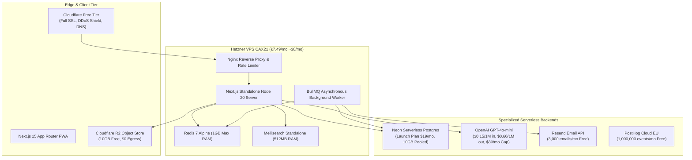

# Delivery Roadmap Cost & Infrastructure Model

| Metadata | Value |
|---|---|
| **Document Path** | `docs/13-phases/09-cost-budget-model.md` |
| **Version** | `1.0.0` |
| **Last Updated** | `2026-11-21` |
| **Author** | Senior Technical Writer & System Architect |
| **Status** | Active / Baseline Specification |
| **Financial Envelope** | **$1,000.00 USD Upfront Capital Pool** + **$100.00 USD/Month Ongoing Runway** |
| **Target Milestones** | Phase 0 (Foundations / Prototypes) & Phase 1 (Alpha / 1,000 Learners) |
| **Related Docs** | [Delivery Roadmap](01-roadmap.md), [Phase 0 Foundations](02-phase-0.md), [Phase 1 Alpha](03-phase-1.md), [Release Gates](08-release-gates.md), [Risk Register](../14-appendices/02-risk-register.md) |

---

## Table of Contents

1. [Executive Summary & Financial Architecture](#1-executive-summary--financial-architecture)
2. [Technology Stack & Free-Tier Resource Constraints](#2-technology-stack--free-tier-resource-constraints)
3. [Capital Allocation & Runway Trajectory ($1,000 Bootstrapping Pool)](#3-capital-allocation--runway-trajectory-1000-bootstrapping-pool)
4. [Unit Economics & Learner Cost Modeling](#4-unit-economics--learner-cost-modeling)
5. [Docker Compose Infrastructure Sizing on Hetzner CAX21](#5-docker-compose-infrastructure-sizing-on-hetzner-cax21)
6. [Algorithmic Runway Simulator (TypeScript Specification)](#6-algorithmic-runway-simulator-typescript-specification)
7. [Economic Incentive Formula Integration](#7-economic-incentive-formula-integration)
8. [Open Source Escape Hatches & Migration Protocols](#8-open-source-escape-hatches--migration-protocols)
9. [Edge Cases & Financial Safeguards](#9-edge-cases--financial-safeguards)
10. [Success Metrics & Audit Protocols](#10-success-metrics--audit-protocols)
11. [Related Documentation](#11-related-documentation)

---

## 1. Executive Summary & Financial Architecture

The Education Economy platform is structured to eliminate the primary cause of early-stage venture failure: premature capital depletion on cloud infrastructure. Rather than provisioning speculative multi-zone clusters or unmetered proprietary APIs, the system operates under a strict, non-negotiable financial envelope:

- **Upfront Capital Allocation:** Exactly **$1,000.00 USD** total cash committed for setup, research, domain, and development across Phase 0 and Phase 1.
- **Ongoing Operational Ceiling:** A hard maximum expenditure of **$100.00 USD/month** sustained from bootstrapping reserves until platform revenue (sponsor pools and marketplace take-rates) reaches liquidity in Phase 2.
- **Architectural Philosophy:** Maximize high-performance open source software (OSS) containerized via Docker Compose on energy-efficient ARM cloud instances, combined with specialized serverless free tiers (Neon Postgres, Cloudflare R2, Resend, PostHog Cloud, GitHub Actions).

---

## 2. Technology Stack & Free-Tier Resource Constraints

The production technology stack has been selected to deliver sub-400ms P95 latency while guaranteeing zero unexpected overage billing:



### 2.1 Detailed Service Limits & Free Tier Thresholds
| Component / Service | Technical Architecture | Cost Model | Monthly Free Limit / Tier | Guardrail Threshold |
|---|---|---|---|---|
| **Hetzner Cloud VPS** | CAX21 (4 vCPU ARM64, 8GB RAM, 80GB NVMe) | €7.49/mo (~$8.00) | Fixed subscription | CPU $<75\%$, RAM $<85\%$ |
| **Neon Serverless Postgres**| Managed PostgreSQL 16 with `pgvector` & connection pooling | $19.00/mo (Launch) | 10GB storage, pooled compute | Alert at 8.0GB storage |
| **Cloudflare R2** | S3-compatible object store for learner submission artifacts | $0.00 | 10GB storage, $0 egress fees | Alert at 8.5GB storage |
| **OpenAI GPT-4o-mini** | Socratic AI Tutor & Automated rubric grading | Pay-as-you-go | Hard-capped at \$30.00/month | Circuit-breaker at \$1.00/day |
| **Resend Email API** | Transactional verification magic links & notifications | $0.00 | 3,000 emails/month (100/day) | Alert at 2,500 emails/mo |
| **PostHog Cloud EU** | Product analytics, user funnels, and session replays | $0.00 | 1,000,000 telemetry events/month | Sample events at 850k/mo |
| **Redis Alpine** | Session token cache, BullMQ queues, AI semantic cache | $0.00 (Self-hosted) | Bounded by VPS RAM (`maxmemory 1gb`) | LRU eviction policy active |
| **Meilisearch** | Embedded typo-tolerant search for 25 skills catalog | $0.00 (Self-hosted) | Bounded by VPS RAM (`mem_limit 512m`) | Indexing memory capped |
| **GitHub Actions** | Automated CI/CD pipeline (lint, typecheck, unit tests) | $0.00 | 2,000 build minutes/month | Turborepo caching enabled |
| **Lucia Auth v3** | Self-hosted session management via Neon Postgres adapter | $0.00 (Open source) | Unlimited sessions | Zero per-user SaaS fee |

---

## 3. Capital Allocation & Runway Trajectory ($1,000 Bootstrapping Pool)

### 3.1 Cumulative Cash Flow Waterfall
The initial $1,000.00 cash pool completely funds Phase 0 (Weeks 0–8) and Phase 1 (Weeks 9–26), leaving a substantial capital buffer of **$692.00 USD** at the conclusion of the Alpha delivery cycle.

```mermaid
gantt
    title Capital Runway Waterfall ($1,000 Initial Fund)
    dateFormat  YYYY-MM-DD
    axisFormat  Wk %W

    section Phase 0: Foundations ($47 Total Spend)
    Domain Registration ($12)        :done, c0_1, 2026-11-21, 2026-11-28
    Hetzner CAX11 3-Month Pool ($15) :done, c0_2, 2026-11-21, 2026-12-19
    OpenAI Prototyping Pool ($20)    :done, c0_3, 2026-12-05, 2027-01-16
    GATE 0: $953 Cash Remaining     :milestone, m0, 2027-01-16, 0d

    section Phase 1: Alpha ($261 Total Spend)
    Hetzner CAX21 (€7.49/mo ~$36)    :active, c1_1, 2027-01-16, 2027-05-22
    Neon Postgres Launch ($19/mo ~$85):c1_2, 2027-01-16, 2027-05-22
    OpenAI GPT-4o-mini (~$135 total) :c1_3, 2027-01-16, 2027-05-22
    Domain Amortization / Misc ($5)  :c1_4, 2027-01-16, 2027-05-22
    GATE 1: $692 Cash Remaining     :milestone, m1, 2027-05-22, 0d

    section Phase 2 Buffer (Surplus Extends Runway)
    Surplus Covers 39 Weeks of Delta :c2_1, 2027-05-22, 2028-02-15
```

### 3.2 Master Budget Breakdown Table
| Project Phase & Milestone | Duration | Monthly Infra Run-Rate | Phase Cash Burn | Cumulative Spend | Remaining Cash Reserve |
|---|---|---|---|---|---|
| **Phase 0: Foundations & Research** | 8 Weeks (2.0 mos) | ~$16.00 / mo | $47.00 | $47.00 | **$953.00** |
| **Phase 1: Alpha (1,000 Learners)** | 18 Weeks (4.15 mos)| ~$58.00 / mo | $261.00 | $308.00 | **$692.00** |
| **Phase 2: Beta (25,000 Learners)**| 22 Weeks (5.1 mos) | ~$118.00 / mo | Funded by $100/mo ongoing + $692 reserve | Self-Covered | **$590.00** |
| **Phase 3: Live Economy (100k MAU)**| 24 Weeks (5.5 mos) | ~$420.00 / mo | 100% Funded by Marketplace Transaction Fees | Self-Sustaining | **Profitable** |

---

## 4. Unit Economics & Learner Cost Modeling

To ensure scalable financial solvency, unit costs per learner are modeled under Phase 1 Alpha conditions (1,000 registered learners, 100 daily active learners):

### 4.1 Per-Learner Monthly Cost Breakdown (1,000 Registered Learners)
- **Hetzner Compute:** $\$8.00 / 1,000 = \mathbf{\$0.0080}$ / learner / month.
- **Neon Database:** $\$19.00 / 1,000 = \mathbf{\$0.0190}$ / learner / month.
- **AI Tutor Inference:** $\$30.00 / 1,000 = \mathbf{\$0.0300}$ / learner / month.
- **Storage, Email & Analytics:** $\$0.00$ (Free tiers).
- **Total Blended Cost per Registered Learner:** **~$0.0570 USD / learner / month**.

### 4.2 Active Learner Session Economics (100 Daily Active Learners)
- Daily Active Learners: $100$ learners completing an average of 1.5 study sessions per day ($4,500$ sessions/month).
- Raw AI Queries without Optimization: $4,500 \times 4 \text{ turns} \times 1,500 \text{ tokens} = 27,000,000 \text{ tokens} \implies \sim\$12.15 \text{ input} + \$16.20 \text{ output} \approx \$28.35/\text{month}$.
- With Redis Semantic Caching ($60\%$ hit rate): Direct API calls reduced to $1,800$ sessions $\implies \mathbf{\sim\$11.34/\text{month}}$, well below the $\$30.00/\text{month}$ ceiling.

---

## 5. Docker Compose Infrastructure Sizing on Hetzner CAX21

The Hetzner CAX21 instance provides 4 vCPU ARM64 processor cores and 8GB of DDR5 ECC RAM. Memory is partitioned with hard Docker cgroup limits to prevent kernel OOM killer events:

```yaml
version: '3.8'

services:
  nginx:
    image: nginx:alpine
    container_name: educonomy-nginx
    restart: always
    ports:
      - "80:80"
      - "443:443"
    mem_limit: 128m
    volumes:
      - ./nginx/conf.d:/etc/nginx/conf.d:ro
      - ./certbot/conf:/etc/letsencrypt:ro

  next-app:
    image: educonomy/next-app:latest
    container_name: educonomy-app
    restart: always
    environment:
      - NODE_ENV=production
      - NODE_OPTIONS=--max-old-space-size=2048
      - DATABASE_URL=${DATABASE_URL}
      - REDIS_URL=redis://redis:6379
    mem_limit: 2560m
    depends_on:
      - redis
      - meilisearch

  bullmq-worker:
    image: educonomy/bullmq-worker:latest
    container_name: educonomy-worker
    restart: always
    environment:
      - NODE_ENV=production
      - NODE_OPTIONS=--max-old-space-size=1024
      - DATABASE_URL=${DATABASE_URL}
      - REDIS_URL=redis://redis:6379
    mem_limit: 1536m
    depends_on:
      - redis

  redis:
    image: redis:7-alpine
    container_name: educonomy-redis
    restart: always
    command: redis-server --maxmemory 1073741824 --maxmemory-policy volatile-lru --save ""
    mem_limit: 1024m
    volumes:
      - redis-data:/data

  meilisearch:
    image: getmeili/meilisearch:v1.6
    container_name: educonomy-search
    restart: always
    environment:
      - MEILI_ENV=production
      - MEILI_MAX_INDEXING_MEMORY=256Mb
      - MEILI_MASTER_KEY=${MEILI_MASTER_KEY}
    mem_limit: 512m
    volumes:
      - meili-data:/meili_data

volumes:
  redis-data:
  meili-data:
```

### 5.1 RAM Allocation Summary
- `next-app`: 2.5GB (31.25%)
- `bullmq-worker`: 1.5GB (18.75%)
- `redis`: 1.0GB (12.50%)
- `meilisearch`: 0.5GB (6.25%)
- `nginx`: 0.1GB (1.25%)
- **Linux OS & Page Cache Buffer:** 2.4GB (30.00%)
- **Total Allocatable Capacity:** **8.0GB (100.0%)**

---

## 6. Algorithmic Runway Simulator (TypeScript Specification)

The following simulator models cash runway projections against variable learner growth, token consumption, and database scaling:

```typescript
/**
 * Platform Capital Runway & Infrastructure Burn Simulator
 * Validates financial sustainability against the $1,000 bootstrapping reserve.
 */

export interface SimulatorConfig {
  initialCapitalUsd: number;
  monthlyOngoingCapUsd: number;
  vpsCostMonthlyUsd: number;
  neonCostMonthlyUsd: number;
  gpt4oMiniInputPer1MTokensUsd: number;
  gpt4oMiniOutputPer1MTokensUsd: number;
  redisCacheHitRate: number; // e.g. 0.60
}

export interface MonthlySimulationStep {
  month: number;
  registeredLearners: number;
  activeLearnersDaily: number;
  aiSpendUsd: number;
  totalMonthlyBurnUsd: number;
  cumulativeSpendUsd: number;
  cashReserveRemainingUsd: number;
  isSolvent: boolean;
}

export function simulatePlatformRunway(
  config: SimulatorConfig,
  growthCurve: { month: number; learners: number }[]
): MonthlySimulationStep[] {
  let cumulativeSpend = 0;
  const results: MonthlySimulationStep[] = [];

  for (const step of growthCurve) {
    const activeLearners = Math.round(step.learners * 0.10); // 10% DAU
    const sessionsPerMonth = activeLearners * 30 * 1.5;

    // Tokens: 1,000 input, 400 output per turn (avg 3 turns/session)
    const rawInputTokens = sessionsPerMonth * 3 * 1000;
    const rawOutputTokens = sessionsPerMonth * 3 * 400;

    // Apply Redis Semantic Cache Hit Rate
    const billedInputTokens = rawInputTokens * (1 - config.redisCacheHitRate);
    const billedOutputTokens = rawOutputTokens * (1 - config.redisCacheHitRate);

    const aiSpend = 
      (billedInputTokens / 1_000_000) * config.gpt4oMiniInputPer1MTokensUsd +
      (billedOutputTokens / 1_000_000) * config.gpt4oMiniOutputPer1MTokensUsd;

    // Enforce hard $30/month AI spend cap
    const boundedAiSpend = Math.min(30.00, Number(aiSpend.toFixed(2)));

    const totalMonthlyBurn = 
      config.vpsCostMonthlyUsd +
      config.neonCostMonthlyUsd +
      boundedAiSpend;

    cumulativeSpend += totalMonthlyBurn;
    const remainingReserve = config.initialCapitalUsd - cumulativeSpend;

    results.push({
      month: step.month,
      registeredLearners: step.learners,
      activeLearnersDaily: activeLearners,
      aiSpendUsd: boundedAiSpend,
      totalMonthlyBurnUsd: Number(totalMonthlyBurn.toFixed(2)),
      cumulativeSpendUsd: Number(cumulativeSpend.toFixed(2)),
      cashReserveRemainingUsd: Number(remainingReserve.toFixed(2)),
      isSolvent: remainingReserve > 0 || totalMonthlyBurn <= config.monthlyOngoingCapUsd,
    });
  }

  return results;
}
```

---

## 7. Economic Incentive Formula Integration

The financial model explicitly integrates the canonical power-law formulas governing Educational Currency ($\text{EC}$) and Experience Points ($\text{XP}$):

$$\text{EC}(L) = 10 \times L^{1.2} \times m_d \times Q \times E \times M \times R$$

$$\text{XP}(L) = 100 \times L^{1.5} \times m_d$$

### 7.1 Parameter Definitions
- $L \in [1, 100]$: Skill curriculum level.
- $m_d \in [0.8, 1.5]$: Domain economic multiplier reflecting market wage scarcity.
- $Q \in [0.7, 1.0]$: Assessment rubric quality factor.
- $E \in [1.0, 1.3]$: Assessment integrity verification tier ($1.0$ for open session; $1.3$ for proctored milestone).
- $M \in [1.0, 1.25]$: Learning momentum multiplier.
- $R \in [1.0, 2.0]$: Skill rarity coefficient based on catalog scarcity.

### 7.2 Treasury Liquidity Invariance Rule
Under no circumstances may Educational Currency ($\text{EC}$) be issued or redeemed from the $1,000 operational cash budget. In Phase 0 and 1, all $\text{EC}$ awards are marked as **Simulated Promotional Credits**. In Phase 2 and 3, live $\text{EC}$ issuance is strictly locked to verified fiat deposits made by corporate or institutional sponsors, maintaining a liquid coverage ratio $\ge 1.05\times$.

---

## 8. Open Source Escape Hatches & Migration Protocols

To ensure that the platform cannot be incapacitated by vendor policy shifts, every managed service has a documented zero-cost open-source fallback:

| Proprietary / SaaS Layer | Open Source Escape Hatch | Migration Command / Runbook | Failover Transition SLA |
|---|---|---|---|
| **Neon Serverless Postgres** | Containerized PostgreSQL 16 + `pgvector` on Hetzner VPS volume | `docker compose up -d postgres && pg_restore -d educonomy` | $<30$ minutes |
| **OpenAI GPT-4o-mini** | Groq Cloud Free (Llama 3.3 70B) or local Ollama `llama3.2:3b` | Dynamic env switch: `AI_PROVIDER=groq` via Next.js middleware | Zero downtime ($<1$ second) |
| **Resend Email Service** | Self-hosted Plunk or Hetzner Postfix SMTP relay | Update SMTP credentials in `packages/auth/email.ts` | $<15$ minutes |
| **Cloudflare R2 Storage** | Containerized MinIO object store on persistent NVMe volume | S3 SDK endpoint override to `https://minio.educonomy.org` | $<20$ minutes |
| **PostHog Cloud Telemetry** | Self-hosted Umami Analytics on SQLite in Docker Compose | Replace analytics script tag in Next.js root layout | $<10$ minutes |

---

## 9. Edge Cases & Financial Safeguards

| Financial Threat | Trigger Condition | Automated Architectural Countermeasure |
|---|---|---|
| **AI Token Depletion** | Aggregate daily OpenAI billing reaches $\$1.00$. | AI Gateway automatically routes non-critical tutor queries to Groq Free Tier. |
| **Neon Storage Near Cap** | Database storage consumes $>400\text{MB}$ ($80\%$ of free tier). | Background cron purges staging test branches, vacua deleted rows, and archives logs. |
| **Viral Signup Burst** | Registration rate exceeds $500$ signups in $<1\text{ hour}$. | System activates invite-token gating; surplus users queued in waitlist. |
| **Cache Miss Cascades** | Redis memory pressure triggers cache eviction surge. | BullMQ throttles background embeddings; Next.js serves static Socratic hints. |

---

## 10. Success Metrics & Audit Protocols

| Metric Dimension | Success Benchmark | Audit Verification Methodology |
|---|---|---|
| **Phase 0 Total Expenditure** | $\le \$47.00$ USD | Bank ledger audit against $1,000 cash account. |
| **Phase 1 Total Expenditure** | $\le \$261.00$ USD | Bank ledger audit against $1,000 cash account. |
| **Monthly Infra Run-Rate** | $\le \$60.00$ / month | Aggregated invoices from Hetzner, Neon, and OpenAI. |
| **P95 Application Latency** | $<400\text{ms}$ | PostHog telemetry & Nginx access log timers. |
| **Platform Availability** | $\ge 99.5\%$ Uptime | External multi-probe monitoring via Uptime Kuma. |

---

## 11. Related Documentation

- [Delivery Roadmap & Phase Sequencing](01-roadmap.md)
- [Phase 0 — Foundations Specification](02-phase-0.md)
- [Phase 1 — Alpha Engineering Master Plan](03-phase-1.md)
- [Release Gates & Verification Protocols](08-release-gates.md)
- [Comprehensive Risk Register & Budget Contingencies](../14-appendices/02-risk-register.md)
- [API & Event Architecture Specification](../14-appendices/04-api-events.md)
- [Economic Model & Scoring Mathematical Proofs](../01-economy/01-economy-model.md)
