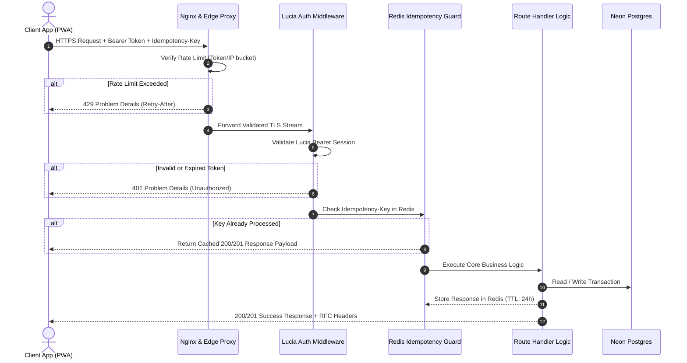

# API & Event Architecture Specification

| Metadata | Value |
|---|---|
| **Document Path** | `docs/14-appendices/04-api-events.md` |
| **Version** | `2.0.0` |
| **Last Updated** | `2026-11-21` |
| **Author** | Senior Technical Writer & System Architect |
| **Status** | Active / Baseline Contract |
| **Protocol Standards** | OpenAPI 3.1.0, JSON Schema Draft 2020-12, RFC 7807 Problem Details |
| **Related Docs** | [Architecture](../06-platforms/01-architecture.md), [Data Model](../10-data-ai/01-data-model.md), [Roadmap](../13-phases/01-roadmap.md), [Phase 1 Alpha](../13-phases/03-phase-1.md) |

---

## Table of Contents

1. [Purpose & Architectural Contract](#1-purpose--architectural-contract)
2. [Conventions & Baseline Protocols](#2-conventions--baseline-protocols)
3. [Public API Method Registry (Overview)](#3-public-api-method-registry-overview)
4. [Internal Service Interfaces & gRPC](#4-internal-service-interfaces--grpc)
5. [Event Envelope & Message Catalog](#5-event-envelope--message-catalog)
6. [Webhooks & Partner Ingestion](#6-webhooks--partner-ingestion)
7. [Realtime Channels & WebSocket Lifecycles](#7-realtime-channels--websocket-lifecycles)
8. [Rate Limiting Framework](#8-rate-limiting-framework)
9. [Core Governance Requirements](#9-core-governance-requirements)
10. [OpenAPI 3.1 Fragment: Core Endpoints Specification](#10-openapi-31-fragment-core-endpoints-specification)
11. [Event Schema Registry (JSON Schema Draft 2020-12)](#11-event-schema-registry-json-schema-draft-2020-12)
12. [API Conventions & Middleware Engine](#12-api-conventions--middleware-engine)
13. [Edge Cases & Error Handling Matrix](#13-edge-cases--error-handling-matrix)
14. [Success Metrics & Contract Verification](#14-success-metrics--contract-verification)
15. [Related Documentation](#15-related-documentation)

---

## 1. Purpose & Architectural Contract

This document constitutes the immutable design contract across the NovaWorth platform. It governs all synchronous client-server HTTP interfaces, asynchronous domain event schemas, internal service boundaries, and partner webhook deliveries.

All platform features must conform strictly to these contracts. Changes to existing schemas must be additive and backward-compatible. Any breaking modification requires a formal schema deprecation notice and a version increment under `/api/v2/`.

---

## 2. Conventions & Baseline Protocols

- **Transport:** HTTPS / TLS 1.3 for all synchronous endpoints; WebSocket (WSS) for realtime event streaming.
- **Base Path:** `/api/v1` for production endpoints.
- **Authentication:** Bearer token session headers (`Authorization: Bearer <lucia_session_token>`) backed by Lucia Auth v3.
- **Idempotency:** State-changing requests (`POST`, `PUT`, `PATCH`) require an `Idempotency-Key: <uuid-v4>` header.
- **Pagination:** Cursor-based pagination (`?cursor=<base64_cursor>&limit=<int>`) for all list collections; offset pagination is prohibited.
- **Errors:** Strict conformance to RFC 7807 (and RFC 9457) Problem Details JSON format (`application/problem+json`).
- **Timestamps:** ISO 8601 UTC strings format: `YYYY-MM-DDTHH:mm:ss.sssZ`.
- **Character Encoding:** UTF-8 throughout.

### 2.1 RFC 7807 Standard Error Shape
```json
{
  "type": "https://api.educonomy.org/v1/errors/validation-failed",
  "title": "Validation Failed",
  "status": 422,
  "detail": "Field 'level' must be an integer between 1 and 100 inclusive.",
  "instance": "/api/v1/skills/CMP-01/levels/105",
  "code": "ERR_VALIDATION_RANGE",
  "invalid_params": [
    {
      "name": "level",
      "reason": "Value 105 exceeds maximum permitted level 100"
    }
  ],
  "trace_id": "trace_01HXYZ7890ABCD",
  "timestamp": "2026-11-21T10:15:30.124Z"
}
```

---

## 3. Public API Method Registry (Overview)

### 3.1 Catalog & Curriculum
| Method | Path | Purpose |
|---|---|---|
| `GET` | `/api/v1/skills` | List skills with domain, query, and band filters |
| `GET` | `/api/v1/skills/{skillId}` | Retrieve skill ladder, metadata, and prerequisites |
| `GET` | `/api/v1/skills/{skillId}/levels/{level}` | Level specification, concept text, and rubric anchors |
| `GET` | `/api/v1/domains` | Retrieve the 20 primary taxonomy domains |

### 3.2 Learner & Profile
| Method | Path | Purpose |
|---|---|---|
| `POST` | `/api/v1/auth/register` | Register new learner via email magic link |
| `POST` | `/api/v1/auth/login` | Authenticate via email magic link or passkey |
| `POST` | `/api/v1/auth/logout` | Revoke active Lucia session token |
| `POST` | `/api/v1/onboarding/sessions` | Initialize interactive onboarding session |
| `PATCH` | `/api/v1/onboarding/progress` | Update onboarding diagnostic answers and profile |
| `POST` | `/api/v1/onboarding/complete` | Complete onboarding and generate recommendations |
| `GET` | `/api/v1/me` | Retrieve authenticated user profile and stats |
| `GET` | `/api/v1/me/skills` | List enrolled skills, current levels, and progress |
| `POST` | `/api/v1/me/skills` | Enroll in a new skill ladder |
| `GET` | `/api/v1/me/experience` | Fetch experience graph nodes |
| `POST` | `/api/v1/me/experience` | Add self-asserted or credentialed experience node |

### 3.3 Learning Engine & AI Tutor
| Method | Path | Purpose |
|---|---|---|
| `GET` | `/api/v1/me/next` | Compute next-best learning action |
| `POST` | `/api/v1/learning/sessions` | Initialize a focused concept study session |
| `GET` | `/api/v1/learning/sessions/{sessionId}` | Retrieve active session state and progress |
| `POST` | `/api/v1/learning/sessions/{sessionId}/events`| Ingest interaction micro-events (clicks, pauses) |
| `POST` | `/api/v1/learning/sessions/{sessionId}/end` | Terminate session and calculate time-on-task |
| `POST` | `/api/v1/learning/tutor/messages` | Stream Socratic AI tutor dialogue turn via SSE |
| `GET` | `/api/v1/learning/reviews` | Retrieve due spaced repetition practice items |

### 3.4 Assessment & Level Gates
| Method | Path | Purpose |
|---|---|---|
| `POST` | `/api/v1/assessment/gates/{gateId}/start` | Initialize level-gate exam attempt and start timer |
| `GET` | `/api/v1/assessment/attempts/{attemptId}` | Retrieve active exam state and remaining time |
| `POST` | `/api/v1/assessment/attempts/{attemptId}/answers` | Submit answer for evaluation |
| `POST` | `/api/v1/assessment/attempts/{attemptId}/artifacts` | Request pre-signed S3/R2 URL for portfolio file |
| `POST` | `/api/v1/assessment/gates/{gateId}/submit` | Finalize gate exam attempt, trigger grading |
| `GET` | `/api/v1/assessment/attempts/{attemptId}/result` | Fetch gate score, rubric breakdown, pass/fail |
| `POST` | `/api/v1/assessment/appeals` | File appeal against gate exam rejection |

### 3.5 Economy & Ledger
| Method | Path | Purpose |
|---|---|---|
| `GET` | `/api/v1/economy/balance` | Retrieve XP and simulated/live EC wallet balances |
| `GET` | `/api/v1/economy/ledger` | Query paginated cryptographic ledger transactions |
| `GET` | `/api/v1/economy/awards/{awardId}` | Verify individual award calculation parameters |
| `GET` | `/api/v1/economy/savings` | Query active learner savings and staking goals |
| `POST` | `/api/v1/economy/savings` | Create or update savings allocation goal |

### 3.6 Marketplace & Redemptions
| Method | Path | Purpose |
|---|---|---|
| `GET` | `/api/v1/marketplace/catalog` | Browse available catalog items, prices, and stock |
| `GET` | `/api/v1/marketplace/items/{itemId}` | Retrieve detailed specifications and partner info |
| `POST` | `/api/v1/marketplace/orders` | Place item redemption order (initiates escrow lock) |
| `GET` | `/api/v1/marketplace/orders/{orderId}` | Check escrow and delivery fulfillment status |
| `POST` | `/api/v1/marketplace/orders/{orderId}/confirm`| Confirm physical receipt (releases escrow payout) |
| `POST` | `/api/v1/marketplace/orders/{orderId}/dispute`| Open order dispute for damaged/missing product |

---

## 4. Internal Service Interfaces & gRPC

For high-throughput, low-latency inter-service communication within the Hetzner internal network:

| Interface Boundary | Protocol / Transport | Semantic Contract | Performance SLA |
|---|---|---|---|
| **Learning $\to$ Content** | gRPC / HTTP/2 | `ContentService.GetLevelSpec` | P99 $<10\text{ms}$ |
| **Learning $\to$ AI Gateway** | gRPC / HTTP/2 Stream | `TutorService.StreamCompletion` | TTFT $<400\text{ms}$ |
| **Assessment $\to$ Item Bank** | gRPC / HTTP/2 | `ItemBankService.DrawCalibratedItems`| P99 $<15\text{ms}$ |
| **Assessment $\to$ AI Grader** | gRPC / HTTP/2 | `GradingService.EvaluateRubric` | P95 $<1.5\text{s}$ |
| **Economy $\to$ Ledger** | gRPC / HTTP/2 | `LedgerService.PostTransaction` | P99.9 $<5\text{ms}$ (ACID) |
| **Marketplace $\to$ Escrow** | gRPC / HTTP/2 | `EscrowService.HoldTokens` | P99.9 $<5\text{ms}$ |
| **Worker $\to$ Search** | REST / Internal HTTP | `Meilisearch.BatchUpdate` | Bulk $<200\text{ms}$ |

---

## 5. Event Envelope & Message Catalog

All asynchronous domain events emitted across BullMQ and PostHog adhere to the unified Event Envelope v1 specification.

```json
{
  "$schema": "https://schemas.educonomy.org/v1/event-envelope.json",
  "event_id": "evt_01H8Z90ABC123456789XYZ01",
  "type": "level.passed",
  "version": 1,
  "occurred_at": "2026-11-21T10:30:00.000Z",
  "actor": {
    "id": "usr_01H8Z7A9B1C2D3E4F5G6H7J8",
    "type": "learner",
    "ip_hash": "a1b2c3d4e5f67890",
    "user_agent": "Mozilla/5.0 (Windows NT 10.0; Win64; x64)"
  },
  "subject": {
    "type": "skill_level",
    "id": "CMP-01:30"
  },
  "payload": {
    "skill_id": "CMP-01",
    "level": 30,
    "xp_awarded": 16432,
    "ec_awarded": 595,
    "attempt_id": "att_01H8Z8Y1Z2A3B4C5D6E7F8G9",
    "credential_id": "crd_01H8Z92B3C4D5E6F7G8H9J0K"
  },
  "trace_id": "trace_01H8Z700000000000000000000",
  "idempotency_key": "idemp_4a2c5e7b-9f1d-4b8a-b8e2-0d5f6c8a7e9b"
}
```

---

## 6. Webhooks & Partner Ingestion

External institutional partners, corporate sponsors, and employers subscribe to outbound webhook triggers:
- `credential.issued`: Fires upon verified issuance of a Level 20, 40, 60, 80, or 100 milestone credential.
- `credential.revoked`: Emitted if an academic integrity appeal or fraud investigation revokes a credential.
- `order.escrow_locked`: Notifies fulfillment partners that tokens are locked and shipment can commence.
- `order.disputed`: Alerts support operations to mediate delivery failure.

### Webhook Security & Delivery Rules
1. **Cryptographic Signature:** All webhook HTTP payloads include the `X-Educonomy-Signature: t=<timestamp>,v1=<hmac_sha256_hash>` header computed using the partner's shared secret.
2. **Replay Defense:** Partners must verify that $|t - \text{now}| \le 300\text{ seconds}$.
3. **Retry Cadence:** Exponential backoff with jitter over 7 attempts ($5\text{s}, 30\text{s}, 5\text{m}, 30\text{m}, 2\text{h}, 8\text{h}, 24\text{h}$).

---

## 7. Realtime Channels & WebSocket Lifecycles

WebSocket server endpoints (`/rt/v1/...`) handle low-latency interactive collaboration and simulations:
- `/rt/v1/sessions/{id}`: Realtime sync of concept reading position, time-on-task heartbeat, and tutor dialogue.
- `/rt/v1/roleplay/{id}`: Realtime conversational AI role-play dialogue state and branching choices.
- `/rt/v1/sim/{id}`: Interactive virtual simulator state machine ticks (e.g., Python code execution output, recipe step verification).

### Connection Rules
- Authentication is established via the initial connection query parameter `?token=<ephemeral_ws_token>` validated against Redis.
- Heartbeat ping-pong frames execute every 30 seconds. Connections without pong response within 10 seconds are terminated.
- Reconnection supports resumption: clients supply `Last-Event-ID` header to replay missed messages from the Redis stream buffer.

---

## 8. Rate Limiting Framework

Rate limits are enforced at the Nginx reverse proxy and Redis middleware layers:

| Endpoint Category | Default Limit | Burst Allowance | Identifier Key | Headers Emitted |
|---|---|---|---|---|
| **Anonymous / Public Catalog** | 100 req / minute | 20 req | Client IP Address | `X-RateLimit-Limit`, `X-RateLimit-Remaining`, `Retry-After` |
| **Authentication Endpoints** | 10 req / minute | 5 req | Client IP + Email Hash | `X-RateLimit-Limit`, `X-RateLimit-Remaining`, `Retry-After` |
| **Authenticated Learner API** | 600 req / minute | 50 req | `user_id` Session Token | `X-RateLimit-Limit`, `X-RateLimit-Remaining`, `Retry-After` |
| **AI Tutor Message Turns** | 20 req / minute | 5 req | `user_id` Session Token | `X-RateLimit-Limit`, `X-RateLimit-Remaining`, `Retry-After` |
| **Gate Exam Submissions** | 5 req / minute | 1 req | `user_id` Session Token | `X-RateLimit-Limit`, `X-RateLimit-Remaining`, `Retry-After` |
| **Marketplace Order Checkout** | 3 req / minute | 1 req | `user_id` Session Token | `X-RateLimit-Limit`, `X-RateLimit-Remaining`, `Retry-After` |

---

## 9. Core Governance Requirements

- `FR-API-001`: Every endpoint must maintain a corresponding OpenAPI 3.1 schema and automated contract validation test.
- `FR-API-002`: All state-changing endpoints (`POST`, `PUT`, `PATCH`, `DELETE`) must enforce the `Idempotency-Key` header.
- `FR-API-003`: All application and infrastructure error responses must strictly adhere to RFC 7807 Problem Details.
- `FR-API-004`: Domain events must include a globally unique event ID, UTC timestamp, actor, subject, and versioned payload.
- `FR-API-005`: All outbound partner webhooks must be cryptographically signed using HMAC-SHA256.
- `FR-API-006`: WebSocket connections must support seamless session resumption using event cursor tokens.
- `FR-API-007`: Rate limits must be enforced at both reverse proxy and application middleware boundaries.
- `NFR-API-001`: Synchronous read endpoints must exhibit a P95 latency $<200\text{ms}$ under nominal load.
- `NFR-API-002`: Synchronous write endpoints must exhibit a P95 latency $<400\text{ms}$ excluding AI inference.
- `NFR-API-003`: Outbound asynchronous event delivery through BullMQ and Redis must achieve $\ge 99.99\%$ delivery reliability.

---

## 10. OpenAPI 3.1 Fragment: Core Endpoints Specification

Below is the OpenAPI 3.1 YAML definition covering the 13 most critical platform endpoints:

```yaml
openapi: 3.1.0
info:
  title: NovaWorth Core Engine API
  version: 1.0.0
  description: Core synchronous REST contract for authentication, curriculum, learning, assessment, and economy.
paths:
  /api/auth/register:
    post:
      summary: Register learner via email magic link
      operationId: registerLearner
      tags: [Auth]
      requestBody:
        required: true
        content:
          application/json:
            schema:
              type: object
              required: [email, consent_terms, consent_privacy]
              properties:
                email: { type: string, format: email }
                invite_code: { type: string }
                consent_terms: { type: boolean, enum: [true] }
                consent_privacy: { type: boolean, enum: [true] }
      responses:
        '200':
          description: Magic link dispatched
          content:
            application/json:
              schema:
                type: object
                properties:
                  success: { type: boolean, example: true }
                  message: { type: string, example: "Verification link sent to email." }
        '400': { $ref: '#/components/responses/ProblemDetails400' }
        '429': { $ref: '#/components/responses/ProblemDetails429' }
        '500': { $ref: '#/components/responses/ProblemDetails500' }

  /api/auth/login:
    post:
      summary: Verify login token and issue session
      operationId: loginLearner
      tags: [Auth]
      requestBody:
        required: true
        content:
          application/json:
            schema:
              type: object
              required: [token]
              properties:
                token: { type: string, minLength: 32 }
      responses:
        '200':
          description: Session created successfully
          headers:
            Set-Cookie: { schema: { type: string } }
          content:
            application/json:
              schema:
                type: object
                properties:
                  user_id: { type: string }
                  session_token: { type: string }
                  expires_at: { type: string, format: date-time }
        '401': { $ref: '#/components/responses/ProblemDetails401' }
        '429': { $ref: '#/components/responses/ProblemDetails429' }
        '500': { $ref: '#/components/responses/ProblemDetails500' }

  /api/auth/logout:
    post:
      summary: Revoke active session token
      operationId: logoutLearner
      tags: [Auth]
      security: [{ BearerAuth: [] }]
      responses:
        '200':
          description: Session terminated
          content:
            application/json:
              schema: { type: object, properties: { success: { type: boolean, example: true } } }
        '401': { $ref: '#/components/responses/ProblemDetails401' }
        '500': { $ref: '#/components/responses/ProblemDetails500' }

  /api/onboarding/progress:
    patch:
      summary: Update onboarding diagnostic profile
      operationId: updateOnboardingProgress
      tags: [Onboarding]
      security: [{ BearerAuth: [] }]
      requestBody:
        required: true
        content:
          application/json:
            schema:
              type: object
              required: [step_id, answers]
              properties:
                step_id: { type: string, enum: [career_goals, diagnostic_skills, time_budget] }
                answers: { type: object, additionalProperties: true }
      responses:
        '200':
          description: Step progress recorded
          content:
            application/json:
              schema:
                type: object
                properties:
                  completed_steps: { type: array, items: { type: string } }
                  next_step: { type: string, nullable: true }
        '400': { $ref: '#/components/responses/ProblemDetails400' }
        '401': { $ref: '#/components/responses/ProblemDetails401' }
        '500': { $ref: '#/components/responses/ProblemDetails500' }

  /api/skills:
    get:
      summary: Paginated list of curriculum skills
      operationId: listSkills
      tags: [Curriculum]
      parameters:
        - name: domain_id
          in: query
          schema: { type: string }
        - name: query
          in: query
          schema: { type: string }
        - name: cursor
          in: query
          schema: { type: string }
        - name: limit
          in: query
          schema: { type: integer, default: 20, maximum: 50 }
      responses:
        '200':
          description: List of matching skills
          content:
            application/json:
              schema:
                type: object
                properties:
                  items:
                    type: array
                    items: { $ref: '#/components/schemas/SkillSummary' }
                  next_cursor: { type: string, nullable: true }
        '400': { $ref: '#/components/responses/ProblemDetails400' }
        '500': { $ref: '#/components/responses/ProblemDetails500' }

  /api/skills/{skillId}/levels/{level}:
    get:
      summary: Retrieve specific level specification
      operationId: getSkillLevel
      tags: [Curriculum]
      parameters:
        - name: skillId
          in: path
          required: true
          schema: { type: string }
        - name: level
          in: path
          required: true
          schema: { type: integer, minimum: 1, maximum: 100 }
      responses:
        '200':
          description: Full level specification
          content:
            application/json:
              schema: { $ref: '#/components/schemas/LevelDetail' }
        '404': { $ref: '#/components/responses/ProblemDetails404' }
        '500': { $ref: '#/components/responses/ProblemDetails500' }

  /api/learning/sessions:
    post:
      summary: Initialize a learning session
      operationId: createLearningSession
      tags: [Learning]
      security: [{ BearerAuth: [] }]
      requestBody:
        required: true
        content:
          application/json:
            schema:
              type: object
              required: [skill_id, level]
              properties:
                skill_id: { type: string }
                level: { type: integer, minimum: 1, maximum: 100 }
                modality: { type: string, enum: [concept_text, interactive_quiz, roleplay_sim] }
      responses:
        '201':
          description: Session created
          content:
            application/json:
              schema:
                type: object
                properties:
                  session_id: { type: string }
                  websocket_url: { type: string }
                  active_concept: { type: object }
        '400': { $ref: '#/components/responses/ProblemDetails400' }
        '401': { $ref: '#/components/responses/ProblemDetails401' }
        '500': { $ref: '#/components/responses/ProblemDetails500' }

  /api/assessment/gates/{gateId}/start:
    post:
      summary: Start high-integrity gate exam attempt
      operationId: startGateAttempt
      tags: [Assessment]
      security: [{ BearerAuth: [] }]
      parameters:
        - name: gateId
          in: path
          required: true
          schema: { type: string }
      responses:
        '201':
          description: Exam attempt initialized
          content:
            application/json:
              schema:
                type: object
                properties:
                  attempt_id: { type: string }
                  time_limit_seconds: { type: integer }
                  expires_at: { type: string, format: date-time }
                  items: { type: array, items: { type: object } }
        '401': { $ref: '#/components/responses/ProblemDetails401' }
        '403': { $ref: '#/components/responses/ProblemDetails403' }
        '404': { $ref: '#/components/responses/ProblemDetails404' }
        '429': { $ref: '#/components/responses/ProblemDetails429' }
        '500': { $ref: '#/components/responses/ProblemDetails500' }

  /api/assessment/gates/{gateId}/submit:
    post:
      summary: Finalize and submit gate exam answers
      operationId: submitGateAttempt
      tags: [Assessment]
      security: [{ BearerAuth: [] }]
      parameters:
        - name: gateId
          in: path
          required: true
          schema: { type: string }
      requestBody:
        required: true
        content:
          application/json:
            schema:
              type: object
              required: [attempt_id, responses]
              properties:
                attempt_id: { type: string }
                responses:
                  type: array
                  items:
                    type: object
                    required: [item_id, answer_payload]
                    properties:
                      item_id: { type: string }
                      answer_payload: { type: object }
      responses:
        '200':
          description: Exam graded and recorded
          content:
            application/json:
              schema:
                type: object
                properties:
                  attempt_id: { type: string }
                  status: { type: string, enum: [PASSED, FAILED, UNDER_REVIEW] }
                  percentage_score: { type: number }
                  xp_awarded: { type: integer }
                  ec_awarded: { type: integer }
                  credential_id: { type: string, nullable: true }
        '400': { $ref: '#/components/responses/ProblemDetails400' }
        '401': { $ref: '#/components/responses/ProblemDetails401' }
        '404': { $ref: '#/components/responses/ProblemDetails404' }
        '500': { $ref: '#/components/responses/ProblemDetails500' }

  /api/economy/balance:
    get:
      summary: Fetch authenticated learner token balances
      operationId: getWalletBalance
      tags: [Economy]
      security: [{ BearerAuth: [] }]
      responses:
        '200':
          description: Realtime balance summary
          content:
            application/json:
              schema:
                type: object
                properties:
                  user_id: { type: string }
                  xp_total: { type: integer, example: 25400 }
                  simulated_ec_balance: { type: integer, example: 850 }
                  live_ec_balance: { type: integer, example: 0 }
                  tier_multiplier: { type: number, example: 1.15 }
        '401': { $ref: '#/components/responses/ProblemDetails401' }
        '500': { $ref: '#/components/responses/ProblemDetails500' }

  /api/economy/awards/{awardId}:
    get:
      summary: Retrieve verifiable award breakdown
      operationId: getAwardDetail
      tags: [Economy]
      security: [{ BearerAuth: [] }]
      parameters:
        - name: awardId
          in: path
          required: true
          schema: { type: string }
      responses:
        '200':
          description: Award mathematical breakdown
          content:
            application/json:
              schema:
                type: object
                properties:
                  award_id: { type: string }
                  awarded_at: { type: string, format: date-time }
                  skill_id: { type: string }
                  level: { type: integer }
                  xp_amount: { type: integer }
                  ec_amount: { type: integer }
                  formula_variables:
                    type: object
                    properties:
                      level: { type: integer }
                      domain_multiplier: { type: number }
                      rubric_quality: { type: number }
                      integrity_tier: { type: number }
                      momentum: { type: number }
                      rarity: { type: number }
        '401': { $ref: '#/components/responses/ProblemDetails401' }
        '404': { $ref: '#/components/responses/ProblemDetails404' }
        '500': { $ref: '#/components/responses/ProblemDetails500' }

  /api/marketplace/catalog:
    get:
      summary: Browse marketplace redemption catalog
      operationId: listCatalogItems
      tags: [Marketplace]
      parameters:
        - name: category
          in: query
          schema: { type: string }
        - name: cursor
          in: query
          schema: { type: string }
        - name: limit
          in: query
          schema: { type: integer, default: 20 }
      responses:
        '200':
          description: Available redemption items
          content:
            application/json:
              schema:
                type: object
                properties:
                  items:
                    type: array
                    items: { $ref: '#/components/schemas/MarketplaceItem' }
                  next_cursor: { type: string, nullable: true }
        '500': { $ref: '#/components/responses/ProblemDetails500' }

  /api/marketplace/orders:
    post:
      summary: Redeem item and initiate escrow lock
      operationId: placeOrder
      tags: [Marketplace]
      security: [{ BearerAuth: [] }]
      requestBody:
        required: true
        content:
          application/json:
            schema:
              type: object
              required: [item_id, shipping_address]
              properties:
                item_id: { type: string }
                shipping_address:
                  type: object
                  required: [full_name, line1, city, postal_code, country]
                  properties:
                    full_name: { type: string }
                    line1: { type: string }
                    city: { type: string }
                    postal_code: { type: string }
                    country: { type: string, minLength: 2, maxLength: 2 }
      responses:
        '201':
          description: Order placed, tokens held in escrow
          content:
            application/json:
              schema:
                type: object
                properties:
                  order_id: { type: string }
                  escrow_transaction_id: { type: string }
                  status: { type: string, example: "ESCROW_LOCKED" }
                  created_at: { type: string, format: date-time }
        '400': { $ref: '#/components/responses/ProblemDetails400' }
        '401': { $ref: '#/components/responses/ProblemDetails401' }
        '403': { $ref: '#/components/responses/ProblemDetails403' }
        '429': { $ref: '#/components/responses/ProblemDetails429' }
        '500': { $ref: '#/components/responses/ProblemDetails500' }

components:
  securitySchemes:
    BearerAuth:
      type: http
      scheme: bearer
      bearerFormat: LuciaSessionToken
  responses:
    ProblemDetails400:
      description: Bad Request
      content: { application/problem+json: { schema: { $ref: '#/components/schemas/ProblemDetails' } } }
    ProblemDetails401:
      description: Unauthorized
      content: { application/problem+json: { schema: { $ref: '#/components/schemas/ProblemDetails' } } }
    ProblemDetails403:
      description: Forbidden
      content: { application/problem+json: { schema: { $ref: '#/components/schemas/ProblemDetails' } } }
    ProblemDetails404:
      description: Resource Not Found
      content: { application/problem+json: { schema: { $ref: '#/components/schemas/ProblemDetails' } } }
    ProblemDetails429:
      description: Rate Limit Exceeded
      headers:
        Retry-After: { schema: { type: integer } }
      content: { application/problem+json: { schema: { $ref: '#/components/schemas/ProblemDetails' } } }
    ProblemDetails500:
      description: Internal Server Error
      content: { application/problem+json: { schema: { $ref: '#/components/schemas/ProblemDetails' } } }
  schemas:
    ProblemDetails:
      type: object
      required: [type, title, status, detail]
      properties:
        type: { type: string, format: uri }
        title: { type: string }
        status: { type: integer }
        detail: { type: string }
        instance: { type: string }
        code: { type: string }
        trace_id: { type: string }
    SkillSummary:
      type: object
      properties:
        id: { type: string }
        name: { type: string }
        domain: { type: string }
        max_level: { type: integer }
        total_enrolled: { type: integer }
    LevelDetail:
      type: object
      properties:
        skill_id: { type: string }
        level: { type: integer }
        title: { type: string }
        objectives: { type: array, items: { type: string } }
        concept_markdown: { type: string }
        rubric_anchors: { type: array, items: { type: string } }
    MarketplaceItem:
      type: object
      properties:
        id: { type: string }
        title: { type: string }
        category: { type: string }
        ec_price: { type: integer }
        stock_available: { type: integer }
```

---

## 11. Event Schema Registry (JSON Schema Draft 2020-12)

The Event Schema Registry contains formal JSON schemas for domain event payloads emitted by platform services.

### 11.1 Identity Domain Events

#### `user.created`
```json
{
  "$schema": "https://json-schema.org/draft/2020-12/schema",
  "title": "UserCreatedEvent",
  "type": "object",
  "required": ["user_id", "email_hash", "locale", "registration_channel", "created_at"],
  "properties": {
    "user_id": { "type": "string", "pattern": "^usr_[0-9A-Za-z]{24}$", "description": "Unique user identifier" },
    "email_hash": { "type": "string", "description": "SHA-256 hash of normalized learner email" },
    "locale": { "type": "string", "pattern": "^[a-z]{2}-[A-Z]{2}$", "description": "BCP 47 language and country tag" },
    "registration_channel": { "type": "string", "enum": ["INVITE_TOKEN", "ORGANIC_WEB", "PARTNER_REFERRAL"] },
    "invite_token": { "type": "string", "nullable": true },
    "created_at": { "type": "string", "format": "date-time" }
  }
}
```

#### `user.consent_changed`
```json
{
  "$schema": "https://json-schema.org/draft/2020-12/schema",
  "title": "UserConsentChangedEvent",
  "type": "object",
  "required": ["user_id", "purpose", "granted", "version", "updated_at"],
  "properties": {
    "user_id": { "type": "string", "pattern": "^usr_[0-9A-Za-z]{24}$" },
    "purpose": { "type": "string", "enum": ["TERMS_OF_SERVICE", "PRIVACY_POLICY", "TELEMETRY_ANALYTICS", "AI_TUTOR_LOGS"] },
    "granted": { "type": "boolean" },
    "version": { "type": "string", "example": "2026-11-v1" },
    "updated_at": { "type": "string", "format": "date-time" }
  }
}
```

#### `user.deleted`
```json
{
  "$schema": "https://json-schema.org/draft/2020-12/schema",
  "title": "UserDeletedEvent",
  "type": "object",
  "required": ["user_id", "requested_at", "purge_scheduled_at"],
  "properties": {
    "user_id": { "type": "string", "pattern": "^usr_[0-9A-Za-z]{24}$" },
    "requested_at": { "type": "string", "format": "date-time" },
    "purge_scheduled_at": { "type": "string", "format": "date-time" },
    "reason": { "type": "string", "enum": ["USER_REQUESTED", "TERMS_VIOLATION", "CHILD_PROTECTION_PURGE"] }
  }
}
```

### 11.2 Onboarding Domain Events

#### `onboarding.started`
```json
{
  "$schema": "https://json-schema.org/draft/2020-12/schema",
  "title": "OnboardingStartedEvent",
  "type": "object",
  "required": ["session_id", "user_id", "entry_point", "started_at"],
  "properties": {
    "session_id": { "type": "string", "pattern": "^onb_[0-9A-Za-z]{24}$" },
    "user_id": { "type": "string", "pattern": "^usr_[0-9A-Za-z]{24}$" },
    "entry_point": { "type": "string", "enum": ["WELCOME_HERO", "SKILL_DEEP_LINK", "DIRECT_INVITE"] },
    "started_at": { "type": "string", "format": "date-time" }
  }
}
```

#### `onboarding.step_completed`
```json
{
  "$schema": "https://json-schema.org/draft/2020-12/schema",
  "title": "OnboardingStepCompletedEvent",
  "type": "object",
  "required": ["session_id", "user_id", "step_index", "step_name", "dwell_time_ms"],
  "properties": {
    "session_id": { "type": "string", "pattern": "^onb_[0-9A-Za-z]{24}$" },
    "user_id": { "type": "string", "pattern": "^usr_[0-9A-Za-z]{24}$" },
    "step_index": { "type": "integer", "minimum": 1, "maximum": 5 },
    "step_name": { "type": "string", "enum": ["CAREER_INTENT", "DIAGNOSTIC_ASSESSMENT", "TIME_BUDGET", "NOTIFICATIONS"] },
    "dwell_time_ms": { "type": "integer", "minimum": 100 }
  }
}
```

#### `onboarding.completed`
```json
{
  "$schema": "https://json-schema.org/draft/2020-12/schema",
  "title": "OnboardingCompletedEvent",
  "type": "object",
  "required": ["session_id", "user_id", "total_duration_seconds", "selected_skill_id"],
  "properties": {
    "session_id": { "type": "string", "pattern": "^onb_[0-9A-Za-z]{24}$" },
    "user_id": { "type": "string", "pattern": "^usr_[0-9A-Za-z]{24}$" },
    "total_duration_seconds": { "type": "integer" },
    "selected_skill_id": { "type": "string" },
    "diagnostic_score": { "type": "number", "minimum": 0.0, "maximum": 1.0 }
  }
}
```

#### `recommendation.shown`
```json
{
  "$schema": "https://json-schema.org/draft/2020-12/schema",
  "title": "RecommendationShownEvent",
  "type": "object",
  "required": ["user_id", "algorithm_version", "recommendations"],
  "properties": {
    "user_id": { "type": "string", "pattern": "^usr_[0-9A-Za-z]{24}$" },
    "algorithm_version": { "type": "string", "example": "v1.2-cosine-demand" },
    "recommendations": {
      "type": "array",
      "items": {
        "type": "object",
        "required": ["skill_id", "rank", "fit_score"],
        "properties": {
          "skill_id": { "type": "string" },
          "rank": { "type": "integer", "minimum": 1 },
          "fit_score": { "type": "number", "minimum": 0.0, "maximum": 1.0 }
        }
      }
    }
  }
}
```

#### `recommendation.accepted`
```json
{
  "$schema": "https://json-schema.org/draft/2020-12/schema",
  "title": "RecommendationAcceptedEvent",
  "type": "object",
  "required": ["user_id", "skill_id", "rank_position", "fit_score"],
  "properties": {
    "user_id": { "type": "string", "pattern": "^usr_[0-9A-Za-z]{24}$" },
    "skill_id": { "type": "string" },
    "rank_position": { "type": "integer", "minimum": 1 },
    "fit_score": { "type": "number" }
  }
}
```

### 11.3 Learning Domain Events

#### `session.started`
```json
{
  "$schema": "https://json-schema.org/draft/2020-12/schema",
  "title": "LearningSessionStartedEvent",
  "type": "object",
  "required": ["session_id", "user_id", "skill_id", "level", "modality", "started_at"],
  "properties": {
    "session_id": { "type": "string", "pattern": "^ses_[0-9A-Za-z]{24}$" },
    "user_id": { "type": "string", "pattern": "^usr_[0-9A-Za-z]{24}$" },
    "skill_id": { "type": "string" },
    "level": { "type": "integer", "minimum": 1, "maximum": 100 },
    "modality": { "type": "string", "enum": ["CONCEPT_TEXT", "PRACTICE_QUIZ", "AI_TUTOR_CHAT", "ROLEPLAY_SIM"] },
    "started_at": { "type": "string", "format": "date-time" }
  }
}
```

#### `content.viewed`
```json
{
  "$schema": "https://json-schema.org/draft/2020-12/schema",
  "title": "ContentViewedEvent",
  "type": "object",
  "required": ["session_id", "content_id", "version", "dwell_time_ms", "scroll_depth_pct"],
  "properties": {
    "session_id": { "type": "string", "pattern": "^ses_[0-9A-Za-z]{24}$" },
    "content_id": { "type": "string" },
    "version": { "type": "string" },
    "dwell_time_ms": { "type": "integer", "minimum": 0 },
    "scroll_depth_pct": { "type": "integer", "minimum": 0, "maximum": 100 }
  }
}
```

#### `practice.attempted`
```json
{
  "$schema": "https://json-schema.org/draft/2020-12/schema",
  "title": "PracticeAttemptedEvent",
  "type": "object",
  "required": ["session_id", "item_id", "is_correct", "latency_ms", "confidence_rating"],
  "properties": {
    "session_id": { "type": "string", "pattern": "^ses_[0-9A-Za-z]{24}$" },
    "item_id": { "type": "string" },
    "is_correct": { "type": "boolean" },
    "latency_ms": { "type": "integer" },
    "confidence_rating": { "type": "integer", "enum": [1, 2, 3, 4, 5] }
  }
}
```

#### `review.completed`
```json
{
  "$schema": "https://json-schema.org/draft/2020-12/schema",
  "title": "ReviewCompletedEvent",
  "type": "object",
  "required": ["user_id", "skill_id", "items_reviewed", "accuracy_pct", "algorithm"],
  "properties": {
    "user_id": { "type": "string", "pattern": "^usr_[0-9A-Za-z]{24}$" },
    "skill_id": { "type": "string" },
    "items_reviewed": { "type": "integer", "minimum": 1 },
    "accuracy_pct": { "type": "number", "minimum": 0.0, "maximum": 100.0 },
    "algorithm": { "type": "string", "example": "FSRS-v4.5" }
  }
}
```

#### `session.ended`
```json
{
  "$schema": "https://json-schema.org/draft/2020-12/schema",
  "title": "LearningSessionEndedEvent",
  "type": "object",
  "required": ["session_id", "user_id", "duration_seconds", "outcome", "ended_at"],
  "properties": {
    "session_id": { "type": "string", "pattern": "^ses_[0-9A-Za-z]{24}$" },
    "user_id": { "type": "string", "pattern": "^usr_[0-9A-Za-z]{24}$" },
    "duration_seconds": { "type": "integer" },
    "outcome": { "type": "string", "enum": ["COMPLETED_MILESTONE", "PARTIAL_READ", "ABANDONED"] },
    "ended_at": { "type": "string", "format": "date-time" }
  }
}
```

### 11.4 Assessment Domain Events

#### `attempt.started`
```json
{
  "$schema": "https://json-schema.org/draft/2020-12/schema",
  "title": "GateAttemptStartedEvent",
  "type": "object",
  "required": ["attempt_id", "user_id", "gate_id", "integrity_tier", "started_at"],
  "properties": {
    "attempt_id": { "type": "string", "pattern": "^att_[0-9A-Za-z]{24}$" },
    "user_id": { "type": "string", "pattern": "^usr_[0-9A-Za-z]{24}$" },
    "gate_id": { "type": "string" },
    "integrity_tier": { "type": "integer", "enum": [0, 1, 2, 3] },
    "started_at": { "type": "string", "format": "date-time" }
  }
}
```

#### `attempt.submitted`
```json
{
  "$schema": "https://json-schema.org/draft/2020-12/schema",
  "title": "GateAttemptSubmittedEvent",
  "type": "object",
  "required": ["attempt_id", "user_id", "items_count", "submitted_at"],
  "properties": {
    "attempt_id": { "type": "string", "pattern": "^att_[0-9A-Za-z]{24}$" },
    "user_id": { "type": "string", "pattern": "^usr_[0-9A-Za-z]{24}$" },
    "items_count": { "type": "integer", "minimum": 1 },
    "submitted_at": { "type": "string", "format": "date-time" }
  }
}
```

#### `attempt.scored`
```json
{
  "$schema": "https://json-schema.org/draft/2020-12/schema",
  "title": "GateAttemptScoredEvent",
  "type": "object",
  "required": ["attempt_id", "score_pct", "passing_threshold_pct", "passed", "rubric_version"],
  "properties": {
    "attempt_id": { "type": "string", "pattern": "^att_[0-9A-Za-z]{24}$" },
    "score_pct": { "type": "number", "minimum": 0.0, "maximum": 100.0 },
    "passing_threshold_pct": { "type": "number", "example": 80.0 },
    "passed": { "type": "boolean" },
    "rubric_version": { "type": "string" }
  }
}
```

#### `level.passed`
```json
{
  "$schema": "https://json-schema.org/draft/2020-12/schema",
  "title": "LevelPassedEvent",
  "type": "object",
  "required": ["user_id", "skill_id", "level", "xp_earned", "ec_earned", "passed_at"],
  "properties": {
    "user_id": { "type": "string", "pattern": "^usr_[0-9A-Za-z]{24}$" },
    "skill_id": { "type": "string" },
    "level": { "type": "integer", "minimum": 1, "maximum": 100 },
    "xp_earned": { "type": "integer" },
    "ec_earned": { "type": "integer" },
    "credential_id": { "type": "string", "nullable": true },
    "passed_at": { "type": "string", "format": "date-time" }
  }
}
```

#### `level.failed`
```json
{
  "$schema": "https://json-schema.org/draft/2020-12/schema",
  "title": "LevelFailedEvent",
  "type": "object",
  "required": ["user_id", "skill_id", "level", "gap_concept_ids", "retry_available_at"],
  "properties": {
    "user_id": { "type": "string", "pattern": "^usr_[0-9A-Za-z]{24}$" },
    "skill_id": { "type": "string" },
    "level": { "type": "integer", "minimum": 1, "maximum": 100 },
    "gap_concept_ids": { "type": "array", "items": { "type": "string" } },
    "retry_available_at": { "type": "string", "format": "date-time" }
  }
}
```

#### `integrity.flagged`
```json
{
  "$schema": "https://json-schema.org/draft/2020-12/schema",
  "title": "IntegrityFlaggedEvent",
  "type": "object",
  "required": ["attempt_id", "user_id", "flag_reason", "anomaly_score", "action_taken"],
  "properties": {
    "attempt_id": { "type": "string", "pattern": "^att_[0-9A-Za-z]{24}$" },
    "user_id": { "type": "string", "pattern": "^usr_[0-9A-Za-z]{24}$" },
    "flag_reason": { "type": "string", "enum": ["COPY_PASTE_BURST", "WINDOW_BLUR_FREQUENCY", "SOLVE_TIME_ANOMALY", "AI_TEXT_DETECTION"] },
    "anomaly_score": { "type": "number", "minimum": 0.0, "maximum": 1.0 },
    "action_taken": { "type": "string", "enum": ["MANUAL_REVIEW_QUEUED", "ATTEMPT_INVALIDATED", "ACCOUNT_WARNED"] }
  }
}
```

#### `appeal.filed`
```json
{
  "$schema": "https://json-schema.org/draft/2020-12/schema",
  "title": "AppealFiledEvent",
  "type": "object",
  "required": ["appeal_id", "attempt_id", "user_id", "justification", "filed_at"],
  "properties": {
    "appeal_id": { "type": "string", "pattern": "^apl_[0-9A-Za-z]{24}$" },
    "attempt_id": { "type": "string", "pattern": "^att_[0-9A-Za-z]{24}$" },
    "user_id": { "type": "string", "pattern": "^usr_[0-9A-Za-z]{24}$" },
    "justification": { "type": "string", "minLength": 50 },
    "filed_at": { "type": "string", "format": "date-time" }
  }
}
```

#### `appeal.decided`
```json
{
  "$schema": "https://json-schema.org/draft/2020-12/schema",
  "title": "AppealDecidedEvent",
  "type": "object",
  "required": ["appeal_id", "outcome", "reviewer_id", "decided_at"],
  "properties": {
    "appeal_id": { "type": "string", "pattern": "^apl_[0-9A-Za-z]{24}$" },
    "outcome": { "type": "string", "enum": ["APPROVED_OVERTURN", "REJECTED_UPHELD"] },
    "reviewer_id": { "type": "string" },
    "notes": { "type": "string" },
    "decided_at": { "type": "string", "format": "date-time" }
  }
}
```

### 11.5 Economy & Marketplace Domain Events

#### `award.posted`
```json
{
  "$schema": "https://json-schema.org/draft/2020-12/schema",
  "title": "AwardPostedEvent",
  "type": "object",
  "required": ["award_id", "user_id", "xp_amount", "ec_amount", "ledger_tx_id", "pool_id"],
  "properties": {
    "award_id": { "type": "string", "pattern": "^awd_[0-9A-Za-z]{24}$" },
    "user_id": { "type": "string", "pattern": "^usr_[0-9A-Za-z]{24}$" },
    "xp_amount": { "type": "integer" },
    "ec_amount": { "type": "integer" },
    "ledger_tx_id": { "type": "string" },
    "pool_id": { "type": "string" }
  }
}
```

#### `award.reversed`
```json
{
  "$schema": "https://json-schema.org/draft/2020-12/schema",
  "title": "AwardReversedEvent",
  "type": "object",
  "required": ["award_id", "user_id", "reversal_reason", "compensating_tx_id"],
  "properties": {
    "award_id": { "type": "string", "pattern": "^awd_[0-9A-Za-z]{24}$" },
    "user_id": { "type": "string", "pattern": "^usr_[0-9A-Za-z]{24}$" },
    "reversal_reason": { "type": "string", "enum": ["ACADEMIC_DISHONESTY", "COLLUSION_RING", "ADMIN_REVERSAL"] },
    "compensating_tx_id": { "type": "string" }
  }
}
```

#### `wallet.viewed`
```json
{
  "$schema": "https://json-schema.org/draft/2020-12/schema",
  "title": "WalletViewedEvent",
  "type": "object",
  "required": ["user_id", "client_type", "viewed_at"],
  "properties": {
    "user_id": { "type": "string", "pattern": "^usr_[0-9A-Za-z]{24}$" },
    "client_type": { "type": "string", "enum": ["PWA_WEB", "MOBILE_VIEWPORT", "DESKTOP_VIEWPORT"] },
    "viewed_at": { "type": "string", "format": "date-time" }
  }
}
```

#### `pool.funded`
```json
{
  "$schema": "https://json-schema.org/draft/2020-12/schema",
  "title": "PoolFundedEvent",
  "type": "object",
  "required": ["pool_id", "sponsor_id", "amount_usd", "ec_liquidity_issued"],
  "properties": {
    "pool_id": { "type": "string" },
    "sponsor_id": { "type": "string" },
    "amount_usd": { "type": "number", "minimum": 100.0 },
    "ec_liquidity_issued": { "type": "integer" }
  }
}
```

#### `pool.exhausted`
```json
{
  "$schema": "https://json-schema.org/draft/2020-12/schema",
  "title": "PoolExhaustedEvent",
  "type": "object",
  "required": ["pool_id", "exhausted_at", "pending_queue_count"],
  "properties": {
    "pool_id": { "type": "string" },
    "exhausted_at": { "type": "string", "format": "date-time" },
    "pending_queue_count": { "type": "integer" }
  }
}
```

#### `order.placed`
```json
{
  "$schema": "https://json-schema.org/draft/2020-12/schema",
  "title": "OrderPlacedEvent",
  "type": "object",
  "required": ["order_id", "user_id", "item_id", "ec_total", "escrow_tx_id", "placed_at"],
  "properties": {
    "order_id": { "type": "string", "pattern": "^ord_[0-9A-Za-z]{24}$" },
    "user_id": { "type": "string", "pattern": "^usr_[0-9A-Za-z]{24}$" },
    "item_id": { "type": "string" },
    "ec_total": { "type": "integer", "minimum": 1 },
    "escrow_tx_id": { "type": "string" },
    "placed_at": { "type": "string", "format": "date-time" }
  }
}
```

#### `order.fulfilled`
```json
{
  "$schema": "https://json-schema.org/draft/2020-12/schema",
  "title": "OrderFulfilledEvent",
  "type": "object",
  "required": ["order_id", "tracking_number", "carrier", "fulfilled_at"],
  "properties": {
    "order_id": { "type": "string", "pattern": "^ord_[0-9A-Za-z]{24}$" },
    "tracking_number": { "type": "string" },
    "carrier": { "type": "string" },
    "fulfilled_at": { "type": "string", "format": "date-time" }
  }
}
```

#### `order.refunded`
```json
{
  "$schema": "https://json-schema.org/draft/2020-12/schema",
  "title": "OrderRefundedEvent",
  "type": "object",
  "required": ["order_id", "user_id", "refund_amount_ec", "reason"],
  "properties": {
    "order_id": { "type": "string", "pattern": "^ord_[0-9A-Za-z]{24}$" },
    "user_id": { "type": "string", "pattern": "^usr_[0-9A-Za-z]{24}$" },
    "refund_amount_ec": { "type": "integer" },
    "reason": { "type": "string", "enum": ["OUT_OF_STOCK", "DAMAGED_TRANSIT", "CANCELLED_BY_BUYER"] }
  }
}
```

#### `order.disputed`
```json
{
  "$schema": "https://json-schema.org/draft/2020-12/schema",
  "title": "OrderDisputedEvent",
  "type": "object",
  "required": ["order_id", "dispute_id", "opened_by", "dispute_reason"],
  "properties": {
    "order_id": { "type": "string", "pattern": "^ord_[0-9A-Za-z]{24}$" },
    "dispute_id": { "type": "string", "pattern": "^dsp_[0-9A-Za-z]{24}$" },
    "opened_by": { "type": "string", "pattern": "^usr_[0-9A-Za-z]{24}$" },
    "dispute_reason": { "type": "string", "enum": ["ITEM_NOT_RECEIVED", "SIGNIFICANTLY_NOT_AS_DESCRIBED"] }
  }
}
```

#### `dispute.decided`
```json
{
  "$schema": "https://json-schema.org/draft/2020-12/schema",
  "title": "DisputeDecidedEvent",
  "type": "object",
  "required": ["dispute_id", "order_id", "resolution", "escrow_payout_target"],
  "properties": {
    "dispute_id": { "type": "string", "pattern": "^dsp_[0-9A-Za-z]{24}$" },
    "order_id": { "type": "string", "pattern": "^ord_[0-9A-Za-z]{24}$" },
    "resolution": { "type": "string", "enum": ["BUYER_REFUNDED", "MERCHANT_RELEASED", "SPLIT_DECISION"] },
    "escrow_payout_target": { "type": "string" }
  }
}
```

### 11.6 Social, Community & Trust Events

#### `guild.joined`
```json
{
  "$schema": "https://json-schema.org/draft/2020-12/schema",
  "title": "GuildJoinedEvent",
  "type": "object",
  "required": ["guild_id", "user_id", "joined_at"],
  "properties": {
    "guild_id": { "type": "string" },
    "user_id": { "type": "string", "pattern": "^usr_[0-9A-Za-z]{24}$" },
    "joined_at": { "type": "string", "format": "date-time" }
  }
}
```

#### `mentor.session_completed`
```json
{
  "$schema": "https://json-schema.org/draft/2020-12/schema",
  "title": "MentorSessionCompletedEvent",
  "type": "object",
  "required": ["session_id", "mentor_id", "learner_id", "duration_minutes", "mentor_rating"],
  "properties": {
    "session_id": { "type": "string" },
    "mentor_id": { "type": "string" },
    "learner_id": { "type": "string" },
    "duration_minutes": { "type": "integer", "minimum": 15 },
    "mentor_rating": { "type": "number", "minimum": 1.0, "maximum": 5.0 }
  }
}
```

#### `peer_review.submitted`
```json
{
  "$schema": "https://json-schema.org/draft/2020-12/schema",
  "title": "PeerReviewSubmittedEvent",
  "type": "object",
  "required": ["review_id", "reviewer_id", "submission_id", "rubric_scores"],
  "properties": {
    "review_id": { "type": "string" },
    "reviewer_id": { "type": "string" },
    "submission_id": { "type": "string" },
    "rubric_scores": { "type": "object", "additionalProperties": { "type": "integer" } }
  }
}
```

#### `moderation.action`
```json
{
  "$schema": "https://json-schema.org/draft/2020-12/schema",
  "title": "ModerationActionEvent",
  "type": "object",
  "required": ["action_id", "moderator_id", "target_id", "target_type", "action_type", "reason"],
  "properties": {
    "action_id": { "type": "string" },
    "moderator_id": { "type": "string" },
    "target_id": { "type": "string" },
    "target_type": { "type": "string", "enum": ["USER", "FORUM_POST", "PORTFOLIO_ARTIFACT"] },
    "action_type": { "type": "string", "enum": ["WARN", "MUTE_24H", "SUSPEND_7D", "PERMANENT_BAN", "CONTENT_REMOVED"] },
    "reason": { "type": "string" }
  }
}
```

#### `safety.escalated`
```json
{
  "$schema": "https://json-schema.org/draft/2020-12/schema",
  "title": "SafetyEscalatedEvent",
  "type": "object",
  "required": ["incident_id", "reporter_id", "severity", "incident_type", "escalated_to"],
  "properties": {
    "incident_id": { "type": "string" },
    "reporter_id": { "type": "string" },
    "severity": { "type": "string", "enum": ["P1_CRITICAL_LEGAL", "P2_HARASSMENT", "P3_POLICY_DISPUTE"] },
    "incident_type": { "type": "string", "enum": ["CHILD_SAFETY", "HARASSMENT", "FINANCIAL_FRAUD", "THREAT_OF_VIOLENCE"] },
    "escalated_to": { "type": "string", "enum": ["TRUST_AND_SAFETY_LEAD", "GENERAL_COUNSEL", "LAW_ENFORCEMENT"] }
  }
}
```

---

## 12. API Conventions & Middleware Engine

To enforce strict API hygiene across all endpoints, Next.js route handlers execute within a composable middleware chain.



### 12.1 Unified Next.js Middleware Implementation (TypeScript)
```typescript
/**
 * Production API Route Middleware Wrapper
 * Standardizes Auth, Rate-Limiting, Idempotency, and RFC 7807 Error Formatting.
 */

import { NextRequest, NextResponse } from 'next/server';
import { Redis } from 'ioredis';

export interface ProblemDetailsPayload {
  type: string;
  title: string;
  status: number;
  detail: string;
  instance: string;
  code?: string;
  trace_id: string;
}

export function formatProblemResponse(
  req: NextRequest,
  status: number,
  title: string,
  detail: string,
  code: string = 'ERR_INTERNAL'
): NextResponse {
  const traceId = req.headers.get('x-trace-id') || `trc_${Date.now()}`;
  const problem: ProblemDetailsPayload = {
    type: `https://api.educonomy.org/v1/errors/${code.toLowerCase()}`,
    title,
    status,
    detail,
    instance: req.nextUrl.pathname,
    code,
    trace_id: traceId,
  };

  return NextResponse.json(problem, {
    status,
    headers: {
      'Content-Type': 'application/problem+json',
      'X-Trace-Id': traceId,
    },
  });
}

export async function withApiGuard(
  req: NextRequest,
  redis: Redis,
  handler: (req: NextRequest, userId: string) => Promise<NextResponse>
): Promise<NextResponse> {
  // Step 1: Authentication Check (Lucia Bearer Token)
  const authHeader = req.headers.get('Authorization');
  if (!authHeader || !authHeader.startsWith('Bearer ')) {
    return formatProblemResponse(req, 401, 'Unauthorized', 'Valid Bearer session token is required.', 'AUTH_REQUIRED');
  }

  const sessionToken = authHeader.slice(7);
  const userId = await redis.get(`session:${sessionToken}`);
  if (!userId) {
    return formatProblemResponse(req, 401, 'Session Expired', 'Provided session has expired or is invalid.', 'AUTH_EXPIRED');
  }

  // Step 2: Idempotency Enforcement for State-Changing Methods
  const method = req.method.toUpperCase();
  if (['POST', 'PUT', 'PATCH'].includes(method)) {
    const idempotencyKey = req.headers.get('Idempotency-Key');
    if (!idempotencyKey) {
      return formatProblemResponse(req, 400, 'Missing Header', 'Idempotency-Key header is mandatory for mutating requests.', 'ERR_IDEMPOTENCY_MISSING');
    }

    const cachedResponse = await redis.get(`idemp:${idempotencyKey}`);
    if (cachedResponse) {
      const parsed = JSON.parse(cachedResponse);
      return NextResponse.json(parsed.body, { status: parsed.status, headers: { 'X-Cache-Lookup': 'HIT' } });
    }
  }

  // Step 3: Execute Business Handler
  try {
    const res = await handler(req, userId);
    return res;
  } catch (err: any) {
    console.error('Unhandled API Exception:', err);
    return formatProblemResponse(req, 500, 'Internal Server Error', 'An unexpected error occurred while processing the request.', 'ERR_SERVER_FAULT');
  }
}
```

---

## 13. Edge Cases & Error Handling Matrix

| Scenario | Condition | Protocol Standard Response | System Recovery Action |
|---|---|---|---|
| **Expired Session Mid-Exam** | Lucia session token expires while learner is typing gate exam response. | Returns `401 Unauthorized` with `AUTH_EXPIRED` detail. | Client PWA auto-refreshes token via refresh cookie; answers preserved in localStorage. |
| **Duplicate Order Submission** | Rapid double-click on "Redeem" button emits two POST requests with same `Idempotency-Key`. | First request locks escrow and succeeds; second request returns cached `201 Created` without deducting additional balance. | Single escrow ledger transaction posted; double-spend prevented. |
| **Missing Idempotency Key** | Client makes POST request to `/api/v1/marketplace/orders` without `Idempotency-Key`. | Returns `400 Bad Request` with `ERR_IDEMPOTENCY_MISSING` in RFC 7807 format. | Client displays client-side validation toast prompt. |
| **Gate Exam Submission Timeout** | Learner submits gate attempt after `expires_at` timer has elapsed. | Returns `422 Unprocessable Content` with `ERR_GATE_TIMEOUT`. | Attempt marked as `FAILED (EXPIRED)`; retry cooldown timer activated. |
| **High Concurrency Rate Limit** | Learner script submits $>10$ gate exam answer updates in 5 seconds. | Returns `429 Too Many Requests` with `Retry-After: 12` header. | Client backoff queue pauses outbound requests until header timestamp. |

---

## 14. Success Metrics & Contract Verification

| Contract Dimension | Target Performance | Verification Methodology |
|---|---|---|
| **OpenAPI Conformance** | 100% Endpoint Coverage | Spectral linter automated run in GitHub Actions CI. |
| **RFC 7807 Conformance** | Zero Non-Compliant JSON Errors | Automated contract tests validating `application/problem+json` content-type. |
| **P95 Latency (Read)** | $<200\text{ms}$ | PostHog telemetry & Nginx access log aggregation. |
| **P95 Latency (Write)** | $<400\text{ms}$ | PostHog telemetry & Neon database query insights. |
| **Idempotency Accuracy** | 100% Duplicate Rejection | Jest automated concurrency tests firing simultaneous identical requests. |

---

## 15. Related Documentation

- [Delivery Roadmap & Phase Sequencing](../13-phases/01-roadmap.md)
- [Phase 1 — Alpha Engineering Master Plan](../13-phases/03-phase-1.md)
- [Platform Architecture Overview](../06-platforms/01-architecture.md)
- [Comprehensive Risk Register & Budget Contingencies](02-risk-register.md)
- [Database Schema & Data Model](../10-data-ai/01-data-model.md)
