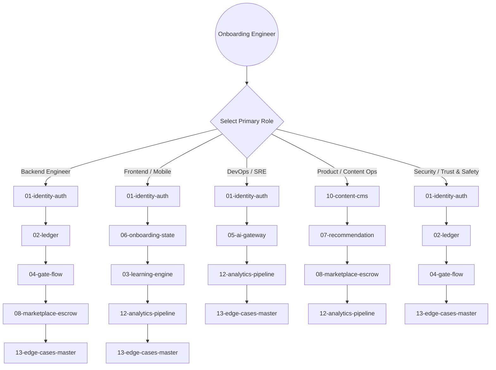
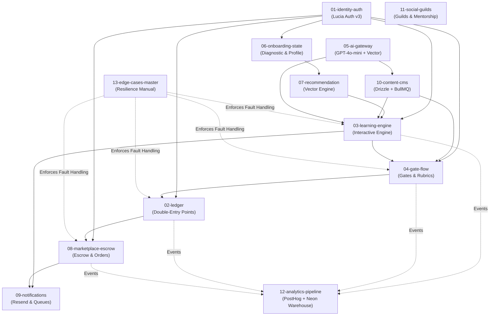

# Low-Level Design (LLD) Suite Index & Architectural Guide

> ⚠️ **Implementation note:** these LLD specs were originally written with TypeScript/Drizzle/BullMQ pseudocode; the concrete implementation is the **Rust** codebase. See [16-rust-implementation.md](../16-rust-implementation.md) for the module-by-module mapping and [SETUP.md](../../SETUP.md) for run/deploy.

- **Document Path:** `docs/15-lld/00-lld-index.md`
- **Version:** `1.0.0`
- **Last Updated:** `2026-11-21`
- **Status:** Approved for Implementation
- **Related Documents:**
  - [System Architecture (High-Level Design)](../06-platforms/01-architecture.md)
  - [Requirements Index](../14-appendices/01-requirements-index.md)
  - [Decision Log](../14-appendices/03-decision-log.md)
  - [Roadmap & Phases](../13-phases/01-roadmap.md)
  - [Master Edge Cases Register](13-edge-cases-master.md)

---

## Table of Contents
1. [Purpose & Scope: LLD vs. HLD](#1-purpose--scope-lld-vs-hld)
2. [Role-Based Reading Paths](#2-role-based-reading-paths)
3. [Master Registry of LLD Specifications](#3-master-registry-of-lld-specifications)
4. [System Interdependence & Cross-Reference Graph](#4-system-interdependence--cross-reference-graph)
5. [Engineering Contribution Standards & Conventions](#5-engineering-contribution-standards--conventions)

---

## 1. Purpose & Scope: LLD vs. HLD

The **High-Level Design (HLD)** documented in `docs/06-platforms/01-architecture.md` and related domain documents defines the platform's macro-architecture: conceptual domain boundaries, business rules, regulatory posture, and high-level service topologies.

In contrast, the **Low-Level Design (LLD)** documents in this directory (`docs/15-lld/`) define concrete engineering implementations. They translate abstract functional requirements into exact, executable technical specifications:

| Architectural Dimension | High-Level Design (HLD) | Low-Level Design (LLD) |
|---|---|---|
| **Primary Audience** | Architects, Product Directors, Auditors | Software Engineers, DevOps/SREs, Data Engineers |
| **System Abstraction** | Conceptual services, trust tiers, actors | Database DDL, TypeScript interfaces, BullMQ workers |
| **Event Model** | High-level event categories | Typed JSON schemas, payload fields, deduplication keys |
| **Data Storage** | "Postgres", "Redis", "Object Store" | Drizzle ORM schemas, indexes, connection pool limits |
| **Edge Cases** | High-level risk categories | Exhaustive scenario tables (Detection, Handling, Recovery) |
| **Infrastructure** | "Cloud VPS and CDN" | Docker Compose CPU/memory limits, cgroup configs, PgBouncer |
| **Algorithms** | Power-law mathematical formulas | Executable TypeScript pseudocode and error handlers |

---

## 2. Role-Based Reading Paths

Engineering contributors should read LLD specifications in prioritized sequence according to their functional specialization:



### 2.1 Backend Engineer Reading Order
1. `docs/15-lld/01-identity-auth.md`: Session tokens, Lucia Auth v3, passkeys, and database connection lifecycle.
2. `docs/15-lld/02-ledger.md`: Double-entry accounting invariants, row-level locks, and power-law formulas.
3. `docs/15-lld/04-gate-flow.md`: Gate exams, autograders, rubric calculators, and race conditions.
4. `docs/15-lld/08-marketplace-escrow.md`: Escrow locks, orders, and merchant settlement.
5. `docs/15-lld/10-content-cms.md`: Drizzle ORM schemas, BullMQ drafting workers, and semantic versioning.
6. `docs/15-lld/13-edge-cases-master.md`: Operational fault modes and recovery handling across all subsystems.

### 2.2 Frontend / Mobile / Spatial Engineer Reading Order
1. `docs/15-lld/01-identity-auth.md`: Passkeys, session cookies, and multi-tab token rotation.
2. `docs/15-lld/06-onboarding-state.md`: Diagnostic placement, profiling, and onboarding state machine.
3. `docs/15-lld/03-learning-engine.md`: Interactive lesson state, simulator WebAssembly hooks, and video players.
4. `docs/15-lld/09-notifications.md`: In-app and push notification delivery, Resend integration.
5. `docs/15-lld/12-analytics-pipeline.md`: PostHog client SDK initialization, privacy masking, and telemetry events.
6. `docs/15-lld/13-edge-cases-master.md`: Client offline reconnection and storage quota handling.

### 2.3 DevOps, SRE & Platform Engineer Reading Order
1. `docs/15-lld/01-identity-auth.md`: Connection pool limits, session caching, and auth middleware.
2. `docs/15-lld/05-ai-gateway.md`: OpenAI rate limiting, Redis semantic caching, and streaming timeouts.
3. `docs/15-lld/12-analytics-pipeline.md`: Self-hosted PostHog vs. Cloud sizing, ClickHouse limits, and Neon warehouse.
4. `docs/15-lld/13-edge-cases-master.md`: Hetzner kernel panics, Neon connection pool saturation, and DNS failover.

---

## 3. Master Registry of LLD Specifications

| Doc # | Filename | Primary Scope & Subsystems | Key Architectural Diagrams | Status |
|---|---|---|---|---|
| `00` | `00-lld-index.md` | LLD directory index, role reading paths, contribution rules | Role Reading Flow, Subsystem Dependency Graph | **Approved** |
| `01` | `01-identity-auth.md` | Lucia Auth v3, Passkeys/WebAuthn, session rotation, RBAC | Auth Flow Sequence, Session State Machine | **Approved** |
| `02` | `02-ledger.md` | Double-entry journal, sponsor pools, power-law awards, wallet | Ledger Transaction Flow, Escrow Lock Cycle | **Approved** |
| `03` | `03-learning-engine.md` | Interactive exercises, video HLS, code sandbox, sims, spacing | Exercise Execution Flow, Code Runner Cgroups | **Approved** |
| `04` | `04-gate-flow.md` | Level gates, item banks, autograders, psychometrics, appeals | Gate State Machine, IRT Calibration Pipeline | **Approved** |
| `05` | `05-ai-gateway.md` | Model routing, RAG retrieval, token quotas, semantic cache | LLM Gateway Fallback, Token Budget Pipeline | **Approved** |
| `06` | `06-onboarding-state.md` | Onboarding state machine, profiling, diagnostic placement | Diagnostic Routing Tree, Profiling Sequence | **Approved** |
| `07` | `07-recommendation.md` | Recommendation algorithms, vector embeddings, cluster graph | Recommendation Flow, Vector Query Graph | **Approved** |
| `08` | `08-marketplace-escrow.md`| Catalog inventory, escrow settlement, shipping logistics | Marketplace Purchase Sequence, Dispute Flow | **Approved** |
| `09` | `09-notifications.md` | Push, email (Resend), in-app notification dispatch and queues | Notification Queue Flow, Template Pipeline | **Approved** |
| `10` | `10-content-cms.md` | Curriculum authoring, Drizzle schema, AI drafting, SemVer | 16-State Workflow FSM, AI Drafting Sequence | **Approved** |
| `11` | `11-social-guilds.md` | Guilds, leagues, peer review assignment, mentorship matching | Guild Quest Cycle, Peer Review Matcher | **Approved** |
| `12` | `12-analytics-pipeline.md` | PostHog telemetry, 32-event catalog, Neon warehouse, dbt | Event Pipeline Architecture, Guardrail Flow | **Approved** |
| `13` | `13-edge-cases-master.md` | Resilience register: 210 edge cases across 10 domains | Comprehensive Edge Case Matrices | **Approved** |

---

## 4. System Interdependence & Cross-Reference Graph

The following Mermaid dependency graph illustrates how data models, queues, and contracts flow across LLD modules:



---

## 5. Engineering Contribution Standards & Conventions

Any pull request introducing or modifying an LLD specification must satisfy the following criteria:

### 5.1 Document Metadata Header
Every file must open with an immutable metadata block:
```markdown
# Low-Level Design: [Subsystem Title]

- **Document Path:** `docs/15-lld/[00-14]-[name].md`
- **Version:** `X.Y.Z` (SemVer)
- **Last Updated:** `YYYY-MM-DD`
- **Status:** Draft | In Review | Approved for Implementation
- **Related Documents:** [Relative markdown links]
```

### 5.2 Mandatory Section Structure
Every functional section within an LLD specification must include the following sub-components:
1. **Purpose:** Concise architectural rationale and system boundaries.
2. **Flow / Algorithm:** Visual flow using Mermaid diagrams (`graph`, `sequenceDiagram`, or `stateDiagram-v2`) and complete, production-grade TypeScript pseudocode.
3. **Edge Cases Matrix:** Explicit table detailing `ID`, `Scenario`, `Detection`, `Handling`, `Recovery`, and `Prevention`.
4. **Error Handling Architecture:** Concrete timeout, retry, backoff, and circuit-breaker behavior.
5. **Requirements Traceability:** Explicit mapping to `FR-[AREA]-NNN` and `NFR-[AREA]-NNN` codes from `docs/14-appendices/01-requirements-index.md`.
6. **Success Metrics:** Quantifiable technical SLOs and performance targets.

### 5.3 Mermaid Syntax Rules
- Node labels with special characters (brackets, colons, arithmetic symbols) must be enclosed in quotes: `ID["Node (Detail)"]`.
- Do not use raw HTML tags inside node text.
- Wrap all diagrams in ` ```mermaid ` fences.

### 5.4 Algorithmic Pseudocode Rules
- Write standard, strictly-typed TypeScript.
- Define explicit Zod schemas or TypeScript interfaces for all data boundaries.
- Include database transactions, connection releases, and error handling branches.
- Use explicit mathematical formulas as defined in platform policy:
  $$\text{EC}(L) = 10 \times L^{1.2} \times m_d \times Q \times E \times M \times R$$
  $$\text{XP}(L) = 100 \times L^{1.5} \times m_d$$

### 5.5 Free-Tier Cost & Infrastructure Boundaries
Specifications must strictly respect the platform's \$1,000 budget and free-tier infrastructure parameters:
- **Hetzner VPS:** CAX21 (4 vCPU ARM, 8GB RAM, €7.49/mo) or CAX11 (2 vCPU ARM, 4GB RAM, €4.49/mo).
- **Neon Postgres:** 0.5 GB storage limit on free tier; use PgBouncer connection pooling.
- **Cloudflare R2:** 10 GB free tier; zero egress costs; S3 API compatibility.
- **OpenAI GPT-4o-mini:** \$0.15/1M input tokens, \$0.60/1M output tokens; enforce per-learner daily token caps.
- **Resend:** 3,000 emails/month free tier; backup local Postfix SMTP relay.
- **PostHog:** Free Cloud tier (1M events/month) for Phase 0–1; self-hosted with strict memory ceilings (3GB max) on VPS when scaling.
