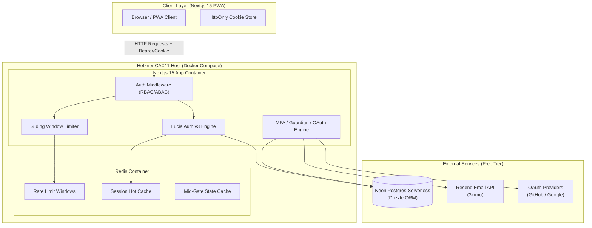
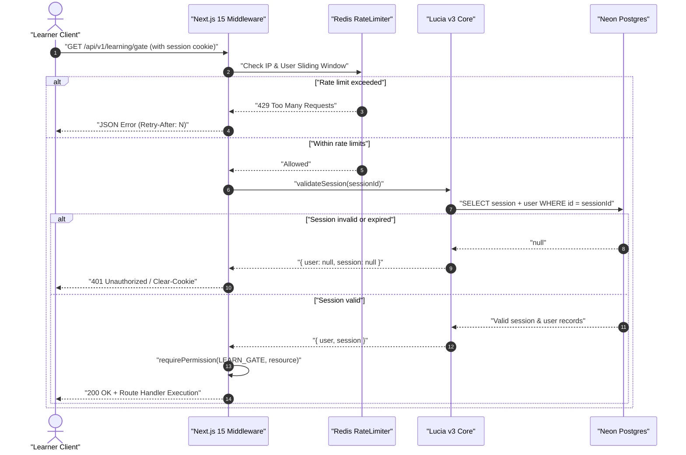
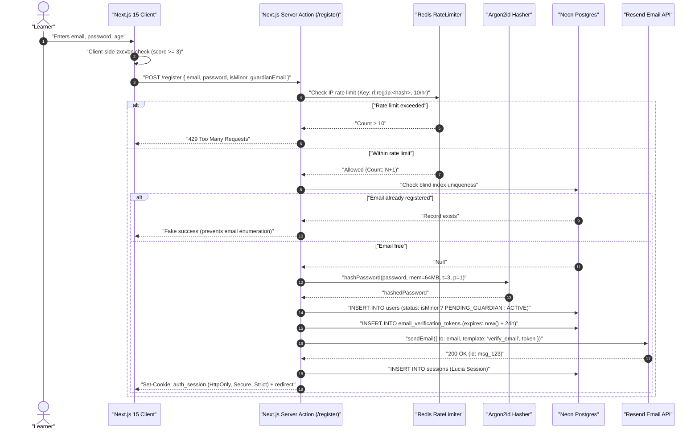
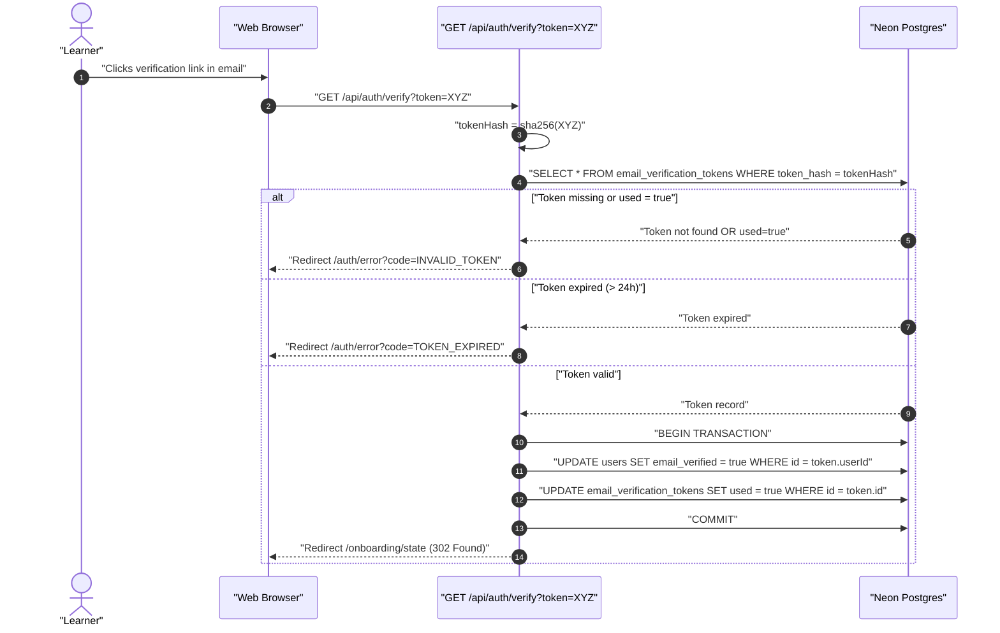
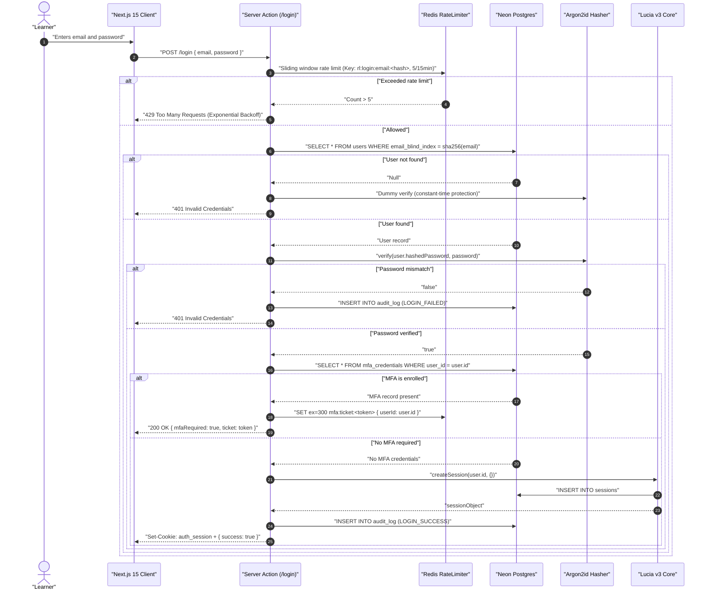
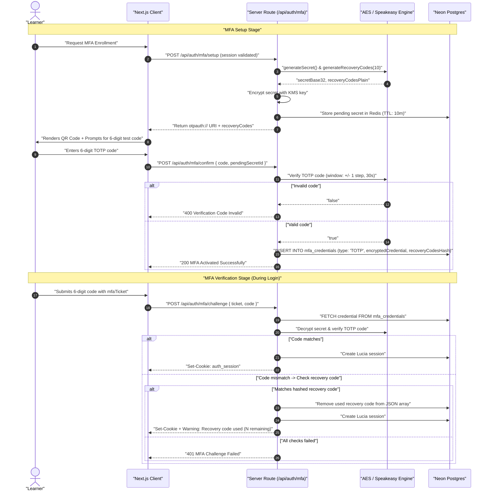
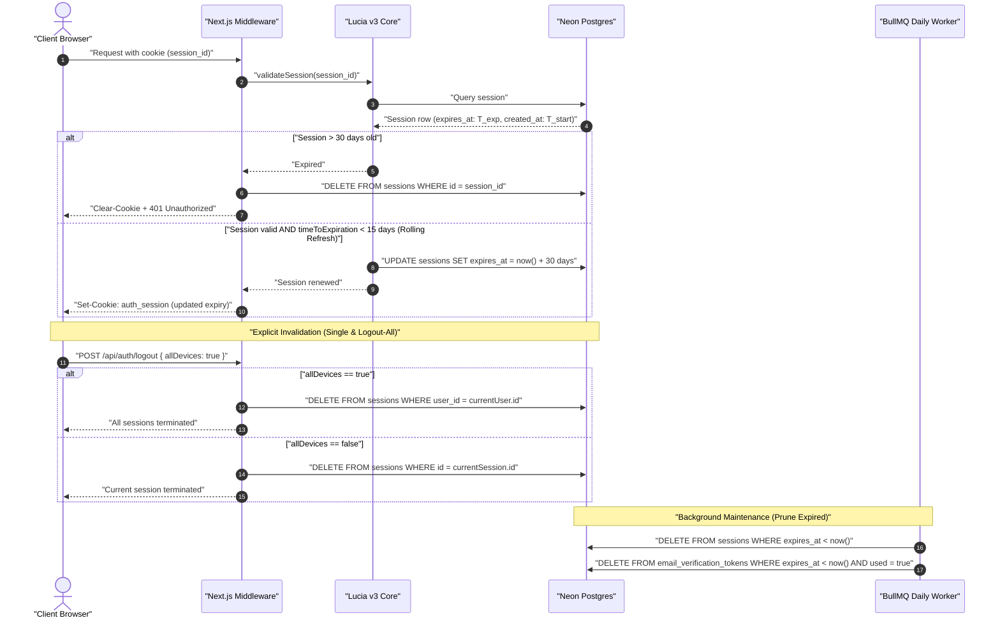
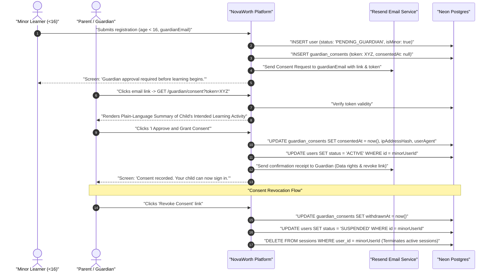

# Low-Level Design: Identity, Authentication & Access Control

- **Document Path:** `docs/15-lld/01-identity-auth.md`
- **Version:** `1.0.0`
- **Last Updated:** `2026-11-21`
- **Related Documents:**
  - `docs/00-foundations/01-vision.md`
  - `docs/06-platforms/01-architecture.md`
  - `docs/09-trust-safety/03-privacy-data.md`
  - `docs/03-onboarding/01-onboarding-flow.md`
  - `docs/15-lld/06-onboarding-state.md`

---

## Table of Contents

1. [Hardware & Free-Tier Operational Constraints](#1-hardware--free-tier-operational-constraints)
2. [Section 1: Architecture Overview](#2-section-1-architecture-overview)
   - 2.1 [Core Architectural Division](#21-core-architectural-division)
   - 2.2 [Lucia Auth v3 Integration Boundary](#22-lucia-auth-v3-integration-boundary)
   - 2.3 [Custom Identity Extensions](#23-custom-identity-extensions)
   - 2.4 [Architecture Flow](#24-architecture-flow)
   - 2.5 [Requirements & Metrics](#25-requirements--metrics)
3. [Section 2: Database Schema (Drizzle ORM)](#3-section-2-database-schema-drizzle-orm)
   - 3.1 [Design Principles for Neon Free Tier](#31-design-principles-for-neon-free-tier)
   - 3.2 [Drizzle TypeScript Schema](#32-drizzle-typescript-schema)
   - 3.3 [Database Indexes & Storage Budget](#33-database-indexes--storage-budget)
   - 3.4 [Requirements & Metrics](#34-requirements--metrics)
4. [Section 3: Authentication Flows (Sequence Diagrams)](#4-section-3-authentication-flows-sequence-diagrams)
   - 4.1 [Flow 1: Email/Password Registration](#41-flow-1-emailpassword-registration)
   - 4.2 [Flow 2: Email Verification](#42-flow-2-email-verification)
   - 4.3 [Flow 3: Login & Multi-Factor Challenge](#43-flow-3-login--multi-factor-challenge)
   - 4.4 [Flow 4: TOTP MFA Setup & Verification](#44-flow-4-totp-mfa-setup--verification)
   - 4.5 [Flow 5: Session Refresh & Invalidation](#45-flow-5-session-refresh--invalidation)
   - 4.6 [Flow 6: Guardian Consent Flow (Minors <16)](#46-flow-6-guardian-consent-flow-minors-16)
   - 4.7 [Flow 7: Password Reset](#47-flow-7-password-reset)
   - 4.8 [Requirements & Metrics](#48-requirements--metrics)
5. [Section 4: Authorization (RBAC + ABAC)](#5-section-4-authorization-rbac--abac)
   - 5.1 [Role Definitions & Hierarchy](#51-role-definitions--hierarchy)
   - 5.2 [Permission Matrix](#52-permission-matrix)
   - 5.3 [Attribute-Based Access Control (ABAC) Rules](#53-attribute-based-access-control-abac-rules)
   - 5.4 [TypeScript Middleware Implementation](#54-typescript-middleware-implementation)
   - 5.5 [Requirements & Metrics](#55-requirements--metrics)
6. [Section 5: Security Hardening](#6-section-5-security-hardening)
   - 6.1 [Argon2id Tuning for Hetzner ARM VPS](#61-argon2id-tuning-for-hetzner-arm-vps)
   - 6.2 [Session Cookie Configuration](#62-session-cookie-configuration)
   - 6.3 [CSRF Protection (Double Submit Cookie)](#63-csrf-protection-double-submit-cookie)
   - 6.4 [Sliding Window Rate Limiting (Redis)](#64-sliding-window-rate-limiting-redis)
   - 6.5 [Timing Attack Mitigation](#65-timing-attack-mitigation)
   - 6.6 [Requirements & Metrics](#66-requirements--metrics)
7. [Section 6: Edge Cases & Error Handling](#7-section-6-edge-cases--error-handling)
   - 7.1 [Comprehensive Edge Cases Matrix (22 Scenarios)](#71-comprehensive-edge-cases-matrix-22-scenarios)
   - 7.2 [Standard Error Response Schema](#72-standard-error-response-schema)

---

## 1. Hardware & Free-Tier Operational Constraints

This identity and authentication subsystem is strictly budgeted to run within the project's zero/low-cost free tier envelope:

| Resource | Allocation / Constraint | Direct Impact on Identity Architecture |
|---|---|---|
| **Hetzner VPS CAX11** | 2 vCPU ARM (Neoverse-N1), 4GB RAM (€4.49/mo) | Argon2id password hashing is capped at `parallelism=1` to avoid CPU starvation. Total concurrent hash requests throttled to 2. |
| **Neon Postgres** | Free Tier: 0.5GB disk, 1 compute project, pooling enabled | Tables strictly partitioned/indexed. Audit logs and old tokens pruned automatically to keep storage <400MB. Pool limit = 20 connections. |
| **Redis (Docker)** | 256MB max memory container on Hetzner VPS | In-memory sliding-window rate limiting, session cache, gate fallback state. Key TTL strictly enforced. |
| **Resend** | 3,000 emails/month free | Email verification and reset tokens throttled aggressively; batching and digest mechanisms prevent quota exhaustion. |
| **Cloudflare R2** | 10GB free, zero egress | Encrypted MFA recovery key escrow backups and audit log cold archives (S3 SDK). |
| **Lucia Auth v3** | Self-hosted NPM library | Zero SaaS user fees; runs fully in Next.js Server Actions / API routes with Neon adapter. |

---

## 2. Section 1: Architecture Overview

### 2.1 Core Architectural Division

The identity service governs who a learner is, verifies their credentials, monitors session states, ensures child protection compliance, and enforces fine-grained authorization.



### 2.2 Lucia Auth v3 Integration Boundary

Lucia Auth v3 is deployed in a stateless adapter configuration against Neon Postgres. Lucia is assigned specific responsibilities:
1. **Cryptographic Session ID Generation:** Cryptographically secure 40-character entropy tokens.
2. **Session Validation & Rotation:** Verification of session expiration, automatic rolling window expiration renewal.
3. **Cookie Serialization:** Generation of standard compliant `Set-Cookie` headers with optimal security flags.
4. **Adapter Interface:** Direct mapping to the `sessions` and `users` Drizzle tables.

### 2.3 Custom Identity Extensions Built on Top

Because Lucia Auth v3 is intentionally unopinionated, the following production features are implemented in application code:
- **Argon2id Password Hasher:** Fine-tuned for ARM64 server constraints.
- **MFA Layer:** TOTP (RFC 6238) and WebAuthn/FIDO2 credentials with encrypted secret storage.
- **Guardian Consent Subsystem:** COPPA and GDPR-K compliant consent ledger for learners under 16.
- **Combined RBAC + ABAC Policy Engine:** Context-aware access decisions evaluated on every server route.
- **Sliding-Window Rate Limiting:** Lua-scripted sliding logs in Redis.

### 2.4 Architecture Flow



### 2.5 Requirements & Metrics

- **`FR-AUTH-001`**: System shall validate session tokens in < 15ms using connection-pooled Neon Postgres queries.
- **`FR-AUTH-002`**: All core auth features shall function without external paid authentication SaaS (Auth0, Clerk, etc.).
- **`NFR-AUTH-001`**: Memory consumption of the auth module in the Node.js runtime shall not exceed 128MB.
- **Success Metric**: 100% adherence to zero-cost auth infrastructure during Phase 0 and Phase 1.

---

## 3. Section 2: Database Schema (Drizzle ORM)

### 3.1 Design Principles for Neon Free Tier

Neon's free tier provides 0.5GB (512MB) of shared NVMe storage. To prevent database bloat:
1. **Email Privacy:** Raw emails are encrypted at rest with AES-256-GCM; a deterministic blind index (`SHA-256(lowercase(email) + pepper)`) is stored for $O(1)$ lookups without exposing plain-text emails in database dumps.
2. **Compact IDs:** NanoID (21 chars) or standard UUIDv4 stored as `varchar(36)` or native UUID.
3. **Automated Pruning:** Ephemeral tokens (verification, reset) include an `expires_at` column indexed for bulk delete sweeps.
4. **Audit Log Hygiene:** The `audit_log` table retains active logs for 90 days; records older than 90 days are archived to Cloudflare R2 as parquet/ndjson before truncation.

### 3.2 Drizzle TypeScript Schema

```typescript
// packages/database/src/schema/auth.ts
import { 
  pgTable, 
  text, 
  varchar, 
  timestamp, 
  boolean, 
  jsonb, 
  index, 
  uniqueIndex, 
  foreignKey 
} from "drizzle-orm/pg-core";
import { relations } from "drizzle-orm";

export const users = pgTable("users", {
  id: varchar("id", { length: 36 }).primaryKey(),
  // Deterministic HMAC/SHA-256 blind index for exact lookup
  emailBlindIndex: varchar("email_blind_index", { length: 64 }).notNull().unique(),
  // AES-256-GCM ciphertext of the original email address: "iv:authTag:ciphertext"
  encryptedEmail: text("encrypted_email").notNull(),
  hashedPassword: text("hashed_password"), // Nullable for OAuth-only accounts
  emailVerified: boolean("email_verified").default(false).notNull(),
  tier: varchar("tier", { length: 20 }).default("FREE").notNull(), // FREE, PRO, SPONSORED
  region: varchar("region", { length: 4 }).default("GLOBAL").notNull(),
  language: varchar("language", { length: 10 }).default("en").notNull(),
  isMinor: boolean("is_minor").default(false).notNull(),
  status: varchar("status", { length: 20 }).default("ACTIVE").notNull(), // ACTIVE, SUSPENDED, PENDING_GUARDIAN
  createdAt: timestamp("created_at", { withTimezone: true }).defaultNow().notNull(),
  updatedAt: timestamp("updated_at", { withTimezone: true }).defaultNow().notNull(),
}, (table) => ({
  emailBlindIdx: uniqueIndex("users_email_blind_idx").on(table.emailBlindIndex),
  statusIdx: index("users_status_idx").on(table.status),
}));

export const sessions = pgTable("sessions", {
  id: varchar("id", { length: 40 }).primaryKey(), // Lucia v3 session token
  userId: varchar("user_id", { length: 36 }).notNull().references(() => users.id, { onDelete: "cascade" }),
  expiresAt: timestamp("expires_at", { withTimezone: true }).notNull(),
  createdAt: timestamp("created_at", { withTimezone: true }).defaultNow().notNull(),
  ipAddressHash: varchar("ip_address_hash", { length: 64 }), // SHA-256 of IP for audit/fraud detection
  userAgent: text("user_agent"),
}, (table) => ({
  userIdIdx: index("sessions_user_id_idx").on(table.userId),
  expiresAtIdx: index("sessions_expires_at_idx").on(table.expiresAt),
}));

export const emailVerificationTokens = pgTable("email_verification_tokens", {
  id: varchar("id", { length: 36 }).primaryKey(),
  userId: varchar("user_id", { length: 36 }).notNull().references(() => users.id, { onDelete: "cascade" }),
  tokenHash: varchar("token_hash", { length: 64 }).notNull().unique(), // SHA-256 hash of token
  expiresAt: timestamp("expires_at", { withTimezone: true }).notNull(),
  used: boolean("used").default(false).notNull(),
  createdAt: timestamp("created_at", { withTimezone: true }).defaultNow().notNull(),
}, (table) => ({
  tokenHashIdx: uniqueIndex("email_tokens_hash_idx").on(table.tokenHash),
  userExpiresIdx: index("email_tokens_user_exp_idx").on(table.userId, table.expiresAt),
}));

export const passwordResetTokens = pgTable("password_reset_tokens", {
  id: varchar("id", { length: 36 }).primaryKey(),
  userId: varchar("user_id", { length: 36 }).notNull().references(() => users.id, { onDelete: "cascade" }),
  tokenHash: varchar("token_hash", { length: 64 }).notNull().unique(),
  expiresAt: timestamp("expires_at", { withTimezone: true }).notNull(),
  used: boolean("used").default(false).notNull(),
  createdAt: timestamp("created_at", { withTimezone: true }).defaultNow().notNull(),
}, (table) => ({
  resetTokenHashIdx: uniqueIndex("pwd_reset_tokens_hash_idx").on(table.tokenHash),
}));

export const oauthAccounts = pgTable("oauth_accounts", {
  id: varchar("id", { length: 36 }).primaryKey(),
  userId: varchar("user_id", { length: 36 }).notNull().references(() => users.id, { onDelete: "cascade" }),
  provider: varchar("provider", { length: 30 }).notNull(), // 'github', 'google'
  providerUserId: varchar("provider_user_id", { length: 128 }).notNull(),
  createdAt: timestamp("created_at", { withTimezone: true }).defaultNow().notNull(),
}, (table) => ({
  providerUserIdx: uniqueIndex("oauth_provider_uid_idx").on(table.provider, table.providerUserId),
  userIdIdx: index("oauth_user_id_idx").on(table.userId),
}));

export const mfaCredentials = pgTable("mfa_credentials", {
  id: varchar("id", { length: 36 }).primaryKey(),
  userId: varchar("user_id", { length: 36 }).notNull().references(() => users.id, { onDelete: "cascade" }),
  type: varchar("type", { length: 20 }).notNull(), // 'TOTP', 'WEBAUTHN'
  // Encrypted TOTP secret or WebAuthn public key credential JSON
  encryptedCredential: text("encrypted_credential").notNull(),
  // Array of SHA-256 hashed single-use recovery codes
  recoveryCodesHash: jsonb("recovery_codes_hash").$type<string[]>().default([]).notNull(),
  createdAt: timestamp("created_at", { withTimezone: true }).defaultNow().notNull(),
}, (table) => ({
  userTypeIdx: index("mfa_user_type_idx").on(table.userId, table.type),
}));

export const guardianConsents = pgTable("guardian_consents", {
  id: varchar("id", { length: 36 }).primaryKey(),
  minorUserId: varchar("minor_user_id", { length: 36 }).notNull().references(() => users.id, { onDelete: "cascade" }),
  guardianEmail: text("guardian_email").notNull(),
  consentTokenHash: varchar("consent_token_hash", { length: 64 }).notNull().unique(),
  consentedAt: timestamp("consented_at", { withTimezone: true }),
  withdrawnAt: timestamp("withdrawn_at", { withTimezone: true }),
  ipAddressHash: varchar("ip_address_hash", { length: 64 }),
  userAgent: text("user_agent"),
  createdAt: timestamp("created_at", { withTimezone: true }).defaultNow().notNull(),
}, (table) => ({
  minorIdx: index("guardian_minor_idx").on(table.minorUserId),
  tokenHashIdx: uniqueIndex("guardian_token_hash_idx").on(table.consentTokenHash),
}));

export const roleAssignments = pgTable("role_assignments", {
  id: varchar("id", { length: 36 }).primaryKey(),
  userId: varchar("user_id", { length: 36 }).notNull().references(() => users.id, { onDelete: "cascade" }),
  role: varchar("role", { length: 30 }).notNull(), // LEARNER, MENTOR, EXAMINER, etc.
  scope: varchar("scope", { length: 128 }).default("GLOBAL").notNull(), // 'GLOBAL' or domain e.g. 'DOM-TECH'
  grantedAt: timestamp("granted_at", { withTimezone: true }).defaultNow().notNull(),
  grantedBy: varchar("granted_by", { length: 36 }).notNull(),
  revokedAt: timestamp("revoked_at", { withTimezone: true }),
}, (table) => ({
  userRoleScopeIdx: index("role_assignments_lookup_idx").on(table.userId, table.role, table.scope),
}));

export const auditLog = pgTable("audit_log", {
  id: varchar("id", { length: 36 }).primaryKey(),
  userId: varchar("user_id", { length: 36 }),
  action: varchar("action", { length: 64 }).notNull(), // 'AUTH_LOGIN_SUCCESS', 'MFA_CHALLENGE_FAILED', etc.
  ipAddressHash: varchar("ip_address_hash", { length: 64 }).notNull(),
  userAgent: text("user_agent"),
  metadata: jsonb("metadata").$type<Record<string, unknown>>().default({}).notNull(),
  createdAt: timestamp("created_at", { withTimezone: true }).defaultNow().notNull(),
}, (table) => ({
  userActionIdx: index("audit_user_action_idx").on(table.userId, table.action),
  createdAtIdx: index("audit_created_at_idx").on(table.createdAt),
}));
```

### 3.3 Database Indexes & Storage Budget

Estimated storage calculation for 1,000 active Phase 1 learners:
- `users`: 1,000 rows × ~350 bytes = 350 KB
- `sessions`: 2,500 active sessions × ~180 bytes = 450 KB
- `audit_log`: ~50,000 records/month × ~250 bytes = 12.5 MB
- Indexes overhead: ~40% of table space = ~5.3 MB
- Total storage consumed: **~18.6 MB**, well below Neon's 512 MB free tier ceiling.

### 3.4 Requirements & Metrics

- **`FR-AUTH-003`**: Raw emails shall never be stored unencrypted in plain text.
- **`FR-AUTH-004`**: Every user mutation shall emit an append-only row in `audit_log`.
- **`NFR-AUTH-002`**: Database table schema must support zero-downtime Drizzle migrations.

---

## 4. Section 3: Authentication Flows (Sequence Diagrams)

### 4.1 Flow 1: Email/Password Registration



### 4.2 Flow 2: Email Verification



### 4.3 Flow 3: Login & Multi-Factor Challenge



### 4.4 Flow 4: TOTP MFA Setup & Verification



### 4.5 Flow 5: Session Refresh & Invalidation



### 4.6 Flow 6: Guardian Consent Flow (Minors <16)



### 4.7 Flow 7: Password Reset

```mermaid
sequenceDiagram
    autonumber
    actor Learner as "Learner"
    participant Server as "Server Route (/api/auth/reset-request)"
    participant Redis as "Redis RateLimiter"
    participant DB as "Neon Postgres"
    participant Resend as "Resend API"

    Learner->>Server: "POST /reset-request { email }"
    Server->>Redis: "Sliding window limit (3 requests / 1 hour / IP)"
    Server->>DB: "Lookup email blind index"
    alt "User exists"
        Server->>DB: "Generate crypto token; INSERT INTO password_reset_tokens (exp: 1h)"
        Server->>Resend: "Send Password Reset Email with Token"
    end
    Server-->>Learner: "Generic 200 OK ('If the email exists, instructions have been sent')"
    
    Learner->>Server: "POST /reset-confirm { token, newPassword }"
    Server->>DB: "Verify token hash, expiration, and used = false"
    Server->>Server: "Argon2id hash newPassword"
    Server->>DB: "BEGIN TRANSACTION"
    Server->>DB: "UPDATE users SET hashed_password = newHash"
    Server->>DB: "UPDATE password_reset_tokens SET used = true"
    Server->>DB: "DELETE FROM sessions WHERE user_id = token.userId (Invalidate all sessions)"
    Server->>DB: "COMMIT"
    Server-->>Learner: "200 Password Updated. Please sign in."
```

### 4.8 Requirements & Metrics

- **`FR-AUTH-005`**: Registration and password reset emails shall dispatch via Resend in < 1,500ms.
- **`FR-AUTH-006`**: Minor accounts (<16) shall have zero access to platform learning sessions until guardian consent is persisted.
- **`NFR-AUTH-003`**: Invalidation of all sessions upon password reset shall execute synchronously within the database transaction.

---

## 5. Section 4: Authorization (RBAC + ABAC)

### 5.1 Role Definitions & Hierarchy

The platform defines 8 distinct system roles:

1. **`LEARNER`**: Default base role. Can progress through curriculum, complete gate assessments, and manage their own wallet.
2. **`MENTOR`**: Guides assigned cohorts, provides qualitative feedback, and submits peer endorsements.
3. **`EXAMINER`**: Accredited evaluator authorized to evaluate Level 50+ manual capstones and portfolio gates within designated domains.
4. **`CONTENT_AUTHOR`**: Creates and edits levels, rubric specifications, and diagnostic items in staging branches.
5. **`MODERATOR`**: Reviews flagged community content, roleplay dialogues, and integrity infractions.
6. **`SUPPORT`**: Customer service agent with restricted impersonation and read-only support access.
7. **`ADMIN`**: Platform administrator; manages global configuration, role grants, and financial reserves.
8. **`SYSTEM`**: Internal automated service worker (BullMQ, cron) executing background reconciliations and pruning.

### 5.2 Permission Matrix

| Action / Capability | LEARNER | MENTOR | EXAMINER | CONTENT_AUTHOR | MODERATOR | SUPPORT | ADMIN | SYSTEM |
|---|:---:|:---:|:---:|:---:|:---:|:---:|:---:|:---:|
| `view_own_data` | **Yes** | **Yes** | **Yes** | **Yes** | **Yes** | **Yes** | **Yes** | **Yes** |
| `view_all_data` | No | No | No | No | No | Read-Only | **Yes** | **Yes** |
| `start_learning_session` | **Yes** | **Yes** | No | No | No | No | No | No |
| `submit_assessment` | **Yes** | No | No | No | No | No | No | No |
| `grade_mentee` | No | **ABAC** | No | No | No | No | **Yes** | No |
| `review_domain_capstone`| No | No | **ABAC** | No | No | No | **Yes** | No |
| `publish_content` | No | No | No | **Yes** | No | No | **Yes** | No |
| `post_award_payout` | No | No | No | No | No | No | **Yes** | **Yes** |
| `run_ledger_clawback` | No | No | No | No | No | No | **Yes** | No |
| `view_sponsor_pool` | No | No | No | No | No | No | **Yes** | **Yes** |
| `moderate_flagged_content`| No | No | No | No | **Yes** | No | **Yes** | No |
| `manage_user_roles` | No | No | No | No | No | No | **Yes** | No |

### 5.3 Attribute-Based Access Control (ABAC) Rules

Contextual attributes dynamically constrain permissions:

1. **Mentor Constraint:** A user with role `MENTOR` can only grade submissions if:
   $$\text{Assignment}(\text{menteeId}, \text{mentorId}) == \text{true} \land \text{mentee.status} == \text{'ACTIVE'}$$
2. **Examiner Domain Constraint:** An `EXAMINER` can only review a portfolio gate if:
   $$\text{skill.domain} \in \text{examiner.accreditedDomains} \land \text{examiner.id} \neq \text{learner.id}$$
3. **Sponsor Scope Constraint:** A sponsor representative can only view cohort analytics if:
   $$\text{pool.sponsorId} == \text{caller.sponsorId}$$

### 5.4 TypeScript Middleware Implementation

```typescript
// packages/auth/src/authorization.ts
import { ForbiddenError, UnauthorizedError } from "./errors";

export type Role = 
  | "LEARNER" 
  | "MENTOR" 
  | "EXAMINER" 
  | "CONTENT_AUTHOR" 
  | "MODERATOR" 
  | "SUPPORT" 
  | "ADMIN" 
  | "SYSTEM";

export type Action =
  | "view_own_data"
  | "view_all_data"
  | "start_learning_session"
  | "submit_assessment"
  | "grade_mentee"
  | "review_domain_capstone"
  | "publish_content"
  | "post_award_payout"
  | "run_ledger_clawback"
  | "view_sponsor_pool"
  | "moderate_flagged_content"
  | "manage_user_roles";

export interface AuthContext {
  userId: string;
  roles: { role: Role; scope: string }[];
  isMinor: boolean;
  status: string;
}

export interface ResourceContext {
  targetUserId?: string;
  menteeId?: string;
  skillDomain?: string;
  sponsorId?: string;
  userAssignedMentorIds?: string[];
}

export async function requirePermission(
  action: Action,
  auth: AuthContext,
  resource?: ResourceContext
): Promise<void> {
  if (auth.status === "PENDING_GUARDIAN" || auth.status === "SUSPENDED") {
    throw new ForbiddenError("Account is inactive or pending guardian consent");
  }

  const userRoles = auth.roles.map((r) => r.role);

  // ADMIN and SYSTEM bypass standard RBAC limits (except audit constraints)
  if (userRoles.includes("ADMIN") || userRoles.includes("SYSTEM")) {
    return;
  }

  switch (action) {
    case "view_own_data":
      if (resource?.targetUserId && resource.targetUserId !== auth.userId) {
        throw new ForbiddenError("Cannot access personal records of other learners");
      }
      return;

    case "grade_mentee": {
      const isMentor = userRoles.includes("MENTOR");
      if (!isMentor) throw new ForbiddenError("Requires MENTOR role");
      if (!resource?.menteeId || !resource.userAssignedMentorIds?.includes(auth.userId)) {
        throw new ForbiddenError("Mentor is not assigned to this specific mentee");
      }
      return;
    }

    case "review_domain_capstone": {
      const isExaminer = userRoles.includes("EXAMINER");
      if (!isExaminer) throw new ForbiddenError("Requires EXAMINER role");
      
      const examinerScopes = auth.roles
        .filter((r) => r.role === "EXAMINER")
        .map((r) => r.scope);

      if (
        !resource?.skillDomain || 
        (!examinerScopes.includes("GLOBAL") && !examinerScopes.includes(resource.skillDomain))
      ) {
        throw new ForbiddenError(`Examiner is not accredited for domain: ${resource?.skillDomain}`);
      }
      return;
    }

    case "publish_content":
      if (!userRoles.includes("CONTENT_AUTHOR")) {
        throw new ForbiddenError("Requires CONTENT_AUTHOR role");
      }
      return;

    case "run_ledger_clawback":
      throw new ForbiddenError("Clawback operations require root ADMIN privilege");

    default:
      throw new ForbiddenError(`Action '${action}' not permitted for current roles`);
  }
}
```

### 5.5 Requirements & Metrics

- **`FR-AUTH-007`**: Every protected API route must enforce `requirePermission` before executing database queries.
- **`FR-AUTH-008`**: Mentors and Examiners attempting cross-boundary access shall generate a high-priority security audit log event.
- **`NFR-AUTH-004`**: Permission resolution shall execute entirely in memory in < 1ms.

---

## 6. Section 5: Security Hardening

### 6.1 Argon2id Tuning for Hetzner ARM VPS

Standard password hashing parameters must balance brute-force resistance against server resource exhaustion on the CAX11 (2 vCPU ARM64, 4GB RAM).

```typescript
// packages/auth/src/password.ts
import { hash, verify } from "@node-rs/argon2";

export const ARGON2ID_CONFIG = {
  memoryCost: 65536, // 64 MB RAM per hash operation
  timeCost: 3,       // 3 iterations
  parallelism: 1,    // 1 lane (critical for 2 vCPU ARM container)
  outputLen: 32,     // 256-bit key output
};

export async function hashPassword(plainText: string): Promise<string> {
  return await hash(plainText, ARGON2ID_CONFIG);
}

export async function verifyPassword(hashed: string, plainText: string): Promise<boolean> {
  return await verify(hashed, plainText, ARGON2ID_CONFIG);
}
```

*Benchmark on CAX11:* ~185ms CPU time per hash. Memory footprint is strictly bounded to 64MB per execution. A Redis semaphore limits concurrent hashing requests to a maximum of 2, preventing CPU starvation.

### 6.2 Session Cookie Configuration

Session cookies are issued directly by Lucia Auth v3 with strict RFC 6265bis security attributes:

```typescript
// packages/auth/src/lucia.ts
export const SESSION_COOKIE_OPTIONS = {
  name: "auth_session",
  options: {
    httpOnly: true,
    secure: process.env.NODE_ENV === "production",
    sameSite: "strict" as const,
    path: "/",
    maxAge: 60 * 60 * 24 * 30, // 30 days
  }
};
```

### 6.3 CSRF Protection (Double Submit Cookie Pattern)

For mutation endpoints (POST/PUT/DELETE) that do not use Next.js Server Actions with built-in origin validation:
1. Client generates a cryptographically random 256-bit token stored in an un-encoded cookie `__Host-csrf-token`.
2. Client sends this token in the custom header `x-csrf-token`.
3. Server middleware compares the cookie and header values using `crypto.timingSafeEqual()`.

### 6.4 Sliding Window Rate Limiting (Redis)

Implemented using a sliding-window log via atomic Redis multi-exec transactions:

```typescript
// packages/auth/src/rate-limit.ts
import { Redis } from "ioredis";

export async function checkSlidingRateLimit(
  redis: Redis,
  key: string,
  limit: number,
  windowSeconds: number
): Promise<{ allowed: boolean; remaining: number; retryAfter: number }> {
  const now = Date.now();
  const clearBefore = now - windowSeconds * 1000;

  const multi = redis.multi();
  multi.zremrangebyscore(key, 0, clearBefore);
  multi.zadd(key, now, `${now}:${Math.random()}`);
  multi.zcard(key);
  multi.expire(key, windowSeconds);

  const results = await multi.exec();
  const currentCount = (results?.[2]?.[1] as number) || 0;

  if (currentCount > limit) {
    return {
      allowed: false,
      remaining: 0,
      retryAfter: windowSeconds,
    };
  }

  return {
    allowed: true,
    remaining: limit - currentCount,
    retryAfter: 0,
  };
}
```

### 6.5 Timing Attack Mitigation

To prevent user enumeration via timing discrepancies on email lookup:
- When a user is not found during login, the system executes a dummy Argon2id hash verification against a pre-computed constant hash.
- All token and MAC comparisons strictly employ `crypto.timingSafeEqual(bufA, bufB)`.

### 6.6 Requirements & Metrics

- **`FR-AUTH-009`**: Sliding window rate limiter shall protect all authentication routes from brute force attacks.
- **`FR-AUTH-010`**: Double Submit CSRF verification shall protect all non-GET mutation routes.
- **`NFR-AUTH-005`**: Maximum rate of Argon2id hashing shall not exceed 2 concurrent instances per VPS host.

---

## 7. Section 6: Edge Cases & Error Handling

### 7.1 Comprehensive Edge Cases Matrix (22 Scenarios)

| # | Edge Case Scenario | Trigger Event | Architectural Handling & System Response | Recovery / State Resolution |
|---|---|---|---|---|
| **1** | Access from new unrecognized device | IP hash or user agent differs from session record | Login succeeds, but system issues security alert email via Resend; audit log records `DEVICE_NEW_DETECTED`. | User can click 1-click revocation link in alert email if unrecognized. |
| **2** | Concurrent login from two devices | User signs in on mobile while desktop session is active | Allowed by default (multi-device learning). User profile shows both active sessions with device tags. | User can selectively terminate either session from profile settings. |
| **3** | Session expired mid-gate assessment | 30-day session TTL elapses while learner is inside a 45-minute timed gate exam | **Do NOT void the gate exam.** Learner assessment progress state is cached in Redis (`gate:state:<examId>`). Client receives `401_SESSION_EXPIRED_MID_GATE`. | Client presents inline re-auth modal; on credential re-entry, exam resumes with zero lost time. |
| **4** | Guardian withdraws consent during active session | Parent clicks revoke link while minor is actively taking a learning module | Revocation webhook sets user status to `SUSPENDED` and purges all sessions from database. Middleware immediately denies next API poll. | Minor client displays respectful explanation screen: "Learning paused by parent/guardian." |
| **5** | MFA device lost / broken | Learner has TOTP enabled but loses smartphone | Learner clicks "Use recovery code" on login challenge screen; submits 1 of 10 single-use codes. | System verifies SHA-256 match, burns code from JSON array, logs in user, prompts to enroll new MFA device. |
| **6** | All 10 recovery codes exhausted | User uses 10th recovery code | Login succeeds, but system immediately forces learner into the `/settings/mfa` re-enrollment view. | System prevents any learning activity until a new set of recovery codes is generated and confirmed. |
| **7** | OAuth account email matches existing password user | Learner registers with email+pwd, later clicks "Sign in with Google" with identical email | If existing email is verified: OAuth account is linked to existing user ID after password re-entry. | Prevents duplicate profile creation; links provider in `oauth_accounts`. |
| **8** | OAuth provider returns unverified email | Provider payload contains `email_verified: false` | Platform refuses automatic sign-in; issues standard platform email verification link to that address. | Account remains `emailVerified = false` until verification link clicked. |
| **9** | Registration race condition (duplicate email) | Two identical registration requests hit API simultaneously | Database unique index on `email_blind_index` causes second INSERT to fail with Postgres error `23505`. | Server catches exception and returns generic success message without leaking collision. |
| **10**| Neon Postgres connection pool exhausted | Traffic spike exhausts the 20-connection pool on free tier | Connection timeout triggers circuit breaker; fallback to Redis session cache for read operations. | Mutating requests receive `503 Service Unavailable` with `Retry-After: 2` header. |
| **11**| Redis container restart / memory flush | Docker container restarts; rate limit and cache keys lost | Stateless architecture falls back to direct Neon DB queries; rate limit windows reset gracefully. | Minor temporary increase in Neon DB queries; platform remains functional. |
| **12**| Resend API outage during registration | Resend returns 500 or timeout during verification email dispatch | User record and token are saved; verification email job is pushed to BullMQ retry queue (3 exponential retries). | Registration UI notifies learner: "Verification email is on its way, may take a few minutes." |
| **13**| Token replay attack on password reset | Attacker captures already-used reset token URL | Database check verifies `used == true` or `expires_at < now()`. | Immediate rejection with `400 Token Expired or Used`; incident logged in `audit_log`. |
| **14**| Brute force password guessing | 5 incorrect attempts on single email within 15 minutes | Redis sliding window trips rate limit; locks account logins for 15 minutes for that email. | Resets after window expires or via successful password reset flow. |
| **15**| Brute force distributed across rotating proxies | 1,000 IPs attempt 1 guess each on a high-value account | Global account-level rate limiter triggers regardless of source IP. | Captcha / Turnstile challenge activated for that specific username. |
| **16**| Minor attempts to modify DOB to bypass guardian check | Learner updates profile birthdate from 15 to 16 | DOB mutation is locked after initial registration; requires manual support verification with ID document. | Form submission rejected with `403 Cannot modify age without identity verification`. |
| **17**| Clock drift on client during TOTP generation | Learner's mobile phone clock is 45 seconds slow | TOTP validator utilizes standard RFC 6238 time step tolerance of $\pm 1$ step (allows 30s drift). | Verification succeeds transparently without error. |
| **18**| User revokes guardian consent, then re-consents | Guardian clicks revoke, then changes mind 2 days later | Guardian clicks re-consent link; system verifies email match, updates `withdrawnAt = null`, reactivates user. | Learner account transitions back to `ACTIVE`; all prior progress preserved. |
| **19**| Examiner attempts to evaluate own capstone | Examiner submits their own capstone in an accredited domain | ABAC check explicitly enforces `examiner.id !== learner.id`. | Request blocked with `403 Cannot evaluate your own capstone assessment`. |
| **20**| Session cookie stripped by client privacy browser | Strict browser extension strips all cookies | API detects missing session header; returns JSON payload prompting user to enable cookies for learning progress. | Displays guide on configuring cookie permissions for the PWA domain. |
| **21**| Timing attack on token verification | Attacker measures microseconds of token comparison | All token checks execute via `crypto.timingSafeEqual(Buffer.from(a), Buffer.from(b))`. | Constant-time execution prevents character-by-character deduction. |
| **22**| Stale session used after role upgrade | Learner is promoted to Mentor while active session exists | Session record does not store static roles; roles are queried dynamically from `role_assignments` table. | New permissions become active on the very next HTTP request without requiring re-login. |

### 7.2 Standard Error Response Schema

All identity and authorization errors adhere to RFC 7807 Problem Details:

```json
{
  "type": "https://novaworth.org/errors/auth/rate-limit-exceeded",
  "title": "Too Many Requests",
  "status": 429,
  "detail": "Maximum login attempts exceeded for this email address. Please retry after 900 seconds.",
  "instance": "/api/v1/auth/login",
  "code": "AUTH_RATE_LIMIT_EXCEEDED",
  "retryAfter": 900,
  "timestamp": "2026-11-21T10:15:30.125Z"
}
```

---

*End of Document `docs/15-lld/01-identity-auth.md`*
