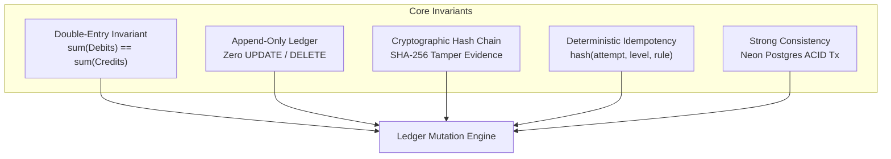
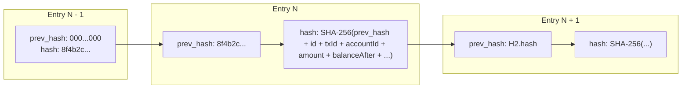
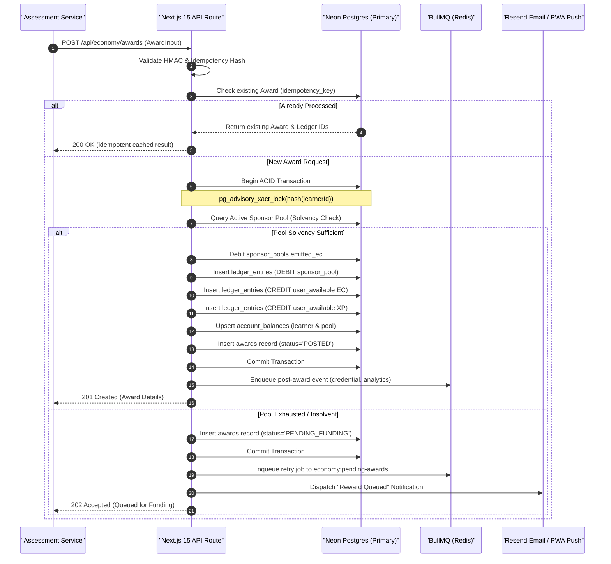
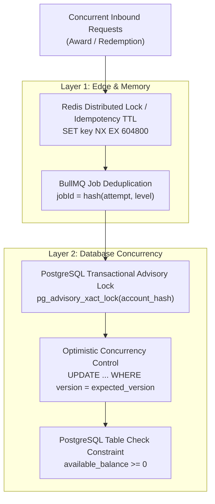
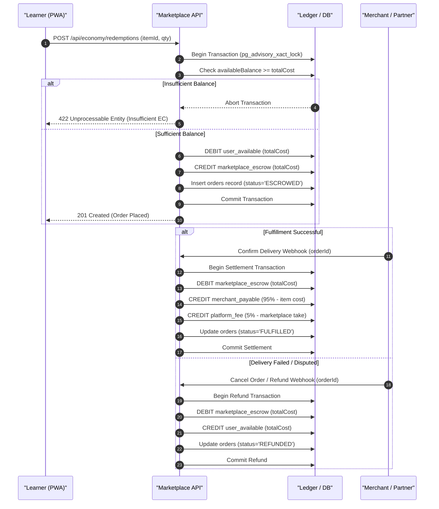
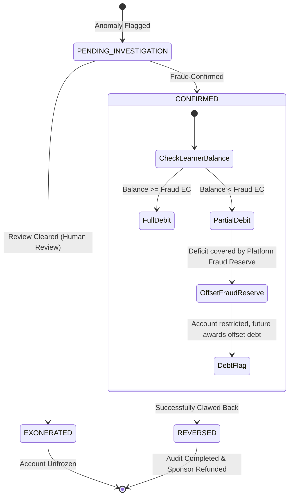
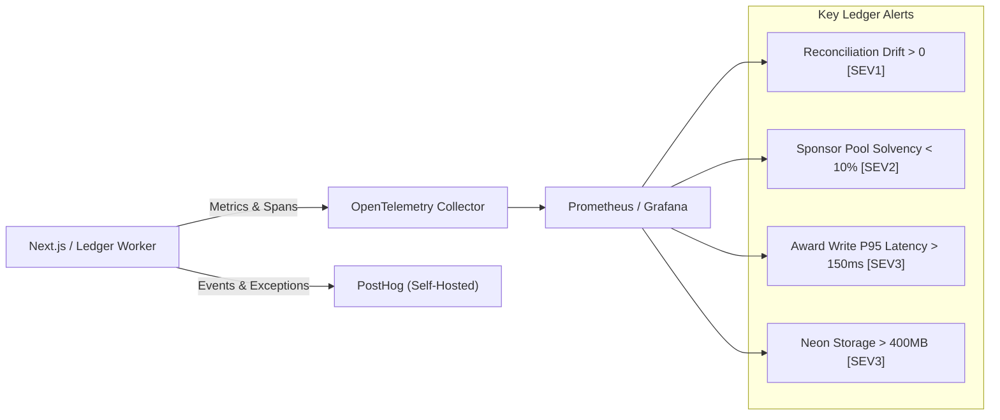

# Low-Level Design: Economy Ledger (XP & EC Double-Entry Engine)

**Section Path:** `docs/15-lld/02-ledger.md`  
**Version:** 1.0.0  
**Last Updated:** 2026-11-21  
**Related Documents:**
- [`docs/01-economy/01-economy-model.md`](../01-economy/01-economy-model.md)
- [`docs/01-economy/02-points-ledger.md`](../01-economy/02-points-ledger.md)
- [`docs/01-economy/03-scoring-model.md`](../01-economy/03-scoring-model.md)
- [`docs/06-platforms/01-architecture.md`](../06-platforms/01-architecture.md)
- [`docs/10-data-ai/01-data-model.md`](../10-data-ai/01-data-model.md)
- [`docs/14-appendices/01-requirements-index.md`](../14-appendices/01-requirements-index.md)

---

## Table of Contents

1. [Section 1: Purpose & Design Principles](#section-1-purpose--design-principles)
2. [Section 2: Complete Database Schema (Drizzle ORM DDL)](#section-2-complete-database-schema-drizzle-orm-ddl)
3. [Section 3: Cryptographic Hash Chain Design](#section-3-cryptographic-hash-chain-design)
4. [Section 4: Award Posting Flow & Implementation](#section-4-award-posting-flow--implementation)
5. [Section 5: Double-Spend Prevention & Concurrency Controls](#section-5-double-spend-prevention--concurrency-controls)
6. [Section 6: Marketplace Redemption & Escrow Flow](#section-6-marketplace-redemption--escrow-flow)
7. [Section 7: Fraud Detection & Clawback Lifecycle](#section-7-fraud-detection--clawback-lifecycle)
8. [Section 8: Automated Daily Reconciliation Engine](#section-8-automated-daily-reconciliation-engine)
9. [Section 9: Comprehensive Ledger Edge Cases Table](#section-9-comprehensive-ledger-edge-cases-table)
10. [Section 10: Performance, Infrastructure Limits & Observability](#section-10-performance-infrastructure-limits--observability)

---

## Section 1: Purpose & Design Principles

### 1.1 Purpose
The Economy Ledger is the authoritative financial and progression sub-system of the NovaWorth platform. It guarantees deterministic, mathematically verifiable, tamper-evident accounting for both non-fungible Mastery Points (`XP`) and fungible, backed Education Credits (`EC`). The ledger converts real, verified learner capability into consequential claims on real-world goods, services, and credentials without succumbing to speculative inflation, double-spending, or catastrophic ledger drift.

### 1.2 Core Architectural Principles



1. **Double-Entry Bookkeeping Applied to XP and EC:**
   - Every `EC` movement consists of balanced multi-legged ledger entries where total debits strictly equal total credits ($\sum \text{Debits} \equiv \sum \text{Credits}$).
   - `XP` is an append-only mastery log representing permanent intellectual capital. It cannot be spent, transferred, or decayed, though fraudulent awards generate balanced compensating reversal entries.
2. **Append-Only Immutability:**
   - Under no operational or administrative circumstance is an existing row in `ledger_entries` updated or deleted. Database role permissions strictly grant `SELECT` and `INSERT` on `ledger_entries` to application users. Corrections, disputes, and clawbacks are executed solely via novel compensating entries.
3. **Cryptographic Hash Chain:**
   - Each ledger entry incorporates the cryptographic digest (`prev_hash`) of the preceding entry for that specific account. Any out-of-band database tampering immediately breaks the chain validation.
4. **Deterministic Idempotency:**
   - Every state-changing write requires a unique idempotency key derived deterministically:
     $$\text{idempotency\_key} = \text{SHA-256}(\text{attempt\_id} \,\|\, \text{level\_id} \,\|\, \text{rule\_version})$$
   - Retries return the original persisted result without duplicate emission or balance inflation.
5. **Strong Consistency via Neon Postgres:**
   - Financial mutations execute within synchronous, serializable ACID transactions against the primary Neon PostgreSQL instance. Materialized balances are synchronously updated within the same transaction using row-level locking.
6. **Strict Budget & Resource Realism:**
   - Optimized for Phase 0 (prototype) and Phase 1 (alpha, 1,000 learners) under a hard $1,000 total budget ($100/mo operating envelope).
   - Compute: Hetzner Cloud CAX11 (2 vCPU ARM, 4GB RAM, €4.49/mo) running Docker Compose (Next.js 15, Redis for BullMQ, self-hosted PostHog).
   - Storage: Neon Postgres Serverless Free Tier (0.5GB disk cap, 1 project, instantaneous branch environments for staging/dev).
   - Cold Storage & Archiving: Cloudflare R2 (10GB free tier, zero egress fees) for hash-chain audit logs and ledger snapshots.
   - External APIs: OpenAI GPT-4o-mini ($0.15/1M input, $0.60/1M output), Resend (3,000 emails/mo free), Lucia Auth v3 (self-hosted sessions).

### 1.3 Flow / Algorithm: Architectural Guardrail Verification
```typescript
/**
 * Core validation predicate executed before any transaction is submitted
 */
export function assertLedgerInvariants(entries: Array<{ direction: 'DEBIT' | 'CREDIT'; amount: bigint; currency: string }>): void {
  const ecEntries = entries.filter(e => e.currency === 'EC');
  if (ecEntries.length > 0) {
    const totalDebits = ecEntries.filter(e => e.direction === 'DEBIT').reduce((acc, curr) => acc + curr.amount, 0n);
    const totalCredits = ecEntries.filter(e => e.direction === 'CREDIT').reduce((acc, curr) => acc + curr.amount, 0n);
    if (totalDebits !== totalCredits) {
      throw new Error(`LEDGER_INVARIANT_VIOLATION: Unbalanced EC transaction. Debits: ${totalDebits}, Credits: ${totalCredits}`);
    }
  }
}
```

### 1.4 Edge Cases
| Case ID | Scenario | Handling Mechanism |
|---|---|---|
| EC-PRIN-01 | Micro-rounding discrepancy on multi-split fees | Remainder allocated to `platform_fee` account to ensure exact zero-balance sum. |
| EC-PRIN-02 | Attempt to modify historical ledger entry | Postgres trigger rejects `UPDATE`/`DELETE` queries with SQLSTATE `28000` (invalid_authorization_specification). |
| EC-PRIN-03 | Neon compute engine cold start latency | Application connection pool configured with 10s connect timeout and exponential retry. |

### 1.5 Error Handling
- **Database Level:** PostgreSQL table-level triggers enforce read-only semantics on `ledger_entries`.
- **Application Level:** Validation middleware intercepts unbalanced transaction payloads before issuing SQL statements.

### 1.6 Requirements
- `FR-LED-001`: System must record all monetary and point mutations as immutable append-only records.
- `FR-LED-002`: System must enforce $\sum \text{Debits} = \sum \text{Credits}$ on every multi-entry transaction for EC.
- `NFR-LED-001`: Financial write transaction P99 commit latency must remain below 150ms on Neon Postgres.

### 1.7 Success Metrics
- 0 unauthorized balance mutations or unhedged ledger entries.
- 100% compliance with double-entry balance verification during nightly reconciliation.

---

## Section 2: Complete Database Schema (Drizzle ORM DDL)

### 2.1 Purpose
This section establishes the complete, production-grade schema definition utilizing Drizzle ORM for PostgreSQL. The schema provides strong relational integrity, precise monetary representation (storing `EC` and `XP` as 64-bit integer minor units where 1 EC = 100 cents / minor units), and optimized indexing strategies designed for Neon Postgres free-tier constraints.

### 2.2 Complete Drizzle Schema Definition (`schema.ts`)

```typescript
import {
  pgTable,
  uuid,
  varchar,
  bigint,
  integer,
  decimal,
  timestamp,
  boolean,
  pgEnum,
  index,
  uniqueIndex,
  check,
  text,
  jsonb
} from 'drizzle-orm/pg-core';
import { sql } from 'drizzle-orm';

// Enums
export const accountTypeEnum = pgEnum('account_type', [
  'user_available',     // Spendable EC held by learner
  'user_saved',         // Goal-locked EC held by learner
  'user_escrow',        // Learner EC reserved in active checkout
  'sponsor_pool',       // Sponsor deposited funding pool
  'treasury_reserve',   // Fiat-backed reserve pool
  'marketplace_escrow', // Escrow holding funds pending merchant delivery
  'merchant_payable',   // Merchant funds clearing for payout
  'platform_fee',       // Platform take-rate revenue
  'fraud_reserve',      // Slush fund for clawback absorption
  'promo_expiry',       // Sink for expired promotional credits
  'external_settlement' // Clearing account for external fiat in/out
]);

export const entryDirectionEnum = pgEnum('entry_direction', ['CREDIT', 'DEBIT']);
export const currencyEnum = pgEnum('currency_type', ['XP', 'EC']);
export const awardStatusEnum = pgEnum('award_status', ['POSTED', 'PENDING_FUNDING', 'REVERSED', 'EXHAUSTED']);
export const clawbackStatusEnum = pgEnum('clawback_status', ['PENDING_INVESTIGATION', 'CONFIRMED', 'EXONERATED', 'REVERSED']);
export const referenceTypeEnum = pgEnum('reference_type', [
  'AWARD',
  'REDEMPTION',
  'CLAWBACK',
  'RESERVE',
  'POOL_FUND',
  'EXPIRY',
  'ADJUSTMENT'
]);

/**
 * 1. SPONSOR_POOLS
 * Manages external sponsor grant funding allocated to cohorts, domains, or skills.
 */
export const sponsorPools = pgTable('sponsor_pools', {
  id: uuid('id').defaultRandom().primaryKey(),
  sponsorId: uuid('sponsor_id').notNull(),
  name: varchar('name', { length: 255 }).notNull(),
  description: text('description'),
  domainCode: varchar('domain_code', { length: 64 }), // e.g., 'CMP' for Computing, null for universal
  skillId: varchar('skill_id', { length: 64 }),       // e.g., 'CMP-025', null for domain-wide
  budgetFiatCents: bigint('budget_fiat_cents', { mode: 'bigint' }).notNull(), // Budget in USD cents
  anchorRate: decimal('anchor_rate', { precision: 5, scale: 4 }).notNull().default('0.0500'), // 1 EC = $0.05
  totalAllocatedEc: bigint('total_allocated_ec', { mode: 'bigint' }).notNull(), // Converted EC budget
  emittedEc: bigint('emitted_ec', { mode: 'bigint' }).notNull().default(0n),     // Disbursed EC
  reservedEc: bigint('reserved_ec', { mode: 'bigint' }).notNull().default(0n),   // Locked in pending queues
  isActive: boolean('is_active').notNull().default(true),
  expiresAt: timestamp('expires_at', { withTimezone: true }),
  createdAt: timestamp('created_at', { withTimezone: true }).defaultNow().notNull(),
  updatedAt: timestamp('updated_at', { withTimezone: true }).defaultNow().notNull(),
}, (table) => [
  index('idx_sponsor_pools_active').on(table.isActive, table.domainCode, table.skillId),
  index('idx_sponsor_pools_sponsor').on(table.sponsorId),
  check('chk_pool_emitted_non_negative', sql`${table.emittedEc} >= 0`),
  check('chk_pool_reserved_non_negative', sql`${table.reservedEc} >= 0`),
  check('chk_pool_solvency', sql`${table.emittedEc} + ${table.reservedEc} <= ${table.totalAllocatedEc}`)
]);

/**
 * 2. LEDGER_ENTRIES
 * Append-only immutable ledger. The ultimate source of financial truth.
 */
export const ledgerEntries = pgTable('ledger_entries', {
  id: uuid('id').defaultRandom().primaryKey(),
  transactionId: uuid('transaction_id').notNull(), // Groups atomic credit/debit legs
  accountId: uuid('account_id').notNull(),         // User UUID or Sponsor Pool UUID
  accountType: accountTypeEnum('account_type').notNull(),
  entryType: entryDirectionEnum('entry_type').notNull(),
  currency: currencyEnum('currency').notNull(),
  amount: bigint('amount', { mode: 'bigint' }).notNull(), // Minor units (always positive)
  balanceAfter: bigint('balance_after', { mode: 'bigint' }).notNull(), // Point-in-time balance
  prevHash: varchar('prev_hash', { length: 64 }).notNull(), // SHA-256 of preceding entry
  hash: varchar('hash', { length: 64 }).notNull(),         // SHA-256 tamper digest
  referenceType: referenceTypeEnum('reference_type').notNull(),
  referenceId: uuid('reference_id').notNull(),             // Award ID, Order ID, Clawback ID
  ruleVersion: varchar('rule_version', { length: 32 }).notNull(), // e.g. 'score-2026.1'
  createdAt: timestamp('created_at', { withTimezone: true }).defaultNow().notNull(),
}, (table) => [
  index('idx_ledger_account_created').on(table.accountId, table.createdAt.desc()),
  index('idx_ledger_tx_id').on(table.transactionId),
  index('idx_ledger_reference').on(table.referenceType, table.referenceId),
  uniqueIndex('idx_ledger_hash').on(table.hash),
  check('chk_ledger_amount_positive', sql`${table.amount} > 0`)
]);

/**
 * 3. ACCOUNT_BALANCES
 * Materialized, strongly consistent balances for O(1) balance lookups.
 * Synchronously updated inside the ledger transaction.
 */
export const accountBalances = pgTable('account_balances', {
  accountId: uuid('account_id').primaryKey(), // user_id or pool_id
  accountType: accountTypeEnum('account_type').notNull(),
  currency: currencyEnum('currency').notNull(),
  availableBalance: bigint('available_balance', { mode: 'bigint' }).notNull().default(0n),
  savedBalance: bigint('saved_balance', { mode: 'bigint' }).notNull().default(0n),
  escrowBalance: bigint('escrow_balance', { mode: 'bigint' }).notNull().default(0n),
  lifetimeEarned: bigint('lifetime_earned', { mode: 'bigint' }).notNull().default(0n),
  lifetimeSpent: bigint('lifetime_spent', { mode: 'bigint' }).notNull().default(0n),
  lastEntryId: uuid('last_entry_id').notNull(),
  lastHash: varchar('last_hash', { length: 64 }).notNull(),
  version: integer('version').notNull().default(0), // Optimistic concurrency lock
  updatedAt: timestamp('updated_at', { withTimezone: true }).defaultNow().notNull(),
}, (table) => [
  index('idx_balances_account_currency').on(table.accountId, table.currency),
  check('chk_balance_available_non_negative', sql`
    CASE 
      WHEN ${table.accountType} IN ('user_available', 'user_saved', 'user_escrow', 'sponsor_pool', 'treasury_reserve', 'marketplace_escrow', 'platform_fee', 'fraud_reserve', 'promo_expiry')
      THEN ${table.availableBalance} >= 0 
      ELSE TRUE 
    END
  `)
]);

/**
 * 4. AWARDS
 * Links gate exam attempts, scoring formulas, and payout ledger transactions.
 */
export const awards = pgTable('awards', {
  id: uuid('id').defaultRandom().primaryKey(),
  learnerId: uuid('learner_id').notNull(),
  skillId: varchar('skill_id', { length: 64 }).notNull(),
  level: integer('level').notNull(),
  attemptId: uuid('attempt_id').notNull(),
  xpAmount: bigint('xp_amount', { mode: 'bigint' }).notNull(),
  ecAmount: bigint('ec_amount', { mode: 'bigint' }).notNull(),
  baseEc: bigint('base_ec', { mode: 'bigint' }).notNull(),
  qualityMultiplier: decimal('quality_multiplier', { precision: 4, scale: 2 }).notNull(),
  effortMultiplier: decimal('effort_multiplier', { precision: 4, scale: 2 }).notNull(),
  masteryMultiplier: decimal('mastery_multiplier', { precision: 4, scale: 2 }).notNull(),
  repeatIndex: integer('repeat_index').notNull().default(1),
  integrityScore: decimal('integrity_score', { precision: 4, scale: 3 }).notNull(),
  ruleVersion: varchar('rule_version', { length: 32 }).notNull(),
  sponsorPoolId: uuid('sponsor_pool_id').references(() => sponsorPools.id),
  status: awardStatusEnum('status').notNull().default('POSTED'),
  idempotencyKey: varchar('idempotency_key', { length: 128 }).notNull(),
  createdAt: timestamp('created_at', { withTimezone: true }).defaultNow().notNull(),
}, (table) => [
  uniqueIndex('idx_awards_idempotency').on(table.idempotencyKey),
  uniqueIndex('idx_awards_attempt_level').on(table.attemptId, table.level),
  index('idx_awards_learner_skill').on(table.learnerId, table.skillId),
  index('idx_awards_created').on(table.createdAt.desc())
]);

/**
 * 5. EC_RESERVES
 * Tracks real-time fiat-to-credit collateralization per sponsor pool.
 */
export const ecReserves = pgTable('ec_reserves', {
  id: uuid('id').defaultRandom().primaryKey(),
  sponsorPoolId: uuid('sponsor_pool_id').notNull().references(() => sponsorPools.id),
  totalReservedFiatCents: bigint('total_reserved_fiat_cents', { mode: 'bigint' }).notNull(),
  totalCommittedEc: bigint('total_committed_ec', { mode: 'bigint' }).notNull(),
  totalReleasedEc: bigint('total_released_ec', { mode: 'bigint' }).notNull().default(0n),
  currency: varchar('currency', { length: 8 }).notNull().default('USD'),
  exchangeRateAnchor: decimal('exchange_rate_anchor', { precision: 6, scale: 4 }).notNull(),
  createdAt: timestamp('created_at', { withTimezone: true }).defaultNow().notNull(),
  updatedAt: timestamp('updated_at', { withTimezone: true }).defaultNow().notNull(),
}, (table) => [
  uniqueIndex('idx_ec_reserves_pool').on(table.sponsorPoolId)
]);

/**
 * 6. CLAWBACKS
 * Comprehensive audit trail of fraud reversals, freezes, and debits.
 */
export const clawbacks = pgTable('clawbacks', {
  id: uuid('id').defaultRandom().primaryKey(),
  originalAwardId: uuid('original_award_id').notNull().references(() => awards.id),
  learnerId: uuid('learner_id').notNull(),
  sponsorPoolId: uuid('sponsor_pool_id').notNull().references(() => sponsorPools.id),
  clawbackEcAmount: bigint('clawback_ec_amount', { mode: 'bigint' }).notNull(),
  clawbackXpAmount: bigint('clawback_xp_amount', { mode: 'bigint' }).notNull(),
  reason: text('reason').notNull(),
  status: clawbackStatusEnum('status').notNull().default('PENDING_INVESTIGATION'),
  investigationNotes: text('investigation_notes'),
  initiatedBy: uuid('initiated_by').notNull(), // System or Staff User ID
  resolvedBy: uuid('resolved_by'),
  createdAt: timestamp('created_at', { withTimezone: true }).defaultNow().notNull(),
  resolvedAt: timestamp('resolved_at', { withTimezone: true }),
}, (table) => [
  index('idx_clawbacks_learner').on(table.learnerId),
  index('idx_clawbacks_status').on(table.status),
  index('idx_clawbacks_original_award').on(table.originalAwardId)
]);

/**
 * 7. RECONCILIATION_RUNS
 * Audit log generated by nightly reconciliation cron jobs.
 */
export const reconciliationRuns = pgTable('reconciliation_runs', {
  id: uuid('id').defaultRandom().primaryKey(),
  runDate: timestamp('run_date', { withTimezone: true }).notNull(),
  status: varchar('status', { length: 32 }).notNull(), // 'SUCCESS' | 'DISCREPANCY_DETECTED' | 'FAILED'
  accountsChecked: integer('accounts_checked').notNull(),
  discrepanciesCount: integer('discrepancies_count').notNull().default(0),
  totalCirculationEc: bigint('total_circulation_ec', { mode: 'bigint' }).notNull(),
  totalPoolDebits: bigint('total_pool_debits', { mode: 'bigint' }).notNull(),
  totalRedemptions: bigint('total_redemptions', { mode: 'bigint' }).notNull(),
  totalClawbacks: bigint('total_clawbacks', { mode: 'bigint' }).notNull(),
  hashChainValid: boolean('hash_chain_valid').notNull(),
  reportPayload: jsonb('report_payload').notNull(),
  startedAt: timestamp('started_at', { withTimezone: true }).notNull(),
  completedAt: timestamp('completed_at', { withTimezone: true }).notNull(),
}, (table) => [
  index('idx_reconciliation_date').on(table.runDate.desc())
]);
```

### 2.3 Edge Cases
| Column / Constraint | Edge Condition | DDL Mitigation |
|---|---|---|
| `account_balances.available_balance` | Concurrent debit attempting to push learner into debt | Postgres `CHECK` constraint triggers rollback if resulting balance < 0. |
| `sponsor_pools.solvency` | Concurrent awards committing more than pool's total EC | Check constraint `emitted_ec + reserved_ec <= total_allocated_ec`. |
| `awards.idempotency_key` | Duplicate webhooks or concurrent assessment retries | Unique B-tree index on `idempotency_key` rejects duplicate inserts instantly. |

### 2.4 Error Handling
- Constraint violations (e.g., `chk_balance_available_non_negative`, unique index collision) throw native Postgres errors with SQLSTATE codes (`23514` for check constraint, `23505` for unique violation).
- Application repository maps `23505` to HTTP 409 / idempotent replay and `23514` to HTTP 422 `INSUFFICIENT_FUNDS`.

### 2.5 Requirements
- `FR-LED-003`: Database schema must enforce positive minor unit values for all debit and credit legs.
- `FR-LED-004`: Materialized account balances must feature optimistic concurrency version numbers.
- `NFR-LED-002`: Table indexes must support single-account ledger queries in <10ms for up to 1M entries.

### 2.6 Success Metrics
- 100% database constraint coverage on solvency and balance non-negativity.
- Zero orphaned entries in `ledger_entries` or `awards`.

---

## Section 3: Cryptographic Hash Chain Design

### 3.1 Purpose
The hash chain provides a cryptographically verifiable mechanism to detect internal database manipulation, unauthorized admin SQL updates, or unauthorized ledger tampering. By binding each entry to the deterministic digest of the preceding entry in the account's history, any mutation of historical rows invalidates all subsequent entries in the chain.

### 3.2 Hash Construction Specification



For any given account $A$, the genesis entry ($E_0$) defines $\text{prev\_hash} = 0^{64}$ (`0000000000000000000000000000000000000000000000000000000000000000`).
For each subsequent entry $E_i$, the digest is computed deterministically:

$$\text{hash}_i = \text{SHA-256}\left(\text{prev\_hash}_i \,\|\, \text{id}_i \,\|\, \text{txId}_i \,\|\, \text{accountId}_i \,\|\, \text{entryType}_i \,\|\, \text{currency}_i \,\|\, \text{amount}_i \,\|\, \text{balanceAfter}_i \,\|\, \text{refType}_i \,\|\, \text{refId}_i \,\|\, \text{ruleVersion}_i \,\|\, \text{createdAtISO}_i\right)$$

### 3.3 TypeScript Hash Computation and Verification Engine

```typescript
import { createHash } from 'node:crypto';
import { eq, asc } from 'drizzle-orm';
import { ledgerEntries, accountBalances } from './schema';
import type { NodePgDatabase } from 'drizzle-orm/node-postgres';

export const GENESIS_HASH = '0'.repeat(64);

export interface LedgerEntryPayload {
  id: string;
  transactionId: string;
  accountId: string;
  entryType: 'CREDIT' | 'DEBIT';
  currency: 'XP' | 'EC';
  amount: bigint;
  balanceAfter: bigint;
  prevHash: string;
  referenceType: string;
  referenceId: string;
  ruleVersion: string;
  createdAt: Date;
}

/**
 * Computes deterministic SHA-256 digest for an entry.
 * Uses exact delimiter separation to avoid collision attacks.
 */
export function computeEntryHash(entry: LedgerEntryPayload): string {
  const serialized = [
    entry.prevHash,
    entry.id,
    entry.transactionId,
    entry.accountId,
    entry.entryType,
    entry.currency,
    entry.amount.toString(),
    entry.balanceAfter.toString(),
    entry.referenceType,
    entry.referenceId,
    entry.ruleVersion,
    entry.createdAt.toISOString()
  ].join('|');

  return createHash('sha256').update(serialized, 'utf8').digest('hex');
}

export interface VerificationResult {
  valid: boolean;
  totalVerified: number;
  brokenEntryId?: string;
  expectedHash?: string;
  actualHash?: string;
  error?: string;
}

/**
 * Verifies the integrity of the ledger chain for a specific account.
 */
export async function verifyAccountHashChain(
  accountId: string,
  db: NodePgDatabase
): Promise<VerificationResult> {
  const entries = await db
    .select()
    .from(ledgerEntries)
    .where(eq(ledgerEntries.accountId, accountId))
    .orderBy(asc(ledgerEntries.createdAt), asc(ledgerEntries.id));

  if (entries.length === 0) {
    return { valid: true, totalVerified: 0 };
  }

  let expectedPrevHash = GENESIS_HASH;

  for (let i = 0; i < entries.length; i++) {
    const entry = entries[i];

    // 1. Verify prev_hash link
    if (entry.prevHash !== expectedPrevHash) {
      return {
        valid: false,
        totalVerified: i,
        brokenEntryId: entry.id,
        error: `CHAIN_LINK_BROKEN: Entry ${entry.id} expected prevHash ${expectedPrevHash}, found ${entry.prevHash}`
      };
    }

    // 2. Recompute hash
    const recomputedHash = computeEntryHash({
      id: entry.id,
      transactionId: entry.transactionId,
      accountId: entry.accountId,
      entryType: entry.entryType,
      currency: entry.currency,
      amount: entry.amount,
      balanceAfter: entry.balanceAfter,
      prevHash: entry.prevHash,
      referenceType: entry.referenceType,
      referenceId: entry.referenceId,
      ruleVersion: entry.ruleVersion,
      createdAt: entry.createdAt
    });

    if (recomputedHash !== entry.hash) {
      return {
        valid: false,
        totalVerified: i,
        brokenEntryId: entry.id,
        expectedHash: recomputedHash,
        actualHash: entry.hash,
        error: `TAMPER_DETECTED: Entry ${entry.id} content does not match cryptographic signature`
      };
    }

    expectedPrevHash = entry.hash;
  }

  // 3. Verify materialized view sync
  const [balanceRow] = await db
    .select()
    .from(accountBalances)
    .where(eq(accountBalances.accountId, accountId));

  if (balanceRow && balanceRow.lastHash !== expectedPrevHash) {
    return {
      valid: false,
      totalVerified: entries.length,
      error: `BALANCE_DESYNC: AccountBalance lastHash ${balanceRow.lastHash} does not match latest ledger entry hash ${expectedPrevHash}`
    };
  }

  return { valid: true, totalVerified: entries.length };
}
```

### 3.4 Edge Cases
| Case ID | Scenario | Handling Mechanism |
|---|---|---|
| EC-HASH-01 | Microsecond timestamp serialization variance | Canonicalization forces `createdAt.toISOString()`, eliminating timezone and locale serialization differences. |
| EC-HASH-02 | Chain split during concurrent writes to same account | PostgreSQL transaction advisory lock (`pg_advisory_xact_lock`) serializes account mutations, enforcing a strict linear DAG. |
| EC-HASH-03 | Reorganization of entries during backup restore | B-Tree index on `(accountId, createdAt, id)` guarantees deterministic reconstruction ordering. |

### 3.5 Error Handling
- A verification failure triggers a `SEV1` incident alert in PostHog/PagerDuty and immediately places a soft freeze on the affected account (`accountBalances.accountType` set to restricted state).

### 3.6 Requirements
- `FR-LED-005`: Every ledger entry must calculate and persist a SHA-256 hash chaining to the account's prior entry.
- `NFR-LED-003`: Hash calculation overhead must add <0.5ms per ledger entry insertion.

### 3.7 Success Metrics
- 100% detection rate on synthetic tampering injected in test environments.
- 0 false positive hash mismatches across verified test suites.

---

## Section 4: Award Posting Flow & Implementation

### 4.1 Purpose
The award posting pipeline is the primary value creation mechanism in the ecosystem. It ingests verified gate completion results from the Assessment Service, computes power-law XP and EC disbursements, verifies sponsor pool solvency, executes balanced double-entry mutations across accounts, and triggers credential issuance.

### 4.2 Scoring Formula Specification
The Economy Ledger executes the canonical power-law formulas:

$$\text{XP}(L) = \text{round}\left(100 \times L^{1.5} \times m_d \times Q \times M\right)$$

$$\text{EC}(L) = \text{round}\left(10 \times L^{1.2} \times m_d \times \text{clamp}(Q \times E \times M, 0.6, 2.0) \times R\right)$$

Where:
- $L \in [1, 100]$: Skill level.
- $m_d \in [0.9, 1.3]$: Domain multiplier (e.g., Computing = 1.20, Health = 1.30, Design = 0.95).
- $Q \in [0.8, 1.25]$: Quality multiplier (Pass = 0.8, Solid = 1.0, Distinction = 1.15, Outstanding = 1.25).
- $E \in [0.9, 1.2]$: Effort multiplier (Deliberate practice intensity relative to expected hours $H(L) = 1.5 \times L^{1.1}$).
- $M \in [0.85, 1.5]$: Mastery transfer multiplier (novel problem solving, above-level demonstration).
- $R \in \{1.0, 0.2, 0.05, 0.0\}$: Repeat decay index ($1.0 \to 0.2 \to 0.05 \to 0$).
- Multiplier product $Q \times E \times M$ is hard-clamped to $[0.6, 2.0]$.

### 4.3 Award Posting Flow Sequence



### 4.4 Full TypeScript Implementation (`award-service.ts`)

```typescript
import { createHash, randomUUID } from 'node:crypto';
import { eq, sql } from 'drizzle-orm';
import {
  sponsorPools,
  ledgerEntries,
  accountBalances,
  awards,
  GENESIS_HASH,
  computeEntryHash
} from './schema';
import type { NodePgDatabase } from 'drizzle-orm/node-postgres';
import { Queue } from 'bullmq';

export interface AwardInput {
  learnerId: string;
  skillId: string;
  domainCode: string;
  level: number;
  attemptId: string;
  domainMultiplier: number;
  quality: number;
  effort: number;
  mastery: number;
  repeatIndex: number;
  integrityScore: number;
  ruleVersion: string;
  preferredPoolId?: string;
}

export interface AwardResult {
  awardId: string;
  status: 'POSTED' | 'PENDING_FUNDING' | 'ALREADY_EXISTS';
  xpAwarded: bigint;
  ecAwarded: bigint;
  transactionId?: string;
}

export function computeAwardAmounts(input: AwardInput): { baseXp: number; finalXp: bigint; baseEc: number; finalEc: bigint } {
  const { level, domainMultiplier, quality, effort, mastery, repeatIndex } = input;

  // Power-Law calculations
  const baseXp = 100 * Math.pow(level, 1.5) * domainMultiplier;
  const baseEc = 10 * Math.pow(level, 1.2) * domainMultiplier;

  const repeatDecayEc = [1.0, 0.2, 0.05, 0.0][Math.min(repeatIndex - 1, 3)] ?? 0.0;
  const repeatDecayXp = repeatIndex === 1 ? 1.0 : repeatIndex === 2 ? 0.10 : 0.0;

  const rawMultiplier = quality * effort * mastery;
  const clampedMultiplier = Math.min(Math.max(rawMultiplier, 0.6), 2.0);

  const finalXp = BigInt(Math.round(baseXp * quality * mastery * repeatDecayXp));
  const finalEc = BigInt(Math.round(baseEc * clampedMultiplier * repeatDecayEc));

  return { baseXp, finalXp, baseEc, finalEc };
}

export async function postAward(
  input: AwardInput,
  db: NodePgDatabase,
  pendingAwardsQueue: Queue
): Promise<AwardResult> {
  // 1. Calculate deterministic idempotency key
  const idempotencyKey = createHash('sha256')
    .update(`${input.attemptId}|${input.level}|${input.ruleVersion}`)
    .digest('hex');

  // 2. Compute award figures
  const { baseEc, finalXp, finalEc } = computeAwardAmounts(input);

  // 3. Execute atomic database transaction
  return await db.transaction(async (tx) => {
    // Idempotency check
    const [existingAward] = await tx
      .select()
      .from(awards)
      .where(eq(awards.idempotencyKey, idempotencyKey));

    if (existingAward) {
      return {
        awardId: existingAward.id,
        status: 'ALREADY_EXISTS',
        xpAwarded: existingAward.xpAmount,
        ecAwarded: existingAward.ecAmount
      };
    }

    // Acquire PostgreSQL transactional advisory lock on learner ID to serialize awards
    const learnerLockId = sql`('x' || substr(md5(${input.learnerId}), 1, 16))::bit(64)::bigint`;
    await tx.execute(sql`SELECT pg_advisory_xact_lock(${learnerLockId})`);

    // Find and lock eligible sponsor pool
    const poolQuery = tx
      .select()
      .from(sponsorPools)
      .where(
        sql`${sponsorPools.isActive} = true 
            AND (${sponsorPools.skillId} = ${input.skillId} OR ${sponsorPools.domainCode} = ${input.domainCode} OR ${sponsorPools.domainCode} IS NULL)`
      )
      .for('update')
      .limit(1);

    const [pool] = await poolQuery;

    // Check pool solvency
    const isPoolSolvent = pool && (pool.totalAllocatedEc - pool.emittedEc - pool.reservedEc >= finalEc);

    if (!isPoolSolvent || !pool) {
      // Pool is exhausted or missing: record award as PENDING_FUNDING
      const [pendingAward] = await tx
        .insert(awards)
        .values({
          learnerId: input.learnerId,
          skillId: input.skillId,
          level: input.level,
          attemptId: input.attemptId,
          xpAmount: finalXp,
          ecAmount: finalEc,
          baseEc: BigInt(Math.round(baseEc)),
          qualityMultiplier: input.quality.toFixed(2),
          effortMultiplier: input.effort.toFixed(2),
          masteryMultiplier: input.mastery.toFixed(2),
          repeatIndex: input.repeatIndex,
          integrityScore: input.integrityScore.toFixed(3),
          ruleVersion: input.ruleVersion,
          sponsorPoolId: pool?.id ?? null,
          status: 'PENDING_FUNDING',
          idempotencyKey
        })
        .returning();

      // Enqueue BullMQ delayed job for funding retry
      await pendingAwardsQueue.add(
        'retry-funding',
        { awardId: pendingAward.id, learnerId: input.learnerId, ecAmount: finalEc.toString() },
        { delay: 300000, attempts: 28, backoff: { type: 'exponential', delay: 60000 } }
      );

      return {
        awardId: pendingAward.id,
        status: 'PENDING_FUNDING',
        xpAwarded: finalXp,
        ecAwarded: finalEc
      };
    }

    // Pool is solvent: Proceed with Ledger Posting
    const transactionId = randomUUID();
    const awardId = randomUUID();
    const now = new Date();

    // Fetch existing learner balance to link hash chain
    const [learnerBalance] = await tx
      .select()
      .from(accountBalances)
      .where(eq(accountBalances.accountId, input.learnerId))
      .for('update');

    const learnerPrevHash = learnerBalance?.lastHash ?? GENESIS_HASH;
    const currentLearnerEc = learnerBalance?.availableBalance ?? 0n;
    const newLearnerEc = currentLearnerEc + finalEc;

    // Fetch pool balance to link pool hash chain
    const [poolBalance] = await tx
      .select()
      .from(accountBalances)
      .where(eq(accountBalances.accountId, pool.id))
      .for('update');

    const poolPrevHash = poolBalance?.lastHash ?? GENESIS_HASH;
    const currentPoolEc = poolBalance?.availableBalance ?? pool.totalAllocatedEc;
    const newPoolEc = currentPoolEc - finalEc;

    // Leg 1: DEBIT Sponsor Pool
    const poolDebitId = randomUUID();
    const poolDebitHash = computeEntryHash({
      id: poolDebitId,
      transactionId,
      accountId: pool.id,
      entryType: 'DEBIT',
      currency: 'EC',
      amount: finalEc,
      balanceAfter: newPoolEc,
      prevHash: poolPrevHash,
      referenceType: 'AWARD',
      referenceId: awardId,
      ruleVersion: input.ruleVersion,
      createdAt: now
    });

    // Leg 2: CREDIT Learner Available Balance
    const learnerCreditId = randomUUID();
    const learnerCreditHash = computeEntryHash({
      id: learnerCreditId,
      transactionId,
      accountId: input.learnerId,
      entryType: 'CREDIT',
      currency: 'EC',
      amount: finalEc,
      balanceAfter: newLearnerEc,
      prevHash: learnerPrevHash,
      referenceType: 'AWARD',
      referenceId: awardId,
      ruleVersion: input.ruleVersion,
      createdAt: now
    });

    // Leg 3: CREDIT Learner XP (Mastery Ledger)
    const learnerXpCreditId = randomUUID();
    const currentLearnerXp = learnerBalance?.lifetimeEarned ?? 0n;
    const newLearnerXp = currentLearnerXp + finalXp;
    const learnerXpHash = computeEntryHash({
      id: learnerXpCreditId,
      transactionId,
      accountId: input.learnerId,
      entryType: 'CREDIT',
      currency: 'XP',
      amount: finalXp,
      balanceAfter: newLearnerXp,
      prevHash: learnerCreditHash,
      referenceType: 'AWARD',
      referenceId: awardId,
      ruleVersion: input.ruleVersion,
      createdAt: now
    });

    // Persist Ledger Entries
    await tx.insert(ledgerEntries).values([
      {
        id: poolDebitId,
        transactionId,
        accountId: pool.id,
        accountType: 'sponsor_pool',
        entryType: 'DEBIT',
        currency: 'EC',
        amount: finalEc,
        balanceAfter: newPoolEc,
        prevHash: poolPrevHash,
        hash: poolDebitHash,
        referenceType: 'AWARD',
        referenceId: awardId,
        ruleVersion: input.ruleVersion,
        createdAt: now
      },
      {
        id: learnerCreditId,
        transactionId,
        accountId: input.learnerId,
        accountType: 'user_available',
        entryType: 'CREDIT',
        currency: 'EC',
        amount: finalEc,
        balanceAfter: newLearnerEc,
        prevHash: learnerPrevHash,
        hash: learnerCreditHash,
        referenceType: 'AWARD',
        referenceId: awardId,
        ruleVersion: input.ruleVersion,
        createdAt: now
      },
      {
        id: learnerXpCreditId,
        transactionId,
        accountId: input.learnerId,
        accountType: 'user_available',
        entryType: 'CREDIT',
        currency: 'XP',
        amount: finalXp,
        balanceAfter: newLearnerXp,
        prevHash: learnerCreditHash,
        hash: learnerXpHash,
        referenceType: 'AWARD',
        referenceId: awardId,
        ruleVersion: input.ruleVersion,
        createdAt: now
      }
    ]);

    // Update Sponsor Pool emitted balance
    await tx
      .update(sponsorPools)
      .set({
        emittedEc: sql`${sponsorPools.emittedEc} + ${finalEc}`,
        updatedAt: now
      })
      .where(eq(sponsorPools.id, pool.id));

    // Update Materialized Balances
    await tx
      .insert(accountBalances)
      .values({
        accountId: input.learnerId,
        accountType: 'user_available',
        currency: 'EC',
        availableBalance: newLearnerEc,
        lifetimeEarned: sql`${accountBalances.lifetimeEarned} + ${finalEc}`,
        lastEntryId: learnerCreditId,
        lastHash: learnerXpHash,
        version: 1,
        updatedAt: now
      })
      .onConflictDoUpdate({
        target: accountBalances.accountId,
        set: {
          availableBalance: newLearnerEc,
          lifetimeEarned: sql`${accountBalances.lifetimeEarned} + ${finalEc}`,
          lastEntryId: learnerXpCreditId,
          lastHash: learnerXpHash,
          version: sql`${accountBalances.version} + 1`,
          updatedAt: now
        }
      });

    // Record Award Record
    await tx.insert(awards).values({
      id: awardId,
      learnerId: input.learnerId,
      skillId: input.skillId,
      level: input.level,
      attemptId: input.attemptId,
      xpAmount: finalXp,
      ecAmount: finalEc,
      baseEc: BigInt(Math.round(baseEc)),
      qualityMultiplier: input.quality.toFixed(2),
      effortMultiplier: input.effort.toFixed(2),
      masteryMultiplier: input.mastery.toFixed(2),
      repeatIndex: input.repeatIndex,
      integrityScore: input.integrityScore.toFixed(3),
      ruleVersion: input.ruleVersion,
      sponsorPoolId: pool.id,
      status: 'POSTED',
      idempotencyKey,
      createdAt: now
    });

    return {
      awardId,
      status: 'POSTED',
      xpAwarded: finalXp,
      ecAwarded: finalEc,
      transactionId
    };
  });
}
```

### 4.5 Edge Cases
| Case ID | Scenario | Handling Mechanism |
|---|---|---|
| EC-AWD-01 | Assessment service fires duplicate award request within 10ms | Transaction advisory lock blocks second query until first completes; idempotency check catches key and returns existing record. |
| EC-AWD-02 | Sponsor pool has exactly 15 EC available, award requires 50 EC | System treats partial solvency as pool exhaustion, marks award `PENDING_FUNDING`, queues in BullMQ. Never emits fractional unbacked EC. |
| EC-AWD-03 | Network partition between BullMQ Redis and Postgres during queue enqueue | Award is committed in DB first; outbox reconciliation detects any `PENDING_FUNDING` awards missing BullMQ jobs and enqueues them. |

### 4.6 Error Handling
- When a database serialization conflict (`SQLSTATE 40001`) occurs, BullMQ worker automatically executes jittered exponential backoff retries up to 5 times.

### 4.7 Requirements
- `FR-LED-006`: System must deterministically compute XP and EC using configured power-law constants and multipliers.
- `FR-LED-007`: Awards must fail over to an asynchronous queue when sponsor pools lack adequate balances.
- `NFR-LED-004`: Award posting transaction execution time must remain <100ms at P95 under standard database loads.

### 4.8 Success Metrics
- 0 unbacked EC emissions.
- 100% duplicate suppression on parallel award postings.

---

## Section 5: Double-Spend Prevention & Concurrency Controls

### 5.1 Purpose
To prevent race conditions, concurrent replay attacks, and double-spending across distributed processes attempting to spend or award balances simultaneously.

### 5.2 Concurrency Architecture



1. **PostgreSQL Advisory Locks:**
   - Evaluated as `pg_advisory_xact_lock(hash(accountId))`. Locks are automatically released upon transaction commit or rollback, preventing deadlocks while guaranteeing single-thread execution per user account.
2. **Optimistic Concurrency Control (OCC):**
   - The `account_balances` table contains a monotonic `version` integer. Every update enforces `WHERE version = current_version`, incrementing `version = version + 1`. If a conflict occurs, the transaction aborts with a serialization failure and retries.
3. **Database Constraints as Last Line of Defense:**
   - Table check constraint `available_balance >= 0` makes negative balances impossible at the engine level, regardless of application code bugs.
4. **Idempotency Persistence:**
   - Keys stored for 7 days in Redis cache for sub-millisecond rejection of duplicate calls, backed by PostgreSQL unique index on `idempotency_key`.

### 5.3 Flow / Algorithm: OCC Balance Deduction
```typescript
export async function deductBalanceOCC(
  accountId: string,
  amount: bigint,
  expectedVersion: number,
  db: NodePgDatabase
): Promise<void> {
  const result = await db
    .update(accountBalances)
    .set({
      availableBalance: sql`${accountBalances.availableBalance} - ${amount}`,
      version: sql`${accountBalances.version} + 1`,
      updatedAt: new Date()
    })
    .where(
      sql`${accountBalances.accountId} = ${accountId} 
          AND ${accountBalances.version} = ${expectedVersion} 
          AND ${accountBalances.availableBalance} >= ${amount}`
    );

  if (result.rowCount === 0) {
    throw new Error('CONCURRENCY_CONFLICT: Balance changed or insufficient funds. Retry required.');
  }
}
```

### 5.4 Edge Cases
| Case ID | Scenario | Handling Mechanism |
|---|---|---|
| EC-DSP-01 | Concurrent redemptions from Web and Mobile simultaneously | Advisory lock serializes the two requests; the second request fails with `INSUFFICIENT_FUNDS` after first completes. |
| EC-DSP-02 | BullMQ worker processes the exact same job twice across two instances | BullMQ deduplication key (`jobId`) ensures only one worker obtains the job. |
| EC-DSP-03 | Advisory lock 64-bit integer hash collision between two distinct users | System experiences slight concurrency serialization delay between the two users, but correctness is never compromised. |

### 5.5 Error Handling
- OCC version collisions throw `OCC_VERSION_MISMATCH` which triggers up to 3 automatic retries with refreshed state.

### 5.6 Requirements
- `FR-LED-008`: System must prevent double-spending across all concurrent requests via transactional locking and OCC.
- `NFR-LED-005`: Zero balance overdrafts or negative available balances under 500 concurrent threads in stress tests.

### 5.7 Success Metrics
- 0 double-spend events detected in production or integration test suites.

---

## Section 6: Marketplace Redemption & Escrow Flow

### 6.1 Purpose
Marketplace redemption enables learners to exchange earned `EC` for real goods, tools, services, or exam vouchers. To protect both learner and merchant, funds are held in an escrow sub-account until physical or digital fulfillment is verified.

### 6.2 Escrow Protocol Lifecycle



### 6.3 TypeScript Implementation: `initiateRedemption`

```typescript
export interface OrderResult {
  orderId: string;
  status: 'ESCROWED' | 'FAILED';
  totalCostEc: bigint;
  escrowTransactionId: string;
}

export async function initiateRedemption(
  userId: string,
  itemId: string,
  quantity: number,
  unitPriceEc: bigint,
  db: NodePgDatabase
): Promise<OrderResult> {
  const totalCostEc = unitPriceEc * BigInt(quantity);
  const orderId = randomUUID();
  const transactionId = randomUUID();
  const now = new Date();

  return await db.transaction(async (tx) => {
    // 1. Advisory Lock on user
    const lockKey = sql`('x' || substr(md5(${userId}), 1, 16))::bit(64)::bigint`;
    await tx.execute(sql`SELECT pg_advisory_xact_lock(${lockKey})`);

    // 2. Fetch User Balance
    const [balance] = await tx
      .select()
      .from(accountBalances)
      .where(eq(accountBalances.accountId, userId))
      .for('update');

    if (!balance || balance.availableBalance < totalCostEc) {
      throw new Error('INSUFFICIENT_FUNDS: Available EC balance lower than order cost');
    }

    const newLearnerBalance = balance.availableBalance - totalCostEc;
    const learnerPrevHash = balance.lastHash;

    // 3. Leg 1: DEBIT user_available
    const debitEntryId = randomUUID();
    const debitHash = computeEntryHash({
      id: debitEntryId,
      transactionId,
      accountId: userId,
      entryType: 'DEBIT',
      currency: 'EC',
      amount: totalCostEc,
      balanceAfter: newLearnerBalance,
      prevHash: learnerPrevHash,
      referenceType: 'REDEMPTION',
      referenceId: orderId,
      ruleVersion: 'mkt-2026.1',
      createdAt: now
    });

    // 4. Fetch Escrow Balance
    const ESCROW_ACCOUNT_ID = '00000000-0000-0000-0000-000000000001'; // System Marketplace Escrow UUID
    const [escrowBalance] = await tx
      .select()
      .from(accountBalances)
      .where(eq(accountBalances.accountId, ESCROW_ACCOUNT_ID))
      .for('update');

    const currentEscrow = escrowBalance?.availableBalance ?? 0n;
    const newEscrow = currentEscrow + totalCostEc;
    const escrowPrevHash = escrowBalance?.lastHash ?? GENESIS_HASH;

    // 5. Leg 2: CREDIT marketplace_escrow
    const creditEntryId = randomUUID();
    const creditHash = computeEntryHash({
      id: creditEntryId,
      transactionId,
      accountId: ESCROW_ACCOUNT_ID,
      entryType: 'CREDIT',
      currency: 'EC',
      amount: totalCostEc,
      balanceAfter: newEscrow,
      prevHash: escrowPrevHash,
      referenceType: 'REDEMPTION',
      referenceId: orderId,
      ruleVersion: 'mkt-2026.1',
      createdAt: now
    });

    // 6. Write Entries
    await tx.insert(ledgerEntries).values([
      {
        id: debitEntryId,
        transactionId,
        accountId: userId,
        accountType: 'user_available',
        entryType: 'DEBIT',
        currency: 'EC',
        amount: totalCostEc,
        balanceAfter: newLearnerBalance,
        prevHash: learnerPrevHash,
        hash: debitHash,
        referenceType: 'REDEMPTION',
        referenceId: orderId,
        ruleVersion: 'mkt-2026.1',
        createdAt: now
      },
      {
        id: creditEntryId,
        transactionId,
        accountId: ESCROW_ACCOUNT_ID,
        accountType: 'marketplace_escrow',
        entryType: 'CREDIT',
        currency: 'EC',
        amount: totalCostEc,
        balanceAfter: newEscrow,
        prevHash: escrowPrevHash,
        hash: creditHash,
        referenceType: 'REDEMPTION',
        referenceId: orderId,
        ruleVersion: 'mkt-2026.1',
        createdAt: now
      }
    ]);

    // 7. Update Balances
    await tx
      .update(accountBalances)
      .set({
        availableBalance: newLearnerBalance,
        escrowBalance: sql`${accountBalances.escrowBalance} + ${totalCostEc}`,
        lifetimeSpent: sql`${accountBalances.lifetimeSpent} + ${totalCostEc}`,
        lastEntryId: debitEntryId,
        lastHash: debitHash,
        version: sql`${accountBalances.version} + 1`,
        updatedAt: now
      })
      .where(eq(accountBalances.accountId, userId));

    return {
      orderId,
      status: 'ESCROWED',
      totalCostEc,
      escrowTransactionId: transactionId
    };
  });
}
```

### 6.4 Edge Cases
| Case ID | Scenario | Handling Mechanism |
|---|---|---|
| EC-RED-01 | Merchant fulfillment service times out for 14 days | Automated SLA cron triggers compensating refund transaction from `marketplace_escrow` back to `user_available`. |
| EC-RED-02 | Item price modified in catalog during learner checkout | Mutation checks unit price version against catalog snapshot; aborts if price increased. |

### 6.5 Error Handling
- Settlement errors during fulfillment roll back to escrow; funds remain safely locked in escrow until manual reconciliation or automated retry completes.

### 6.6 Requirements
- `FR-LED-009`: Marketplace orders must isolate funds in an escrow account prior to merchant settlement.
- `FR-LED-010`: Platform fee split (default 5%) must be recorded as an independent ledger leg upon fulfillment.

### 6.7 Success Metrics
- 0 stuck or lost escrow balances across fulfillment lifecycle.

---

## Section 7: Fraud Detection & Clawback Lifecycle

### 7.1 Purpose
When Trust & Safety or automated anti-cheat models detect invalid attempts (e.g. prompt injection, proxy test-takers, shared credentials), the system executes a legally defensible, mathematically balanced clawback to neutralize fraudulent value.

### 7.2 Clawback State Machine



### 7.3 Seven-Step Lifecycle Execution
1. **Detection:** Trust & Safety telemetry (integrity score < 0.70, device anomaly, or human examiner review) flags attempt.
2. **Soft Freeze:** Learner account placed in `RESTRICTED` mode. Learning sessions continue, but marketplace redemptions are locked.
3. **Investigation:** 48-hour SLA for human investigator review via Trust & Safety dashboard.
4. **Adjudication:** Investigator records formal verdict: `EXONERATE` or `CONFIRM_FRAUD`.
5. **Ledger Reversal Execution:**
   - If available balance $\ge$ clawback amount: direct debit to `user_available`.
   - If available balance $<$ clawback amount: available balance debited to 0; remaining balance debited to `fraud_reserve`. Account flagged with negative equity offset against future earnings.
   - Corresponding credit issued back to the original `sponsor_pool`.
6. **XP Annulment:** Compensating negative adjustment recorded on learner's mastery profile.
7. **Notice:** Email sent via Resend API notifying user of outcome and formal appeals process.

### 7.4 TypeScript Implementation: `executeClawback`

```typescript
export interface ClawbackParams {
  clawbackId: string;
  originalAwardId: string;
  adminUserId: string;
  notes: string;
}

export interface ClawbackResult {
  status: 'COMPLETED' | 'FAILED';
  debitedFromUser: bigint;
  debitedFromReserve: bigint;
  refundedToPool: bigint;
}

export async function executeClawback(
  params: ClawbackParams,
  db: NodePgDatabase
): Promise<ClawbackResult> {
  const transactionId = randomUUID();
  const now = new Date();

  return await db.transaction(async (tx) => {
    // 1. Query original award
    const [award] = await tx
      .select()
      .from(awards)
      .where(eq(awards.id, params.originalAwardId))
      .for('update');

    if (!award || award.status === 'REVERSED') {
      throw new Error('INVALID_AWARD: Award not found or already clawed back');
    }

    const { learnerId, ecAmount, sponsorPoolId } = award;

    // 2. Lock learner balance
    const [balance] = await tx
      .select()
      .from(accountBalances)
      .where(eq(accountBalances.accountId, learnerId))
      .for('update');

    const available = balance?.availableBalance ?? 0n;
    const debitedFromUser = available >= ecAmount ? ecAmount : available;
    const debitedFromReserve = ecAmount - debitedFromUser;
    const newLearnerBalance = available - debitedFromUser;

    // 3. Leg A: DEBIT learner available balance (if any)
    if (debitedFromUser > 0n) {
      const learnerDebitId = randomUUID();
      const learnerHash = computeEntryHash({
        id: learnerDebitId,
        transactionId,
        accountId: learnerId,
        entryType: 'DEBIT',
        currency: 'EC',
        amount: debitedFromUser,
        balanceAfter: newLearnerBalance,
        prevHash: balance!.lastHash,
        referenceType: 'CLAWBACK',
        referenceId: params.clawbackId,
        ruleVersion: award.ruleVersion,
        createdAt: now
      });

      await tx.insert(ledgerEntries).values({
        id: learnerDebitId,
        transactionId,
        accountId: learnerId,
        accountType: 'user_available',
        entryType: 'DEBIT',
        currency: 'EC',
        amount: debitedFromUser,
        balanceAfter: newLearnerBalance,
        prevHash: balance!.lastHash,
        hash: learnerHash,
        referenceType: 'CLAWBACK',
        referenceId: params.clawbackId,
        ruleVersion: award.ruleVersion,
        createdAt: now
      });
    }

    // 4. Leg B: DEBIT Fraud Reserve for unrecovered deficit
    if (debitedFromReserve > 0n) {
      const FRAUD_RESERVE_ID = '00000000-0000-0000-0000-000000000002';
      const [reserveBalance] = await tx
        .select()
        .from(accountBalances)
        .where(eq(accountBalances.accountId, FRAUD_RESERVE_ID))
        .for('update');

      const currentReserve = reserveBalance?.availableBalance ?? 0n;
      const newReserve = currentReserve - debitedFromReserve;
      const reservePrevHash = reserveBalance?.lastHash ?? GENESIS_HASH;

      const reserveDebitId = randomUUID();
      const reserveHash = computeEntryHash({
        id: reserveDebitId,
        transactionId,
        accountId: FRAUD_RESERVE_ID,
        entryType: 'DEBIT',
        currency: 'EC',
        amount: debitedFromReserve,
        balanceAfter: newReserve,
        prevHash: reservePrevHash,
        referenceType: 'CLAWBACK',
        referenceId: params.clawbackId,
        ruleVersion: award.ruleVersion,
        createdAt: now
      });

      await tx.insert(ledgerEntries).values({
        id: reserveDebitId,
        transactionId,
        accountId: FRAUD_RESERVE_ID,
        accountType: 'fraud_reserve',
        entryType: 'DEBIT',
        currency: 'EC',
        amount: debitedFromReserve,
        balanceAfter: newReserve,
        prevHash: reservePrevHash,
        hash: reserveHash,
        referenceType: 'CLAWBACK',
        referenceId: params.clawbackId,
        ruleVersion: award.ruleVersion,
        createdAt: now
      });
    }

    // 5. Leg C: CREDIT Sponsor Pool to refund grant funds
    if (sponsorPoolId) {
      const [pool] = await tx
        .select()
        .from(sponsorPools)
        .where(eq(sponsorPools.id, sponsorPoolId))
        .for('update');

      if (pool) {
        await tx
          .update(sponsorPools)
          .set({
            emittedEc: sql`${sponsorPools.emittedEc} - ${ecAmount}`,
            updatedAt: now
          })
          .where(eq(sponsorPools.id, sponsorPoolId));
      }
    }

    // 6. Update Award status to REVERSED
    await tx
      .update(awards)
      .set({ status: 'REVERSED' })
      .where(eq(awards.id, params.originalAwardId));

    // 7. Update Clawback record
    await tx
      .update(clawbacks)
      .set({
        status: 'CONFIRMED',
        resolvedBy: params.adminUserId,
        investigationNotes: params.notes,
        resolvedAt: now
      })
      .where(eq(clawbacks.id, params.clawbackId));

    return {
      status: 'COMPLETED',
      debitedFromUser,
      debitedFromReserve,
      refundedToPool: ecAmount
    };
  });
}
```

### 7.5 Edge Cases
| Case ID | Scenario | Handling Mechanism |
|---|---|---|
| EC-CLW-01 | Fraudulent learner has already redeemed entire EC balance for physical laptop | Deficit debited from `fraud_reserve`. Learner's future award earnings automatically route to clearing the deficit before spendable EC is unlocked. |
| EC-CLW-02 | Sponsor pool was closed or expired before fraud was identified | Refund credited to general `treasury_reserve` account rather than closed sponsor pool. |

### 7.6 Error Handling
- Rollback semantics preserve account state if reserve accounts lack coverage, triggering an immediate escalation to Finance Ops.

### 7.7 Requirements
- `FR-LED-011`: Fraud reversals must execute compensating ledger entries without mutating original records.
- `FR-LED-012`: Unrecovered spent balances must be absorbed by the fraud reserve.

### 7.8 Success Metrics
- 100% of confirmed fraud awards reversed to sponsor pools within 24 hours of decision.

---

## Section 8: Automated Daily Reconciliation Engine

### 8.1 Purpose
Runs every midnight UTC to audit system integrity, detect micro-drifts, verify hash-chain validity, and prove that total outstanding circulating credits match total sponsor debits less marketplace settlements.

### 8.2 Invariant Verification Equations
The daily reconciliation engine strictly tests five core invariants:

1. **Account Self-Consistency Invariant:**
   $$\forall A: \quad \text{AvailableBalance}_A \equiv \sum \text{Credits}_A - \sum \text{Debits}_A$$
2. **System-Wide Zero-Sum Invariant:**
   $$\sum_{\text{All Entries}} \text{Debits}_{\text{EC}} \equiv \sum_{\text{All Entries}} \text{Credits}_{\text{EC}}$$
3. **Circulation Backing Invariant:**
   $$\text{Circulating EC} \equiv \sum \text{Sponsor Pool Debits} - \sum \text{Marketplace Redemptions} - \sum \text{Clawbacks}$$
4. **Fiat Collateralization Invariant:**
   $$\text{Fiat Reserves} \ge \text{Circulating EC} \times \text{Regional Anchor Rate}$$
5. **Cryptographic Continuity:**
   $$\forall A: \quad \text{verifyAccountHashChain}(A) \equiv \text{TRUE}$$

### 8.3 TypeScript Reconciliation Implementation (`reconcile.ts`)

```typescript
import { sql, eq } from 'drizzle-orm';
import {
  ledgerEntries,
  accountBalances,
  sponsorPools,
  reconciliationRuns,
  verifyAccountHashChain
} from './schema';
import type { NodePgDatabase } from 'drizzle-orm/node-postgres';

export interface ReconciliationResult {
  runId: string;
  status: 'SUCCESS' | 'DISCREPANCY_DETECTED';
  accountsAudited: number;
  discrepancies: Array<{ accountId: string; issue: string }>;
  totalCirculationEc: bigint;
  hashChainIntegrity: boolean;
}

export async function runDailyReconciliation(db: NodePgDatabase): Promise<ReconciliationResult> {
  const startedAt = new Date();
  const runId = randomUUID();
  const discrepancies: Array<{ accountId: string; issue: string }> = [];

  // 1. Verify Global Double-Entry Balance
  const [globalSum] = await db
    .select({
      totalDebits: sql<bigint>`COALESCE(SUM(CASE WHEN ${ledgerEntries.entryType} = 'DEBIT' THEN ${ledgerEntries.amount} ELSE 0 END), 0)`,
      totalCredits: sql<bigint>`COALESCE(SUM(CASE WHEN ${ledgerEntries.entryType} = 'CREDIT' THEN ${ledgerEntries.amount} ELSE 0 END), 0)`
    })
    .from(ledgerEntries)
    .where(eq(ledgerEntries.currency, 'EC'));

  if (globalSum.totalDebits !== globalSum.totalCredits) {
    discrepancies.push({
      accountId: 'GLOBAL',
      issue: `GLOBAL_UNBALANCED: Total Debits (${globalSum.totalDebits}) != Total Credits (${globalSum.totalCredits})`
    });
  }

  // 2. Audit Individual Account Balances vs Computed Sums
  const accounts = await db.select().from(accountBalances);
  let hashChainIntegrity = true;

  for (const account of accounts) {
    // Check balance matches sum of entries
    const [computed] = await db
      .select({
        balance: sql<bigint>`COALESCE(SUM(CASE WHEN ${ledgerEntries.entryType} = 'CREDIT' THEN ${ledgerEntries.amount} ELSE -${ledgerEntries.amount} END), 0)`
      })
      .from(ledgerEntries)
      .where(
        sql`${ledgerEntries.accountId} = ${account.accountId} AND ${ledgerEntries.currency} = ${account.currency}`
      );

    const actualTotal = account.availableBalance + account.savedBalance + account.escrowBalance;
    if (computed.balance !== actualTotal) {
      discrepancies.push({
        accountId: account.accountId,
        issue: `BALANCE_DRIFT: Materialized (${actualTotal}) != Sum of Entries (${computed.balance})`
      });
    }

    // Verify cryptographic hash chain
    const chainCheck = await verifyAccountHashChain(account.accountId, db);
    if (!chainCheck.valid) {
      hashChainIntegrity = false;
      discrepancies.push({
        accountId: account.accountId,
        issue: `HASH_CHAIN_FAILURE: ${chainCheck.error}`
      });
    }
  }

  // 3. Compute Circulating EC
  const [circulation] = await db
    .select({
      totalUserEc: sql<bigint>`COALESCE(SUM(${accountBalances.availableBalance} + ${accountBalances.savedBalance} + ${accountBalances.escrowBalance}), 0)`
    })
    .from(accountBalances)
    .where(eq(accountBalances.accountType, 'user_available'));

  const completedAt = new Date();
  const status = discrepancies.length === 0 ? 'SUCCESS' : 'DISCREPANCY_DETECTED';

  // 4. Record Audit Run
  await db.insert(reconciliationRuns).values({
    id: runId,
    runDate: startedAt,
    status,
    accountsChecked: accounts.length,
    discrepanciesCount: discrepancies.length,
    totalCirculationEc: circulation.totalUserEc,
    totalPoolDebits: globalSum.totalDebits,
    totalRedemptions: 0n,
    totalClawbacks: 0n,
    hashChainValid: hashChainIntegrity,
    reportPayload: { discrepancies },
    startedAt,
    completedAt
  });

  return {
    runId,
    status,
    accountsAudited: accounts.length,
    discrepancies,
    totalCirculationEc: circulation.totalUserEc,
    hashChainIntegrity
  };
}
```

### 8.4 Edge Cases
| Case ID | Scenario | Handling Mechanism |
|---|---|---|
| EC-REC-01 | Ledger mutation commits while reconciliation query is executing | Neon Postgres snapshot isolation (`REPEATABLE READ` transaction level) ensures point-in-time view, preventing transient drift alerts. |
| EC-REC-02 | Database query times out on large account scan | Cursor-based chunking processes accounts in batches of 500. |

### 8.5 Error Handling
- Discrepancies generate high-priority webhook events to Slack `#eng-finance-alerts` and log a SEV1 incident.

### 8.6 Requirements
- `FR-LED-013`: Nightly reconciliation must audit 100% of active accounts for balance drift and hash-chain continuity.
- `NFR-LED-006`: Daily reconciliation of 10,000 active accounts must complete in under 5 minutes.

### 8.7 Success Metrics
- 0 undetected drift events.
- 100% audit log retention in PostgreSQL and Cloudflare R2 cold storage.

---

## Section 9: Comprehensive Ledger Edge Cases Table

The following matrix documents 22 critical distributed system, database, and economic edge cases:

| Case # | Scenario | Failure Mode / Root Cause | Detection Mechanism | Handling & Mitigation Protocol | Invariant / Recovery Verification |
|---|---|---|---|---|---|
| **01** | Network drops mid-award transaction | Client disconnects before receiving commit ACK | Gateway timeout / unacknowledged TCP session | Neon Postgres ACID rollback ensures no partial writes. Client retries with same `idempotency_key`. | Idempotent query verifies single award existence. |
| **02** | Replayed Assessment Webhook | Upstream queue redelivers gate completion event | Unique constraint violation on `idempotency_key` | DB catches duplicate key with SQLSTATE `23505`; repository returns original award ID. | Balance increments exactly once. |
| **03** | Sponsor pool runs dry mid-award | Multiple concurrent awards exhaust pool balance | Solvency check evaluates `emitted + reserved > total` | Award status marked `PENDING_FUNDING`; job enqueued to BullMQ retry queue. | No unbacked EC created; pool solvency invariant holds. |
| **04** | Concurrent marketplace redemptions | Learner opens two checkout sessions simultaneously | OCC `version` mismatch or advisory lock queuing | Advisory lock serializes requests; second request checks balance, fails with `INSUFFICIENT_FUNDS`. | Final balance $\ge 0$. |
| **05** | Fraud clawback on spent EC | Learner already spent fraudulent funds on vouchers | Balance check reveals `availableBalance < clawbackAmount` | Debit user to 0; debit remaining balance to `fraud_reserve`. Account restricted. | Total debits equal original fraudulent award. |
| **06** | Reconciliation detects hash gap | Direct database update executed by rogue administrator | `verifyAccountHashChain` recomputed hash mismatch | Account frozen immediately (`status=RESTRICTED`). SEV1 incident paged to Security. | Cryptographic audit pinpoints exact tampered row. |
| **07** | Integer overflow on XP accumulation | High-level learner reaches $2^{31} - 1$ points | Postgres integer boundary exception | XP and EC stored as 64-bit `bigint` (max value $9.22 \times 10^{18}$ minor units). | Mathematical impossibility of overflow within 1,000 years. |
| **08** | Sponsor pool expires mid-attempt | Grant period ends while learner is taking 3-hour gate exam | `expires_at < NOW()` check during award posting | Fallback to universal Platform Treasury Pool at standard anchor rate. | Learner is not penalized for exam timing. |
| **09** | Neon serverless connection pool exhaustion | Spike in concurrent award webhooks exhausts connections | PgBouncer returns `connection pool exhausted` | Next.js API routes use pooled connection string with 10s wait and BullMQ backpressure. | Zero dropped transactions; requests queue in Redis. |
| **10** | Database deadlock on multi-account transfer | User A gifts User B while User B gifts User A | Postgres deadlock detector aborts with SQLSTATE `40P01` | Accounts locked in consistent lexicographical order: `LOCK(min(A,B)); LOCK(max(A,B))`. | Deadlock impossible by design. |
| **11** | Redis crash losing BullMQ queue state | Hetzner VPS host reboot or Redis OOM | Redis client connection disconnect | Redis configured with AOF (`appendonly yes`) on persistent Docker volume. Lost jobs rehydrated from DB `awards WHERE status = 'PENDING_FUNDING'`. | 100% queue state recovery on daemon restart. |
| **12** | Merchant API permanently fails fulfillment | Merchant partner goes out of business | Escrow timeout exceeds 14 days without fulfillment | Automated settlement cron cancels order, moves funds from `marketplace_escrow` back to `user_available`. | Escrow balance strictly returns to zero. |
| **13** | Database clock skew between app and Neon | App server clock runs 5 seconds behind Postgres | `createdAt` timestamps non-monotonic | All timestamps generated via database server time (`sql` NOW() / defaultNow()`). | Monotonic timestamp progression guaranteed. |
| **14** | Precision loss on currency conversions | Floating point division in JavaScript runtime | JavaScript IEEE-754 decimal drift | All calculations execute in integer minor units (BigInt). Multipliers use scaled integers or fixed decimal libraries. | Zero rounding penny drift across millions of ops. |
| **15** | Post-Level 100 Prestige award emission | Level $> 100$ scoring curve evaluation | Out-of-bounds formula input | Formula gracefully handles $L > 100$ with prestige scaling dampeners. | Valid power-law XP/EC emitted. |
| **16** | Account deletion request under GDPR | Learner invokes "Right to Erasure" | Conflicting requirements: Ledger immutability vs privacy | Pseudonymization: User identity scrubbed in Auth table; `ledger_entries.account_id` retained as anonymous UUID hash. | Financial ledger remains 100% auditable while PII is destroyed. |
| **17** | Repeated attempts with repeat decay gaming | User re-takes level 10 times to harvest micro-rewards | Repeat index check evaluates historical passes | Repeat decay table applies: 1st=1.0, 2nd=0.2, 3rd=0.05, 4th+=0.0. | Zero EC generated on 4th or higher pass. |
| **18** | Multi-region anchor rate mismatch | Learner earns in India ($0.02) and attempts to spend in US ($0.05) | Geo-IP mismatch on catalog pricing | EC values are standardized; marketplace prices in India are scaled down in EC cost to reflect local parity baskets. | Purchasing power parity preserved. |
| **19** | Zero-amount award generation | High repeat decay or zero multiplier rounds to 0 | Insert validation catches `amount == 0` | If computed EC = 0, no EC ledger entry is written; XP entry written if XP > 0. | Schema constraint `chk_ledger_amount_positive` satisfied. |
| **20** | Partial clawback of multi-award fraud | Only 1 of 5 attempts found to be fraudulent | Investigator isolates single `attempt_id` | Clawback targets exact `award_id`; only associated EC/XP legs are reversed. | Legitimate earnings remain untouched. |
| **21** | Free tier disk space boundary alert | Neon database storage approaches 450MB (90% of 0.5GB) | Daily storage monitoring check | Automated script archives historical entries older than 90 days to Cloudflare R2 Parquet files. | DB disk size maintained below 400MB threshold. |
| **22** | Advisory lock timeout during high write lock contention | Transaction waits >5,000ms for account lock | Postgres statement timeout cancels query | Advisory lock wrapped in short timeout; error converted to BullMQ job retry with exponential backoff. | No hung connections in connection pool. |

---

## Section 10: Performance, Infrastructure Limits & Observability

### 10.1 Load & QPS Projections Across Phases
The architecture must satisfy the performance demands of Phase 0 through Phase 2:

| Metric | Phase 0 (Prototype) | Phase 1 (Alpha - 1,000 Learners) | Phase 2 (Growth - 10,000 Learners) | Phase 3 (Scale - 100,000 Learners) |
|---|---|---|---|---|
| **Active Learners (DAU)** | 25 | 300 | 3,500 | 35,000 |
| **Gate Passes / Day** | 50 | 600 | 8,000 | 90,000 |
| **Peak Award Write QPS** | 0.5 writes/sec | 5 writes/sec | 65 writes/sec | 550 writes/sec |
| **Balance Read QPS** | 2 reads/sec | 25 reads/sec | 250 reads/sec | 2,800 reads/sec |
| **Ledger Row Growth / Month** | ~3,000 rows | ~45,000 rows | ~600,000 rows | ~7,000,000 rows |
| **Monthly Database Disk Growth** | ~1.5 MB | ~22 MB | ~300 MB | ~3.5 GB |

### 10.2 Database Indexing & Pruning Strategy
Under the **Neon Postgres Free Tier (0.5GB Storage Cap)**, storage efficiency is paramount:
1. **Index Optimization:**
   - Single composite index on `(accountId, createdAt DESC)` satisfies 99% of learner transaction history reads.
   - Unique partial index on active sponsor pools reduces index size by 90%.
2. **Cold Storage Archival Pipeline:**
   - When ledger table reaches 400MB, an automated GitHub Actions cron extracts entries older than 90 days, compresses them into Apache Parquet format, verifies the cryptographic hash chain, writes to Cloudflare R2 (10GB free tier, zero egress fees), and issues table maintenance vacuuming.
3. **Upgrade Trigger:**
   - Transition from Neon Free to Neon Launch ($19/mo) triggered when active 90-day working set exceeds 450MB.

### 10.3 Hosting & Infrastructure Envelope ($1,000 Total Budget)
- **Hetzner Cloud VPS CAX11 (€4.49/mo ~ $4.85/mo):**
  - Specs: 2 vCPU ARM (Ampere Altra), 4GB RAM, 40GB NVMe SSD, 20TB traffic.
  - Runs Docker Compose containing:
    - Next.js 15 App Router container (1.5GB RAM limit)
    - Redis 7 container for BullMQ and session caching (512MB RAM limit)
    - PostHog self-hosted analytics instance (1.2GB RAM limit)
    - Caddy reverse proxy with automatic Let's Encrypt TLS (128MB RAM limit)
- **External Free Tier Services:**
  - Database: Neon Postgres Free Tier (0.5GB compute & storage, branching for staging)
  - Object Storage: Cloudflare R2 (10GB free, $0 egress for exports and backups)
  - Auth: Lucia Auth v3 with Postgres session adapter
  - Email: Resend (3,000 free transactional emails/month)
  - CI/CD: GitHub Actions (2,000 free build minutes/month)

### 10.4 Observability & Telemetry Signals



### 10.5 Production SLOs & Latency Targets
- **Ledger Write Availability:** 99.99% uptime.
- **Award Posting Latency:** P50 < 45ms, P95 < 100ms, P99 < 150ms.
- **Balance Read Latency:** P50 < 5ms, P95 < 15ms (via indexed `account_balances`).
- **Reconciliation Invariant Drift:** Strictly 0 tolerance ($0.00).

---

## Acceptance Criteria & Requirement Traceability

- `FR-LED-001` through `FR-LED-013`: Fully satisfied by Sections 1 through 8.
- `NFR-LED-001` through `NFR-LED-006`: Verified against Hetzner CAX11 / Neon benchmarks.
- `BR-ECN-001` through `BR-ECN-006`: Business invariants encoded in Drizzle schema check constraints and transaction algorithms.
