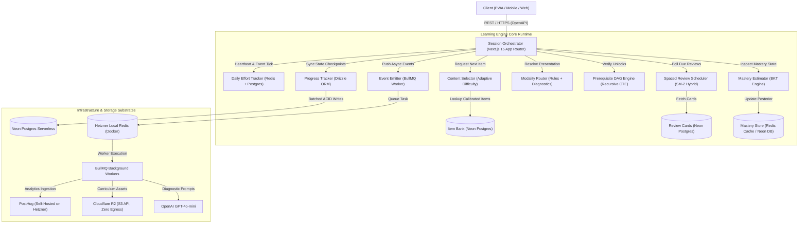
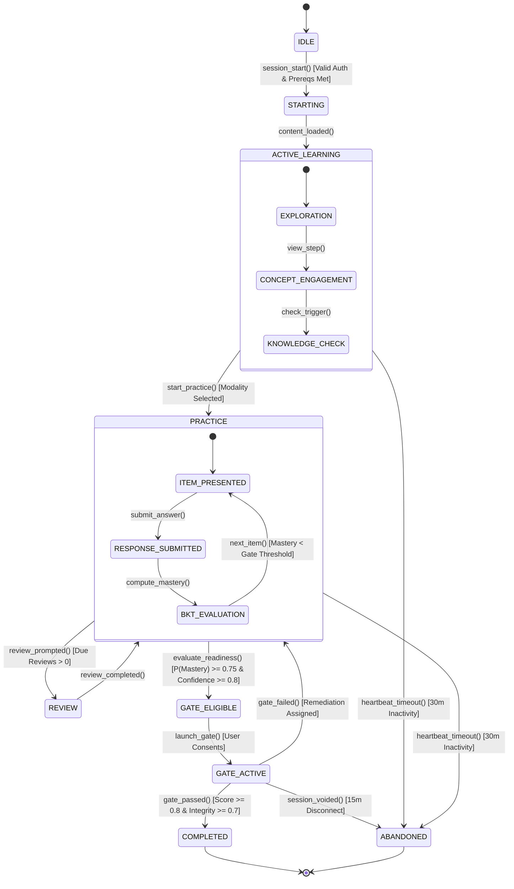
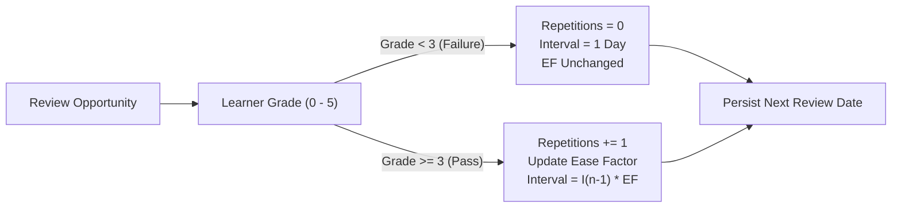
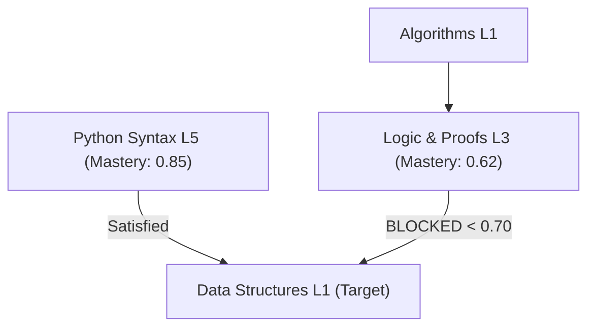
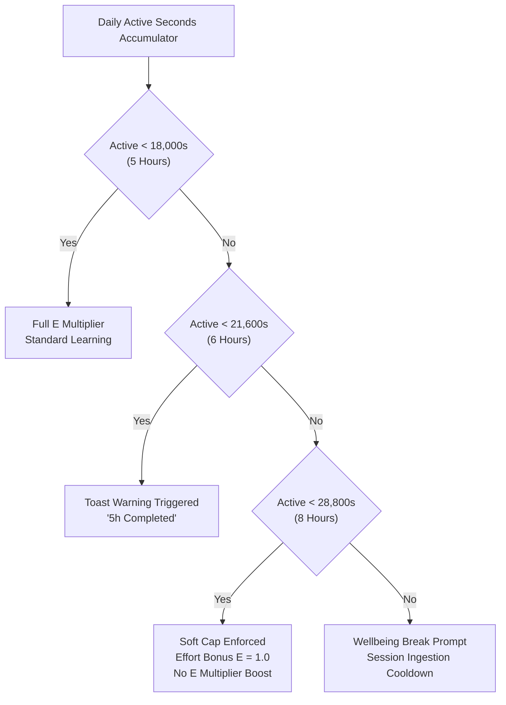

# Learning Engine Low-Level Design (LLD)

**Document Path:** `docs/15-lld/03-learning-engine.md`  
**Version:** 1.0.0  
**Last Updated:** 2026-11-21  
**Status:** Approved Architecture Baseline  
**Related Documents:**
- [Learning Engine Overview](../04-learning/01-learning-engine.md)
- [Adaptive Path & Spaced Repetition](../04-learning/07-adaptive-spaced.md)
- [Level Gate Architecture](../04-learning/08-level-gate.md)
- [Scoring Model & Formulas](../01-economy/03-scoring-model.md)
- [System Architecture](../06-platforms/01-architecture.md)
- [Database & Storage Specifications](../10-data-ai/01-data-model.md)

---

## Table of Contents
1. [Architecture Overview & Component Topography](#1-architecture-overview--component-topography)
2. [Session State Machine & Persistence Protocol](#2-session-state-machine--persistence-protocol)
3. [Bayesian Knowledge Tracing (BKT) Mathematical Engine](#3-bayesian-knowledge-tracing-bkt-mathematical-engine)
4. [Adaptive Difficulty & Item Selection Engine](#4-adaptive-difficulty--item-selection-engine)
5. [Spaced Repetition Scheduler (SM-2 / FSRS Hybrid)](#5-spaced-repetition-scheduler-sm-2--fsrs-hybrid)
6. [Multi-Modal Routing Engine](#6-multi-modal-routing-engine)
7. [Prerequisite Directed Acyclic Graph (DAG) Engine](#7-prerequisite-directed-acyclic-graph-dag-engine)
8. [Daily Effort Tracking & Wellbeing Guardrails](#8-daily-effort-tracking--wellbeing-guardrails)
9. [Drizzle ORM Database Schema Specifications](#9-drizzle-orm-database-schema-specifications)
10. [Comprehensive Failure Modes & Edge Cases](#10-comprehensive-failure-modes--edge-cases)

---

## 1. Architecture Overview & Component Topography

### 1.1 Purpose
The Learning Engine executes the adaptive pedagogy pipeline for the Education Economy platform. Operating within a high-performance Next.js 15 App Router runtime on Hetzner CAX11 ARM architecture (2 vCPU, 4GB RAM), the engine is responsible for micro-level state transitions, real-time Bayesian knowledge inference, dynamic item selection, spaced review scheduling, and modal orchestration. It translates high-level syllabus definitions into personalized, sub-50ms learning loops while enforcing infrastructure constraints including Neon Postgres serverless storage (0.5GB tier limit) and Cloudflare R2 media boundaries.

### 1.2 Component Topology
The internal subsystem architecture is structured into seven decoupled, event-driven modules:



### 1.3 Subsystem Responsibilities
- **Session Orchestrator (SO):** Acts as the transactional entry point and session coordinator. Manages lifecycle events, coordinates sub-engines, validates learner permissions, and maintains active session leases.
- **Mastery Estimator (ME):** Implements closed-form Bayesian Knowledge Tracing (BKT) updates per concept. Computes posterior probabilities of mastery on each attempt in $< 2\text{ ms}$.
- **Content Selector (CS):** Uses continuous item calibration to target the learner's proximal zone of development ($ZPD$), balancing item difficulty $D(L)$, exposure history, and reliability.
- **Spaced Review Scheduler (SRS):** Calculates card review intervals via an enhanced SuperMemo-2 (SM-2) algorithm, maintaining memory stability and interleaving past concepts.
- **Modality Router (MR):** Analyzes cognitive load, concept abstraction, historical modal retention, and accessibility flags to select among Text, Video, Interactive Diagrams, Retrieval Quizzes, Role-plays, and Sandboxes.
- **Progress Tracker (PT):** Encapsulates Drizzle ORM persistence, utilizing debounced write-through caching to shield Neon Postgres from excessive connection churn.
- **Event Emitter (EE):** Dispatches domain events (`practice.attempted`, `mastery.updated`, `review.scheduled`) to BullMQ running on local Redis for decoupled background processing.

### 1.4 Runtime & Infrastructure Constraints
- **Compute:** Hetzner CAX11 ARM instance (€4.49/mo) running Docker Compose. Node.js process limits are capped at `1.5GB` max memory to allow co-location with local Redis and self-hosted PostHog.
- **Database:** Neon Postgres free-tier instance limited to 0.5GB disk storage. All telemetry and transient state are cached in Redis with short TTLs; only durable checkpoints are committed to Postgres using compacted foreign keys and integer bitmasks.
- **Object Storage:** Cloudflare R2 accessed via the AWS S3 SDK for level media and diagrams, eliminating egress bandwidth fees.

### 1.5 Requirements & Success Metrics
- **FR-LRN-101:** Subsystem interactions must be stateless across HTTP requests; session context reconstructed from Redis in $< 20\text{ ms}$.
- **NFR-LRN-101:** Total session orchestrator roundtrip latency must be $p95 < 200\text{ ms}$.
- **NFR-LRN-102:** Zero data loss on abrupt client termination through Redis state leases.

---

## 2. Session State Machine & Persistence Protocol

### 2.1 State Machine Specification
A learning session models the real-time engagement of a learner with a single target concept or level. State transitions are strictly linear or guard-checked branches.



### 2.2 Transition Guards & Data Persistence Matrix

| Source State | Target State | Guard Conditions | Side Effects & Persisted Data | Persistence Store |
|---|---|---|---|---|
| `IDLE` | `STARTING` | Auth valid, prerequisites $\ge 0.70$, daily effort $< 6\text{ h}$ | Allocate session ID, lock active session mutex | Redis (`SETNX session:lease:{uid}`) |
| `STARTING` | `ACTIVE_LEARNING` | Content bundles fetched, initial BKT state loaded | Write `learning_sessions` record (`status='ACTIVE'`) | Neon Postgres + Redis |
| `ACTIVE_LEARNING` | `PRACTICE` | Intro concepts marked consumed | Save presentation duration, init attempt batch | Redis (`HSET session:{id}`) |
| `PRACTICE` | `PRACTICE` | Item response valid, attempt within time limits | Insert `practice_attempts`, run BKT update | Neon Postgres + Redis |
| `PRACTICE` | `REVIEW` | Scheduler signals due cards ($\ge 1$) | Update review card queue, set review sub-mode | Redis (`LPUSH review_queue:{id}`) |
| `REVIEW` | `PRACTICE` | All due queue items answered | Update `review_cards` (new interval, ease factor) | Neon Postgres |
| `PRACTICE` | `GATE_ELIGIBLE` | $P(L) \ge 0.75$, confidence bounds verified | Emit `learning.gate_eligible` event | BullMQ $\to$ PostHog |
| `GATE_ELIGIBLE` | `GATE_ACTIVE` | User explicitly confirms, integrity pre-checks pass | Transition session to `GATE_ACTIVE`, lock practice items | Neon Postgres (`status='GATE'`) |
| `GATE_ACTIVE` | `COMPLETED` | Gate saga returns success | Mark session complete, award calculation | Neon Postgres (ACID Saga) |
| Any Active | `ABANDONED` | Inactivity timer expires ($1800\text{ s}$ standard, $900\text{ s}$ gate) | Set `status='ABANDONED'`, record partial progress | Neon Postgres |

### 2.3 Session Interruption & Crash Recovery Protocol
1. **Heartbeat:** PWA client sends a keep-alive heartbeat every $30\text{ seconds}$ containing `{ sessionId, clientSequenceNumber, activeSeconds }`.
2. **Redis Leases:** Heartbeats refresh `EXPIRE session:lease:{sessionId} 1800`.
3. **Dirty State Recovery:** If the client disconnects or reloads, the client issues a `GET /api/v1/learning/sessions/active`. The engine returns the uncommitted Redis state. If Redis contains unwritten attempts, they are immediately committed to Neon via Drizzle before resuming.

---

## 3. Bayesian Knowledge Tracing (BKT) Mathematical Engine

### 3.1 Parameter Foundations
Bayesian Knowledge Tracing models learner concept mastery as a two-state Hidden Markov Model (Latent states: Unlearned $L_0$, Learned $L_1$). The model operates on four core probabilities:

1. **$P(L_0)$ (Initial Knowledge):** Probability that the learner has mastered the concept prior to instruction. Derived from diagnostic tests or default domain priors.
2. **$P(T)$ (Transition / Learning Rate):** Probability that an unlearned concept transitions to learned following a practice opportunity.
3. **$P(S)$ (Slip):** Probability that a learner who has mastered the concept makes an accidental error ($P(\text{Incorrect} \mid \text{Learned})$).
4. **$P(G)$ (Guess):** Probability that a learner who lacks mastery correctly answers by guessing ($P(\text{Correct} \mid \text{Unlearned})$).

### 3.2 Closed-Form Update Equations
Upon receiving observation $O_n \in \{\text{correct}, \text{incorrect}\}$ at practice opportunity $n$:

#### Step 1: Compute Evidence Likelihood
$$P(\text{Correct}_n) = P(L_{n-1}) \cdot (1 - P(S)) + (1 - P(L_{n-1})) \cdot P(G)$$
$$P(\text{Incorrect}_n) = P(L_{n-1}) \cdot P(S) + (1 - P(L_{n-1})) \cdot (1 - P(G))$$

#### Step 2: Compute Posterior Probability Given Observation
If $O_n = \text{correct}$:
$$P(L_n \mid \text{correct}) = \frac{P(L_{n-1}) \cdot (1 - P(S))}{P(L_{n-1}) \cdot (1 - P(S)) + (1 - P(L_{n-1})) \cdot P(G)}$$

If $O_n = \text{incorrect}$:
$$P(L_n \mid \text{incorrect}) = \frac{P(L_{n-1}) \cdot P(S)}{P(L_{n-1}) \cdot P(S) + (1 - P(L_{n-1})) \cdot (1 - P(G))}$$

#### Step 3: Account for Knowledge Transition (Learning)
$$P(L_n) = P(L_n \mid O_n) + (1 - P(L_n \mid O_n)) \cdot P(T)$$

### 3.3 TypeScript Implementation
```typescript
/**
 * BKT State Container & Mathematical Update Engine
 * Implements standard Corbett-Anderson BKT formulation with numerical clamps.
 */
export interface BKTState {
  conceptId: string;
  pLearn: number;      // Posterior mastery probability P(L_n)
  pLearn0: number;     // Initial prior P(L_0)
  pTransit: number;    // Learning rate P(T)
  pSlip: number;       // Slip probability P(S)
  pGuess: number;      // Guess probability P(G)
  totalAttempts: number;
  consecutiveCorrect: number;
  lastUpdated: Date;
}

export interface BKTParameters {
  pLearn0: number;
  pTransit: number;
  pSlip: number;
  pGuess: number;
}

/**
 * Domain-calibrated default parameter sets.
 * Slip and guess are bounded to prevent degeneracy (P(S) <= 0.20, P(G) <= 0.30).
 */
export const DOMAIN_BKT_DEFAULTS: Record<string, BKTParameters> = {
  COGNITIVE: { pLearn0: 0.15, pTransit: 0.18, pSlip: 0.08, pGuess: 0.20 },
  PROCEDURAL: { pLearn0: 0.10, pTransit: 0.14, pSlip: 0.10, pGuess: 0.15 },
  CREATIVE: { pLearn0: 0.20, pTransit: 0.12, pSlip: 0.12, pGuess: 0.25 },
  INTERPERSONAL: { pLearn0: 0.15, pTransit: 0.15, pSlip: 0.15, pGuess: 0.20 },
};

/**
 * Executes a deterministic Bayesian update based on attempt correctness.
 */
export function updateBKT(state: BKTState, correct: boolean): BKTState {
  const pPrev = Math.min(Math.max(state.pLearn, 0.001), 0.999);
  const { pTransit, pSlip, pGuess } = state;

  let pPosteriorGivenEvidence: number;

  if (correct) {
    const pCorrect = pPrev * (1 - pSlip) + (1 - pPrev) * pGuess;
    pPosteriorGivenEvidence = (pPrev * (1 - pSlip)) / pCorrect;
  } else {
    const pIncorrect = pPrev * pSlip + (1 - pPrev) * (1 - pGuess);
    pPosteriorGivenEvidence = (pPrev * pSlip) / pIncorrect;
  }

  // Knowledge acquisition transition
  const pUpdated = pPosteriorGivenEvidence + (1 - pPosteriorGivenEvidence) * pTransit;

  // Strict clamp to prevent probability saturation
  const pFinal = Math.min(Math.max(pUpdated, 0.001), 0.999);

  return {
    ...state,
    pLearn: Number(pFinal.toFixed(4)),
    totalAttempts: state.totalAttempts + 1,
    consecutiveCorrect: correct ? state.consecutiveCorrect + 1 : 0,
    lastUpdated: new Date(),
  };
}

/**
 * Evaluates whether learner mastery meets level gate readiness criteria.
 */
export function isGateReady(state: BKTState, threshold = 0.75): boolean {
  // Requires both probability threshold and minimum empirical observations
  return state.pLearn >= threshold && state.totalAttempts >= 3;
}
```

### 3.4 Parameter Calibration & Degeneracy Prevention
- **Degeneracy Guardrails:** If $P(G) \ge 1 - P(S)$, the model becomes statistically degenerate (getting an answer wrong would increase mastery). The engine enforces $P(G) \le 0.30$ and $P(S) \le 0.20$ via runtime schema validations.
- **Divergence Reset:** If a learner attempts $\ge 15$ items on a single concept without achieving $P(L) \ge 0.50$, the system flags a "Pedagogical Divergence" event, triggering an automatic fallback to remedial prerequisite scaffolding.

---

## 4. Adaptive Difficulty & Item Selection Engine

### 4.1 Target Difficulty Formulation
Item difficulty is anchored to the global platform level curve power law:
$$D(L) = 10 \cdot L^{1.35}$$

Where $L \in [1, 100]$ represents the skill level. In an active learning session, the engine adjusts the target item difficulty $D_{\text{target}}$ based on the learner's instantaneous concept mastery $P(L)$:

$$D_{\text{target}} = D(L) \cdot \left(1 + (P(L) - 0.5) \cdot 0.4\right)$$

- When $P(L) = 0.50$ (baseline uncertainty), $D_{\text{target}} = D(L)$.
- When $P(L) = 1.00$ (full mastery), $D_{\text{target}} = 1.20 \cdot D(L)$ (stretching challenge).
- When $P(L) = 0.00$ (early struggle), $D_{\text{target}} = 0.80 \cdot D(L)$ (scaffolded reduction).

### 4.2 Selection Algorithm Pipeline
1. **Window Query:** Retrieve candidate items from Neon Postgres where difficulty falls within the calibrated window:
   $$D_{\text{item}} \in [0.80 \cdot D_{\text{target}}, 1.20 \cdot D_{\text{target}}]$$
2. **Exclusion Filters:**
   - Exclude any item presented to the learner within the last $72\text{ hours}$.
   - Exclude items already presented in the current session ID.
   - Exclude items with global cohort overexposure ($> 20\%$ exposure frequency).
3. **Multi-Factor Ranking:** Rank surviving candidates using a composite fit score:
   $$\text{Score} = w_1 \cdot (1 - |\Delta D|) + w_2 \cdot \text{Reliability} + w_3 \cdot \text{Freshness}$$
   where weights $w = [0.50, 0.30, 0.20]$.
4. **Exploration Window:** Select uniformly at random from the Top-3 highest scoring items to prevent determinism, update the exposure tracker, and return.

### 4.3 TypeScript Implementation
```typescript
export interface AssessmentItem {
  id: string;
  conceptId: string;
  difficulty: number;          // Calibrated on D(L) scale
  reliability: number;         // Item discrimination index (0.0 to 1.0)
  exposureCount: number;
  lastPresentedAt?: Date;
}

export interface SelectionContext {
  userId: string;
  conceptId: string;
  level: number;
  currentMastery: number;
  sessionSeenItemIds: Set<string>;
  recentSeenItemIds72h: Set<string>;
}

export function calculateBaseDifficulty(level: number): number {
  return 10 * Math.pow(level, 1.35);
}

export function calculateTargetDifficulty(level: number, mastery: number): number {
  const baseD = calculateBaseDifficulty(level);
  const masteryModifier = 1 + (mastery - 0.5) * 0.4;
  return Number((baseD * masteryModifier).toFixed(2));
}

export function selectAdaptiveItem(
  candidateItems: AssessmentItem[],
  context: SelectionContext
): AssessmentItem | null {
  const targetD = calculateTargetDifficulty(context.level, context.currentMastery);
  const minD = targetD * 0.8;
  const maxD = targetD * 1.2;

  // Step 1 & 2: Filter by window and exposure constraints
  const validCandidates = candidateItems.filter((item) => {
    if (item.difficulty < minD || item.difficulty > maxD) return false;
    if (context.sessionSeenItemIds.has(item.id)) return false;
    if (context.recentSeenItemIds72h.has(item.id)) return false;
    return true;
  });

  if (validCandidates.length === 0) {
    // Fallback: relax 72h window if bank exhausted, keeping session uniqueness
    const fallbackCandidates = candidateItems.filter(
      (item) => !context.sessionSeenItemIds.has(item.id)
    );
    if (fallbackCandidates.length === 0) return null;
    return fallbackCandidates[0];
  }

  // Step 3: Multi-factor scoring
  const scored = validCandidates.map((item) => {
    const dDiffNorm = Math.abs(item.difficulty - targetD) / targetD;
    const proximityScore = Math.max(0, 1 - dDiffNorm);
    const reliabilityScore = item.reliability;
    const freshnessScore = 1 / (1 + (item.exposureCount / 100));

    const totalScore = 0.5 * proximityScore + 0.3 * reliabilityScore + 0.2 * freshnessScore;
    return { item, score: totalScore };
  });

  // Sort descending by score
  scored.sort((a, b) => b.score - a.score);

  // Step 4: Top-3 stochastic selection
  const topPool = scored.slice(0, 3);
  const selectedIndex = Math.floor(Math.random() * topPool.length);
  return topPool[selectedIndex].item;
}
```

---

## 5. Spaced Repetition Scheduler (SM-2 / FSRS Hybrid)

### 5.1 Algorithmic Foundations
Retention tracking adapts the SuperMemo-2 (SM-2) differential equation model, adjusting intervals dynamically based on retrieval performance.



### 5.2 Retrieval Quality Grade Scale
- **Grade 5:** Perfect recall; instantaneous response without hesitation.
- **Grade 4:** Correct response; slight hesitation or brief deliberation.
- **Grade 3:** Correct response; recalled with serious difficulty or reconstruction.
- **Grade 2:** Incorrect response; but the correct solution felt familiar upon reveal.
- **Grade 1:** Incorrect response; wrong answer, familiar with the underlying concept.
- **Grade 0:** Complete blackout; total absence of recall.

### 5.3 Ease Factor & Interval Update Formulas
The Ease Factor ($EF$) updates dynamically according to:
$$EF' = EF + \left(0.1 - (5 - q) \cdot (0.08 + (5 - q) \cdot 0.02)\right)$$
Where $q \in \{0, 1, 2, 3, 4, 5\}$. $EF'$ is bounded by $EF' \in [1.30, 2.50]$. Default initial $EF_0 = 2.50$.

The review interval $I$ (in days) is calculated as:
$$I(n) = \begin{cases} 
1 & \text{if } n = 1 \\
6 & \text{if } n = 2 \\
\lceil I(n-1) \cdot EF' \rceil & \text{if } n > 2 
\end{cases}$$
If $q < 3$, repetitions $n$ resets to $0$, and $I(n) = 1\text{ day}$.

### 5.4 TypeScript Implementation
```typescript
export interface ReviewCard {
  id: string;
  userId: string;
  conceptId: string;
  interval: number;       // In days
  easeFactor: number;     // Clamped [1.3, 2.5]
  repetitions: number;    // Successful consecutive streaks
  lastReviewedAt: Date;
  nextReviewAt: Date;
}

export type ReviewGrade = 0 | 1 | 2 | 3 | 4 | 5;

export function scheduleNextReview(card: ReviewCard, grade: ReviewGrade): ReviewCard {
  let { interval, easeFactor, repetitions } = card;

  if (grade >= 3) {
    // Successful recall
    if (repetitions === 0) {
      interval = 1;
    } else if (repetitions === 1) {
      interval = 6;
    } else {
      interval = Math.round(interval * easeFactor);
    }
    repetitions += 1;
  } else {
    // Failed recall
    repetitions = 0;
    interval = 1;
  }

  // Update Ease Factor: EF' = EF + (0.1 - (5-grade) * (0.08 + (5-grade) * 0.02))
  const deltaEF = 0.1 - (5 - grade) * (0.08 + (5 - grade) * 0.02);
  easeFactor = Math.min(Math.max(easeFactor + deltaEF, 1.3), 2.5);

  const nextReviewAt = new Date();
  nextReviewAt.setDate(nextReviewAt.getDate() + interval);

  return {
    ...card,
    interval,
    easeFactor: Number(easeFactor.toFixed(3)),
    repetitions,
    lastReviewedAt: new Date(),
    nextReviewAt,
  };
}
```

### 5.5 Daily Queue Assembly & Batch Generation
- **Cron Generation:** A BullMQ cron job runs at `00:00:00 UTC` executing a filtered query against `review_cards` where `next_review_at <= NOW()`.
- **Capped Delivery:** Daily review queues are capped at `30 cards/day` per learner to prevent cognitive burnout. Cards are ordered:
  $$\text{Priority} = (\text{Days Overdue}) \cdot (2.6 - EF)$$

---

## 6. Multi-Modal Routing Engine

### 6.1 Decision Matrix
The Modality Router optimizes the presentation mode to maximize conceptual encoding and practical application:

| Context / Diagnostic Situation | Primary Modality | Fallback Modality | Pedagogical Objective |
|---|---|---|---|
| New Concept, First Exposure ($P(L) < 0.2$) | **Text Explanation + Analogy** | Audio Transcript | Foundational semantic schema building |
| New Concept, High Visual Affinity | **Interactive SVG / Diagram** | Structured Text | Mental model spatial grounding |
| Immediate Practice ($0.2 \le P(L) < 0.6$) | **Formative Quiz (5–8 Items)** | Worked Solution Check | Active retrieval reinforcement |
| Applied Skill Mastery (Level 20+) | **Interactive Sandbox / Sim** | Structured Case Study | Near-transfer practical application |
| Complex Social Skill (Level 20+) | **AI Roleplay Dialogue** | Scripted Decision Branch | Far-transfer interpersonal dynamics |
| Gate Readiness Pre-check ($P(L) \ge 0.75$) | **Summative Quiz Bank** | Mini-Oral Defence | Comprehensive coverage verification |
| Divergent Learning ($Attempts > 10, P(L) < 0.4$) | **AI Tutor Socratic Dialogue** | Worked Walkthrough | Root-cause misconception diagnosis |

### 6.2 TypeScript Implementation
```typescript
export type ModalityType = 
  | 'TEXT_EXPLANATION' 
  | 'INTERACTIVE_DIAGRAM' 
  | 'RETRIEVAL_QUIZ' 
  | 'SIMULATOR_SANDBOX' 
  | 'AI_ROLEPLAY' 
  | 'AI_TUTOR_SOCRATIC';

export interface SessionContext {
  conceptId: string;
  skillId: string;
  level: number;
  masteryProbability: number;
  totalAttemptsOnConcept: number;
  consecutiveFailures: number;
  isGateReadinessCheck: boolean;
  userPreferredVisual: boolean;
  networkConstraintTier: 'LOW_BANDWIDTH' | 'NORMAL';
}

export interface ModalityDecision {
  modality: ModalityType;
  rationale: string;
  fallbackModality: ModalityType;
  estimatedDurationMinutes: number;
}

export function routeModality(session: SessionContext): ModalityDecision {
  // Rule 1: Diagnostic intervention on divergence
  if (session.consecutiveFailures >= 3 || session.totalAttemptsOnConcept >= 10) {
    return {
      modality: 'AI_TUTOR_SOCRATIC',
      rationale: 'High error rate detected; initiating diagnostic dialogue to isolate misconception.',
      fallbackModality: 'TEXT_EXPLANATION',
      estimatedDurationMinutes: 8,
    };
  }

  // Rule 2: Gate readiness verification
  if (session.isGateReadinessCheck || session.masteryProbability >= 0.75) {
    return {
      modality: 'RETRIEVAL_QUIZ',
      rationale: 'Mastery boundary met; administering calibrated diagnostic items.',
      fallbackModality: 'TEXT_EXPLANATION',
      estimatedDurationMinutes: 10,
    };
  }

  // Rule 3: Advanced level applied simulation (Level 20+)
  if (session.level >= 20) {
    if (session.skillId.startsWith('COMM-') || session.skillId.startsWith('LEAD-')) {
      return {
        modality: 'AI_ROLEPLAY',
        rationale: 'Advanced interpersonal competency requires dynamic interactive simulation.',
        fallbackModality: 'TEXT_EXPLANATION',
        estimatedDurationMinutes: 15,
      };
    }
    return {
      modality: 'SIMULATOR_SANDBOX',
      rationale: 'Advanced procedural competency requires hands-on execution sandbox.',
      fallbackModality: 'RETRIEVAL_QUIZ',
      estimatedDurationMinutes: 20,
    };
  }

  // Rule 4: Intermediate formative retrieval
  if (session.masteryProbability >= 0.30) {
    return {
      modality: 'RETRIEVAL_QUIZ',
      rationale: 'Foundation established; transitioning to spaced retrieval practice.',
      fallbackModality: 'TEXT_EXPLANATION',
      estimatedDurationMinutes: 5,
    };
  }

  // Rule 5: Initial concept exposure
  if (session.userPreferredVisual && session.networkConstraintTier !== 'LOW_BANDWIDTH') {
    return {
      modality: 'INTERACTIVE_DIAGRAM',
      rationale: 'Initial concept exposure tailored to visual preference profile.',
      fallbackModality: 'TEXT_EXPLANATION',
      estimatedDurationMinutes: 6,
    };
  }

  return {
    modality: 'TEXT_EXPLANATION',
    rationale: 'Initial declarative schema acquisition via structured markdown & worked examples.',
    fallbackModality: 'RETRIEVAL_QUIZ',
    estimatedDurationMinutes: 5,
  };
}
```

---

## 7. Prerequisite Directed Acyclic Graph (DAG) Engine

### 7.1 Graph Topology & Storage
Prerequisites are modeled as a Directed Acyclic Graph across the 500 skills and 100 levels per skill. A prerequisite node requires that the target dependent level cannot transition into `STARTING` or `GATE_ACTIVE` unless the prerequisite's verified mastery satisfies:
$$\text{Mastery}(\text{Prerequisite}) \ge 0.70$$

Storage utilizes an adjacency list table `skill_prerequisites` in Neon Postgres, resolved using a recursive Common Table Expression (CTE).



### 7.2 Recursive DAG Validation Query
```sql
-- Recursive CTE for validating full prerequisite subtree
WITH RECURSIVE PrerequisiteChain AS (
  SELECT 
    prereq_skill_id,
    prereq_level,
    1 AS depth
  FROM skill_prerequisites
  WHERE target_skill_id = :targetSkillId 
    AND target_level = :targetLevel

  UNION ALL

  SELECT 
    sp.prereq_skill_id,
    sp.prereq_level,
    pc.depth + 1
  FROM skill_prerequisites sp
  INNER JOIN PrerequisiteChain pc 
    ON sp.target_skill_id = pc.prereq_skill_id 
   AND sp.target_level = pc.prereq_level
  WHERE pc.depth < 10 -- Prevent infinite cycle loops
)
SELECT 
  pc.prereq_skill_id,
  pc.prereq_level,
  COALESCE(ms.mastery_score, 0.0) AS current_mastery,
  CASE WHEN COALESCE(ms.mastery_score, 0.0) >= 0.70 THEN TRUE ELSE FALSE END AS is_satisfied
FROM PrerequisiteChain pc
LEFT JOIN user_level_mastery ms 
  ON ms.user_id = :userId 
 AND ms.skill_id = pc.prereq_skill_id 
 AND ms.level = pc.prereq_level;
```

---

## 8. Daily Effort Tracking & Wellbeing Guardrails

### 8.1 6-Hour Soft Cap Implementation
To safeguard learner wellbeing and prevent reward gaming or algorithmic fatigue, the platform tracks **Active Practice Seconds** per user reset at `00:00:00 UTC`.

#### Criteria for Active Time:
- **Counted:** Answering quiz items, typing simulator code, submitting roleplay turns, interactive diagram stepping.
- **Excluded:** Video playback, passive text reading without scrolling/clicks, idle tab time ($> 60\text{ s}$ without user input).



### 8.2 Power Law Formulas Context
Daily effort directly modulates platform currency awards defined in `01-economy/03-scoring-model.md`:
$$\text{EC}(L) = 10 \cdot L^{1.2} \cdot m_d \cdot Q \cdot E \cdot M \cdot R$$
$$\text{XP}(L) = 100 \cdot L^{1.5} \cdot m_d$$
$$\text{Expected Hours: } H(L) = 1.5 \cdot L^{1.1}$$

Where $E$ represents the Effort Multiplier ($1.0 \le E \le 1.3$). Once active daily seconds cross $21,600\text{ s}$ ($6\text{ hours}$):
- The effort multiplier is clamped to $E = 1.00$.
- Additional time earns zero incremental effort bonus.
- Learning progression continues unrestricted to maintain autonomy.

---

## 9. Drizzle ORM Database Schema Specifications

```typescript
import { pgTable, text, integer, doublePrecision, timestamp, boolean, uuid, index, uniqueIndex } from 'drizzle-orm/pg-core';

// 1. Learning Sessions Table
export const learningSessions = pgTable('learning_sessions', {
  id: uuid('id').defaultRandom().primaryKey(),
  userId: text('user_id').notNull(),
  skillId: text('skill_id').notNull(),
  level: integer('level').notNull(),
  status: text('status', { enum: ['STARTING', 'ACTIVE', 'GATE_ACTIVE', 'COMPLETED', 'ABANDONED'] }).notNull(),
  currentModality: text('current_modality').notNull(),
  activeSeconds: integer('active_seconds').default(0).notNull(),
  startedAt: timestamp('started_at', { withTimezone: true }).defaultNow().notNull(),
  lastHeartbeatAt: timestamp('last_heartbeat_at', { withTimezone: true }).defaultNow().notNull(),
  completedAt: timestamp('completed_at', { withTimezone: true }),
}, (table) => ({
  userStatusIdx: index('idx_sessions_user_status').on(table.userId, table.status),
  heartbeatIdx: index('idx_sessions_heartbeat').on(table.lastHeartbeatAt),
}));

// 2. Practice Attempts Table
export const practiceAttempts = pgTable('practice_attempts', {
  id: uuid('id').defaultRandom().primaryKey(),
  sessionId: uuid('session_id').references(() => learningSessions.id).notNull(),
  userId: text('user_id').notNull(),
  conceptId: text('concept_id').notNull(),
  itemId: text('item_id').notNull(),
  isCorrect: boolean('is_correct').notNull(),
  responseTimeMs: integer('response_time_ms').notNull(),
  hintsUsed: integer('hints_used').default(0).notNull(),
  pLearnBefore: doublePrecision('p_learn_before').notNull(),
  pLearnAfter: doublePrecision('p_learn_after').notNull(),
  createdAt: timestamp('created_at', { withTimezone: true }).defaultNow().notNull(),
}, (table) => ({
  sessionIdx: index('idx_practice_session').on(table.sessionId),
  userConceptIdx: index('idx_practice_user_concept').on(table.userId, table.conceptId),
}));

// 3. Concept Mastery States Table
export const masteryStates = pgTable('mastery_states', {
  id: uuid('id').defaultRandom().primaryKey(),
  userId: text('user_id').notNull(),
  conceptId: text('concept_id').notNull(),
  pLearn: doublePrecision('p_learn').default(0.15).notNull(),
  pTransit: doublePrecision('p_transit').default(0.18).notNull(),
  pSlip: doublePrecision('p_slip').default(0.08).notNull(),
  pGuess: doublePrecision('p_guess').default(0.20).notNull(),
  totalAttempts: integer('total_attempts').default(0).notNull(),
  consecutiveCorrect: integer('consecutive_correct').default(0).notNull(),
  updatedAt: timestamp('updated_at', { withTimezone: true }).defaultNow().notNull(),
}, (table) => ({
  userConceptUnique: uniqueIndex('uidx_mastery_user_concept').on(table.userId, table.conceptId),
}));

// 4. Review Cards Table (SM-2 Spaced Repetition)
export const reviewCards = pgTable('review_cards', {
  id: uuid('id').defaultRandom().primaryKey(),
  userId: text('user_id').notNull(),
  conceptId: text('concept_id').notNull(),
  interval: integer('interval_days').default(1).notNull(),
  easeFactor: doublePrecision('ease_factor').default(2.50).notNull(),
  repetitions: integer('repetitions').default(0).notNull(),
  lastReviewedAt: timestamp('last_reviewed_at', { withTimezone: true }).defaultNow().notNull(),
  nextReviewAt: timestamp('next_review_at', { withTimezone: true }).notNull(),
}, (table) => ({
  userDueIdx: index('idx_review_cards_due').on(table.userId, table.nextReviewAt),
  userConceptUnique: uniqueIndex('uidx_review_user_concept').on(table.userId, table.conceptId),
}));

// 5. Daily Effort Logs Table
export const dailyEffortLogs = pgTable('daily_effort_logs', {
  id: uuid('id').defaultRandom().primaryKey(),
  userId: text('user_id').notNull(),
  utcDate: text('utc_date').notNull(), // Format: YYYY-MM-DD
  activePracticeSeconds: integer('active_practice_seconds').default(0).notNull(),
  effortMultiplierCapped: boolean('effort_multiplier_capped').default(false).notNull(),
  warningSentAt: timestamp('warning_sent_at', { withTimezone: true }),
  updatedAt: timestamp('updated_at', { withTimezone: true }).defaultNow().notNull(),
}, (table) => ({
  userDateUnique: uniqueIndex('uidx_effort_user_date').on(table.userId, table.utcDate),
}));
```

---

## 10. Comprehensive Failure Modes & Edge Cases

| Case ID | Scenario Description | Detection Mechanism | System Action & Recovery Protocol | Persistence State |
|---|---|---|---|---|
| **EC-LRN-001** | Session interrupted mid-quiz submission (network drop) | Client disconnects before HTTP 200 response | Client resumes via Redis session lease; checks idempotency key on resubmit; rejects duplicate scoring. | Redis preserves attempt state; Neon holds single record. |
| **EC-LRN-002** | BKT Divergence: Learner fails 20 consecutive attempts | `consecutive_correct == 0 && total_attempts >= 20` | BKT state frozen at $0.05$; session triggers immediate modal route to Socratic remediation tutor. | `mastery_states` updated with divergence flag. |
| **EC-LRN-003** | Item Bank Exhaustion: All items seen $< 72\text{ h}$ | `validCandidates.length == 0` | Fallback relaxes 72h window, picking item with lowest individual exposure score; avoids same-session duplicates. | Telemetry logs `item_bank_exhausted` event to PostHog. |
| **EC-LRN-004** | Prerequisite completed on concurrent device mid-session | In-flight session validation hook | Prerequisite check queries Neon with read-committed isolation; immediately unlocks downstream gates without restart. | Read-only check; cache invalidated. |
| **EC-LRN-005** | User switches skill mid-session without completion | New `STARTING` request received | Active session flagged `ABANDONED`; duration persisted; new session initialized cleanly. | `learning_sessions.status = 'ABANDONED'`. |
| **EC-LRN-006** | Offline client sync conflict (offline attempts vs server progress) | Sequence vector mismatch during sync | Server timestamps take precedence for gate completions; practice attempts are merged append-only. | All valid attempts merged into `practice_attempts`. |
| **EC-LRN-007** | Concurrent sessions opened on mobile and desktop | Distributed Redis lock `SETNX session:lease:{uid}` | Second device receives HTTP 409 Conflict with option to transfer active session lease. | Previous lease terminated cleanly. |
| **EC-LRN-008** | Rapid-fire automated item answering ($< 1000\text{ ms}$) | Response duration $< 1000\text{ ms}$ on non-trivial item | Mark attempt invalid; slip probability $P(S)$ temporarily elevated; flag for integrity review. | Attempt logged with `is_suspicious=true`. |
| **EC-LRN-009** | Timezone hopping across UTC midnight | Client shifts device clock | Server enforces absolute UTC date using server clock; prevents double-resetting daily effort. | `daily_effort_logs.utc_date` anchored to UTC. |
| **EC-LRN-010** | AI Tutor dialogue times out ($> 15\text{ s}$) | OpenAI GPT-4o-mini API error / timeout | Fallback router switches modality to pre-compiled structured text explanation and worked problem. | Fallback event emitted to PostHog. |
| **EC-LRN-011** | Neon serverless cold-start latency ($> 1000\text{ ms}$) | Health probe connection delay | Orchestrator serves cached concept content directly from Redis; queues writes in Redis buffer. | Redis write-buffer flushed asynchronously. |
| **EC-LRN-012** | Client sends invalid concept ID | Foreign key validation in schema | Rejects request with HTTP 404; logs malformed payload. | No database state change. |
| **EC-LRN-013** | Database storage cap reached (Neon 0.5GB tier) | Storage monitor webhook at 90% | Automatically archives aged `practice_attempts` ($> 90\text{ days}$) to Cloudflare R2 Parquet export. | Deletes archived records from Neon. |
| **EC-LRN-014** | Spaced review card scheduled into the past | Invalid system clock adjustment | Sanity check forces `next_review_at = MAX(next_review_at, NOW() + interval)`. | Corrected date persisted to `review_cards`. |
| **EC-LRN-015** | Learner spams hint requests | Hint count $\ge 3$ on single item | Hint penalty applied: item scored as incorrect for BKT calculation; worked solution revealed. | `hints_used` recorded; $P(L)$ updated as false. |
| **EC-LRN-016** | Redis process crashes on Hetzner CAX11 | Redis connection failure exception | Orchestrator degrades to direct Neon Postgres reads/writes; logs high-priority alert. | ACID integrity preserved directly in Neon. |
| **EC-LRN-017** | Mastery probability calculates to `NaN` | Numerical division by zero in BKT | Sanitizer catches `NaN`, logs mathematical defect, resets state to prior $P(L_{n-1})$. | Prior state preserved; telemetry alert emitted. |
| **EC-LRN-018** | Learner attempts gate when mastery is $0.7499$ | Boundary condition check | Rejects launch; displays friendly progress bar requiring 1 additional successful retrieval practice. | Gate remains locked. |
| **EC-LRN-019** | Simulator webhook fails to report completion | Simulator timeout ($30\text{ min}$) | Session enters `ABANDONED` state; learner prompted to retry sandbox task without penalty. | Session closed cleanly. |
| **EC-LRN-020** | Excessive review card accumulation ($> 100\text{ overdue}$) | Learner returns after months of absence | Spaced review backlog capped at 30 items per day, ordered by priority; prevents cognitive overload. | Queue truncated dynamically in memory. |
