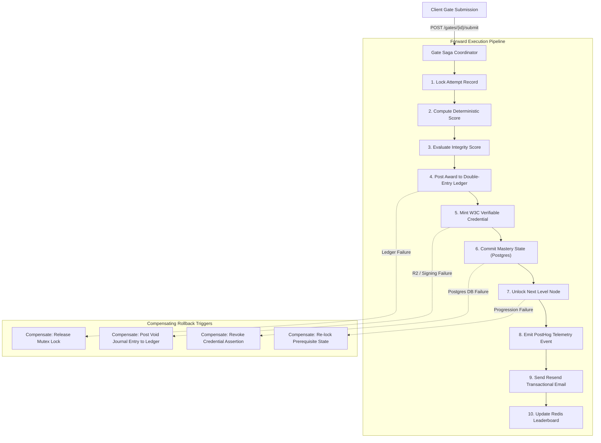
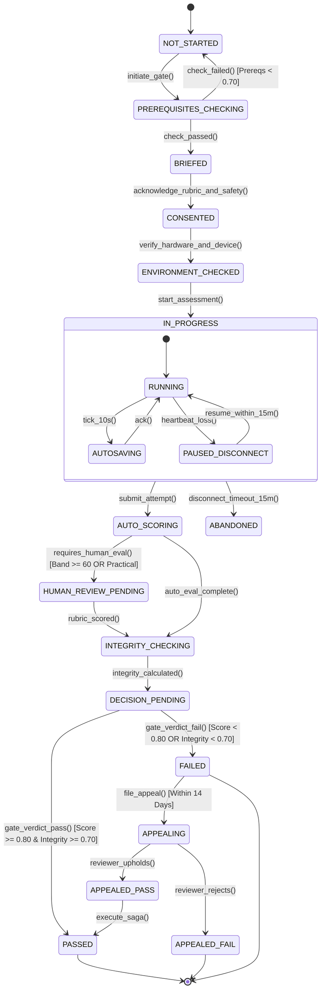

# Level Gate Flow & Distributed Saga Low-Level Design (LLD)

**Document Path:** `docs/15-lld/04-gate-flow.md`  
**Version:** 1.0.0  
**Last Updated:** 2026-11-21  
**Status:** Approved Architecture Baseline  
**Related Documents:**
- [Level Gate Architecture](../04-learning/08-level-gate.md)
- [Gate Exams Assessment Design](../05-assessment/03-gate-exams.md)
- [Points & Ledger Architecture](../01-economy/02-points-ledger.md)
- [Scoring Model & Formulas](../01-economy/03-scoring-model.md)
- [Integrity & Anti-Cheat Specifications](../09-trust-safety/01-integrity-anti-cheat.md)
- [Legal & Verifiable Credentials](../12-legal/02-credentials-employment.md)

---

## Table of Contents
1. [Gate Completion as a Distributed Transaction](#1-gate-completion-as-a-distributed-transaction)
2. [Gate State Machine Specification](#2-gate-state-machine-specification)
3. [Distributed Saga Design & Compensating Transactions](#3-distributed-saga-design--compensating-transactions)
4. [Multi-Signal Integrity Score Computation Engine](#4-multi-signal-integrity-score-computation-engine)
5. [Disconnection, Heartbeat Failure & Session Recovery](#5-disconnection-heartbeat-failure--session-recovery)
6. [High-Frequency Autosave & Durability Layer](#6-high-frequency-autosave--durability-layer)
7. [Retake Policy & Cooldown Engine](#7-retake-policy--cooldown-engine)
8. [Expert Panel Scheduling Subsystem (Levels 80+)](#8-expert-panel-scheduling-subsystem-levels-80)
9. [Formal Appeals Workflow & Evidence Packaging](#9-formal-appeals-workflow--evidence-packaging)
10. [Comprehensive Failure Modes & Edge Cases](#10-comprehensive-failure-modes--edge-cases)

---

## 1. Gate Completion as a Distributed Transaction

### 1.1 Purpose & Problem Statement
A Level Gate pass is the singular transition point in the Education Economy where verified capability produces real economic value (EC) and reputational standing (XP). Completing a gate is inherently a **distributed transaction** spanning six decoupled architectural domains:

1. **Assessment Service:** Validates item responses, timing verifications, and scoring rubrics.
2. **Double-Entry Points Ledger:** Posts immutable credit transactions to user wallets backed by designated sponsor pools.
3. **W3C Verifiable Credential Service:** Generates DID-signed JSON-LD credential assertions archived in Cloudflare R2.
4. **Mastery & Progression Service:** Freezes baseline mastery, invalidates prerequisite locks, and advances the skill tree.
5. **Analytics & Trust Service:** Computes cheating probabilities and updates global telemetry in PostHog.
6. **Notification & Leaderboard Service:** Dispatches transactional emails via Resend and updates real-time Redis leaderboards.

### 1.2 The Failure of Two-Phase Commit (2PC)
Traditional ACID distributed transactions via Two-Phase Commit (2PC) or distributed table locking are fundamentally unviable in this environment:
- **Serverless Database Latency:** Neon Postgres operates over serverless connection poolers; persistent database connections and long-lived row locks risk connection exhaustion under traffic spikes.
- **Heterogeneous Boundaries:** W3C credential issuance and email delivery involve external HTTP APIs (Cloudflare R2, Resend API) that cannot participate in database-level commit trees.
- **Availability Hazard:** A network partition or downstream latency spike would stall the orchestrator, locking learner accounts and violating availability SLOs.

### 1.3 The Orchestrated Saga Solution
The platform adopts an **Orchestrated Saga Pattern**. A centralized `GateSagaCoordinator` executes a strictly defined sequence of local transactions. If any forward step fails, the coordinator halts forward progression and executes backward **compensating transactions** in reverse order, ensuring eventual consistency without distributed locks.



---

## 2. Gate State Machine Specification

### 2.1 Full Lifecycle State Diagram
The gate lifecycle enforces strict sequential verification from pre-check consent to summative credential issuance.



### 2.2 Transition Guards & Side Effects Matrix

| Source State | Target State | Guard Conditions | Side Effects & Actions |
|---|---|---|---|
| `NOT_STARTED` | `PREREQUISITES_CHECKING` | User authenticated, gate attempt quota available | Fetch mastery of all upstream prerequisite skills. |
| `PREREQUISITES_CHECKING` | `BRIEFED` | All prerequisite masteries $\ge 0.70$ | Display rubric, time duration, and integrity tier rules. |
| `BRIEFED` | `CONSENTED` | User explicitly checks acknowledgement boxes | Persist consent log with client IP and user agent. |
| `CONSENTED` | `ENVIRONMENT_CHECKED` | Camera/mic active (if tier $\ge 21$), single screen confirmed | Emit `integrity.environment_cleared` event. |
| `ENVIRONMENT_CHECKED` | `IN_PROGRESS` | Unique session token generated | Allocate Redis session buffer; start wall-clock timer. |
| `IN_PROGRESS` | `AUTO_SCORING` | All mandatory items answered OR time expired | Seal attempt buffer; freeze response timestamps. |
| `AUTO_SCORING` | `HUMAN_REVIEW_PENDING` | Gate requires artifact rubric or oral panel (Level 61+) | Enqueue review package in BullMQ examiner queue. |
| `AUTO_SCORING` | `INTEGRITY_CHECKING` | Pure knowledge gate completed (Levels 1–60 auto) | Aggregate client telemetry signals and anomaly scores. |
| `INTEGRITY_CHECKING` | `DECISION_PENDING` | Composite integrity score computed | Check if score falls within Hold review band ($0.50 \le I < 0.70$). |
| `DECISION_PENDING` | `PASSED` | Academic score $\ge 80\%$, Integrity $\ge 0.70$ | Trigger `GateSagaCoordinator.executePassSaga()`. |
| `DECISION_PENDING` | `FAILED` | Academic score $< 80\%$ OR Integrity $< 0.70$ | Record failure diagnostics; compute retake cooldown window. |
| `FAILED` | `APPEALING` | Submission within 14 calendar days of failure notice | Freeze attempt evidence; assign independent reviewer. |

---

## 3. Distributed Saga Design & Compensating Transactions

### 3.1 Ten-Step Forward Execution & Compensating Action Definitions

| Step | Action Description | Primary System | Compensating Action on Downstream Failure |
|---|---|---|---|
| **1. Lock Attempt** | Acquire distributed mutex on `gate_attempt:{id}` | Redis (`SETNX`) | Delete Redis lock key (`DEL gate_attempt:{id}`). |
| **2. Compute Scores** | Pure deterministic scoring of item responses against rubric | In-Memory Worker | None (pure function; idempotent). |
| **3. Integrity Check** | Run ML behavioral checks & signal aggregation | Assessment API | None (read-only analytical evaluation). |
| **4. Post Award to Ledger** | Execute double-entry transaction debiting sponsor pool & crediting learner wallet | Neon Postgres (`ledger_entries`) | Post matching reversal journal entry (`REVERSAL_CLAWBACK`) referencing original transaction ID. |
| **5. Mint Credential** | Issue W3C DID-signed JSON-LD credential assertion | Node.js Crypto + Cloudflare R2 | Mark credential assertion `REVOKED` in database and publish revocation list head to R2. |
| **6. Commit Mastery** | Set skill level mastery to $1.00$ in database | Neon Postgres (`mastery_states`) | Revert mastery score to previous checkpoint value ($P(L_{n-1})$). |
| **7. Unlock Next Level** | Update progression graph, unlocking level $L+1$ | Neon Postgres (`user_progress`) | Re-lock level $L+1$ node; mark status `LOCKED`. |
| **8. Emit Telemetry** | Send `gate.passed` domain event to message bus | BullMQ $\to$ PostHog | Emit compensating `gate.award_cancelled` event to PostHog. |
| **9. Send Notification** | Dispatch transactional pass email to learner | Resend API | Dispatch follow-up correction notification email via Resend. |
| **10. Update Leaderboard**| Increment user XP score in global sorted set | Redis (`ZINCRBY`) | Decrement user XP score in Redis (`ZINCRBY -XP`). |

### 3.2 TypeScript Implementation: `GateSagaCoordinator`
```typescript
import { db } from '@/lib/db';
import { redis } from '@/lib/redis';
import { resend } from '@/lib/resend';
import { PutObjectCommand, S3Client } from '@aws-sdk/client-s3';

export interface GateContext {
  attemptId: string;
  userId: string;
  skillId: string;
  level: number;
  score: number;
  integrityScore: number;
  ecAward: number;
  xpAward: number;
  sponsorPoolId: string;
}

export class GateSagaCoordinator {
  private r2Client: S3Client;

  constructor() {
    this.r2Client = new S3Client({
      region: 'auto',
      endpoint: process.env.CLOUDFLARE_R2_ENDPOINT,
      credentials: {
        accessKeyId: process.env.R2_ACCESS_KEY_ID || '',
        secretAccessKey: process.env.R2_SECRET_ACCESS_KEY || '',
      },
    });
  }

  public async executePassSaga(ctx: GateContext): Promise<{ success: boolean; error?: string }> {
    const executedSteps: string[] = [];
    let ledgerTxId: string | null = null;
    let credentialId: string | null = null;

    try {
      // Step 1: Distributed Lock
      const lockAcquired = await redis.set(`lock:gate:${ctx.attemptId}`, 'LOCKED', 'EX', 60, 'NX');
      if (!lockAcquired) throw new Error('Concurrent gate settlement in progress.');
      executedSteps.push('STEP_1_LOCK');

      // Step 2 & 3: Validate deterministic score & integrity threshold
      if (ctx.score < 0.80 || ctx.integrityScore < 0.70) {
        throw new Error('Gate requirements not met for pass award.');
      }
      executedSteps.push('STEP_2_3_VALIDATION');

      // Step 4: Post Award to Double-Entry Ledger (ACID Transaction)
      ledgerTxId = await this.postLedgerAward(ctx);
      executedSteps.push('STEP_4_LEDGER');

      // Step 5: Mint W3C Verifiable Credential
      credentialId = await this.mintVerifiableCredential(ctx);
      executedSteps.push('STEP_5_CREDENTIAL');

      // Step 6: Commit Mastery State
      await this.commitMasteryState(ctx);
      executedSteps.push('STEP_6_MASTERY');

      // Step 7: Unlock Next Level
      await this.unlockNextLevel(ctx);
      executedSteps.push('STEP_7_UNLOCK');

      // Step 8: Telemetry Emission (Async BullMQ)
      await this.emitAnalyticsEvent(ctx);
      executedSteps.push('STEP_8_TELEMETRY');

      // Step 9: User Notification (Resend)
      await this.sendEmailNotification(ctx);
      executedSteps.push('STEP_9_NOTIFICATION');

      // Step 10: Leaderboard Update
      await redis.zincrby('leaderboard:global:xp', ctx.xpAward, ctx.userId);
      executedSteps.push('STEP_10_LEADERBOARD');

      // Release Lock
      await redis.del(`lock:gate:${ctx.attemptId}`);
      return { success: true };

    } catch (err: any) {
      console.error(`Gate Saga failed at stage: ${executedSteps.slice(-1)[0]}. Initiating compensation...`, err);
      await this.rollback(executedSteps, ctx, ledgerTxId, credentialId);
      return { success: false, error: err.message };
    }
  }

  private async rollback(
    steps: string[],
    ctx: GateContext,
    ledgerTxId: string | null,
    credentialId: string | null
  ): Promise<void> {
    // Reverse rollback execution
    if (steps.includes('STEP_7_UNLOCK')) {
      await db.update(userProgressTable)
        .set({ status: 'LOCKED' })
        .where(eq(userProgressTable.userId, ctx.userId));
    }
    if (steps.includes('STEP_6_MASTERY')) {
      await db.update(masteryTable)
        .set({ pLearn: 0.75 }) // Roll back to pre-gate readiness checkpoint
        .where(eq(masteryTable.userId, ctx.userId));
    }
    if (steps.includes('STEP_5_CREDENTIAL') && credentialId) {
      await this.revokeCredential(credentialId);
    }
    if (steps.includes('STEP_4_LEDGER') && ledgerTxId) {
      await this.reverseLedgerAward(ledgerTxId, ctx);
    }
    if (steps.includes('STEP_1_LOCK')) {
      await redis.del(`lock:gate:${ctx.attemptId}`);
    }
  }

  private async postLedgerAward(ctx: GateContext): Promise<string> {
    // Executes double-entry debit of sponsor pool and credit of learner wallet
    const txId = `tx_${crypto.randomUUID()}`;
    await db.transaction(async (tx) => {
      // 1. Debit Sponsor Pool
      await tx.insert(ledgerEntriesTable).values({
        transactionId: txId,
        accountId: ctx.sponsorPoolId,
        entryType: 'DEBIT',
        currency: 'EC',
        amount: ctx.ecAward,
        memo: `Gate pass award Level ${ctx.level} Skill ${ctx.skillId}`,
      });
      // 2. Credit Learner Wallet
      await tx.insert(ledgerEntriesTable).values({
        transactionId: txId,
        accountId: `wallet:${ctx.userId}`,
        entryType: 'CREDIT',
        currency: 'EC',
        amount: ctx.ecAward,
        memo: `Gate pass Level ${ctx.level}`,
      });
    });
    return txId;
  }

  private async mintVerifiableCredential(ctx: GateContext): Promise<string> {
    const credId = `urn:uuid:${crypto.randomUUID()}`;
    const payload = {
      '@context': ['https://www.w3.org/2018/credentials/v1'],
      id: credId,
      type: ['VerifiableCredential', 'SkillMasteryCredential'],
      issuer: 'did:web:educationeconomy.org',
      issuanceDate: new Date().toISOString(),
      credentialSubject: {
        id: `did:key:${ctx.userId}`,
        skillId: ctx.skillId,
        level: ctx.level,
        score: ctx.score,
        integrityScore: ctx.integrityScore,
      },
    };
    // Persist to Cloudflare R2
    await this.r2Client.send(new PutObjectCommand({
      Bucket: 'credentials',
      Key: `${ctx.userId}/${ctx.skillId}_L${ctx.level}.json`,
      Body: JSON.stringify(payload),
      ContentType: 'application/json',
    }));
    return credId;
  }

  private async revokeCredential(credId: string): Promise<void> {
    await this.r2Client.send(new PutObjectCommand({
      Bucket: 'credentials',
      Key: `revocations/${credId}.revoked`,
      Body: JSON.stringify({ revokedAt: new Date().toISOString(), reason: 'SAGA_COMPENSATION' }),
    }));
  }

  private async reverseLedgerAward(originalTxId: string, ctx: GateContext): Promise<void> {
    const reversalTxId = `rev_${crypto.randomUUID()}`;
    await db.transaction(async (tx) => {
      await tx.insert(ledgerEntriesTable).values({
        transactionId: reversalTxId,
        accountId: `wallet:${ctx.userId}`,
        entryType: 'DEBIT',
        currency: 'EC',
        amount: ctx.ecAward,
        memo: `Compensating reversal of ${originalTxId}`,
      });
      await tx.insert(ledgerEntriesTable).values({
        transactionId: reversalTxId,
        accountId: ctx.sponsorPoolId,
        entryType: 'CREDIT',
        currency: 'EC',
        amount: ctx.ecAward,
        memo: `Compensating credit reversal of ${originalTxId}`,
      });
    });
  }

  private async commitMasteryState(ctx: GateContext): Promise<void> {
    await db.update(masteryTable)
      .set({ pLearn: 1.0, updatedAt: new Date() })
      .where(and(eq(masteryTable.userId, ctx.userId), eq(masteryTable.conceptId, ctx.skillId)));
  }

  private async unlockNextLevel(ctx: GateContext): Promise<void> {
    await db.insert(userProgressTable).values({
      userId: ctx.userId,
      skillId: ctx.skillId,
      level: ctx.level + 1,
      status: 'AVAILABLE',
    }).onConflictDoNothing();
  }

  private async emitAnalyticsEvent(ctx: GateContext): Promise<void> {
    // Dispatched via local Redis BullMQ queue
    await redis.lpush('queue:analytics:events', JSON.stringify({
      event: 'gate_passed',
      userId: ctx.userId,
      skillId: ctx.skillId,
      level: ctx.level,
      score: ctx.score,
      timestamp: new Date().toISOString(),
    }));
  }

  private async sendEmailNotification(ctx: GateContext): Promise<void> {
    await resend.emails.send({
      from: 'awards@educationeconomy.org',
      to: `${ctx.userId}@learners.org`,
      subject: `Gate Passed: Level ${ctx.level} ${ctx.skillId}!`,
      html: `<p>Congratulations! You earned ${ctx.ecAward} EC and ${ctx.xpAward} XP.</p>`,
    });
  }
}
```

---

## 4. Multi-Signal Integrity Score Computation Engine

### 4.1 Signal Specifications
The integrity engine evaluates client-side and server-side behavioral streams during the gate to compute a normalized composite integrity score $I \in [0.0, 1.0]$:

```typescript
export interface IntegritySignals {
  identityVerified: boolean;      // Verified through passkey/Lucia session/gov ID
  deviceBound: boolean;           // Device fingerprint matches learner baseline
  behavioralAnomaly: number;      // 0.0 (normal) to 1.0 (extreme ML anomaly)
  timingAnomaly: number;          // Deviation from item reading speed (< 200 wpm)
  itemOrderDeviation: number;     // 0.0 (natural sequential) to 1.0 (erratic jumping)
  pasteEvents: number;            // Count of raw clipboard paste triggers
  focusLossCount: number;         // Browser blur / tab-switch occurrences
  provenanceScore: number;        // Git commit tree / keystroke replay authenticity
  peerSimilarity: number;         // Jaccard similarity to cohort concurrent attempts
}
```

### 4.2 Weight Distribution Across Integrity Tiers
Integrity weights adapt dynamically according to the level band's integrity tier:

| Signal Dimension | Tier 1: Open (1–20) | Tier 2: Monitored (21–50) | Tier 3: Proctored (51–80) | Tier 4: Panel (81–100) |
|---|---|---|---|---|
| **Identity Verification** | $0.10$ | $0.20$ | $0.25$ | $0.30$ |
| **Device Binding** | $0.15$ | $0.15$ | $0.15$ | $0.10$ |
| **Behavioral Anomaly** | $0.15$ | $0.20$ | $0.20$ | $0.10$ |
| **Timing Anomaly** | $0.20$ | $0.15$ | $0.10$ | $0.05$ |
| **Focus Loss Count** | $0.25$ | $0.15$ | $0.10$ | $0.05$ |
| **Paste Event Penalty** | $0.15$ | $0.15$ | $0.10$ | $0.05$ |
| **Artifact Provenance** | $0.00$ | $0.00$ | $0.10$ | $0.25$ |
| **Oral Defense Score** | $0.00$ | $0.00$ | $0.00$ | $0.10$ |
| **Total Weight Sum** | **1.00** | **1.00** | **1.00** | **1.00** |

### 4.3 Algorithmic Formulation & TypeScript Implementation
```typescript
export function computeIntegrityScore(signals: IntegritySignals, level: number): number {
  // Determine tier weights
  let weights = {
    identity: 0.10,
    device: 0.15,
    behavior: 0.15,
    timing: 0.20,
    focus: 0.25,
    paste: 0.15,
    provenance: 0.00,
  };

  if (level >= 81) {
    weights = { identity: 0.30, device: 0.10, behavior: 0.10, timing: 0.05, focus: 0.05, paste: 0.05, provenance: 0.35 };
  } else if (level >= 51) {
    weights = { identity: 0.25, device: 0.15, behavior: 0.20, timing: 0.10, focus: 0.10, paste: 0.10, provenance: 0.10 };
  } else if (level >= 21) {
    weights = { identity: 0.20, device: 0.15, behavior: 0.20, timing: 0.15, focus: 0.15, paste: 0.15, provenance: 0.00 };
  }

  // Signal normalization
  const sIdentity = signals.identityVerified ? 1.0 : 0.0;
  const sDevice = signals.deviceBound ? 1.0 : 0.2;
  const sBehavior = Math.max(0, 1.0 - signals.behavioralAnomaly);
  const sTiming = Math.max(0, 1.0 - signals.timingAnomaly);
  
  // Exponential penalties for tab switching and paste spam
  const sFocus = Math.exp(-0.4 * signals.focusLossCount);
  const sPaste = Math.exp(-0.6 * signals.pasteEvents);
  const sProvenance = Math.min(Math.max(signals.provenanceScore, 0.0), 1.0);

  // Composite calculation
  const compositeScore = 
    weights.identity * sIdentity +
    weights.device * sDevice +
    weights.behavior * sBehavior +
    weights.timing * sTiming +
    weights.focus * sFocus +
    weights.paste * sPaste +
    weights.provenance * sProvenance;

  // Peer collusion override: if peer similarity > 0.90, penalize score by 50%
  const finalScore = signals.peerSimilarity > 0.90 ? compositeScore * 0.50 : compositeScore;

  return Number(Math.min(Math.max(finalScore, 0.0), 1.0).toFixed(4));
}
```

---

## 5. Disconnection, Heartbeat Failure & Session Recovery

### 5.1 Recovery Lifecycle Sequence
When network partitions or client power crashes occur during an active gate, the platform preserves session continuity via Redis ephemeral buffers with a strictly bounded 15-minute recovery window.

```mermaid
sequenceDiagram
    autonumber
    actor Learner as PWA Client
    participant API as Next.js API Gateway
    participant Redis as Hetzner Redis Buffer
    participant Postgres as Neon Postgres DB
    participant Reviewer as Human Proctor / Reviewer

    Learner->>API: Heartbeat Tick (every 30s)
    API->>Redis: Refresh Lease (EXPIRE gate:sess:{id} 900)
    
    Note over Learner,API: Client disconnects (Network loss / Power failure)
    
    API->>API: Monitor detects Heartbeat Timeout (>30s)
    API->>Postgres: Flag attempt state = 'PAUSED_DISCONNECTED'
    API->>Redis: Snapshot attempt state (TTL = 15 minutes)
    
    alt Client Reconnects within 15 Minutes
        Learner->>API: POST /gates/{id}/resume (Valid Session Token)
        API->>Redis: GET gate:sess:{id}
        Redis-->>API: Restores exact item index, answers, elapsed seconds
        API-->>Learner: HTTP 200 (State Restored; Resume Exam)
        API->>Postgres: Set state = 'IN_PROGRESS'
    else Inactivity Exceeds 15 Minutes
        API->>Redis: Lease expires (TTL = 0)
        API->>Postgres: Set state = 'VOID_EXPIRED'; Zero Awards
        Learner->>API: POST /gates/{id}/resume
        API-->>Learner: HTTP 410 Gone (Session Voided; Cooldown Assigned)
    else Proctored Gate Video Stream Gap (Level 51+)
        Learner->>API: Resumes within 15m but Video Feed dropped > 60s
        API->>Postgres: Flag attempt 'SUSPICIOUS_VIDEO_GAP'
        API->>Reviewer: Queue session for mandatory human verification
    end
```

---

## 6. High-Frequency Autosave & Durability Layer

### 6.1 Autosave Pipeline Architecture
To eliminate learner data loss while protecting Neon Postgres from unsustainable write throughput, autosaves operate in a two-tier decoupled topology:

1. **Tier 1 (Sub-100ms Ingestion):** Every 10 seconds, the client sends `{ attemptId, answeredItems, cursorTime }`. The API validates the Lucia session token and writes to Redis:
   ```
   HSET gate:attempt:{id} answers <json_payload>
   EXPIRE gate:attempt:{id} 900
   ```
2. **Tier 2 (60-second Durability Flusher):** A background BullMQ debouncer worker reads dirty Redis state and commits batched updates to Neon Postgres `gate_attempts` every $60\text{ seconds}$.
3. **Failover Guarantee:** If Neon Postgres experiences a serverless cold-start stall or transient connection drop, Redis remains the authoritative state source. The worker retries Postgres persistence using exponential backoff with jitter ($1\text{s}, 2\text{s}, 4\text{s}, 8\text{s}$).

---

## 7. Retake Policy & Cooldown Engine

### 7.1 Progressive Cooldown Matrix
To discourage brute-force guessing and protect item bank exposure, failed gate attempts incur tiered mandatory cooldowns and remediation hurdles:

| Failure Count | Cooldown Duration | Remediation Requirement | Human Gatekeeper |
|---|---|---|---|
| **1st Failure** | $24\text{ Hours}$ | Complete 3 recommended spaced review cards | None (automated unlock) |
| **2nd Failure** | $72\text{ Hours}$ | Complete structured targeted remediation plan | None (automated verification) |
| **3rd Failure** | $7\text{ Days}$ | Review with peer mentor or AI Socratic diagnostic | Mentor / Staff check-in signoff |
| **4th+ Failure** | $14\text{ Days}$ | Formal appeal / custom curriculum remediation | Senior domain examiner approval |

### 7.2 TypeScript Implementation
```typescript
export interface AttemptRecord {
  attemptId: string;
  completedAt: Date;
  score: number;
  isPassed: boolean;
}

export interface RetakePolicy {
  canRetake: boolean;
  attemptNumber: number;
  cooldownHours: number;
  cooldownExpiresAt: Date;
  requiresRemediationPlan: boolean;
  requiresHumanCheckIn: boolean;
}

export function getRetakePolicy(history: AttemptRecord[]): RetakePolicy {
  // Sort attempts descending by completion date
  const sorted = [...history].sort((a, b) => b.completedAt.getTime() - a.completedAt.getTime());
  const failStreak = sorted.findIndex((att) => att.isPassed);
  const failureCount = failStreak === -1 ? sorted.length : failStreak;

  const lastAttempt = sorted[0];
  const attemptNumber = failureCount + 1;

  let cooldownHours = 24;
  let requiresRemediationPlan = false;
  let requiresHumanCheckIn = false;

  if (failureCount === 1) {
    cooldownHours = 24;
  } else if (failureCount === 2) {
    cooldownHours = 72;
    requiresRemediationPlan = true;
  } else if (failureCount === 3) {
    cooldownHours = 168; // 7 days
    requiresRemediationPlan = true;
    requiresHumanCheckIn = true;
  } else if (failureCount >= 4) {
    cooldownHours = 336; // 14 days
    requiresRemediationPlan = true;
    requiresHumanCheckIn = true;
  }

  const cooldownExpiresAt = new Date(lastAttempt.completedAt.getTime() + cooldownHours * 3600 * 1000);
  const canRetake = new Date() >= cooldownExpiresAt;

  return {
    canRetake,
    attemptNumber,
    cooldownHours,
    cooldownExpiresAt,
    requiresRemediationPlan,
    requiresHumanCheckIn,
  };
}
```

---

## 8. Expert Panel Scheduling Subsystem (Levels 80+)

### 8.1 Examiner Pool & Conflict of Interest (COI) Verification
For senior and master tiers (Levels 81–100), summative evaluation requires a multi-expert defense panel.
- **Pool Qualifications:** Verified domain experts holding Level 90+ credentials, peer reputation $\ge 4.5/5.0$, and active KYC.
- **COI Graph Traversal:** The scheduler checks the platform social graph to strictly disqualify candidate examiners who:
  1. Share an employer or educational institution with the candidate within the last 3 years.
  2. Have participated in direct mentorship or guild co-membership with the candidate.
  3. Have personal relationships or co-authored artifacts.

### 8.2 Dispatch Workflow & Tie-Breaking
1. **BullMQ Dispatch:** A queue job polls pending panel requests, dispatches email invites via Resend to 5 eligible examiners.
2. **Quorum:** The first 2 to 4 examiners to confirm within 48 hours are seated; an ICS calendar invite is issued.
3. **Tie-Break Protocol:** If an even-numbered panel deadlocks (e.g., 1 Pass, 1 Fail), a 3rd senior examiner is automatically assigned by the system to review recorded artifacts and cast the decisive verdict.
4. **SLAs:** Panel scheduled within $7\text{ days}$; oral defense completed within $14\text{ days}$.

---

## 9. Formal Appeals Workflow & Evidence Packaging

```mermaid
sequenceDiagram
    autonumber
    actor Learner as Learner
    participant App as Platform API
    participant Storage as Cloudflare R2
    participant Reviewer as Senior Reviewer (Independent)
    participant Saga as GateSagaCoordinator

    Learner->>App: POST /gates/{id}/appeal (Rationale + Fee/Waiver)
    App->>App: Validate Window (<= 14 Days from Fail Notice)
    
    App->>Storage: Bundle Evidence (Keystroke log, Video, Answers, Rubric)
    Storage-->>App: Generated Evidence Package URI
    
    App->>Reviewer: Dispatch Review Package (Double-Blind)
    Note over Reviewer: Evaluates within 7 Calendar Days SLA
    
    alt Appeal Upheld (Pass Granted)
        Reviewer->>App: POST /appeals/{id}/decide (Status: UPHELD)
        App->>Saga: executePassSaga() [Awards EC/XP & Issues Credential]
        App-->>Learner: Notification: Appeal Upheld; Awards Posted
    else Appeal Denied (Fail Maintained)
        Reviewer->>App: POST /appeals/{id}/decide (Status: REJECTED, Detailed Feedback)
        App-->>Learner: Notification: Appeal Denied; Remediation Assigned
    end
```

---

## 10. Comprehensive Failure Modes & Edge Cases

| Case ID | Scenario Description | Detection Mechanism | System Action & Recovery Protocol | Durability State |
|---|---|---|---|---|
| **EC-GAT-001** | Sponsor funding pool exhausted at exact moment of gate pass | `ledgerEntriesTable` insert fails balance check | Award transitions to `QUEUED_BACKLOG`; learner notified; EC minted automatically when pool replenished. | Attempt marked `PASSED_PENDING_PAYOUT`. |
| **EC-GAT-002** | Examiner no-show for Level 85 oral panel | Examiner unjoined $10\text{ min}$ past scheduled start | Backup examiner dispatched via emergency SMS; if unavailable within 20m, rescheduled with $50\text{ EC}$ compensation. | Calendar incident recorded; SLA reset. |
| **EC-GAT-003** | Integrity score lands on exact boundary ($0.6999$) | Boundary threshold comparison | Borderline evaluation triggers hold: status set to `HUMAN_REVIEW_PENDING`; reviewer audits within 24h. | Locked in `DECISION_PENDING`. |
| **EC-GAT-004** | Learner files appeal on day 15 ($> 14\text{ days}$) | `Date.now() - failNoticeDate > 14 * 86400 * 1000` | Rejection of appeal request with HTTP 403; displays policy guide and retake path. | No state modification. |
| **EC-GAT-005** | Minor learner ($< 18$) passes gate | Age check on user profile | Pass award executed normally; guardian notified via email of pass outcome (no monetary balance details). | Standard ledger write. |
| **EC-GAT-006** | Browser crash during high-res video recording upload | Missing multipart chunk in Cloudflare R2 | PWA retries resume upload on reconnect using tus.io / R2 multipart protocol without repeating exam. | Chunked upload resumed. |
| **EC-GAT-007** | Network partition during Saga Step 5 (Credential Mint) | S3 API timeout after ledger commit | Saga catches exception; invokes compensating transaction reversing ledger credit; unlocks attempt. | Ledger reversal journal entry logged. |
| **EC-GAT-008** | Concurrent gate attempts launched on dual devices | Redis mutex `lock:gate:active:{uid}` | Second launch rejected with HTTP 409 Conflict. | Single active attempt maintained. |
| **EC-GAT-009** | Item bank completely exhausted for specific level | Available items $< \text{Required}$ | System falls back to isomorphic algorithmic item generator; alerts content ops via BullMQ alert. | Generated items logged. |
| **EC-GAT-010** | Daylight Saving Time shift during 2-hour timed exam | Client clock skips backward/forward 1 hour | Server measures elapsed time using monotonic UNIX epoch offsets, ignoring local timezones. | Exact server duration recorded. |
| **EC-GAT-011** | Examiner deadlocks 1–1 on 2-person oral panel | Equal split in rubric verdict | Automatic assignment of a 3rd senior examiner who reviews recorded audio/video within 48h. | Status set to `TIE_BREAKER_PENDING`. |
| **EC-GAT-012** | Database failover mid-gate submission | Connection pool error from Neon | Next.js API route retries write up to 3 times with exponential backoff; leverages Redis cache if persistent. | Redis maintains authoritative copy. |
| **EC-GAT-013** | Extreme paste event (code snippet > 1,000 chars) | Client clipboard interceptor | Paste logged; integrity score penalized by $0.20$; keystroke reconstruction audit requested. | Integrity telemetry payload saved. |
| **EC-GAT-014** | Learner attempts to retake before 24h cooldown expires | Attempt timestamp comparison | Rejects initiation request with HTTP 429; returns exact seconds remaining until cooldown expiration. | Request rejected at API gateway. |
| **EC-GAT-015** | PostHog analytics ingestion drops event | BullMQ worker failure | Worker moves failed job to Dead Letter Queue (DLQ); retries 5 times over 24h without blocking gate pass. | Core progression unaffected. |
| **EC-GAT-016** | Resend email API rate limit exceeded | HTTP 429 from Resend | Worker schedules email task for delayed retry; does not halt saga progression. | Notification queued. |
| **EC-GAT-017** | Examiner identified as learner’s former manager | COI detection post-assignment | Examiner instantly unseated; replacement assigned from examiner pool; logged to trust register. | Assignment revoked. |
| **EC-GAT-018** | Duplicate webhook submission from proctoring vendor | Webhook delivery replay | Webhook handler verifies idempotency key; returns HTTP 200 without re-triggering scoring. | Single execution guaranteed. |
| **EC-GAT-019** | Learner passes Level 100 world-class capstone | Level == 100 validation | Triggers global platform announcement, prestige constellation unlock, and cryptographic DID publication. | Prestige record written. |
| **EC-GAT-020** | Cloudflare R2 bucket temporarily unavailable | S3 500 error on artifact fetch | Serves cached artifact thumbnail from Redis; defers full archive rendering. | Fallback preview served. |
| **EC-GAT-021** | Client manipulates local client timer | Time discrepancy between client & server | Server-side monotonic timer strictly controls gate expiration; client submission beyond deadline rejected. | Server timestamp authoritative. |
| **EC-GAT-022** | Second appeal filed on lower band gate (Level 35) | Band check on appeal submission | Rejects second appeal; policy strictly restricts second appeals to high-stakes gates (Level 80+). | Rejection logged. |
| **EC-GAT-023** | Learner repeats already-passed gate | User progress check | Repeat permitted for diagnostic refresh; EC award decays according to rule (1.0 $\to$ 0.2 $\to$ 0.05 $\to$ 0). | Decayed award calculated. |
| **EC-GAT-024** | Power failure during oral panel defense | Zoom/WebRTC disconnect | Panel pauses timer; waits up to 15 minutes; if unrecovered, oral portion rescheduled without redoing written exam. | Partial score preserved. |
| **EC-GAT-025** | Malicious injection in written answer payload | Input sanitization / regex check | Sanitizes markdown input; prevents XSS/SQL injection before Drizzle ORM execution. | Sanitized text stored. |
