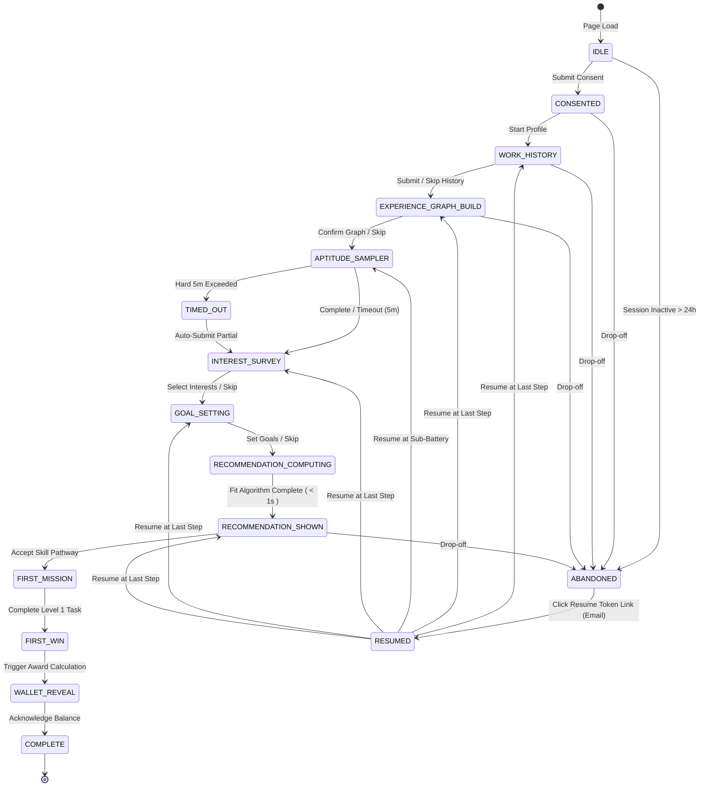
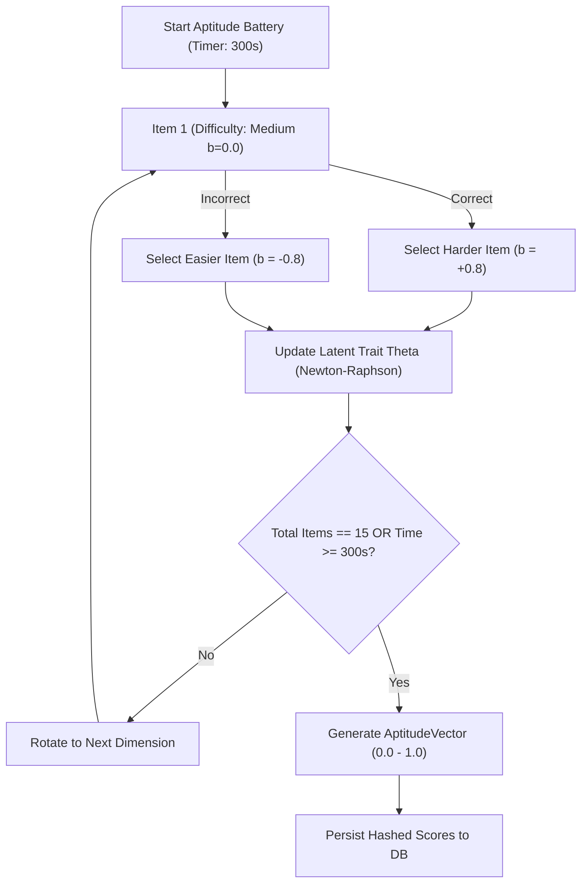

# Low-Level Design: Onboarding State Machine & Progressive Profiling

- **Document Path:** `docs/15-lld/06-onboarding-state.md`
- **Version:** `1.0.0`
- **Last Updated:** `2026-11-21`
- **Related Documents:**
  - `docs/03-onboarding/01-onboarding-flow.md`
  - `docs/03-onboarding/02-experience-graph.md`
  - `docs/03-onboarding/03-profiling.md`
  - `docs/15-lld/01-identity-auth.md`
  - `docs/15-lld/07-recommendation.md`

---

## Table of Contents

1. [Hardware & Free-Tier Operational Constraints](#1-hardware--free-tier-operational-constraints)
2. [Section 1: Onboarding as a State Machine](#2-section-1-onboarding-as-a-state-machine)
   - 2.1 [State Machine Architecture](#21-state-machine-architecture)
   - 2.2 [State Flowchart (Mermaid)](#22-state-flowchart-mermaid)
   - 2.3 [State Transition Table](#23-state-transition-table)
   - 2.4 [TypeScript State Engine Implementation](#24-typescript-state-engine-implementation)
   - 2.5 [Requirements & Metrics](#25-requirements--metrics)
3. [Section 2: Resume Token Design](#3-section-2-resume-token-design)
   - 2.1 [OnboardingState Data Model](#31-onboardingstate-data-model)
   - 2.2 [JWT Token Structure & Lifecycle](#32-jwt-token-structure--lifecycle)
   - 2.3 [Abandonment Trigger & Re-engagement (Resend)](#33-abandonment-trigger--re-engagement-resend)
   - 2.4 [Expired Token Resolution & State Preservation](#34-expired-token-resolution--state-preservation)
   - 2.5 [Requirements & Metrics](#35-requirements--metrics)
4. [Section 3: Work History Collection & Signal Extraction](#4-section-3-work-history-collection--signal-extraction)
   - 4.1 [Meilisearch Job Title Autocomplete](#41-meilisearch-job-title-autocomplete)
   - 4.2 [Duration Ranges (Privacy-Preserving)](#42-duration-ranges-privacy-preserving)
   - 4.3 [Lookup Table Domain Knowledge Mapping](#43-lookup-table-domain-knowledge-mapping)
   - 4.4 [Informal Experience Classification via GPT-4o-mini](#44-informal-experience-classification-via-gpt-4o-mini)
   - 4.5 [Self-Reported Certifications Weighting](#45-self-reported-certifications-weighting)
   - 4.6 [SkillSignalVector Output Specification](#46-skillsignalvector-output-specification)
   - 4.7 [Requirements & Metrics](#47-requirements--metrics)
5. [Section 4: Adaptive Aptitude Sampler](#5-section-4-adaptive-aptitude-sampler)
   - 5.1 [Test Battery Architecture (5-Minute Strict Budget)](#51-test-battery-architecture-5-minute-strict-budget)
   - 5.2 [1-Parameter IRT (Rasch Model) Adaptive Engine](#52-1-parameter-irt-rasch-model-adaptive-engine)
   - 5.3 [AptitudeVector Structure](#53-aptitudevector-structure)
   - 5.4 [Privacy, Ethical Isolation & Guardrails](#54-privacy-ethical-isolation--guardrails)
   - 5.5 [Differential Item Functioning (DIF) Fairness Controls](#55-differential-item-functioning-dif-fairness-controls)
   - 5.6 [Requirements & Metrics](#56-requirements--metrics)
6. [Section 5: Accessibility Variants Across All Steps](#6-section-5-accessibility-variants-across-all-steps)
   - 6.1 [Universal Design Specification](#61-universal-design-specification)
   - 6.2 [Step-by-Step Accessibility Adaptation Matrix](#62-step-by-step-accessibility-adaptation-matrix)
   - 6.3 [Requirements & Metrics](#63-requirements--metrics)
7. [Section 6: Edge Cases & Error Handling](#7-section-6-edge-cases--error-handling)
   - 7.1 [Comprehensive Edge Cases Matrix (22 Scenarios)](#71-comprehensive-edge-cases-matrix-22-scenarios)
   - 7.2 [Standard Error Response Schema](#72-standard-error-response-schema)

---

## 1. Hardware & Free-Tier Operational Constraints

The onboarding experience runs on a strictly budgeted multi-tier topology:

| Component | Free-Tier Allocation | Constraint on Onboarding Architecture |
|---|---|---|
| **Hetzner VPS CAX11** | 2 vCPU ARM, 4GB RAM (€4.49/mo) | Meilisearch engine runs in Docker with memory ceiling capped at 512MB RAM. Vector similarity searches during profiling utilize pre-indexed float32 quantization. |
| **Neon Postgres** | 0.5GB disk, 1 compute branch | User onboarding progress state records are stored in a single partitioned table `onboarding_progress`. Completed states are purged after 60 days to keep DB < 50MB. |
| **OpenAI GPT-4o-mini** | $0.15/1M in, $0.60/1M out | Classification of informal work experience (caregiving, volunteering) uses prompt caching and a Redis similarity cache. Max input tokens = 350 per user submission. |
| **Resend** | 3,000 emails/month | Onboarding abandonment drip emails are sent strictly once at $T + 24\text{ hours}$. Total monthly automated onboarding emails capped at 1,000. |
| **Redis** | 256MB memory container | Fast caching for in-progress aptitude sampler item selections and ephemeral session state tokens. |

---

## 2. Section 1: Onboarding as a State Machine

### 2.1 State Machine Architecture

The onboarding flow transitions a learner deterministically from an anonymous visitor to an active learner with a verified wallet balance and primary skill pathway.

The flow is modeled as a strictly monotonic finite state machine (FSM). Each state possesses:
- **Data Invariants:** Minimum required payload to trigger transition.
- **Skippability Policy:** Explicit boolean flag indicating whether the state can be bypassed with default priors.
- **Checkpoint Resilience:** Exact resume point persisted in Neon Postgres and Redis.

### 2.2 State Flowchart (Mermaid)



### 2.3 State Transition Table

| State ID | Target Data Collected | Skippable? | Fallback / Prior if Skipped | Resume Point |
|---|---|:---:|---|---|
| `IDLE` | Locale, referrer, cookie consent | **No** | Default to `en-US`, `GLOBAL` | Entry URL |
| `CONSENTED` | Privacy choices, guardian email if <16 | **No** | Cannot proceed without core consent | Screen 1 |
| `WORK_HISTORY` | Roles, duration ranges, tools | **Yes** | Prior: Unemployed/Student baseline | Screen 2 |
| `EXPERIENCE_GRAPH_BUILD`| Life skills (caregiving, volunteering) | **Yes** | Prior: Empty graph vector $\vec{0}$ | Screen 3 |
| `APTITUDE_SAMPLER` | 15 item responses across 5 dimensions | **Yes** | Cohort median priors ($\theta = 0.0$) | Section 4 start |
| `INTEREST_SURVEY` | Card sorts (3-5 interest domain tags) | **Yes** | Top 3 general trending categories | Screen 5 |
| `GOAL_SETTING` | Income, career switch, curiosity | **Yes** | Primary: "Skill Mastery" | Screen 6 |
| `RECOMMENDATION_COMPUTING`| Latent fit scores calculated | **No** | Instant timeout fallback to MAL top 4 | Loading indicator |
| `RECOMMENDATION_SHOWN`| Learner pathway selection | **No** | Default to recommended primary | Screen 7 |
| `FIRST_MISSION` | Level 1 task artifact completion | **Yes** | Can defer to dashboard; no reward | Mission screen |
| `FIRST_WIN` | Evaluation score $Q \ge 0.70$ | **No** | Retry level 1 task | Result screen |
| `WALLET_REVEAL` | First XP and EC award revealed | **No** | Persisted to ledger | Wallet screen |
| `COMPLETE` | Onboarding flag marked true in DB | **No** | Transition to main `/dashboard` | Dashboard |

### 2.4 TypeScript State Engine Implementation

```typescript
// packages/onboarding/src/state-machine.ts
export type OnboardingStep =
  | "IDLE"
  | "CONSENTED"
  | "WORK_HISTORY"
  | "EXPERIENCE_GRAPH_BUILD"
  | "APTITUDE_SAMPLER"
  | "INTEREST_SURVEY"
  | "GOAL_SETTING"
  | "RECOMMENDATION_COMPUTING"
  | "RECOMMENDATION_SHOWN"
  | "FIRST_MISSION"
  | "FIRST_WIN"
  | "WALLET_REVEAL"
  | "COMPLETE"
  | "ABANDONED"
  | "TIMED_OUT"
  | "RESUMED";

export interface StateTransitionEvent {
  type: "NEXT" | "SKIP" | "TIMEOUT" | "ABANDON" | "RESUME";
  payload?: Record<string, unknown>;
  timestamp: number;
}

export const STATE_HIERARCHY: Record<OnboardingStep, number> = {
  IDLE: 0,
  CONSENTED: 1,
  WORK_HISTORY: 2,
  EXPERIENCE_GRAPH_BUILD: 3,
  APTITUDE_SAMPLER: 4,
  INTEREST_SURVEY: 5,
  GOAL_SETTING: 6,
  RECOMMENDATION_COMPUTING: 7,
  RECOMMENDATION_SHOWN: 8,
  FIRST_MISSION: 9,
  FIRST_WIN: 10,
  WALLET_REVEAL: 11,
  COMPLETE: 12,
  ABANDONED: -1,
  TIMED_OUT: -2,
  RESUMED: -3,
};

export class OnboardingStateMachine {
  public static getNextStep(current: OnboardingStep, event: StateTransitionEvent): OnboardingStep {
    switch (current) {
      case "IDLE":
        if (event.type === "NEXT") return "CONSENTED";
        break;
      case "CONSENTED":
        if (event.type === "NEXT") return "WORK_HISTORY";
        break;
      case "WORK_HISTORY":
        if (event.type === "NEXT" || event.type === "SKIP") return "EXPERIENCE_GRAPH_BUILD";
        break;
      case "EXPERIENCE_GRAPH_BUILD":
        if (event.type === "NEXT" || event.type === "SKIP") return "APTITUDE_SAMPLER";
        break;
      case "APTITUDE_SAMPLER":
        if (event.type === "NEXT" || event.type === "SKIP" || event.type === "TIMEOUT") {
          return "INTEREST_SURVEY";
        }
        break;
      case "INTEREST_SURVEY":
        if (event.type === "NEXT" || event.type === "SKIP") return "GOAL_SETTING";
        break;
      case "GOAL_SETTING":
        if (event.type === "NEXT" || event.type === "SKIP") return "RECOMMENDATION_COMPUTING";
        break;
      case "RECOMMENDATION_COMPUTING":
        if (event.type === "NEXT") return "RECOMMENDATION_SHOWN";
        break;
      case "RECOMMENDATION_SHOWN":
        if (event.type === "NEXT") return "FIRST_MISSION";
        break;
      case "FIRST_MISSION":
        if (event.type === "NEXT") return "FIRST_WIN";
        if (event.type === "SKIP") return "COMPLETE";
        break;
      case "FIRST_WIN":
        if (event.type === "NEXT") return "WALLET_REVEAL";
        break;
      case "WALLET_REVEAL":
        if (event.type === "NEXT") return "COMPLETE";
        break;
    }

    if (event.type === "ABANDON") return "ABANDONED";
    throw new Error(`Illegal state transition from ${current} with event ${event.type}`);
  }
}
```

### 2.5 Requirements & Metrics

- **`FR-ONB-101`**: State engine must save partial state after every single form interaction within 300ms.
- **`NFR-ONB-101`**: State transition evaluation overhead must be < 5ms in Node.js runtime.
- **Success Metric**: Zero data loss for learners who leave and return within 7 days.

---

## 3. Section 2: Resume Token Design

### 3.1 OnboardingState Data Model

The complete learner state is captured in a type-safe interface:

```typescript
// packages/onboarding/src/types.ts
export interface WorkHistoryEntry {
  title: string;
  onetCode?: string;
  durationRange: "<1yr" | "1-3yrs" | "3-5yrs" | "5+yrs";
  skillsExtracted: string[];
  isInformal: boolean;
}

export interface AptitudeScores {
  fluid: number;      // 0.0 - 1.0 (Rasch theta mapped)
  verbal: number;     // 0.0 - 1.0
  numerical: number;  // 0.0 - 1.0
  spatial: number;    // 0.0 - 1.0
  agility: number;    // 0.0 - 1.0
  completedCount: number; // 0 - 15
}

export interface InterestVector {
  domains: string[]; // e.g. ["DOM-TECH", "DOM-CREATIVE"]
  tags: string[];    // e.g. ["coding", "design", "robotics"]
  dislikedTags: string[];
}

export interface GoalSet {
  primaryGoal: "CAREER_SWITCH" | "INCOME_GROWTH" | "CURIOSITY" | "CERTIFICATION";
  weeklyHoursBudget: number;
  timeframeDays: number;
}

export interface OnboardingState {
  userId: string;
  currentStep: OnboardingStep;
  completedSteps: OnboardingStep[];
  collectedData: {
    workHistory?: WorkHistoryEntry[];
    aptitudeScores?: AptitudeScores;
    interests?: InterestVector;
    goals?: GoalSet;
  };
  resumeToken: string;  // JWT, 7-day expiry
  startedAt: Date;
  lastActiveAt: Date;
}
```

### 3.2 JWT Token Structure & Lifecycle

The `resumeToken` is an HMAC-SHA256 signed JWT containing:
- `sub`: User ID (`usr_...`)
- `step`: Current `OnboardingStep`
- `shash`: SHA-256 fingerprint of the current collected state data
- `iat`: Timestamp issued
- `exp`: Timestamp expiration (strict 7 days from last interaction)

```typescript
// packages/onboarding/src/tokens.ts
import jwt from "jsonwebtoken";
import crypto from "crypto";
import { OnboardingState } from "./types";

const JWT_SECRET = process.env.ONBOARDING_JWT_SECRET!;

export function generateResumeToken(state: OnboardingState): string {
  const stateHash = crypto
    .createHash("sha256")
    .update(JSON.stringify(state.collectedData))
    .digest("hex")
    .substring(0, 16);

  return jwt.sign(
    {
      sub: state.userId,
      step: state.currentStep,
      shash: stateHash,
    },
    JWT_SECRET,
    { expiresIn: "7d" }
  );
}

export function verifyResumeToken(token: string): { userId: string; step: string; shash: string } {
  return jwt.verify(token, JWT_SECRET) as { userId: string; step: string; shash: string };
}
```

### 3.3 Abandonment Trigger & Re-engagement (Resend)

1. **Inactivity Detection:** A BullMQ cron job runs hourly on the Hetzner CAX11 host, scanning `onboarding_progress` for rows where:
   $$\text{lastActiveAt} < \text{now}() - 24\text{ hours} \land \text{currentStep} \notin [\text{'COMPLETE'}, \text{'ABANDONED'}]$$
2. **Email Dispatch:** If the user has a valid verified email address and has not already received an abandonment email:
   - System compiles an email with a 1-click magic link: `https://app.education-economy.org/onboarding/resume?token=${state.resumeToken}`
   - Email is dispatched via Resend API.
   - Status updated to `ABANDONED` with flag `emailSent = true`.

### 3.4 Expired Token Resolution & State Preservation

If a learner clicks a link with a token older than 7 days:
1. Verification throws `TokenExpiredError`.
2. The server extracts the `sub` (User ID) from the unverified decoded payload.
3. System fetches the persistent record from Neon Postgres (`onboarding_progress` table).
4. If the record exists, the system re-hydrates `collectedData`, generates a **fresh** 7-day resume token, and places the learner back at `currentStep` without requiring them to re-enter historical data.
5. If the record has been pruned (>60 days), the learner starts at `WORK_HISTORY` with clear UI notification.

### 3.5 Requirements & Metrics

- **`FR-ONB-102`**: Resume tokens shall be cryptographically signed and withstand client-side tampering.
- **`FR-ONB-103`**: An abandoned onboarding session must preserve 100% of entered work history and survey choices.
- **`NFR-ONB-102`**: Token validation and hydration route shall render in < 100ms.

---

## 4. Section 3: Work History Collection & Signal Extraction

### 4.1 Meilisearch Job Title Autocomplete

To achieve snappy (<50ms) autocomplete on Hetzner CAX11 without external search API costs, an open-source Meilisearch container is indexed with 10,000 standardized O*NET and ESCO job titles.

```typescript
// packages/onboarding/src/search.ts
import { MeiliSearch } from "meilisearch";

const client = new MeiliSearch({
  host: process.env.MEILISEARCH_HOST || "http://127.0.0.1:7700",
  apiKey: process.env.MEILISEARCH_KEY,
});

export async function searchJobTitles(query: string, limit = 5): Promise<Array<{ title: string; onetCode: string }>> {
  if (query.trim().length < 2) return [];
  const index = client.index("job_titles");
  const result = await index.search(query, {
    limit,
    attributesToRetrieve: ["title", "onetCode"],
  });
  return result.hits;
}
```

### 4.2 Duration Ranges (Privacy-Preserving)

To protect learner privacy and comply with minimization rules, exact employment start and end dates are never requested. Instead, learners select discrete duration bands:
- `< 1 year` (Multiplier = 0.5)
- `1–3 years` (Multiplier = 1.0)
- `3–5 years` (Multiplier = 1.5)
- `5+ years` (Multiplier = 2.0, capped to prevent runaway scores)

### 4.3 Lookup Table Domain Knowledge Mapping

When a standard O*NET job title is selected, domain competence vectors are populated directly from a local static JSON mapping (`onet-domain-map.json`), requiring zero LLM inference:

$$\text{DomainStrength}(D) = \text{BaseWeight}(D) \times \text{DurationMultiplier}$$

Example: *"Junior Software Developer"* maps directly to:
- `DOM-TECH` (Computer Science): 0.85
- `DOM-LOGIC` (Mathematical Reasoning): 0.60
- `DOM-COMM` (Communication): 0.40

### 4.4 Informal Experience Classification via GPT-4o-mini

For non-standard, unpaid, or informal life experiences (e.g., caregiving, volunteering, hobby electronics, community organizing), learners provide 1–2 sentences of free text. This is processed via OpenAI GPT-4o-mini with prompt caching:

```typescript
// packages/onboarding/src/llm-classifier.ts
import OpenAI from "openai";
import { Redis } from "ioredis";
import crypto from "crypto";

const openai = new OpenAI({ apiKey: process.env.OPENAI_API_KEY });
const redis = new Redis(process.env.REDIS_URL!);

export interface ExtractedSkillSignal {
  domain: string;
  inferredCompetencies: string[];
  confidence: number; // 0.0 - 1.0
}

export async function classifyInformalExperience(text: string): Promise<ExtractedSkillSignal[]> {
  const cacheKey = `exp:classify:${crypto.createHash("sha256").update(text.toLowerCase().trim()).digest("hex")}`;
  const cached = await redis.get(cacheKey);
  if (cached) return JSON.parse(cached);

  const response = await openai.chat.completions.create({
    model: "gpt-4o-mini",
    messages: [
      {
        role: "system",
        content: `You are an expert labor economist. Map the following informal life experience into 1-3 standardized skill domains: DOM-TECH, DOM-MANUAL, DOM-CARE, DOM-COMM, DOM-BUSINESS, DOM-CREATIVE. Return pure JSON: [{"domain": string, "inferredCompetencies": string[], "confidence": number}]. Max 3 domains.`,
      },
      { role: "user", content: text },
    ],
    temperature: 0.1,
    max_tokens: 150,
  });

  const content = response.choices[0].message.content || "[]";
  const parsed = JSON.parse(content);

  // Cache in Redis for 30 days to save API cost
  await redis.setex(cacheKey, 60 * 60 * 24 * 30, JSON.stringify(parsed));
  return parsed;
}
```

### 4.5 Self-Reported Certifications Weighting

Self-reported certifications and diplomas without cryptographic verification (e.g., Coursera certificate, college degree) are assigned a **0.30× confidence weight** during onboarding fit scoring. Full 1.0× weighting is only unlocked once verified by diagnostic gates or examiner review.

### 4.6 SkillSignalVector Output Specification

The work history module outputs a normalized 12-dimensional vector:

$$\vec{V}_{\text{experience}} \in [0.0, 1.0]^{12}$$

Representing normalized domain proficiencies across all 12 core catalog domains (Computer Science, Electrical, Cooking, Healthcare, Communication, Mathematical Logic, etc.).

### 4.7 Requirements & Metrics

- **`FR-ONB-104`**: Job title autocomplete response time shall be < 50ms at p95.
- **`FR-ONB-105`**: Free-text informal experience classification shall be cached in Redis with a 30-day TTL.
- **`NFR-ONB-103`**: LLM token spend for informal classification shall not exceed $0.0003 per onboarding user.

---

## 5. Section 4: Adaptive Aptitude Sampler

### 5.1 Test Battery Architecture (5-Minute Strict Budget)

The aptitude sampler is an adaptive diagnostic battery strictly capped at **5 minutes (300 seconds)**. It evaluates 5 latent cognitive dimensions with exactly 3 items per dimension (15 items total):

1. **Fluid Reasoning (Gf):** Matrix reasoning, pattern completion.
2. **Numeracy (Gq):** Quantitative relationships, rate calculations.
3. **Verbal Comprehension (Gc):** Semantic precision, logical deduction.
4. **Spatial Ability (Gv):** Mental rotation, geometric folding.
5. **Learning Agility (Gl):** Rapid rule-switching task (Wisconsin Card Sorting analogue).



### 5.2 1-Parameter IRT (Rasch Model) Adaptive Engine

Item response probability follows the standard Rasch logistic model:

$$P(X_i = 1 \mid \theta) = \frac{1}{1 + e^{-(\theta - b_i)}}$$

Where:
- $\theta$: Latent learner ability in the dimension.
- $b_i$: Calibrated item difficulty parameter ($b_i \in [-2.5, +2.5]$).

After each item response, $\theta$ is updated iteratively via Maximum Likelihood Estimation (MLE) or Expected A Posteriori (EAP):

```typescript
// packages/onboarding/src/rasch-irt.ts
export interface IRTItem {
  id: string;
  dimension: "fluid" | "verbal" | "numerical" | "spatial" | "agility";
  difficulty: number; // b parameter
}

export function updateThetaEAP(
  priorTheta: number,
  responses: Array<{ difficulty: number; correct: boolean }>
): number {
  let numerator = 0;
  let denominator = 0;

  // Numerical quadrature over [-3.0, +3.0]
  for (let t = -3.0; t <= 3.0; t += 0.2) {
    let likelihood = 1.0;
    for (const r of responses) {
      const p = 1.0 / (1.0 + Math.exp(-(t - r.difficulty)));
      likelihood *= r.correct ? p : 1.0 - p;
    }
    const prior = Math.exp(-(t * t) / 2.0); // Standard normal prior N(0, 1)
    numerator += t * likelihood * prior;
    denominator += likelihood * prior;
  }

  const posteriorMean = numerator / (denominator || 1);
  // Normalize theta from [-3.0, +3.0] into [0.0, 1.0] range
  return Math.max(0.0, Math.min(1.0, (posteriorMean + 3.0) / 6.0));
}
```

### 5.3 AptitudeVector Structure

The battery outputs a normalized object:

```typescript
export interface AptitudeVector {
  fluid: number;      // 0.00 - 1.00
  verbal: number;     // 0.00 - 1.00
  numerical: number;  // 0.00 - 1.00
  spatial: number;    // 0.00 - 1.00
  agility: number;    // 0.00 - 1.00
}
```

### 5.4 Privacy, Ethical Isolation & Guardrails

1. **No Learner-Facing IQ / Score:** The learner is never shown raw scores, percentiles, or intelligence labels. The platform communicates: *"Your profile is calibrated for hands-on, adaptive skill building."*
2. **Cryptographic Isolation:** `AptitudeVector` is stored in an encrypted database column. It cannot be queried alongside protected demographic traits (gender, race, nationality).
3. **Strict Utilization Boundary:** Aptitude scores are used **only** for:
   - Recommending appropriate starting level (Level 1 vs Level 5 test-out).
   - Computing multi-factor `FitScore`.
   - Calibrating initial difficulty in adaptive practice engines.

### 5.5 Differential Item Functioning (DIF) Fairness Controls

All aptitude sampler items are audited for Differential Item Functioning across language, region, and age groups:
- Evaluated using Mantel-Haenszel $\chi^2$ statistics and Lord's $\Delta_{\text{MH}}$.
- Any item exhibiting significant DIF ($\Delta_{\text{MH}} \ge 1.5$ and $p < 0.05$) is automatically flagged and disabled in production.

### 5.6 Requirements & Metrics

- **`FR-ONB-106`**: Aptitude battery shall enforce a hard 300-second countdown timer.
- **`FR-ONB-107`**: No raw cognitive test scores shall be visible to learners or external employers.
- **`NFR-ONB-104`**: Next item selection calculation shall execute in < 20ms.

---

## 6. Section 5: Accessibility Variants Across All Steps

### 6.1 Universal Design Specification

The onboarding interface is engineered to adhere strictly to **WCAG 2.2 Level AAA** for all educational content. Five distinct accessibility profiles are supported natively:

1. **Screen Reader (JAWS, NVDA, VoiceOver):** ARIA live regions, semantic fieldsets, single-focus management.
2. **Low Bandwidth (<100 kbps, 2G/3G):** Total asset payload < 60KB; SVG vector illustrations only; zero autoplay video.
3. **Mobile Layout:** 100% responsive, single-column vertical flow, no horizontal scrolling, min touch targets of 48×48px.
4. **Low Literacy / Plain Language:** Readability at Flesch-Kincaid Grade 4; 1-click audio narration via Web Speech API.
5. **Low Cognitive Load:** Strictly one question or conceptual card per screen; persistent progress indicator.

### 6.2 Step-by-Step Accessibility Adaptation Matrix

| Step | Screen Reader Adaptation | Low Bandwidth Adaptation | Mobile Touch / Viewport | Low Literacy Adaptation | Low Cognitive Load |
|---|---|---|---|---|---|
| **0: Welcome** | `aria-label="Welcome"`, headings H1-H2 structured | Pure HTML/CSS, zero external images | Single CTA pinned to viewport bottom (48px height) | Text simplified to 3 short sentences; audio button | Zero marketing fluff; 1 clear action |
| **1: Consent** | Checkboxes in `<fieldset>` with explicit `<legend>` | Standard form inputs; inline SVG icons | Checkbox touch target 48×48px with 12px padding | "What we do / What we don't do" two-column bullet list | Toggles grouped logically, default opt-outs |
| **2: Identity** | Dynamic errors announced via `aria-live="polite"` | Minimal styling, native `<input>` elements | Native virtual keyboard triggers (`type="email"`) | Single display name field; no complex username rules | Only 3 inputs per screen |
| **3: Work History** | Combobox with `aria-expanded` and `aria-activedescendant` | Local client-side fuzzy match fallback if offline | Autocomplete dropdown renders above keyboard | Common job title tags provided as 1-tap chips | Enter 1 job role at a time |
| **4: Life Graph** | Card selection buttons with `aria-pressed="true|false"` | 1-bit monochrome SVG icons (< 1KB each) | Horizontal swipe disabled; clean vertical card list | Everyday examples: "Cooking for family", "Repairing items" | Max 6 cards displayed at once |
| **5: Aptitude** | Plain-text logical reasoning questions; no visual puzzles | Text-only logic puzzles; zero heavy images | Radio cards with large 16px typography | Audio TTS button reads each question aloud | Hard 1 question per screen; countdown hidden |
| **6: Interests** | Tag list with multi-select ARIA listbox | Zero image icons; text tags styled with CSS border | 2-column large chip grid with vibration haptic feedback | Visual category emojis alongside Plain English labels | Select between 3 and 5 only |
| **7: Goals** | Radio group with descriptive helper text linked via `aria-describedby` | Lightweight SVG icons | Pinned bottom sheet on mobile | Simple choices: "Get a job", "Earn extra income", "Learn for fun" | 3 discrete options |
| **8: Reveal** | Results table with accessible headings & score summaries | SVG bar charts; zero canvas/WebGL | Swipeable horizontal cards with pagination dots | Plain language rationale: "Fits your experience because..." | Exactly 4 cards shown |
| **9: First Mission** | Code editor or text input with screen-reader friendly mode | Interactive terminal replaced with simple text box | Full-screen modal with fixed 'Submit' button | Step-by-step instructions with highlighted keywords | Single 5-minute task |
| **10: Wallet Reveal**| Award amount announced: *"You earned 100 Experience Points"* | Static CSS coin graphic | Celebration confetti respects `prefers-reduced-motion` | Big bold numbers with clear currency explainer | Big visual reward; 1 'Continue' button |

### 6.3 Requirements & Metrics

- **`FR-ONB-108`**: Every step must provide audio narration fallbacks for learners with reading difficulties.
- **`FR-ONB-109`**: Interface must honor CSS `@media (prefers-reduced-motion: reduce)`.
- **`NFR-ONB-105`**: Total bundle size for initial onboarding screen must not exceed 60KB gzipped.

---

## 7. Section 6: Edge Cases & Error Handling

### 7.1 Comprehensive Edge Cases Matrix (22 Scenarios)

| # | Edge Case Scenario | Trigger Event | Architectural Handling & System Response | Recovery / State Resolution |
|---|---|---|---|---|
| **1** | User closes browser mid-aptitude sampler | Learner navigates away on question 7 of 15 | Current item responses are saved to Redis. Countdown timer continues server-side. | On return, learner resumes at item 7 if within 5m, or transitions to auto-submit if >5m. |
| **2** | Aptitude sampler hard timeout | Learner reaches 300 seconds on question 9 | Timer fires client and server-side; API forces submission of available responses. | IRT engine calculates Bayesian EAP estimate using prior and answered items; marks flag `partial_imputed`. |
| **3** | Unemployed / no formal work history | Learner selects "I have no formal work experience" | Bypasses job title search; directs learner to life experience card deck (caregiving, volunteering). | Work history vector assigned baseline entry priors; no negative score penalty applied. |
| **4** | Minor under 16 detected during registration | Learner selects birthdate indicating age 14 | Form dynamically inserts required Guardian Email field; sets state to `PENDING_GUARDIAN`. | Onboarding paused; magic link sent to parent. Learner sees child-friendly waiting screen. |
| **5** | Duplicate email during onboarding signup | Email already exists in Neon Postgres | Server returns error `EMAIL_ALREADY_EXISTS`; offers 1-click password login or reset. | User authenticates; existing progress is merged with newly entered onboarding signals. |
| **6** | OAuth signup missing email scope | Provider (e.g. GitHub) does not return public email | System intercepts OAuth callback; displays interstitial email capture modal before creating session. | Enters email; verification link dispatched; onboarding resumes from `CONSENTED`. |
| **7** | Aptitude sampler API / Redis down | Network timeout or 500 error fetching item | System catches exception; logs alert to Sentry; bypasses sampler with `SKIP_SAMPLER` event. | Assigns cohort median aptitude priors ($\theta = 0.50$); onboarding proceeds smoothly. |
| **8** | Zero interests selected by learner | Learner clicks "Skip" on interest survey | System selects top 3 most popular and versatile skills across distinct domains (e.g., Tech, Writing, Logic). | Displays curated starter paths with clear explanation. |
| **9** | Goals selected have zero catalog matches | Niche goal combination yields 0 direct skills | Vector similarity search falls back to nearest 3 cross-domain skills with lowest prerequisite barrier. | Displays nearest matches with note: "Found 3 skills closely related to your interests." |
| **10**| Resume token expired (> 7 days) | Learner clicks email magic link after 10 days | JWT verification fails with `TokenExpiredError`; server extracts User ID. | System pulls persisted state from DB, issues fresh 7-day token, and resumes at last step. |
| **11**| High network latency on mobile (> 2,000ms) | 2G connection causes request delays | Client UI renders optimistic updates and local spinner; auto-retries failed mutation with exponential backoff. | State saved to local IndexedDB; syncs to server once connection stabilizes. |
| **12**| User enters invalid / gibberish informal text | Learner types "asdfghjkl" in informal work box | GPT-4o-mini classification returns confidence < 0.20 or empty domain list. | Text ignored; system logs warning; does not distort skill signal vector. |
| **13**| Accidental double-click on state transition | Learner taps "Next" twice rapidly | Client disables button on first tap; backend enforces idempotency key on state mutations. | Second request returns identical state transition payload without re-running computations. |
| **14**| Client device runs out of battery mid-mission | Battery dies during Level 1 mission task | Mission editor auto-saves draft text to browser `localStorage` every 5 seconds. | On device reboot and login, mission draft is restored automatically. |
| **15**| Recommendation engine timeout (> 1,000ms) | Hetzner VPS CPU spike delays fit calculation | Client timeout triggers after 1,000ms; pulls cached pre-computed cohort recommendations. | Learner sees high-quality recommendations immediately; background job updates scores. |
| **16**| User rejects all 4 initial recommendations | Learner clicks "None of these fit me" | System displays modal with domain category explorer ("Browse all 500 skills"). | Learner picks any domain; system generates 4 fresh recommendations from that selected branch. |
| **17**| First mission evaluation failure ($Q < 0.70$) | Learner fails first attempt at level 1 task | System provides friendly AI tutor hints explaining how to improve without failing them permanently. | Unlimited retries allowed; learner prompted to adjust draft and re-submit. |
| **18**| User revokes browser cookie permissions mid-flow | PWA local session cookie cleared | Next API request returns 401; client gracefully preserves form state in memory. | Prompts user to re-enable cookies; session re-authenticated without data loss. |
| **19**| Meilisearch container offline / restarting | Autocomplete request fails with connection refused | Client catches error; falls back to static local list of 200 common job titles embedded in JS bundle. | Autocomplete remains functional with reduced dictionary until container recovers. |
| **20**| Minor learner turns 16 while in onboarding | Learner reaches birthday during paused consent | Batch job detects age transition; automatically updates `isMinor = false` and `status = 'ACTIVE'`. | Guardian requirement lifted; learner notified they can now start learning directly. |
| **21**| Audio narration fails on legacy browser | Web Speech API not supported on old Android device | UI detects `window.speechSynthesis == null`; hides audio button cleanly. | Replaced with simplified text expander without throwing JS errors. |
| **22**| User attempts to tamper with resume token | Attacker modifies user ID in JWT payload | Cryptographic signature verification fails with `JsonWebTokenError`. | Request rejected with 403 Forbidden; incident logged in security audit table. |

### 7.2 Standard Error Response Schema

```json
{
  "type": "https://education-economy.org/errors/onboarding/timeout",
  "title": "Aptitude Sampler Timed Out",
  "status": 408,
  "detail": "The 5-minute allocation for the aptitude battery has elapsed. Your partial responses have been saved.",
  "instance": "/api/v1/onboarding/aptitude/submit",
  "code": "ONB_APTITUDE_TIMEOUT",
  "data": {
    "itemsCompleted": 9,
    "imputedScoreGenerated": true,
    "nextStep": "INTEREST_SURVEY"
  },
  "timestamp": "2026-11-21T10:45:12.802Z"
}
```

---

*End of Document `docs/15-lld/06-onboarding-state.md`*
