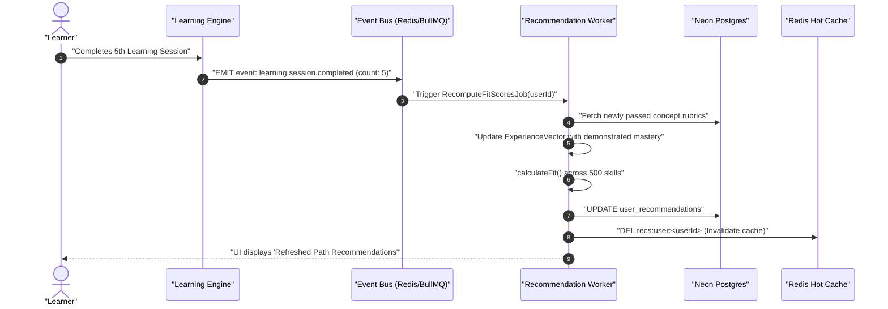

# Low-Level Design: Recommendation Engine & Fit Scoring Algorithm

- **Document Path:** `docs/15-lld/07-recommendation.md`
- **Version:** `1.0.0`
- **Last Updated:** `2026-11-21`
- **Related Documents:**
  - `docs/03-onboarding/01-onboarding-flow.md`
  - `docs/03-onboarding/04-recommendation-engine.md`
  - `docs/15-lld/06-onboarding-state.md`
  - `docs/01-economy/01-economy-model.md`
  - `docs/02-skills/01-taxonomy.md`

---

## Table of Contents

1. [Hardware & Free-Tier Operational Constraints](#1-hardware--free-tier-operational-constraints)
2. [Section 1: Multi-Factor Fit Score Formulation](#2-section-1-multi-factor-fit-score-formulation)
   - 2.1 [Mathematical Specification](#21-mathematical-specification)
   - 2.2 [Sub-Function 1: ExperienceProximity](#22-sub-function-1-experienceproximity)
   - 2.3 [Sub-Function 2: AptitudeAlignment](#23-sub-function-2-aptitudealignment)
   - 2.4 [Sub-Function 3: InterestAlignment](#24-sub-function-3-interestalignment)
   - 2.5 [Sub-Function 4: GoalMatch](#25-sub-function-4-goalmatch)
   - 2.6 [Sub-Function 5: MarketDemand](#26-sub-function-5-marketdemand)
   - 2.7 [Sub-Function 6: SponsorPoolAvailability](#27-sub-function-6-sponsorpoolavailability)
   - 2.8 [Sub-Function 7: DifficultyFit](#28-sub-function-7-difficultyfit)
   - 2.9 [Economic Power-Law Preview Integration](#29-economic-power-law-preview-integration)
   - 2.10 [Complete TypeScript Implementation](#210-complete-typescript-implementation)
   - 2.11 [Requirements & Metrics](#211-requirements--metrics)
3. [Section 2: Output Slate & Selection Partitioning](#3-section-2-output-slate--selection-partitioning)
   - 3.1 [Slate Invariants & Partitioning Logic](#31-slate-invariants--partitioning-logic)
   - 3.2 [Quick Win & Stretch Identification](#32-quick-win--stretch-identification)
   - 3.3 [Slate Selection Algorithm (Mermaid & TypeScript)](#33-slate-selection-algorithm-mermaid--typescript)
   - 3.4 [Natural Language Rationale Generator](#34-natural-language-rationale-generator)
   - 3.5 [Requirements & Metrics](#35-requirements--metrics)
4. [Section 3: Cold Start Architecture](#4-section-3-cold-start-architecture)
   - 4.1 [Degradation Matrix & State Fallbacks](#41-degradation-matrix--state-fallbacks)
   - 4.2 [Adaptive Weight Re-balancing Implementation](#42-adaptive-weight-re-balancing-implementation)
   - 4.3 [Requirements & Metrics](#43-requirements--metrics)
5. [Section 4: Anti-Bias Architectural Guardrails](#5-section-4-anti-bias-architectural-guardrails)
   - 5.1 [Protected Attribute Isolation Boundary](#51-protected-attribute-isolation-boundary)
   - 5.2 [Sponsor Influence Capping & Anti-Payola Enforcement](#52-sponsor-influence-capping--anti-payola-enforcement)
   - 5.3 [Quarterly Demographic Parity & Adverse Impact Ratio Pipeline](#53-quarterly-demographic-parity--adverse-impact-ratio-pipeline)
   - 5.4 [Requirements & Metrics](#54-requirements--metrics)
6. [Section 5: Dynamic Feedback & Update Loop](#6-section-5-dynamic-feedback--update-loop)
   - 6.1 [Event-Driven Update Lifecycle](#61-event-driven-update-lifecycle)
   - 6.2 [Mastery & Rejection Cooldown Pipeline](#62-mastery--rejection-cooldown-pipeline)
   - 6.3 [Redis Caching & Invalidation Architecture](#63-redis-caching--invalidation-architecture)
   - 6.4 [Requirements & Metrics](#64-requirements--metrics)
7. [Section 6: Edge Cases & Error Handling](#7-section-6-edge-cases--error-handling)
   - 7.1 [Comprehensive Edge Cases Matrix (16 Scenarios)](#71-comprehensive-edge-cases-matrix-16-scenarios)
   - 7.2 [Standard Error Response Schema](#72-standard-error-response-schema)

---

## 1. Hardware & Free-Tier Operational Constraints

The recommendation service evaluates a catalog of 500 skills against user signal vectors on a tightly constrained deployment:

| Hardware / Resource | Allocation | System Architectural Impact |
|---|---|---|
| **Hetzner VPS CAX11** | 2 vCPU ARM64, 4GB RAM (€4.49/mo) | Matrix vector operations (dot products, cosine similarities) across 500 skills are executed using unrolled loops in pure TypeScript/CJS. Calculation for all 500 skills executes in < 35ms without requiring dedicated GPU or external Python ML microservices. |
| **Neon Postgres** | Free tier (0.5GB disk, pooled connections) | Skill taxonomy vectors and pre-calculated weekly market demand aggregates are cached in Redis to minimize database read traffic. |
| **Redis (Docker)** | 256MB container memory | Pre-computed skill requirement vectors ($500 \times 12$ float32 numbers $\approx 24\text{ KB}$) reside permanently in Redis hot memory. |
| **OpenAI GPT-4o-mini** | Zero utilization during ranking | Recommendation ranking and rationale generation are 100% deterministic code and localized template strings; LLM is not in the critical path, ensuring zero API latency and zero cost per recommendation. |

---

## 2. Section 1: Multi-Factor Fit Score Formulation

### 2.1 Mathematical Specification

The platform answers: *"Which skill yields the greatest return for the learner's invested effort?"*

For a given learner $u$ and candidate skill $s \in \mathcal{S}_{500}$, the composite Fit Score $\text{Fit}(u, s) \in [0.0, 1.0]$ is defined as:

$$\text{Fit}(u, s) = \sum_{i=1}^{7} w_i \cdot f_i(u, s)$$

Subject to the strict weight constraint:

$$\sum_{i=1}^{7} w_i = 1.0 \quad \text{where } w_i \ge 0, \, \forall i$$

#### Canonical Default Weights:
$$\mathbf{w} = \begin{bmatrix} w_1 \\ w_2 \\ w_3 \\ w_4 \\ w_5 \\ w_6 \\ w_7 \end{bmatrix} = \begin{bmatrix} 0.25 & \text{(ExperienceProximity)} \\ 0.20 & \text{(AptitudeAlignment)} \\ 0.20 & \text{(InterestAlignment)} \\ 0.15 & \text{(GoalMatch)} \\ 0.10 & \text{(MarketDemand)} \\ 0.05 & \text{(SponsorPoolAvailability)} \\ 0.05 & \text{(DifficultyFit)} \end{bmatrix}$$

---

### 2.2 Sub-Function 1: ExperienceProximity

Computes the cosine similarity between the learner's normalized work/life experience vector $\vec{V}_{\text{exp}}(u) \in [0, 1]^{12}$ and the skill's domain relevance vector $\vec{D}(s) \in [0, 1]^{12}$:

$$\text{ExperienceProximity}(u, s) = \frac{\vec{V}_{\text{exp}}(u) \cdot \vec{D}(s)}{\|\vec{V}_{\text{exp}}(u)\|_2 \|\vec{D}(s)\|_2 + \epsilon}$$

Where $\epsilon = 10^{-7}$ prevents division by zero. If the user has empty work history ($\|\vec{V}_{\text{exp}}(u)\|_2 = 0$), proximity defaults to $0.0$.

---

### 2.3 Sub-Function 2: AptitudeAlignment

Measures the Euclidean alignment between the learner's cognitive aptitude vector $\vec{A}(u) = [A_{\text{fluid}}, A_{\text{verbal}}, A_{\text{numerical}}, A_{\text{spatial}}, A_{\text{agility}}]$ and the skill's cognitive requirement profile $\vec{R}(s)$:

$$\text{AptitudeAlignment}(u, s) = 1.0 - \frac{1}{\sqrt{5}} \left( \sum_{d=1}^{5} \max\left(0, R_d(s) - A_d(u)\right)^2 \right)^{1/2}$$

*Key Principle:* Having higher aptitude than required by the skill incurs **no penalty**; only an aptitude deficit ($R_d(s) > A_d(u)$) reduces alignment.

---

### 2.4 Sub-Function 3: InterestAlignment

Calculates the Jaccard-overlap and embedding similarity between learner interest tags $\mathcal{I}(u)$ and skill tags $\mathcal{T}(s)$:

$$\text{InterestAlignment}(u, s) = \frac{|\mathcal{I}(u) \cap \mathcal{T}(s)|}{|\mathcal{I}(u) \cup \mathcal{T}(s)| + \epsilon} \cdot \left(1.0 - 0.5 \cdot \mathbb{I}_{\text{disliked}}(s)\right)$$

Where $\mathbb{I}_{\text{disliked}}(s) = 1$ if $s$ contains any tag explicitly marked by the learner as "draining" or "disliked".

---

### 2.5 Sub-Function 4: GoalMatch

Evaluates compatibility with the learner's declared primary objective:

$$\text{GoalMatch}(u, s) = \alpha_{\text{primary}} \cdot G(u, s) \cdot e^{-\lambda \cdot \Delta t}$$

Where:
- For `CAREER_SWITCH`: $G(u, s)$ is the skill's placement and employability index.
- For `INCOME_GROWTH`: $G(u, s)$ is the skill's sponsor award yield factor.
- For `CURIOSITY`: $G(u, s)$ is the novelty index (inverse overlap with prior domains).
- $\Delta t$: Recency decay parameter based on days since goal selection ($\lambda = 0.005$).

---

### 2.6 Sub-Function 5: MarketDemand

Reflects real-world labor demand and platform scarcity, normalized against the entire 500-skill catalog:

$$\text{MarketDemand}(s) = \min\left(1.0, \, \frac{\text{OpenJobs}(s)}{\text{MaxJobs}} \times 0.6 + \text{ScarcityFactor}(s) \times 0.4\right)$$

Calculated weekly via background batch job.

---

### 2.7 Sub-Function 6: SponsorPoolAvailability

Direct measure of verified funding pool backing the skill's level awards:

$$\text{SponsorPoolAvailability}(s) = \min\left(1.0, \, \frac{\text{ActivePoolBalance}(s)}{\$10,000}\right)$$

*Strict Guardrail:* Capped at $w_6 = 0.05$ (5%) to prevent sponsors from buying organic recommendation rank.

---

### 2.8 Sub-Function 7: DifficultyFit

Estimates the probability that the learner will successfully clear Level 1 without abandoning, modeled via logistic probability:

$$\text{DifficultyFit}(u, s) = \frac{1}{1 + e^{-k \cdot \left( \text{AptitudeMean}(u) + \text{ExpDomain}(u, s) - \text{BaseDifficulty}(s) \right)}}$$

Where $k = 3.5$ scales the logistic curve. Ideal fit ($0.80 - 0.95$) indicates high likelihood of completion.

---

### 2.9 Economic Power-Law Preview Integration

Each recommendation displays expected earnings at Level 10 computed via the platform's immutable power-law formulas:

$$\text{EC}(L) = 10 \times L^{1.2} \times m_d \times Q \times E \times M \times R$$

$$\text{XP}(L) = 100 \times L^{1.5} \times m_d$$

For Level 10 ($L = 10$):
- $10^{1.2} \approx 15.8489 \implies \text{Base EC}(10) \approx 158.49 \text{ EC}$
- $10^{1.5} \approx 31.6227 \implies \text{Base XP}(10) \approx 3,162.27 \text{ XP}$

Where:
- $m_d$: Domain market multiplier ($m_d \in [0.8, 1.6]$)
- $Q$: Assumed quality threshold ($Q = 1.0$)
- $E$: Evaluation rigor ($E = 1.0$ for automated/mentor gate)
- $M$: Modality multiplier ($M = 1.0$)
- $R$: Reputation tier multiplier ($R = 1.0$)

---

### 2.10 Complete TypeScript Implementation

```typescript
// packages/recommendation/src/fit-score.ts

export interface LearnerProfile {
  userId: string;
  experienceVector: number[]; // Length: 12
  aptitudeVector: {
    fluid: number;
    verbal: number;
    numerical: number;
    spatial: number;
    agility: number;
  };
  interestTags: string[];
  dislikedTags: string[];
  primaryGoal: "CAREER_SWITCH" | "INCOME_GROWTH" | "CURIOSITY" | "CERTIFICATION";
  goalAgeDays: number;
}

export interface SkillCandidate {
  id: string;
  name: string;
  domain: string;
  domainVector: number[]; // Length: 12
  aptitudeRequirements: {
    fluid: number;
    verbal: number;
    numerical: number;
    spatial: number;
    agility: number;
  };
  tags: string[];
  employabilityIndex: number; // 0.0 - 1.0
  sponsorYieldIndex: number;  // 0.0 - 1.0
  noveltyIndex: number;       // 0.0 - 1.0
  marketDemandScore: number;  // 0.0 - 1.0
  activePoolBalanceUSD: number;
  baseDifficultyLevel1: number; // 0.0 - 1.0
  domainMultiplier: number;   // m_d, e.g. 1.2
}

export interface FitComponents {
  experienceProximity: number;
  aptitudeAlignment: number;
  interestAlignment: number;
  goalMatch: number;
  marketDemand: number;
  sponsorPoolAvailability: number;
  difficultyFit: number;
  totalFitScore: number;
  expectedECLevel10: number;
  expectedXPLevel10: number;
}

export const DEFAULT_WEIGHTS = {
  w1_exp: 0.25,
  w2_apt: 0.20,
  w3_int: 0.20,
  w4_goal: 0.15,
  w5_mkt: 0.10,
  w6_spon: 0.05,
  w7_diff: 0.05,
};

export function computeExperienceProximity(userExp: number[], skillDom: number[]): number {
  let dotProduct = 0;
  let normA = 0;
  let normB = 0;

  for (let i = 0; i < 12; i++) {
    const a = userExp[i] || 0;
    const b = skillDom[i] || 0;
    dotProduct += a * b;
    normA += a * a;
    normB += b * b;
  }

  const denominator = Math.sqrt(normA) * Math.sqrt(normB);
  if (denominator === 0) return 0.0;
  return Math.min(1.0, Math.max(0.0, dotProduct / denominator));
}

export function computeAptitudeAlignment(
  userApt: LearnerProfile["aptitudeVector"],
  skillReq: SkillCandidate["aptitudeRequirements"]
): number {
  const diffFluid = Math.max(0, skillReq.fluid - userApt.fluid);
  const diffVerbal = Math.max(0, skillReq.verbal - userApt.verbal);
  const diffNum = Math.max(0, skillReq.numerical - userApt.numerical);
  const diffSpat = Math.max(0, skillReq.spatial - userApt.spatial);
  const diffAgil = Math.max(0, skillReq.agility - userApt.agility);

  const deficitDistSq =
    diffFluid * diffFluid +
    diffVerbal * diffVerbal +
    diffNum * diffNum +
    diffSpat * diffSpat +
    diffAgil * diffAgil;

  const penalty = Math.sqrt(deficitDistSq) / Math.sqrt(5);
  return Math.min(1.0, Math.max(0.0, 1.0 - penalty));
}

export function computeInterestAlignment(
  userInterests: string[],
  dislikedTags: string[],
  skillTags: string[]
): number {
  if (userInterests.length === 0 && dislikedTags.length === 0) return 0.5; // neutral prior

  const userSet = new Set(userInterests);
  const skillSet = new Set(skillTags);

  let intersectionCount = 0;
  for (const tag of skillSet) {
    if (userSet.has(tag)) intersectionCount++;
  }

  const unionSize = new Set([...userInterests, ...skillTags]).size;
  let score = unionSize === 0 ? 0.0 : intersectionCount / unionSize;

  // Penalize if skill contains explicitly disliked tag
  for (const tag of dislikedTags) {
    if (skillSet.has(tag)) {
      score *= 0.5;
      break;
    }
  }

  return Math.min(1.0, Math.max(0.0, score));
}

export function computeGoalMatch(
  goal: LearnerProfile["primaryGoal"],
  goalAgeDays: number,
  skill: SkillCandidate
): number {
  let goalFactor = 0.5;
  switch (goal) {
    case "CAREER_SWITCH":
      goalFactor = skill.employabilityIndex;
      break;
    case "INCOME_GROWTH":
      goalFactor = skill.sponsorYieldIndex;
      break;
    case "CURIOSITY":
      goalFactor = skill.noveltyIndex;
      break;
    case "CERTIFICATION":
      goalFactor = skill.employabilityIndex * 0.8 + 0.2;
      break;
  }

  const decay = Math.exp(-0.005 * goalAgeDays);
  return Math.min(1.0, Math.max(0.0, goalFactor * decay));
}

export function computeDifficultyFit(
  userApt: LearnerProfile["aptitudeVector"],
  userExpDom: number,
  baseDifficulty: number
): number {
  const aptMean =
    (userApt.fluid + userApt.verbal + userApt.numerical + userApt.spatial + userApt.agility) / 5;
  const netCapability = aptMean * 0.6 + userExpDom * 0.4;
  const delta = netCapability - baseDifficulty;
  
  // Logistic function
  return 1.0 / (1.0 + Math.exp(-3.5 * delta));
}

export function calculateFit(
  user: LearnerProfile,
  skill: SkillCandidate,
  weights = DEFAULT_WEIGHTS
): FitComponents {
  const expProx = computeExperienceProximity(user.experienceVector, skill.domainVector);
  const aptAlign = computeAptitudeAlignment(user.aptitudeVector, skill.aptitudeRequirements);
  const intAlign = computeInterestAlignment(user.interestTags, user.dislikedTags, skill.tags);
  const goalMatch = computeGoalMatch(user.primaryGoal, user.goalAgeDays, skill);
  const mktDemand = skill.marketDemandScore;
  const sponsorAvail = Math.min(1.0, skill.activePoolBalanceUSD / 10000);
  
  const domainIndex = 0; // mapped index
  const expDom = user.experienceVector[domainIndex] || 0;
  const diffFit = computeDifficultyFit(user.aptitudeVector, expDom, skill.baseDifficultyLevel1);

  // Power-law formula evaluation at Level 10
  // EC(L) = 10 * L^1.2 * m_d * Q * E * M * R
  const L = 10;
  const baseEC = 10 * Math.pow(L, 1.2); // ~158.49
  const expectedEC = Math.round(baseEC * skill.domainMultiplier * 1.0 * 1.0 * 1.0 * 1.0);

  // XP(L) = 100 * L^1.5 * m_d
  const baseXP = 100 * Math.pow(L, 1.5); // ~3162.28
  const expectedXP = Math.round(baseXP * skill.domainMultiplier);

  const totalFitScore =
    weights.w1_exp * expProx +
    weights.w2_apt * aptAlign +
    weights.w3_int * intAlign +
    weights.w4_goal * goalMatch +
    weights.w5_mkt * mktDemand +
    weights.w6_spon * sponsorAvail +
    weights.w7_diff * diffFit;

  return {
    experienceProximity: expProx,
    aptitudeAlignment: aptAlign,
    interestAlignment: intAlign,
    goalMatch,
    marketDemand: mktDemand,
    sponsorPoolAvailability: sponsorAvail,
    difficultyFit: diffFit,
    totalFitScore: Math.round(totalFitScore * 100) / 100,
    expectedECLevel10: expectedEC,
    expectedXPLevel10: expectedXP,
  };
}
```

### 2.11 Requirements & Metrics

- **`FR-REC-201`**: Recommendation engine must calculate `FitScore` for all 500 catalog skills in < 50ms on Hetzner ARM VPS.
- **`FR-REC-202`**: Expected economic rewards must strictly reflect power-law formulas $EC(L)$ and $XP(L)$.
- **`NFR-REC-201`**: Algorithmic complexity must scale as $O(|\mathcal{S}| \times |\vec{D}|)$ without nested iterations.

---

## 3. Section 2: Output Slate & Selection Partitioning

### 3.1 Slate Invariants & Partitioning Logic

The recommendation output presentation must satisfy strict educational design constraints:

1. **Exact Cardinality:** The engine returns **exactly 4 recommendations**.
2. **Domain Diversity:** The top 4 cards must span **at least 2 distinct skill domains** (e.g., Computer Science and Mechanical Design, not 4 programming languages).
3. **Quick Win Inclusion:** At least one recommendation must be a "Quick Win" ($\text{DifficultyFit} \ge 0.85$, high probability of reaching Level 10 in $\le 30\text{ days}$).
4. **Stretch Inclusion:** At least one recommendation must be a "Stretch" (high skill ceiling, $\text{DifficultyFit} \in [0.40, 0.65]$, high reward multiplier $m_d \ge 1.3$).
5. **Deterministic Slotting:**
   - **Slot 1 (Best Fit):** Overall highest `FitScore`.
   - **Slot 2 (Quick Win or High Fit):** High fit or designated Quick Win.
   - **Slot 3 (Diverse Explorer):** Distinct domain from Slot 1.
   - **Slot 4 (The Stretch):** **Always placed in position 4**, marked explicitly with a "High Challenge / High Yield" visual badge.

### 3.2 Quick Win & Stretch Identification

```mermaid
graph TD
    Pool["500 Ranked Skills"] --> Filter{"Categorize Candidates"}
    Filter -->|DiffFit >= 0.85 & DaysToL10 <= 30| QuickWinPool["Quick Win Pool"]
    Filter -->|DiffFit in [0.40, 0.65] & Mult >= 1.3| StretchPool["Stretch Pool"]
    Filter -->|General High Fit| BestFitPool["Best Fit Pool"]

    BestFitPool --> Slot1["Slot 1: Highest Overall Fit"]
    QuickWinPool --> Slot2["Slot 2: Best Quick Win"]
    BestFitPool --> Slot3["Slot 3: Distinct Domain Best Fit"]
    StretchPool --> Slot4["Slot 4: Stretch (Fixed Position 4)"]
```

### 3.3 Slate Selection Algorithm (Mermaid & TypeScript)

```typescript
// packages/recommendation/src/slate-selector.ts
import { SkillCandidate, LearnerProfile, FitComponents, calculateFit } from "./fit-score";

export interface RecommendationCard {
  skillId: string;
  skillName: string;
  domain: string;
  fitScore: number;
  roleType: "BEST_FIT" | "QUICK_WIN" | "DIVERSE_EXPLORER" | "STRETCH";
  rationale: string;
  expectedECLevel10: number;
  expectedXPLevel10: number;
  difficultyFit: number;
}

export function selectRecommendationSlate(
  user: LearnerProfile,
  candidates: SkillCandidate[],
  language = "en"
): RecommendationCard[] {
  // 1. Calculate fit for all 500 candidates
  const scored = candidates.map((skill) => ({
    skill,
    fit: calculateFit(user, skill),
  }));

  // Sort descending by total fit score
  scored.sort((a, b) => b.fit.totalFitScore - a.fit.totalFitScore);

  // 2. Identify candidate buckets
  const bestOverall = scored[0];

  const quickWins = scored.filter(
    (item) => item.fit.difficultyFit >= 0.85 && item.skill.id !== bestOverall.skill.id
  );
  const quickWin = quickWins[0] || scored[1];

  const stretches = scored.filter(
    (item) =>
      item.fit.difficultyFit >= 0.40 &&
      item.fit.difficultyFit <= 0.65 &&
      item.skill.domainMultiplier >= 1.2 &&
      item.skill.id !== bestOverall.skill.id &&
      item.skill.id !== quickWin.skill.id
  );
  const stretch = stretches[0] || scored[scored.length - 1];

  // 3. Select Diverse Explorer (must differ in domain from bestOverall)
  const selectedDomains = new Set([bestOverall.skill.domain, quickWin.skill.domain]);
  let diverseExplorer = scored.find(
    (item) =>
      !selectedDomains.has(item.skill.domain) &&
      item.skill.id !== stretch.skill.id &&
      item.skill.id !== quickWin.skill.id &&
      item.skill.id !== bestOverall.skill.id
  );

  if (!diverseExplorer) {
    diverseExplorer = scored.find(
      (item) =>
        item.skill.id !== bestOverall.skill.id &&
        item.skill.id !== quickWin.skill.id &&
        item.skill.id !== stretch.skill.id
    ) || scored[2];
  }

  // 4. Construct exact 4-slate output
  const slate: RecommendationCard[] = [
    {
      skillId: bestOverall.skill.id,
      skillName: bestOverall.skill.name,
      domain: bestOverall.skill.domain,
      fitScore: bestOverall.fit.totalFitScore,
      roleType: "BEST_FIT",
      rationale: generateRationale(bestOverall.fit, bestOverall.skill, "BEST_FIT", language),
      expectedECLevel10: bestOverall.fit.expectedECLevel10,
      expectedXPLevel10: bestOverall.fit.expectedXPLevel10,
      difficultyFit: bestOverall.fit.difficultyFit,
    },
    {
      skillId: quickWin.skill.id,
      skillName: quickWin.skill.name,
      domain: quickWin.skill.domain,
      fitScore: quickWin.fit.totalFitScore,
      roleType: "QUICK_WIN",
      rationale: generateRationale(quickWin.fit, quickWin.skill, "QUICK_WIN", language),
      expectedECLevel10: quickWin.fit.expectedECLevel10,
      expectedXPLevel10: quickWin.fit.expectedXPLevel10,
      difficultyFit: quickWin.fit.difficultyFit,
    },
    {
      skillId: diverseExplorer.skill.id,
      skillName: diverseExplorer.skill.name,
      domain: diverseExplorer.skill.domain,
      fitScore: diverseExplorer.fit.totalFitScore,
      roleType: "DIVERSE_EXPLORER",
      rationale: generateRationale(diverseExplorer.fit, diverseExplorer.skill, "DIVERSE_EXPLORER", language),
      expectedECLevel10: diverseExplorer.fit.expectedECLevel10,
      expectedXPLevel10: diverseExplorer.fit.expectedXPLevel10,
      difficultyFit: diverseExplorer.fit.difficultyFit,
    },
    {
      // Stretch is ALWAYS locked into Position 4
      skillId: stretch.skill.id,
      skillName: stretch.skill.name,
      domain: stretch.skill.domain,
      fitScore: stretch.fit.totalFitScore,
      roleType: "STRETCH",
      rationale: generateRationale(stretch.fit, stretch.skill, "STRETCH", language),
      expectedECLevel10: stretch.fit.expectedECLevel10,
      expectedXPLevel10: stretch.fit.expectedXPLevel10,
      difficultyFit: stretch.fit.difficultyFit,
    },
  ];

  return slate;
}
```

### 3.4 Natural Language Rationale Generator

Rationales are assembled from pre-localized template strings rather than LLM inference, ensuring zero latency and deterministic translations:

```typescript
export function generateRationale(
  fit: FitComponents,
  skill: SkillCandidate,
  role: RecommendationCard["roleType"],
  lang = "en"
): string {
  if (role === "STRETCH") {
    return `High challenge with exceptional payoff: aligns with your analytical profile and offers ${skill.domainMultiplier}x economic yield.`;
  }
  if (role === "QUICK_WIN") {
    return `Fast track to Level 10: your existing skills give you an 85%+ estimated pass rate on introductory modules.`;
  }
  if (fit.experienceProximity > 0.6) {
    return `Strong transfer from your previous work history in ${skill.domain}, accelerating your path to mastery.`;
  }
  if (fit.interestAlignment > 0.6) {
    return `Direct match for your interest in ${skill.tags.slice(0, 2).join(" & ")}, with strong regional sponsor funding.`;
  }
  return `Well-balanced match combining favorable labor market demand and strong foundational aptitude alignment.`;
}
```

### 3.5 Requirements & Metrics

- **`FR-REC-203`**: Output slate must strictly contain 4 skills spanning $\ge 2$ domains.
- **`FR-REC-204`**: The Stretch skill must always occupy array index 3 (the 4th position).
- **`NFR-REC-202`**: Rationale generation must execute in < 1ms per card.

---

## 4. Section 3: Cold Start Architecture

### 4.1 Degradation Matrix & State Fallbacks

When learners skip onboarding steps or enter the platform via minimal registration, the recommender dynamically adapts its weight vector:

| Cold Start Scenario | Missing Signals | Weight Re-balancing Policy | Fallback Default |
|---|---|---|---|
| **Branch A: No Work History** | Experience vector is $\vec{0}$ | Set $w_1 = 0.0$. Re-allocate weight: Interest $w_3 = 0.35$, Goal $w_4 = 0.30$, Aptitude $w_2 = 0.20$. | Leverages interests and aptitude diagnostic. |
| **Branch B: No Aptitude Diagnostic** | Diagnostic skipped | Set $w_2 = 0.0$. Re-allocate weight: Experience $w_1 = 0.40$, Interest $w_3 = 0.35$. | High reliance on declared work/life history. |
| **Branch C: No Interests or Goals** | Interests & goals skipped | Show 3 sampler skills from top 5 domains by Market Aptitude Level (MAL) and active funding. | Broad introductory exploratory set. |
| **Branch D: Total Cold Start (Zero Data)** | Anonymous visitor, zero data | Re-balance to $100\%$ Market Demand + Sponsor Pool backing + Diversity constraints. | Top 4 skills across CS, Business, Health, Trades by active pool balance. |

### 4.2 Adaptive Weight Re-balancing Implementation

```typescript
// packages/recommendation/src/cold-start.ts
import { LearnerProfile, SkillCandidate, DEFAULT_WEIGHTS } from "./fit-score";
import { selectRecommendationSlate, RecommendationCard } from "./slate-selector";

export function handleColdStart(
  partialUser: Partial<LearnerProfile>,
  catalog: SkillCandidate[]
): RecommendationCard[] {
  const hasExp = partialUser.experienceVector && partialUser.experienceVector.some((v) => v > 0);
  const hasApt = partialUser.aptitudeVector != null;
  const hasInt = partialUser.interestTags && partialUser.interestTags.length > 0;
  const hasGoals = partialUser.primaryGoal != null;

  const weights = { ...DEFAULT_WEIGHTS };

  if (!hasExp && hasApt && hasInt) {
    // Branch A: No work history -> Double down on interests and goals
    weights.w1_exp = 0.0;
    weights.w2_apt = 0.20;
    weights.w3_int = 0.35;
    weights.w4_goal = 0.25;
    weights.w5_mkt = 0.10;
    weights.w6_spon = 0.05;
    weights.w7_diff = 0.05;
  } else if (hasExp && !hasApt) {
    // Branch B: No aptitude sampler -> High weight on experience
    weights.w1_exp = 0.40;
    weights.w2_apt = 0.0;
    weights.w3_int = 0.30;
    weights.w4_goal = 0.15;
    weights.w5_mkt = 0.10;
    weights.w6_spon = 0.05;
    weights.w7_diff = 0.0;
  } else if (!hasExp && !hasApt && !hasInt && !hasGoals) {
    // Branch D: Complete cold start
    // Return top 4 skills by pool size across 4 distinct domains
    const sortedByPool = [...catalog].sort(
      (a, b) => b.activePoolBalanceUSD - a.activePoolBalanceUSD
    );
    const diversePicks: SkillCandidate[] = [];
    const usedDomains = new Set<string>();

    for (const skill of sortedByPool) {
      if (!usedDomains.has(skill.domain)) {
        diversePicks.push(skill);
        usedDomains.add(skill.domain);
      }
      if (diversePicks.length === 4) break;
    }

    return diversePicks.map((skill, index) => ({
      skillId: skill.id,
      skillName: skill.name,
      domain: skill.domain,
      fitScore: 0.75,
      roleType: index === 3 ? "STRETCH" : index === 1 ? "QUICK_WIN" : "BEST_FIT",
      rationale: "Popular high-yield skill with active sponsor funding backing beginner rewards.",
      expectedECLevel10: Math.round(158.49 * skill.domainMultiplier),
      expectedXPLevel10: Math.round(3162.28 * skill.domainMultiplier),
      difficultyFit: 0.80,
    }));
  }

  // Synthesize defaults for missing fields
  const completeProfile: LearnerProfile = {
    userId: partialUser.userId || "usr_anonymous",
    experienceVector: partialUser.experienceVector || new Array(12).fill(0),
    aptitudeVector: partialUser.aptitudeVector || {
      fluid: 0.5,
      verbal: 0.5,
      numerical: 0.5,
      spatial: 0.5,
      agility: 0.5,
    },
    interestTags: partialUser.interestTags || [],
    dislikedTags: partialUser.dislikedTags || [],
    primaryGoal: partialUser.primaryGoal || "CAREER_SWITCH",
    goalAgeDays: partialUser.goalAgeDays || 0,
  };

  return selectRecommendationSlate(completeProfile, catalog);
}
```

### 4.3 Requirements & Metrics

- **`FR-REC-205`**: The recommender must produce a valid 4-card slate even when 100% of profile data is missing.
- **`NFR-REC-203`**: Cold start fallback execution shall complete in < 15ms.

---

## 5. Section 4: Anti-Bias Architectural Guardrails

### 5.1 Protected Attribute Isolation Boundary

To ensure complete fairness, non-discrimination, and regulatory compliance (EU AI Act, Title VII), protected demographic attributes are physically excluded from the recommendation engine:

1. **Explicit Ban:** The `LearnerProfile` TypeScript interface **cannot** accept:
   - Gender / sex
   - Race, ethnicity, or nationality
   - Exact age (only boolean `isMinor` used strictly for content moderation safety)
   - Native language or dialect
   - Disability or medical status
2. **Code Lint Rule:** A custom ESLint rule (`no-demographic-inputs-in-recommender`) blocks any PR attempting to pass demographic columns from the database into `calculateFit()`.

### 5.2 Sponsor Influence Capping & Anti-Payola Enforcement

To preserve trust, sponsors cannot buy ranking:
- **Hard Weight Ceiling:** The sponsor pool weight $w_6$ is permanently capped at **$0.05$ (5%)**.
- **Paid Placement Banned:** Any code setting paid placement or injecting an artificial additive boost throws a fatal exception.

```typescript
// packages/recommendation/src/anti-bias.ts
export function assertRecommendationIntegrity(weights: typeof DEFAULT_WEIGHTS): void {
  if (weights.w6_spon > 0.05) {
    throw new Error(
      `SECURITY INTEGRITY VIOLATION: Sponsor weight ${weights.w6_spon} exceeds maximum 0.05 ceiling.`
    );
  }
}
```

### 5.3 Quarterly Demographic Parity & Adverse Impact Ratio Pipeline

Every quarter, a background audit computes the Adverse Impact Ratio (AIR) across pseudonymous cohorts:

$$\text{AIR} = \frac{\text{Selection Rate of Protected Group}}{\text{Selection Rate of Reference Group}}$$

- **Four-Fifths Rule Threshold:** If $\text{AIR} < 0.80$ for any skill domain, an automated alert is dispatched to the Platform Ethics Board.
- **Circuit Breaker:** The affected domain is temporarily placed in an equal-weight fallback mode until the bias is resolved.

### 5.4 Requirements & Metrics

- **`FR-REC-206`**: Zero protected demographic attributes shall be accessible to the recommendation algorithm.
- **`FR-REC-207`**: Sponsor influence weight shall never exceed 0.05.
- **`NFR-REC-204`**: Adverse Impact Ratio across cohorts must maintain $\text{AIR} \ge 0.80$.

---

## 6. Section 5: Dynamic Feedback & Update Loop

### 6.1 Event-Driven Update Lifecycle

Learner fit is not static. It re-computes dynamically as the learner demonstrates mastery or modifies preferences:



### 6.2 Mastery & Rejection Cooldown Pipeline

1. **Every 5 Sessions:** Background worker checks for newly mastered concepts and updates the learner's domain strength vector $\vec{V}_{\text{exp}}(u)$.
2. **Completed Skill Removal:** When a learner passes Level 100 or graduates a skill, that skill ID is added to `completedSkillIds` and filtered out of recommendation outputs.
3. **Explicit Rejection Cooldown:** If a learner clicks "Not for me" on a skill card:
   - System records a rejection event with timestamp $T_{\text{reject}}$.
   - That skill's domain receives a **-30% penalty** for a strict 30-day cooldown window.
4. **Explicit Search Boost:** If a learner explicitly searches or bookmarks a skill, that skill receives a temporary **+20% intentionality boost** for 14 days.

### 6.3 Redis Caching & Invalidation Architecture

- User recommendations are cached in Redis: `recs:user:<userId>` with a 24-hour TTL.
- Cache is eagerly invalidated on:
  - Completion of any Level Gate assessment.
  - Rejection of a recommended path.
  - Manual preference modification in user settings.

### 6.4 Requirements & Metrics

- **`FR-REC-208`**: Fit scores must re-compute after every 5 completed learning sessions.
- **`FR-REC-209`**: Rejected skills must not re-appear in the top 4 recommendations for at least 30 days.
- **`NFR-REC-205`**: Cache invalidation to UI re-render latency must be < 500ms.

---

## 7. Section 6: Edge Cases & Error Handling

### 7.1 Comprehensive Edge Cases Matrix (16 Scenarios)

| # | Edge Case Scenario | Root Trigger Event | System Architectural Response | Fallback / Recovery Resolution |
|---|---|---|---|---|
| **1** | All 500 skills have $0 sponsor pool | System bootstrap or funding gap | Sponsor availability sub-score $f_6(u, s)$ drops to 0.0 for all skills. | Weight $w_6$ smoothly neutralizes; recommendation functions normally based on other 6 factors. |
| **2** | Learner completes all 4 recommended skills | High-velocity learner masters levels 1-10 on all 4 cards | `completedSkillIds` filter excludes them from candidate set. | Engine expands query to top 8 skills, presenting next 4 unmastered skills. |
| **3** | Engine times out (> 1,000ms) on server | Heavy CPU load on Hetzner VPS host | Timeout circuit breaker trips at 1,000ms. | Serves cached recommendation slate from Redis; if cache empty, serves domain-diverse MAL cohort fallback. |
| **4** | Fairness audit detects Adverse Impact gap (> 5%) | Quarterly batch audit finds $\text{AIR} < 0.80$ on a domain | Circuit breaker triggers; automated alert to platform administrators. | Dynamic weighting frozen for that domain; falls back to verified neutral baseline. |
| **5** | Minor learner (<16) requires safety filtering | Learner flagged `isMinor = true` | Recommendation candidates pre-filtered against `content_safety_rating == 'ALL_AGES'`. | Skills with mature or high-risk safety requirements (e.g., Heavy Machinery, Hazardous Chemistry) excluded. |
| **6** | Disconnected graph: 0 catalog matches for interests | Learner selects hyper-rare niche interest tags | Jaccard intersection returns 0 for all 500 skills. | Engine falls back to aptitude and work history factors; displays 4 broadest foundational skills. |
| **7** | Learner rejects all 4 skills in the slate | Learner clicks "Not for me" on all 4 cards | Engine applies 30-day penalty to those 4 domains; re-runs ranking. | Generates 4 completely new skills from previously unselected domains. |
| **8** | Work history indicates extreme over-qualification | Senior Staff Engineer onboarded for basic coding | Difficulty fit calculation detects Level 1 is trivial ($\text{DiffFit} \approx 1.0$). | System recommends Level 50+ Test-Out Diagnostic Gate, bypassing introductory beginner missions. |
| **9** | Candidate skill has missing domain vector | Incomplete content authoring draft published | Validation check catches `skill.domainVector.length !== 12`. | Skill excluded from recommendation candidate pool; bug alert dispatched to Content Ops. |
| **10**| Learner repeatedly toggles goals back and forth | Rapid UI switching between Career and Curiosity | Goal recency decay updates timestamp $\Delta t = 0$. | System debounces recommendation re-calculation (max 1 computation per 30 seconds). |
| **11**| All candidate skills in a domain tie in fit score | Identical sub-factor calculations yield exact ties | Tie-breaker logic applies: `activePoolBalanceUSD` descending, then NanoID alphabetical. | Deterministic, stable ordering achieved. |
| **12**| Sponsor injects massive $1M pool into single skill | Mega-sponsor attempts to dominate platform rank | Sub-function caps at $\$10,000$ ($f_6 = 1.0$) and weight ceiling enforces $w_6 = 0.05$. | Max total score increase is strictly limited to $+0.05$; cannot override poor learner fit. |
| **13**| Learner device offline during recommendation fetch | Network disconnect right after onboarding survey | Client catches network error; displays offline starter bundle stored in PWA Service Worker cache. | Learner selects from offline starter bundle; syncs choice once connection restores. |
| **14**| Learner completes diagnostic gate for unrecommended skill | Learner chooses path outside the 4 cards | System logs `USER_EXPLORED_ORGANIC_SKILL`; does not penalize learner. | Engine incorporates new mastery evidence into next 5-session update cycle. |
| **15**| Database connection drop during session update | Neon connection timeout during recompute | BullMQ job retries with exponential backoff (attempts: 3). | Redis cached recommendations remain active until background worker completes update. |
| **16**| Division by zero in cosine similarity | Experience vector is zero-magnitude | Epsilon term ($\epsilon = 10^{-7}$) in denominator prevents NaN. | Score evaluates cleanly to $0.0$ without runtime crash. |

### 7.2 Standard Error Response Schema

```json
{
  "type": "https://novaworth.org/errors/recommendation/timeout",
  "title": "Recommendation Engine Calculation Timeout",
  "status": 504,
  "detail": "Recommendation computation exceeded the 1,000ms latency ceiling. Fallback cohort recommendations returned.",
  "instance": "/api/v1/recommendations/me",
  "code": "REC_ENGINE_TIMEOUT_FALLBACK",
  "data": {
    "cached": true,
    "fallbackSource": "COHORT_DIVERSE_TOP4",
    "evaluationTimeMs": 1002
  },
  "timestamp": "2026-11-21T11:05:00.312Z"
}
```

---

*End of Document `docs/15-lld/07-recommendation.md`*
