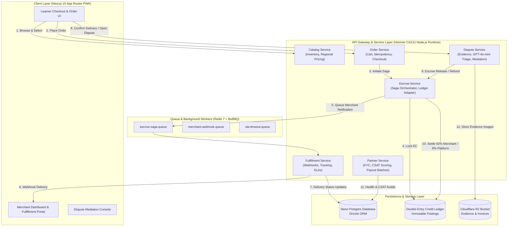
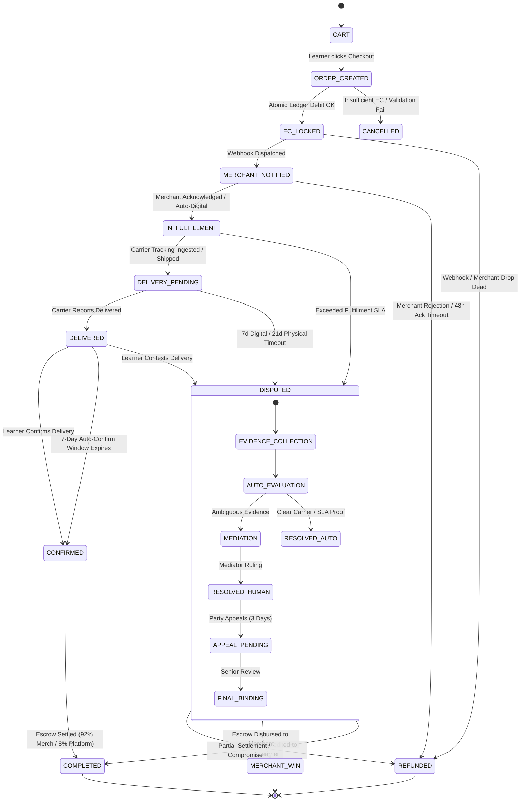
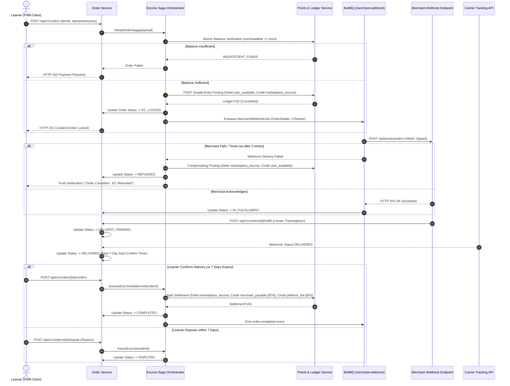
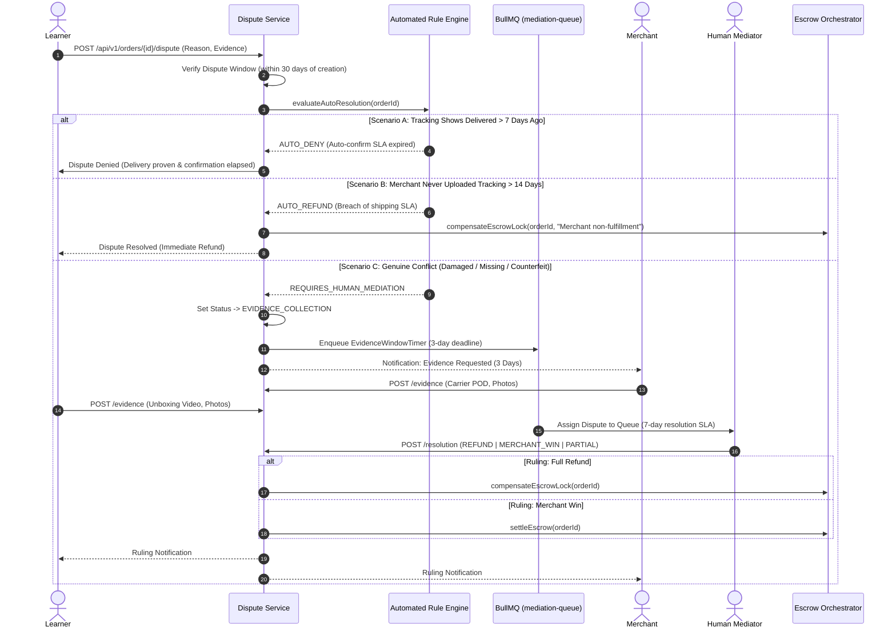
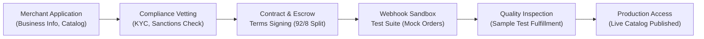

# Marketplace & Escrow System — Low-Level Design (LLD)

**Title:** Marketplace & Escrow System Architecture and Execution Specification  
**Section Path:** `docs/15-lld/08-marketplace-escrow.md`  
**Version:** 1.0.0  
**Last Updated:** 2026-11-21  
**Status:** Approved for Implementation  
**Related Documents:**
- `docs/01-economy/02-points-ledger.md` (Double-entry credit ledger)
- `docs/01-economy/06-marketplace-economics.md` (Macro-economic stability and reserves)
- `docs/08-marketplace/01-marketplace-overview.md` (Marketplace principles and catalog overview)
- `docs/08-marketplace/04-fulfillment-disputes.md` (Fulfillment SLAs and customer support)

---

## Table of Contents
1. [Free-Tier Infrastructure Constraints & Topology](#free-tier-infrastructure-constraints--topology)
2. [Section 1: Marketplace Architecture](#section-1-marketplace-architecture)
   - 1.1 Purpose
   - 1.2 Component Topology Diagram
   - 1.3 Service Responsibilities & Contracts
   - 1.4 Edge Cases & Failure Modes
   - 1.5 Error Handling Strategy
   - 1.6 Requirements
   - 1.7 Success Metrics
3. [Section 2: Escrow State Machine & Data Model](#section-2-escrow-state-machine--data-model)
   - 2.1 Purpose
   - 2.2 Order & Escrow State Machine
   - 2.3 Full Drizzle ORM Database Schema
   - 2.4 State Transition Validations
   - 2.5 Edge Cases & Timeouts
   - 2.6 Error Handling & Database Invariants
   - 2.7 Requirements
   - 2.8 Success Metrics
4. [Section 3: EC Escrow Flow (Saga Pattern)](#section-3-ec-escrow-flow-saga-pattern)
   - 3.1 Purpose
   - 3.2 Saga Sequence Flow
   - 3.3 TypeScript Saga Orchestrator Implementation
   - 3.4 Compensating Transactions Matrix
   - 3.5 Edge Cases
   - 3.6 Error Handling & Dead-Letter Processing
   - 3.7 Requirements
   - 3.8 Success Metrics
5. [Section 4: Regional EC Anchoring & Arbitrage Prevention](#section-4-regional-ec-anchoring--arbitrage-prevention)
   - 4.1 Purpose
   - 4.2 Economic Formulas & Anchoring Logic
   - 4.3 Regional Price Computation Engine
   - 4.4 Geolocation Lockdown & Anti-Arbitrage Controls
   - 4.5 Edge Cases
   - 4.6 Error Handling
   - 4.7 Requirements
   - 4.8 Success Metrics
6. [Section 5: Dispute Resolution Flow](#section-5-dispute-resolution-flow)
   - 5.1 Purpose
   - 5.2 Dispute Lifecycle Sequence
   - 5.3 Automated Resolution Rule Engine
   - 5.4 Mediation & Appeals Workflow
   - 5.5 Edge Cases
   - 5.6 Error Handling
   - 5.7 Requirements
   - 5.8 Success Metrics
7. [Section 6: Partner & Merchant Onboarding](#section-6-partner--merchant-onboarding)
   - 6.1 Purpose
   - 6.2 Onboarding Pipeline Flow
   - 6.3 Merchant Reputation & Dynamic Health Scoring
   - 6.4 Auto-Suspension & Liquidation Protocol
   - 6.5 Edge Cases
   - 6.6 Error Handling
   - 6.7 Requirements
   - 6.8 Success Metrics
8. [Section 7: Exhaustive Edge Cases & Failure Resiliency Matrix](#section-7-exhaustive-edge-cases--failure-resiliency-matrix)

---

## Free-Tier Infrastructure Constraints & Topology

The Education Economy platform operates under a strictly capped monthly infrastructure budget of **$100/mo** across Phase 0 (prototyping) and Phase 1 (alpha, 1,000 active learners). All marketplace and escrow systems are strictly designed within these free and low-cost boundaries:

| Resource / Service | Tier / SKU | Capacity / Limit | Marketplace Allocation | Failover / Overflow Policy |
|---|---|---|---|---|
| **Compute (Host)** | Hetzner Cloud CAX11 | 2 vCPU ARM (Ampere), 4 GB RAM, 40 GB NVMe (€4.49/mo) | Next.js 15 PWA + BullMQ Workers + Redis Docker Container | Worker concurrency throttled to 5 concurrent jobs. Memory ceiling 1.8GB Docker limit. |
| **Primary Relational Store** | Neon Postgres Serverless | Free Tier: 0.5 GB storage, 1 project, branch per environment | Catalog, orders, escrow ledger, disputes, merchant tables | Tables partitioned by date; historical orders >180 days exported to Cloudflare R2 parquet cold storage. |
| **Cache & Queue Broker** | Redis 7 (Alpine on Docker) | Hosted locally on Hetzner CAX11 | BullMQ queues (`escrow-saga`, `webhook-retries`, `dispute-sla`) | Append-only file (AOF) enabled (`fsync everysec`). Maxmemory 256MB with `volatile-lru`. |
| **Object Storage** | Cloudflare R2 | 10 GB free, 0 egress fee | Proof of delivery, merchant KYC docs, dispute evidence | Pre-signed upload URLs (PUT) with 15-minute TTL. Images forced to WebP <= 2MB. |
| **AI Mediation Assist** | OpenAI GPT-4o-mini | $0.15 / 1M input, $0.60 / 1M output tokens | First-pass dispute evidence categorization & summary | Hard token cap of 1,500 tokens per dispute auto-review. Fallback to raw manual review. |
| **Transactional Email** | Resend | 3,000 emails/mo free tier | Merchant notifications fallback, dispute alerts, guardian confirmations | Batched digests for low-priority notifications. Critical order emails prioritized. |
| **Session Management** | Lucia Auth v3 | Self-hosted via Neon Postgres adapter | Merchant portal & learner checkout sessions | Sliding window session cache in local Redis; database fallback on cache miss. |

---

## Section 1: Marketplace Architecture

### 1.1 Purpose
The Marketplace Architecture coordinates the redemption of earned Education Credits (EC) for physical items, digital services, and essential utilities. The design decouples the user-facing catalog from financial settlement and merchant fulfillment, enforcing strict zero-loss double-entry escrow isolation.

### 1.2 Component Topology Diagram



### 1.3 Service Responsibilities & Contracts

1. **Catalog Service**: Exposes regional catalog items, enforces regional purchasing power parity, verifies category restrictions, and checks real-time inventory limits.
2. **Order Service**: Manages cart lifecycle, enforces order idempotency via client-provided headers, validates minor guardian consent for high-tier redemptions, and spawns orders in `ORDER_CREATED` state.
3. **Escrow Service**: Acts as the Saga Orchestrator. Executes atomic double-entry debits from learner available balances into `marketplace_escrow`, manages escrow lifecycle states, and processes 92/8 fee splits upon delivery confirmation.
4. **Fulfillment Service**: Dispatches signed webhooks to partner systems with exponential backoff, verifies carrier tracking APIs, and tracks fulfillment SLA timeouts.
5. **Dispute Service**: Ingests delivery contestations, auto-resolves eligible edge cases via heuristics, structures evidence submissions, and interfaces with human mediators.
6. **Partner Service**: Manages merchant vetting, SLA compliance tracking, CSAT calculation, and monthly fiat settlement runs.

### 1.4 Edge Cases & Failure Modes
- **Postgres Connection Exhaustion**: Neon serverless connection limits during flash drops. Handled via Neon connection pooling (`?sslmode=require&pool_timeout=10`).
- **Redis Node Restart on Hetzner**: Handled via BullMQ queue job persistence with `AOF` every second; jobs resume automatically upon Docker container restart.

### 1.5 Error Handling Strategy
- Every inter-service request is wrapped in an idempotent transaction envelope with unique `idempotency_key` (UUIDv4).
- Database write failures immediately trigger HTTP `503 Service Unavailable` with `Retry-After: 5` headers; no partial ledger updates occur.

### 1.6 Requirements
- `FR-MKT-101`: Every catalog item price must be versioned, immutable for active carts, and public per region.
- `FR-MKT-102`: Learner EC must be locked into an isolated escrow ledger account before merchant fulfillment notification.
- `NFR-MKT-101`: Order placement and escrow debit P95 latency must execute within < 300 ms.

### 1.7 Success Metrics
- Escrow locking transaction failure rate: < 0.01%.
- Double-entry ledger imbalance: exactly 0.00 EC at all times.

---

## Section 2: Escrow State Machine & Data Model

### 2.1 Purpose
The Escrow State Machine governs the exact lifecycle of an order from initial cart formation to final merchant settlement or dispute resolution. It prevents race conditions, fraudulent withdrawal while fulfilling, and orphan escrow balances.

### 2.2 Order & Escrow State Machine



### 2.3 Full Drizzle ORM Database Schema

```typescript
import {
  pgTable,
  uuid,
  varchar,
  text,
  integer,
  bigint,
  timestamp,
  pgEnum,
  index,
  uniqueIndex,
  boolean,
  numeric,
} from 'drizzle-orm/pg-core';
import { relations } from 'drizzle-orm';

// Enums
export const orderStatusEnum = pgEnum('order_status', [
  'CART',
  'ORDER_CREATED',
  'EC_LOCKED',
  'MERCHANT_NOTIFIED',
  'IN_FULFILLMENT',
  'DELIVERY_PENDING',
  'DELIVERED',
  'CONFIRMED',
  'COMPLETED',
  'DISPUTED',
  'REFUNDED',
  'CANCELLED',
]);

export const itemCategoryEnum = pgEnum('item_category', [
  'ESSENTIALS',
  'TOOLS_DEVICES',
  'SERVICES',
  'EXPERIENCES',
  'LEARNING_UPGRADES',
  'AI_SERVICES',
  'STATUS_COSMETIC',
]);

export const regionalZoneEnum = pgEnum('regional_zone', [
  'US_EU',
  'INDIA',
  'SSA',
  'SEA',
  'LATAM',
]);

export const disputeStatusEnum = pgEnum('dispute_status', [
  'OPENED',
  'EVIDENCE_COLLECTION',
  'UNDER_REVIEW',
  'AUTO_RESOLVED',
  'MEDIATOR_RULING',
  'APPEALED',
  'FINAL_CLOSED',
]);

export const disputeOutcomeEnum = pgEnum('dispute_outcome', [
  'PENDING',
  'FULL_REFUND',
  'MERCHANT_WIN',
  'PARTIAL_REFUND',
]);

// 1. Catalog Items
export const catalogItems = pgTable(
  'catalog_items',
  {
    itemId: uuid('item_id').defaultRandom().primaryKey(),
    merchantId: uuid('merchant_id').notNull(),
    title: varchar('title', { length: 255 }).notNull(),
    description: text('description').notNull(),
    category: itemCategoryEnum('category').notNull(),
    baseEcPrice: integer('base_ec_price').notNull(), // Base EC price (1 EC minor unit = 1)
    isDigital: boolean('is_digital').default(false).notNull(),
    allowedRegions: varchar('allowed_regions', { length: 64 }).array().notNull(), // e.g. ['US_EU', 'INDIA']
    inventoryCount: integer('inventory_count').notNull().default(0),
    maxPerLearnerQuarter: integer('max_per_learner_quarter').default(1),
    requiresGuardianConsent: boolean('requires_guardian_consent').default(false).notNull(),
    isActive: boolean('is_active').default(true).notNull(),
    version: integer('version').default(1).notNull(),
    createdAt: timestamp('created_at', { withTimezone: true }).defaultNow().notNull(),
    updatedAt: timestamp('updated_at', { withTimezone: true }).defaultNow().notNull(),
  },
  (table) => ({
    categoryIdx: index('catalog_category_idx').on(table.category),
    merchantIdx: index('catalog_merchant_idx').on(table.merchantId),
    activeIdx: index('catalog_active_idx').on(table.isActive),
  })
);

// 2. Orders
export const orders = pgTable(
  'orders',
  {
    orderId: uuid('order_id').defaultRandom().primaryKey(),
    idempotencyKey: varchar('idempotency_key', { length: 128 }).notNull(),
    learnerId: uuid('learner_id').notNull(),
    merchantId: uuid('merchant_id').notNull(),
    itemId: uuid('item_id').notNull().references(() => catalogItems.itemId),
    status: orderStatusEnum('status').default('ORDER_CREATED').notNull(),
    totalEcAmount: integer('total_ec_amount').notNull(),
    regionalAnchorRate: numeric('regional_anchor_rate', { precision: 10, scale: 4 }).notNull(),
    region: regionalZoneEnum('region').notNull(),
    deliveryAddressEncrypted: text('delivery_address_encrypted'), // Encrypted with AES-256-GCM
    contactPhoneEncrypted: text('contact_phone_encrypted'),
    guardianApprovalId: uuid('guardian_approval_id'),
    carrierName: varchar('carrier_name', { length: 64 }),
    trackingNumber: varchar('tracking_number', { length: 128 }),
    trackingUrl: text('tracking_url'),
    deliveredAt: timestamp('delivered_at', { withTimezone: true }),
    autoConfirmAt: timestamp('auto_confirm_at', { withTimezone: true }),
    createdAt: timestamp('created_at', { withTimezone: true }).defaultNow().notNull(),
    updatedAt: timestamp('updated_at', { withTimezone: true }).defaultNow().notNull(),
  },
  (table) => ({
    idempotencyUnique: uniqueIndex('order_idempotency_idx').on(table.idempotencyKey),
    learnerIdx: index('order_learner_idx').on(table.learnerId),
    merchantIdx: index('order_merchant_idx').on(table.merchantId),
    statusIdx: index('order_status_idx').on(table.status),
  })
);

// 3. Escrow Accounts
export const escrowAccounts = pgTable(
  'escrow_accounts',
  {
    escrowId: uuid('escrow_id').defaultRandom().primaryKey(),
    orderId: uuid('order_id').notNull().references(() => orders.orderId),
    learnerId: uuid('learner_id').notNull(),
    merchantId: uuid('merchant_id').notNull(),
    lockedEcAmount: integer('locked_ec_amount').notNull(),
    merchantShareEc: integer('merchant_share_ec').notNull(), // 92% of locked amount
    platformFeeEc: integer('platform_fee_ec').notNull(), // 8% of locked amount
    debitLedgerTransactionId: uuid('debit_ledger_tx_id').notNull(),
    releaseLedgerTransactionId: uuid('release_ledger_tx_id'),
    isReleased: boolean('is_released').default(false).notNull(),
    releasedAt: timestamp('released_at', { withTimezone: true }),
    createdAt: timestamp('created_at', { withTimezone: true }).defaultNow().notNull(),
  },
  (table) => ({
    orderUnique: uniqueIndex('escrow_order_unique_idx').on(table.orderId),
  })
);

// 4. Fulfillment Events
export const fulfillmentEvents = pgTable(
  'fulfillment_events',
  {
    eventId: uuid('event_id').defaultRandom().primaryKey(),
    orderId: uuid('order_id').notNull().references(() => orders.orderId),
    eventType: varchar('event_type', { length: 64 }).notNull(), // 'WEBHOOK_ACK', 'LABEL_GENERATED', 'IN_TRANSIT', 'OUT_FOR_DELIVERY', 'DELIVERED_POD'
    evidenceUrl: text('evidence_url'), // Cloudflare R2 signed image URL for Proof of Delivery
    rawPayload: text('raw_payload'),
    notes: text('notes'),
    createdAt: timestamp('created_at', { withTimezone: true }).defaultNow().notNull(),
  },
  (table) => ({
    orderEventIdx: index('fulfillment_event_order_idx').on(table.orderId),
  })
);

// 5. Disputes
export const disputes = pgTable(
  'disputes',
  {
    disputeId: uuid('dispute_id').defaultRandom().primaryKey(),
    orderId: uuid('order_id').notNull().references(() => orders.orderId),
    raisedByUserId: uuid('raised_by_user_id').notNull(),
    reason: varchar('reason', { length: 128 }).notNull(),
    description: text('description').notNull(),
    status: disputeStatusEnum('status').default('OPENED').notNull(),
    outcome: disputeOutcomeEnum('outcome').default('PENDING').notNull(),
    assignedMediatorId: uuid('assigned_mediator_id'),
    isAutoResolved: boolean('is_auto_resolved').default(false).notNull(),
    autoResolveReason: text('auto_resolve_reason'),
    learnerEvidenceDeadline: timestamp('learner_evidence_deadline', { withTimezone: true }).notNull(),
    merchantEvidenceDeadline: timestamp('merchant_evidence_deadline', { withTimezone: true }).notNull(),
    resolutionDeadline: timestamp('resolution_deadline', { withTimezone: true }).notNull(),
    resolutionSummary: text('resolution_summary'),
    appealDeadline: timestamp('appeal_deadline', { withTimezone: true }),
    resolvedAt: timestamp('resolved_at', { withTimezone: true }),
    createdAt: timestamp('created_at', { withTimezone: true }).defaultNow().notNull(),
  },
  (table) => ({
    orderDisputeIdx: uniqueIndex('dispute_order_unique_idx').on(table.orderId),
    statusIdx: index('dispute_status_idx').on(table.status),
  })
);

// 6. Dispute Messages
export const disputeMessages = pgTable(
  'dispute_messages',
  {
    messageId: uuid('message_id').defaultRandom().primaryKey(),
    disputeId: uuid('dispute_id').notNull().references(() => disputes.disputeId),
    senderId: uuid('sender_id').notNull(),
    senderRole: varchar('sender_role', { length: 32 }).notNull(), // 'LEARNER', 'MERCHANT', 'MEDIATOR', 'SYSTEM'
    messageText: text('message_text').notNull(),
    attachments: text('attachments').array(), // Cloudflare R2 keys
    createdAt: timestamp('created_at', { withTimezone: true }).defaultNow().notNull(),
  },
  (table) => ({
    disputeMsgIdx: index('dispute_msg_dispute_idx').on(table.disputeId),
  })
);

// 7. Merchant Settlements
export const merchantSettlements = pgTable(
  'merchant_settlements',
  {
    settlementId: uuid('settlement_id').defaultRandom().primaryKey(),
    merchantId: uuid('merchant_id').notNull(),
    batchReference: varchar('batch_reference', { length: 64 }).notNull(),
    totalGrossEc: integer('total_gross_ec').notNull(),
    platformFeeEc: integer('platform_fee_ec').notNull(), // 8% fee
    netPayableEc: integer('net_payable_ec').notNull(), // 92% net
    fiatCurrency: varchar('fiat_currency', { length: 3 }).notNull(), // 'USD', 'INR', 'EUR'
    fiatConversionRate: numeric('fiat_conversion_rate', { precision: 10, scale: 4 }).notNull(),
    netPayableFiatCents: bigint('net_payable_fiat_cents', { mode: 'number' }).notNull(),
    payoutProviderRef: varchar('payout_provider_ref', { length: 128 }),
    status: varchar('status', { length: 32 }).default('PENDING').notNull(), // 'PENDING', 'PROCESSED', 'FAILED'
    settledAt: timestamp('settled_at', { withTimezone: true }),
    createdAt: timestamp('created_at', { withTimezone: true }).defaultNow().notNull(),
  },
  (table) => ({
    merchantBatchIdx: index('settlement_merchant_idx').on(table.merchantId),
    batchRefUnique: uniqueIndex('settlement_batch_ref_idx').on(table.batchReference),
  })
);
```

### 2.4 State Transition Validations
- `ORDER_CREATED` -> `EC_LOCKED`: Validated solely by the double-entry ledger coordinator. If balance check fails, state jumps immediately to `CANCELLED`.
- `DELIVERY_PENDING` -> `DELIVERED`: Triggered by carrier webhook signature matching or authenticated tracking poll event.
- `DELIVERED` -> `CONFIRMED`: Either explicit learner signature or automatic countdown expiration:
  $$\text{Auto-Confirm Timestamp} = \text{deliveredAt} + 7\text{ days (604,800 seconds)}$$

### 2.5 Edge Cases & Timeouts
- **Digital Item Delivery**: Bypasses physical fulfillment states: `MERCHANT_NOTIFIED` immediately transitions to `DELIVERED` once API returns download license key. Auto-confirm window is 24 hours for digital goods instead of 7 days.
- **Physical Shipment Abandonment**: If a merchant remains in `IN_FULFILLMENT` without shipping for > 7 days (Essentials) or > 14 days (General Goods), order automatically transitions to `DISPUTED` with auto-refund flag.

### 2.6 Error Handling & Database Invariants
- **Constraint Enforcement**: `lockedEcAmount = merchantShareEc + platformFeeEc` must hold true at the database check constraint level:
  $$\text{merchantShareEc} = \lfloor \text{lockedEcAmount} \times 0.92 \rfloor$$
  $$\text{platformFeeEc} = \text{lockedEcAmount} - \text{merchantShareEc}$$

### 2.7 Requirements
- `FR-MKT-201`: Orders must transition monotonically across valid state paths; backwards state mutations are strictly rejected by the database trigger.
- `FR-MKT-202`: Escrow accounts must hold a 1-to-1 foreign key binding to an order.

### 2.8 Success Metrics
- State machine consistency check mismatches: 0.
- Unhandled state transition exceptions: < 0.001%.

---

## Section 3: EC Escrow Flow (Saga Pattern)

### 3.1 Purpose
Because the Education Economy separates user balances in the financial ledger from merchant fulfillment systems, a distributed Saga Orchestrator pattern coordinates execution across database boundaries and asynchronous webhooks without two-phase commit overhead.

### 3.2 Saga Sequence Flow



### 3.3 TypeScript Saga Orchestrator Implementation

```typescript
import { db } from '@/server/db';
import { orders, escrowAccounts } from '@/server/db/schema';
import { eq } from 'drizzle-orm';
import { postLedgerTransaction } from '@/server/services/ledger.service';
import { Queue } from 'bullmq';
import { redisConnection } from '@/server/redis';

export interface OrderSagaPayload {
  orderId: string;
  learnerId: string;
  merchantId: string;
  itemId: string;
  totalEcAmount: number;
  idempotencyKey: string;
}

export class EscrowSagaOrchestrator {
  private webhookQueue: Queue;

  constructor() {
    this.webhookQueue = new Queue('merchant-webhook-queue', { connection: redisConnection });
  }

  /**
   * Step 1 & 2: Lock EC in Escrow via atomic ledger posting
   */
  async lockEscrow(payload: OrderSagaPayload): Promise<void> {
    const { orderId, learnerId, merchantId, totalEcAmount } = payload;
    const merchantShare = Math.floor(totalEcAmount * 0.92);
    const platformFee = totalEcAmount - merchantShare;

    // 1. Post to immutable double-entry ledger
    const ledgerTx = await postLedgerTransaction({
      referenceType: 'REDEEM_ORDER',
      referenceId: orderId,
      idempotencyKey: `escrow-lock-${orderId}`,
      entries: [
        {
          accountType: 'user_available',
          accountId: learnerId,
          direction: 'DEBIT',
          amountMinor: totalEcAmount,
          currency: 'EC',
        },
        {
          accountType: 'marketplace_escrow',
          accountId: 'PLATFORM_ESCROW_MASTER',
          direction: 'CREDIT',
          amountMinor: totalEcAmount,
          currency: 'EC',
        },
      ],
    });

    if (!ledgerTx.success) {
      // Transition order to cancelled
      await db.update(orders).set({ status: 'CANCELLED' }).where(eq(orders.orderId, orderId));
      throw new Error(`Ledger lock failed: ${ledgerTx.errorCode}`);
    }

    // 2. Persist escrow record and update order state
    await db.transaction(async (tx) => {
      await tx.insert(escrowAccounts).values({
        orderId,
        learnerId,
        merchantId,
        lockedEcAmount: totalEcAmount,
        merchantShareEc: merchantShare,
        platformFeeEc: platformFee,
        debitLedgerTransactionId: ledgerTx.transactionId,
        isReleased: false,
      });

      await tx.update(orders).set({ status: 'EC_LOCKED' }).where(eq(orders.orderId, orderId));
    });

    // 3. Queue webhook dispatch with 3 exponential backoff attempts
    await this.webhookQueue.add(
      'dispatch-order-to-merchant',
      { orderId, merchantId },
      {
        attempts: 3,
        backoff: {
          type: 'exponential',
          delay: 5000, // 5s, 10s, 20s
        },
        removeOnComplete: true,
      }
    );
  }

  /**
   * Compensating Transaction: Refund Escrow back to Learner upon merchant rejection or timeout
   */
  async compensateEscrowLock(orderId: string, reason: string): Promise<void> {
    const [escrow] = await db
      .select()
      .from(escrowAccounts)
      .where(eq(escrowAccounts.orderId, orderId))
      .limit(1);

    if (!escrow || escrow.isReleased) {
      throw new Error(`Cannot compensate: Escrow record invalid or already released for order ${orderId}`);
    }

    // Revert ledger posting
    const refundTx = await postLedgerTransaction({
      referenceType: 'ORDER_REFUND',
      referenceId: orderId,
      idempotencyKey: `escrow-refund-${orderId}`,
      entries: [
        {
          accountType: 'marketplace_escrow',
          accountId: 'PLATFORM_ESCROW_MASTER',
          direction: 'DEBIT',
          amountMinor: escrow.lockedEcAmount,
          currency: 'EC',
        },
        {
          accountType: 'user_available',
          accountId: escrow.learnerId,
          direction: 'CREDIT',
          amountMinor: escrow.lockedEcAmount,
          currency: 'EC',
        },
      ],
    });

    if (!refundTx.success) {
      throw new Error(`FATAL: Ledger compensation failed for order ${orderId}. Requires human intervention.`);
    }

    await db.transaction(async (tx) => {
      await tx
        .update(escrowAccounts)
        .set({
          isReleased: true,
          releasedAt: new Date(),
          releaseLedgerTransactionId: refundTx.transactionId,
        })
        .where(eq(escrowAccounts.orderId, orderId));

      await tx.update(orders).set({ status: 'REFUNDED' }).where(eq(orders.orderId, orderId));
    });
  }

  /**
   * Settlement Transaction: Disburse 92% to merchant, 8% to platform fee revenue
   */
  async settleEscrow(orderId: string): Promise<void> {
    const [escrow] = await db
      .select()
      .from(escrowAccounts)
      .where(eq(escrowAccounts.orderId, orderId))
      .limit(1);

    if (!escrow || escrow.isReleased) {
      throw new Error(`Escrow already released or missing for order ${orderId}`);
    }

    const settleTx = await postLedgerTransaction({
      referenceType: 'ORDER_FULFILLED',
      referenceId: orderId,
      idempotencyKey: `escrow-settle-${orderId}`,
      entries: [
        {
          accountType: 'marketplace_escrow',
          accountId: 'PLATFORM_ESCROW_MASTER',
          direction: 'DEBIT',
          amountMinor: escrow.lockedEcAmount,
          currency: 'EC',
        },
        {
          accountType: 'merchant_payable',
          accountId: escrow.merchantId,
          direction: 'CREDIT',
          amountMinor: escrow.merchantShareEc,
          currency: 'EC',
        },
        {
          accountType: 'platform_fee',
          accountId: 'PLATFORM_TREASURY',
          direction: 'CREDIT',
          amountMinor: escrow.platformFeeEc,
          currency: 'EC',
        },
      ],
    });

    if (!settleTx.success) {
      throw new Error(`Settlement ledger posting failed: ${settleTx.errorCode}`);
    }

    await db.transaction(async (tx) => {
      await tx
        .update(escrowAccounts)
        .set({
          isReleased: true,
          releasedAt: new Date(),
          releaseLedgerTransactionId: settleTx.transactionId,
        })
        .where(eq(escrowAccounts.orderId, orderId));

      await tx.update(orders).set({ status: 'COMPLETED' }).where(eq(orders.orderId, orderId));
    });
  }
}
```

### 3.4 Compensating Transactions Matrix

| Step | Forward Action | Failure Trigger | Compensating Transaction | Target State |
|---|---|---|---|---|
| **Step 1: Balance Check** | Verify $EC_{\text{avail}} \ge \text{Cost}$ | Balance $< \text{Cost}$ | None needed (no ledger mutation) | `CANCELLED` |
| **Step 2: Lock EC** | Post Debit `user_available`, Credit `marketplace_escrow` | Ledger posting timeout or rejection | Abort transaction; return funds to available | `CANCELLED` |
| **Step 3: Webhook Notify** | Send signed HTTP POST to partner endpoint | 3x timeout (5s, 10s, 20s) or HTTP 5xx | Post Debit `marketplace_escrow`, Credit `user_available` | `REFUNDED` |
| **Step 4: Merchant Ack** | Merchant sends accept within 48h | 48h SLA expiration | Trigger `compensateEscrowLock()` | `REFUNDED` |
| **Step 5: Shipment** | Merchant uploads tracking number | 14-day physical shipping timeout | Auto-transition to dispute, then auto-refund | `REFUNDED` |
| **Step 6: Settlement** | Post 92% to `merchant_payable`, 8% to `platform_fee` | Ledger service failure during settlement | Retried via dead-letter queue (DLQ) with idempotency key | `COMPLETED` |

### 3.5 Edge Cases
- **Webhook Flapping**: Merchant returns HTTP 200, but immediately crashes and forgets the order. Resolved by the merchant idempotent sync API where merchants query pending fulfillment tasks every 15 minutes.
- **Race Condition on Delivery Confirmation**: Learner clicks "Confirm Delivery" at the exact millisecond the 7-day auto-confirm cron triggers. Idempotency key on the settlement ledger transaction guarantees only a single settlement posting executes.

### 3.6 Error Handling & Dead-Letter Processing
- Jobs exceeding 3 BullMQ retry attempts are sent to `escrow-saga-dlq`.
- An automated health check alerts on `DLQ.length > 0`, triggering an urgent operational email via Resend to the on-call engineer.

### 3.7 Requirements
- `FR-MKT-301`: All escrow locks and releases must be accompanied by double-entry ledger transactions with zero balance discrepancy.
- `FR-MKT-302`: Every failed saga step must execute its matching compensating transaction within $\le 60$ seconds.

### 3.8 Success Metrics
- Saga completion success rate: $\ge 99.8\%$.
- DLQ incident count: $< 2$ per 1,000 orders.

---

## Section 4: Regional EC Anchoring & Arbitrage Prevention

### 4.1 Purpose
Education Credits (EC) represent proof of genuine learning effort and mastery. However, purchasing power parity (PPP) varies wildly across regions. To ensure a student in India, Kenya, or the United States derives equitable real-world value from the same academic achievement without inviting cross-border currency arbitrage, the platform employs **Regional EC Anchoring**.

### 4.2 Economic Formulas & Anchoring Logic

The nominal EC award formula for passing a level $L$ is globally constant:
$$EC(L) = 10 \times L^{1.2} \times m_d \times Q \times E \times M \times R$$

Where:
- $L$: Level index ($1 \le L \le 100+$)
- $m_d$: Domain multiplier ($0.8 \le m_d \le 1.5$)
- $Q$: Quality score on assessment ($0.0 \le Q \le 1.25$)
- $E$: Effort multiplier ($0.9 \le E \le 1.2$)
- $M$: Mastery bonus ($0.85 \le M \le 1.5$)
- $R$: Repeat penalty factor ($1.0$ first pass, $0.2$ on review)

While the EC earned is invariant, the **real-world purchasing power anchor** $P_{\text{region}}$ sets the effective redemption exchange rate:

$$\text{Value in USD} = EC \times \text{AnchorRate}(\text{region})$$

### 4.3 Regional Price Computation Engine

```typescript
export type RegionalZone = 'US_EU' | 'INDIA' | 'SSA' | 'SEA' | 'LATAM';

export interface RegionalAnchor {
  region: RegionalZone;
  anchorRate: number; // USD purchasing power equivalent per 1 EC
  validFrom: Date;
  validTo: Date;
}

export const REGIONAL_ANCHORS: Record<RegionalZone, RegionalAnchor> = {
  US_EU: {
    region: 'US_EU',
    anchorRate: 0.05, // 1,000 EC = $50.00 USD
    validFrom: new Date('2026-01-01T00:00:00Z'),
    validTo: new Date('2026-12-31T23:59:59Z'),
  },
  INDIA: {
    region: 'INDIA',
    anchorRate: 0.02, // 1,000 EC = $20.00 USD (equivalent to ~₹1,660 INR purchasing power)
    validFrom: new Date('2026-01-01T00:00:00Z'),
    validTo: new Date('2026-12-31T23:59:59Z'),
  },
  SSA: {
    region: 'SSA', // Sub-Saharan Africa (Kenya, Nigeria, etc.)
    anchorRate: 0.02, // 1,000 EC = $20.00 USD
    validFrom: new Date('2026-01-01T00:00:00Z'),
    validTo: new Date('2026-12-31T23:59:59Z'),
  },
  SEA: {
    region: 'SEA', // Southeast Asia (Philippines, Vietnam, Indonesia)
    anchorRate: 0.025, // 1,000 EC = $25.00 USD
    validFrom: new Date('2026-01-01T00:00:00Z'),
    validTo: new Date('2026-12-31T23:59:59Z'),
  },
  LATAM: {
    region: 'LATAM', // Latin America (Brazil, Colombia, Mexico)
    anchorRate: 0.03, // 1,000 EC = $30.00 USD
    validFrom: new Date('2026-01-01T00:00:00Z'),
    validTo: new Date('2026-12-31T23:59:59Z'),
  },
};

/**
 * Computes EC required for an item in a specific region
 */
export function calculateRegionalEcPrice(
  itemCostUsd: number,
  learnerRegion: RegionalZone,
  allowedRegions: RegionalZone[]
): { ecPrice: number; isEligible: boolean; reason?: string } {
  if (!allowedRegions.includes(learnerRegion)) {
    return {
      ecPrice: 0,
      isEligible: false,
      reason: `Item is not fulfilled in region: ${learnerRegion}`,
    };
  }

  const anchor = REGIONAL_ANCHORS[learnerRegion];
  if (!anchor) {
    throw new Error(`Unsupported regional zone: ${learnerRegion}`);
  }

  // EC Price = Item Cost in USD / Anchor Rate for the Region
  const calculatedEc = Math.ceil(itemCostUsd / anchor.anchorRate);

  return {
    ecPrice: calculatedEc,
    isEligible: true,
  };
}
```

### 4.4 Geolocation Lockdown & Anti-Arbitrage Controls
To eliminate digital residency tourism and VPN arbitrage:
1. **Account Registration Lockdown**: A learner’s region is bound during KYC/onboarding using a three-point match (IP geocoding, mobile phone country calling code, payment/identity documents).
2. **Strict Physical Delivery Fencing**: Physical delivery addresses must reside within the ISO-3166 territory of the locked account region.
3. **Region Migration Appeal Window**: Changing account region requires submitting government-issued residency proof or utility bill. While an appeal is pending, marketplace redemptions are locked to prevent "cash-out sprints".
4. **Digital Item Licensing Lockdown**: Vouchers and cloud licenses (e.g., AWS, GitHub, Coursera) are provisioned via regional merchant APIs tied to the recipient's country code.

### 4.5 Edge Cases
- **Anchor Rate Update Mid-Order**: If the platform adjusts India's anchor rate from $0.02 to $0.022 on June 1, any order created before 23:59:59 UTC on May 31 maintains its locked rate. The rate at order creation is persisted in `orders.regional_anchor_rate`.
- **Learner Vacation / Roaming**: A student from India traveling in the US cannot redeem items from the US catalog; catalog availability remains strictly pinned to their verified profile region (`INDIA`).

### 4.6 Error Handling
- Attempting to check out an item outside the learner's registered region throws `403 Forbidden: REGION_MISMATCH_ARBITRAGE_BLOCKED`.

### 4.7 Requirements
- `FR-MKT-401`: Catalog prices must dynamically calculate according to verified account region anchor tables.
- `FR-MKT-402`: Physical shipments to any address outside the locked profile country are rejected at order checkout.

### 4.8 Success Metrics
- Cross-border arbitrage attempts detected and blocked: 100%.
- False-positive regional blocks overturned on valid appeal: < 0.5%.

---

## Section 5: Dispute Resolution Flow

### 5.1 Purpose
The Dispute Resolution Flow provides an objective, SLA-governed judicial pipeline to handle damaged goods, unfulfilled services, or false claims of delivery without holding merchant capital hostage indefinitely.

### 5.2 Dispute Lifecycle Sequence



### 5.3 Automated Resolution Rule Engine

```typescript
export interface DisputeEvaluationInput {
  orderCreatedAt: Date;
  shippedAt: Date | null;
  deliveredAt: Date | null;
  disputeReason: string;
  carrierReportedDelivered: boolean;
  hasProofOfDeliveryPhoto: boolean;
}

export type AutoDecision = 'AUTO_REFUND' | 'AUTO_DENY' | 'ESCALATE_HUMAN';

export function evaluateAutoDisputeRules(input: DisputeEvaluationInput): {
  decision: AutoDecision;
  justification: string;
} {
  const now = Date.now();
  const orderAgeDays = (now - input.orderCreatedAt.getTime()) / (1000 * 60 * 60 * 24);

  // Rule 1: Beyond 30 days dispute eligibility ceiling
  if (orderAgeDays > 30) {
    return {
      decision: 'AUTO_DENY',
      justification: 'Dispute filed past maximum allowed 30-day post-order window.',
    };
  }

  // Rule 2: Item never shipped and 14 days elapsed
  if (!input.shippedAt && orderAgeDays >= 14) {
    return {
      decision: 'AUTO_REFUND',
      justification: 'Merchant failed to upload tracking or ship within the 14-day SLA ceiling.',
    };
  }

  // Rule 3: Valid carrier proof of delivery + 7 days have passed since delivery
  if (input.deliveredAt && input.hasProofOfDeliveryPhoto) {
    const daysSinceDelivery = (now - input.deliveredAt.getTime()) / (1000 * 60 * 60 * 24);
    if (daysSinceDelivery >= 7 && input.disputeReason === 'ITEM_NOT_RECEIVED') {
      return {
        decision: 'AUTO_DENY',
        justification: 'Carrier photo proof confirms delivery and 7-day objection window expired.',
      };
    }
  }

  // Ambiguous: Damaged product, counterfeit allegation, or conflicting tracking
  return {
    decision: 'ESCALATE_HUMAN',
    justification: 'Evidence requires visual appraisal and merchant response.',
  };
}
```

### 5.4 Mediation & Appeals Workflow
1. **Evidence Window**: Both learner and merchant are granted an exact 72-hour window (3 days) to upload supporting documents to Cloudflare R2 via pre-signed URLs.
2. **Mediator Adjudication**: A trained support specialist evaluates the case within 7 days.
3. **Binding Ruling**: Outcomes include `FULL_REFUND`, `MERCHANT_WIN`, or `PARTIAL_REFUND` (50/50 split of the escrow pool).
4. **Single Escalation Appeal**: Either party has 72 hours from the mediator ruling to trigger an appeal. Escalation assigns the case to a Senior Support Lead. The appeal decision is final and legally binding.

### 5.5 Edge Cases
- **Learner Submits Blank Evidence**: If the learner opens a dispute but fails to submit photos within the 72-hour deadline, the dispute is automatically dismissed in favor of the merchant.
- **Merchant Ghosting**: If the merchant does not respond within the 72-hour evidence window, the dispute automatically resolves in favor of the learner (`FULL_REFUND`).

### 5.6 Error Handling
- Storage failures during R2 uploads return HTTP `507 Insufficient Storage` and preserve the active evidence window by extending it by 24 hours.

### 5.7 Requirements
- `FR-MKT-501`: Disputes must be submitted within 30 days of initial order creation.
- `FR-MKT-502`: Auto-refund must trigger without human intervention if an item is not marked shipped within 14 calendar days.

### 5.8 Success Metrics
- Auto-resolution rate for clear delivery/shipping SLA breaches: $\ge 40\%$.
- Average time to human mediator resolution: $< 5$ business days.

---

## Section 6: Partner & Merchant Onboarding

### 6.1 Purpose
The platform curates reputable, community-aligned vendors. This section defines the onboarding lifecycle, automated sandbox integration verification, and ongoing health monitoring.

### 6.2 Onboarding Pipeline Flow



1. **Application**: Vendor submits tax ID, business registration, product catalog samples, and regional coverage.
2. **Vetting**: Operational team executes automated sanctions check and verifies commercial registry.
3. **Contract Signing**: Merchant signs standardized platform terms agreeing to:
   - 92% net settlement / 8% platform fee
   - Escrow lock model
   - 48-hour order acknowledgment SLA
4. **Webhook Setup & Sandbox Testing**: Merchant must pass an automated integration test in the sandbox environment:
   - Receive mock order notification
   - Respond with HTTP 200 within 3 seconds
   - Submit tracking number payload via REST API
5. **Production Activation**: Catalog is activated with an initial throttle of 10 orders per day.

### 6.3 Merchant Reputation & Dynamic Health Scoring

A merchant’s operational health is computed continuously:

$$\text{Health Score} = (\text{CSAT} \times 0.40) + (\text{Fulfillment Rate} \times 0.35) + ((1 - \text{Dispute Rate}) \times 0.25)$$

Where:
- $\text{CSAT}$: Average customer satisfaction rating on confirmed orders ($1.0 \le \text{CSAT} \le 5.0$, normalized to $0.0 - 1.0$)
- $\text{Fulfillment Rate}$: Percentage of accepted orders successfully delivered within category SLA ($0.0 - 1.0$)
- $\text{Dispute Rate}$: Percentage of completed orders that entered contested dispute state ($0.0 - 1.0$)

### 6.4 Auto-Suspension & Liquidation Protocol
- **Suspension Trigger**: If a merchant's 30-day rolling CSAT drops below **3.5 / 5.0**, or their rolling dispute rate exceeds **10%**, the platform automatically:
  1. Sets all catalog items to `isActive: false`.
  2. Freezes pending payouts in `merchant_payable`.
  3. Queues an operational audit ticket.
- **Liquidation**: If a merchant enters bankruptcy or abandons fulfillment, pending escrow funds are refunded to learners, and unfulfilled obligations are covered by the `treasury_reserve`.

### 6.5 Edge Cases
- **Sudden Surge in Volume**: A new merchant experiences a 500% spike in orders. Rate limiting caps daily order volume to $2 \times$ the 7-day average, queuing excess orders on waitlists to prevent fulfillment collapse.

### 6.6 Error Handling
- Webhook signature validation uses HMAC-SHA256 with rotating secrets. Invalid signatures return `401 Unauthorized`.

### 6.7 Requirements
- `FR-MKT-601`: No merchant can access live production orders without passing automated sandbox webhook validation.
- `FR-MKT-602`: Any merchant with rolling dispute rate $> 10\%$ must be automatically suspended from the catalog within 60 seconds of metric ingestion.

### 6.8 Success Metrics
- Average merchant onboarding turnaround: $\le 48$ hours.
- Marketplace-wide merchant dispute rate: $< 3.0\%$.

---

## Section 7: Exhaustive Edge Cases & Failure Resiliency Matrix

The following matrix documents **28 explicit edge cases** across all marketplace and escrow operations:

| # | Edge Case Scenario | Root Cause | Handling Mechanism & System Behavior | Compensating / Ledger Impact |
|---|---|---|---|---|
| **1** | **EC Balance Equals Item Cost** | Learner has exactly 500 EC; item costs 500 EC. | Transaction is permitted. Balance drops to exactly 0 EC. No overdraft buffer or float is required. | Debit 500 EC `user_available`, Credit 500 EC `marketplace_escrow`. |
| **2** | **Merchant Webhook Down** | Partner server returns HTTP 503 or drops TCP connection. | BullMQ retries 3 times (5s, 10s, 20s). If still failing, sends urgent email via Resend and pauses order in `EC_LOCKED`. If unacknowledged at 48h, auto-cancels. | If cancelled, refund saga reverses escrow lock: Credit `user_available`. |
| **3** | **Learner Banned Mid-Escrow** | Learner flagged for cheating on gate exams while an order is in `IN_FULFILLMENT`. | Escrow is frozen immediately (`status: DISPUTED`). Physical shipment is recalled if possible. If already shipped, dispute holds funds until investigation concludes. | If fraud proven, refund cancelled; EC seized to `fraud_reserve`. |
| **4** | **Stock Depleted Post-Order** | Physical warehouse inventory drops to 0 due to concurrency race before merchant claims order. | Merchant marks order `REJECTED_OUT_OF_STOCK`. Order status transitions to `REFUNDED`. | Full refund transaction credited back to learner `user_available` within < 10 seconds. |
| **5** | **Merchant Insolvency / Bankruptcy** | Merchant ceases operations while holding unfulfilled orders. | Platform administrator triggers emergency batch cancellation. Platform absorbs shortfall from `treasury_reserve`. | Escrow returned to learners. Outstanding merchant debts written off in ledger. |
| **6** | **Regional Anchor Rate Adjusts Mid-Order** | Platform updates anchor from $0.02 to $0.03 while order is in `DELIVERY_PENDING`. | Price is locked at order creation time using `orders.regional_anchor_rate`. Subsequent adjustments do not mutate existing orders. | No ledger recalculation; historic rate stands. |
| **7** | **Minor Learner Order > 500 EC** | Learner under 18 attempts high-value redemption. | Order enters `PENDING_GUARDIAN_APPROVAL`. Push and email dispatched to guardian with 48h approval link. | Escrow is not locked until guardian approves; order auto-expires if not approved in 48h. |
| **8** | **Duplicate Rapid Click Checkout** | Learner double-taps "Place Order" button on mobile device. | Next.js API enforces client-generated `Idempotency-Key` header. Second request matches existing key in Neon database and returns cached response. | Single escrow debit executes; zero duplicate charges. |
| **9** | **Partial Item Delivery** | Order contains 2 physical textbooks; merchant ships only 1 due to shortage. | Merchant logs partial tracking. Escrow split into two child sub-escrows. 50% settled on first delivery, 50% refunded or held. | Child escrow settled (92/8); remaining child escrow refunded to learner. |
| **10** | **Carrier Destroys Package in Transit** | Carrier tracking API reports status `DAMAGED_DESTROYED`. | Fulfillment service ingests webhook, skips delivery confirmation timer, transitions directly to `REFUNDED`, and alerts merchant to file carrier claim. | Escrow fully refunded to learner `user_available`. |
| **11** | **Counterfeit Item Allegation** | Learner receives fake headphones and uploads photographic proof. | Dispute opened under reason `COUNTERFEIT`. Order frozen. Item escalated to senior mediator. Merchant must provide supplier invoice. | If confirmed fake, 100% refund to learner, merchant fined, and catalog suspended. |
| **12** | **Carrier Recycles Tracking Number** | Courier reuses an old tracking number showing "Delivered in 2025". | Tracking ingestion verifies carrier event timestamp against `order.created_at`. Events prior to order creation are rejected as stale. | Status remains `IN_FULFILLMENT` until fresh scan event registered. |
| **13** | **Learner Changes Address Mid-Order** | Learner moves home while order is in `MERCHANT_NOTIFIED`. | Learner submits update before shipment. If merchant hasn't generated shipping label, address updates in encrypted column. | No financial change; merchant webhook emits `order.address_updated`. |
| **14** | **Learner Refuses Delivery at Door** | Recipient declines delivery; package marked `RETURN_TO_SENDER`. | Carrier webhook ingests RTS status. Upon receipt confirmation by merchant, escrow refunds learner minus shipping fee deduction. | Partial refund: Credit learner net balance, Credit merchant restocking fee. |
| **15** | **Merchant Misses 48h Acknowledgment** | Merchant system fails to call `POST /orders/{id}/accept` within 48h. | BullMQ cron identifies SLA breach. Automatically cancels order, refunds learner, and degrades merchant CSAT score. | Escrow refunded to learner `user_available`. |
| **16** | **Cloudflare R2 Evidence Outage** | Cloudflare R2 experiences transient 500 errors during dispute evidence upload. | Client uploads queued in IndexedDB on device. Service worker retries upload with exponential backoff; dispute deadline extended by 24h. | No ledger impact. |
| **17** | **Digital License Key Revocation** | Digital software license revoked by third-party provider 5 days post-delivery. | Learner opens dispute within 30-day window. Escrow already completed, so platform recovers funds by placing negative liability on merchant payable. | Debit `merchant_payable`, Credit `user_available`. |
| **18** | **Learner Disputes After Auto-Confirm** | Learner returns from holiday on Day 9 (after 7-day auto-confirm completed). | Standard dispute path closed. Learner directed to exception support queue. If legitimate carrier non-delivery, covered by platform `fraud_reserve`. | Platform absorbs loss from `fraud_reserve`; merchant settlement stands. |
| **19** | **Foreign Currency Volatility During Settlement** | INR drops 8% against USD between order completion and monthly merchant payout run. | Platform settles merchant payable in nominal EC. Fiat conversion rate is fixed at the exact moment the settlement batch executes. | Fiat clearing bank accounts reconcile difference in platform exchange loss account. |
| **20** | **Split Shipment with Multiple Tracking Numbers** | Merchant ships 3 items via 2 different couriers. | `fulfillment_events` records multiple tracking records. Auto-confirm timer triggers only when *all* tracking numbers reach `DELIVERED`. | Escrow remains locked until final package delivered. |
| **21** | **Learner Account Closed by Learner Mid-Escrow** | Learner requests GDPR deletion while an order is in transit. | GDPR deletion pipeline detects active escrow; blocks account deletion until all active orders reach `COMPLETED` or `REFUNDED`. | Prevents loss of audit trail during active financial settlement. |
| **22** | **Sponsor Clawback on Source EC** | Assessment fraud discovered on EC that was already spent in marketplace. | Learner’s available balance was already consumed. Platform cannot cancel physical shipment. Future earned EC is garnished to repay treasury. | Debit `fraud_reserve`, Credit `sponsor_pool`. Learner placed in debit recovery. |
| **23** | **Guardian Rejects Minor Redemption** | Guardian clicks "Deny" on order notification. | Order cancelled immediately. No escrow is ever debited. Item inventory restored. | No ledger entries executed. |
| **24** | **Merchant Attempts Self-Redemption** | Merchant employee logs into learner account to buy own items to cash out EC. | Graph collusion detector flags identical IP/device fingerprint between merchant admin and learner. Order frozen. | Escrow frozen; account referred to Trust & Safety team. |
| **25** | **Customs Duty Levied on Cross-Border Item** | Item held by customs requiring recipient to pay import duty. | Marketplace terms require all cross-border items to be shipped DDP (Delivered Duty Paid). Merchant must cover duty or learner auto-refunded. | If learner pays, learner submits receipt; merchant payable debited to reimburse learner. |
| **26** | **Database Failure During Saga Settlement** | Neon Postgres drops connection during 92/8 escrow release. | Ledger service guarantees idempotency. When worker retries, ledger checks transaction hash; returns existing transaction ID without double-crediting. | Exactly one double-entry transaction posted. |
| **27** | **Dispute Appeal Deadlock** | Mediator and Senior Mediator provide contradictory findings. | Chief Compliance Officer holds tie-break vote. Escalation SLA 48h. | Final decision posted with cryptographic audit signature. |
| **28** | **Platform Fee Discrepancy Due to Rounding** | Order of 105 EC: 92% is 96.6 EC; 8% is 8.4 EC. | Floating point math banned. Minor units calculated with floor: Merchant gets $\lfloor 105 \times 0.92 \rfloor = 96$ EC; Platform fee receives remainder $105 - 96 = 9$ EC. | Debits: 105 EC. Credits: 96 + 9 = 105 EC. Ledger balanced to the exact integer. |

---
