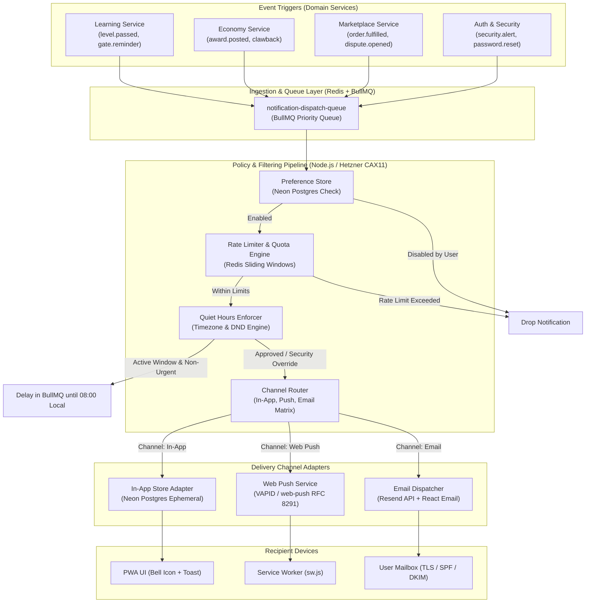
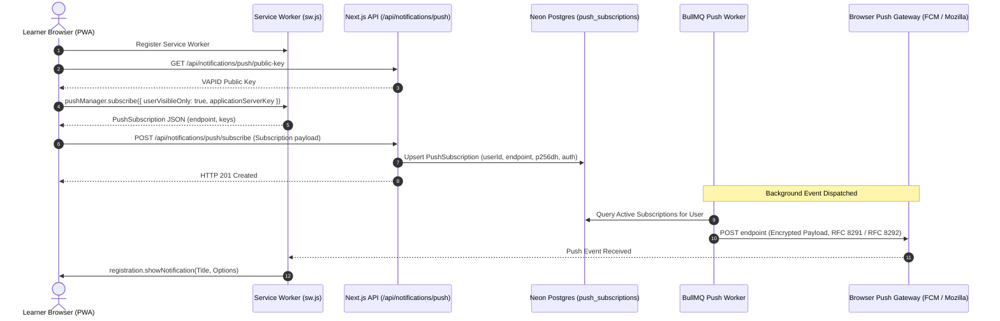

# Notification System — Low-Level Design (LLD)

**Title:** Multi-Channel Notification Architecture and Resiliency Specification  
**Section Path:** `docs/15-lld/09-notifications.md`  
**Version:** 1.0.0  
**Last Updated:** 2026-11-21  
**Status:** Approved for Implementation  
**Related Documents:**
- `docs/06-platforms/01-architecture.md` (System components and event model)
- `docs/06-platforms/02-web.md` (PWA push service worker and caching)
- `docs/07-experience/01-information-architecture.md` (User notification center UX)
- `docs/12-legal/01-privacy-gdpr.md` (GDPR consent, CAN-SPAM, and right to erasure)

---

## Table of Contents
1. [Free-Tier Infrastructure Constraints & Topology](#free-tier-infrastructure-constraints--topology)
2. [Section 1: Notification Architecture](#section-1-notification-architecture)
   - 1.1 Purpose
   - 1.2 Component Topology Diagram
   - 1.3 Service Responsibilities & Ingestion Flow
   - 1.4 Edge Cases & Failure Modes
   - 1.5 Error Handling Strategy
   - 1.6 Requirements
   - 1.7 Success Metrics
3. [Section 2: Notification Types & Channel Routing Matrix](#section-2-notification-types--channel-routing-matrix)
   - 2.1 Purpose
   - 2.2 Exhaustive Multi-Channel Matrix
   - 2.3 Regulatory vs Non-Regulatory Channel Rules
   - 2.4 Edge Cases
   - 2.5 Error Handling
   - 2.6 Requirements
   - 2.7 Success Metrics
4. [Section 3: Rate Limiting & Anti-Dark-Patterns Engine](#section-3-rate-limiting--anti-dark-patterns-engine)
   - 3.1 Purpose
   - 3.2 Anti-Dark-Pattern Principles
   - 3.3 Rate Limiter & Quiet Hours Implementation
   - 3.4 Sliding-Window Burst Protection Algorithm
   - 3.5 Edge Cases
   - 3.6 Error Handling
   - 3.7 Requirements
   - 3.8 Success Metrics
5. [Section 4: Email System & React Email Templates](#section-4-email-system--react-email-templates)
   - 4.1 Purpose
   - 4.2 Template Registry & Variable Definitions
   - 4.3 Production React Email Component ("Level Passed")
   - 4.4 Resend Integration & Header Injection
   - 4.5 Edge Cases
   - 4.6 Error Handling
   - 4.7 Requirements
   - 4.8 Success Metrics
6. [Section 5: Self-Hosted Web Push Service (VAPID)](#section-5-self-hosted-web-push-service-vapid)
   - 5.1 Purpose
   - 5.2 Next.js 15 PWA Push Pipeline
   - 5.3 VAPID Key Management & API Endpoints
   - 5.4 BullMQ Push Worker Implementation
   - 5.5 Client-Side Service Worker (`sw.js`)
   - 5.6 Edge Cases
   - 5.7 Error Handling
   - 5.8 Requirements
   - 5.9 Success Metrics
7. [Section 6: Opt-Out, CAN-SPAM, & GDPR Compliance](#section-6-opt-out-can-spam--gdpr-compliance)
   - 6.1 Purpose
   - 6.2 One-Click RFC 8058 Unsubscribe Engine
   - 6.3 Preference Center & Drizzle Schema
   - 6.4 Right to Erasure (GDPR Art. 17) Purge Pipeline
   - 6.5 Edge Cases
   - 6.6 Error Handling
   - 6.7 Requirements
   - 6.8 Success Metrics
8. [Section 7: Exhaustive Edge Cases & Failure Resiliency Matrix](#section-7-exhaustive-edge-cases--failure-resiliency-matrix)

---

## Free-Tier Infrastructure Constraints & Topology

The Notification System is engineered to operate strictly within the $100/mo total platform infrastructure budget, leveraging high-efficiency free tiers and self-hosted primitives:

| Service / Resource | Allocation & Limits | Architectural Constraint & Optimization |
|---|---|---|
| **Resend (Email)** | 3,000 emails/month free tier, max 10 emails/sec | Strict non-transactional batching. Marketing/digest emails limited to 1 weekly digest per user. Non-critical notifications diverted to In-App and Web Push. |
| **Web Push (VAPID)** | Self-hosted via `web-push` npm package | Zero external SaaS cost. Push subscriptions stored in Neon Postgres. Push dispatch handled via internal BullMQ worker on Hetzner CAX11. |
| **Neon Postgres** | 0.5 GB storage ceiling (free tier) | `in_app_notifications` table is ephemeral: rows auto-pruned after 30 days via daily pg_cron job. Payload JSON kept $< 1\text{ KB}$. |
| **Redis 7 (Docker)** | 256 MB memory limit on Hetzner CAX11 | Rate limiting counters stored with explicit TTLs (max 86,400s). Queues configured with `removeOnComplete: 100`, `removeOnFail: 500`. |
| **PostHog Analytics** | Self-hosted on Hetzner CAX11 | Notification open rates, push delivery rates, and opt-out conversions tracked with zero data ingestion fees. |

---

## Section 1: Notification Architecture

### 1.1 Purpose
The Notification Architecture guarantees reliable, transparent, and non-exploitative communication across three distinct channels: In-App, Web Push, and Transactional Email. It enforces strict user autonomy, quiet hours, and legal compliance before any message is transmitted.

### 1.2 Component Topology Diagram



### 1.3 Service Responsibilities & Ingestion Flow
1. **Event Ingestion**: Domain events emit a standardized `NotificationEventEnvelope` into the `notification-dispatch-queue`.
2. **Preference Evaluation**: Evaluates whether the recipient has disabled this notification category or channel.
3. **Rate Limit Evaluation**: Queries Redis atomic counters to enforce hourly and daily caps per category.
4. **Quiet Hours Evaluation**: Uses user-configured timezones to suppress non-urgent audio/push interruptions between 23:00 and 08:00 local time.
5. **Channel Routing**: Dispatches payloads simultaneously to approved channels.

### 1.4 Edge Cases & Failure Modes
- **Worker Crash During Dispatch**: BullMQ job lock prevents duplicate processing; upon worker restart, unfinished jobs are retried safely due to unique `notification_id` idempotency keys.
- **Neon Database Lag**: If database read times out during preference check, transactional/security alerts default to **allow**, whereas non-essential learning reminders default to **suppress** to protect learner peace of mind.

### 1.5 Error Handling Strategy
- Downstream channel errors (e.g., Resend 429 or Web Push 410) are handled independently. A push failure does not abort an email or in-app write.

### 1.6 Requirements
- `FR-NOT-101`: Every notification must be evaluated against recipient preferences and quiet-hour rules before dispatch.
- `FR-NOT-102`: Security alerts and legal order confirmations must bypass rate limits and quiet-hour delays.
- `NFR-NOT-101`: End-to-end notification delivery P95 latency must be $< 1,500\text{ ms}$ for real-time events.

### 1.7 Success Metrics
- Notification delivery success rate: $\ge 99.5\%$.
- Erroneous quiet-hour breach rate: $0.0\%$.

---

## Section 2: Notification Types & Channel Routing Matrix

### 2.1 Purpose
The platform categorizes notifications into distinct functional domains, balancing immediate educational feedback with respect for learner attention. 

### 2.2 Exhaustive Multi-Channel Matrix

The table below defines all **24 supported notification types** across the platform:

| # | Notification Type | Category | In-App | Email | Push | Default State | Can Disable? | Regulatory / Transactional |
|---|---|---|:---:|:---:|:---:|:---:|:---:|:---:|
| **1** | `LEVEL_PASSED` | Learning | ✓ | ✓ | ✓ | On | Yes | No |
| **2** | `LEVEL_FAILED_GUIDANCE` | Learning | ✓ | ✗ | ✗ | On | Yes | No |
| **3** | `EC_EARNED` | Economy | ✓ | ✗ | ✓ | On | Yes | No |
| **4** | `GATE_REMINDER` | Learning | ✓ | ✗ | ✓ | On | Yes | No |
| **5** | `ORDER_CONFIRMED` | Economy | ✓ | ✓ | ✓ | On | No | **Yes (Legal/Tx)** |
| **6** | `ORDER_FULFILLED` | Economy | ✓ | ✓ | ✓ | On | No | **Yes (Legal/Tx)** |
| **7** | `ORDER_TRACKING_UPDATED` | Economy | ✓ | ✗ | ✓ | On | Yes | No |
| **8** | `SECURITY_ALERT_LOGIN` | Security | ✓ | ✓ | ✓ | On | No | **Yes (Security)** |
| **9** | `PASSWORD_RESET_REQUEST`| Security | ✗ | ✓ | ✗ | On | No | **Yes (Security)** |
| **10**| `MFA_CODE` | Security | ✗ | ✓ | ✗ | On | No | **Yes (Security)** |
| **11**| `NEW_LEVEL_UNLOCKED` | Learning | ✓ | ✗ | ✓ | On | Yes | No |
| **12**| `GUILD_INVITE` | Social | ✓ | ✗ | ✓ | On | Yes | No |
| **13**| `GUILD_ROLE_PROMOTED` | Social | ✓ | ✗ | ✓ | On | Yes | No |
| **14**| `PEER_REVIEW_ASSIGNED` | Social | ✓ | ✗ | ✓ | On | Yes | No |
| **15**| `PEER_REVIEW_REMINDER` | Social | ✓ | ✗ | ✓ | On | Yes | No |
| **16**| `MENTOR_SESSION_BOOKED`| Social | ✓ | ✓ | ✓ | On | Yes | No |
| **17**| `MENTOR_REMINDER_1H` | Social | ✓ | ✗ | ✓ | On | Yes | No |
| **18**| `DISPUTE_OPENED` | Economy | ✓ | ✓ | ✓ | On | No | **Yes (Legal/Tx)** |
| **19**| `DISPUTE_EVIDENCE_REQ` | Economy | ✓ | ✓ | ✓ | On | No | **Yes (Legal/Tx)** |
| **20**| `DISPUTE_RESOLVED` | Economy | ✓ | ✓ | ✓ | On | No | **Yes (Legal/Tx)** |
| **21**| `GUARDIAN_CONSENT_REQ`| Legal | ✓ | ✓ | ✓ | On | No | **Yes (Legal)** |
| **22**| `LEAGUE_PROMOTED` | Social | ✓ | ✗ | ✗ | On | Yes | No |
| **23**| `LEAGUE_RELEGATION_WARN`| Social | ✓ | ✗ | ✗ | Off | Yes | No |
| **24**| `WEEKLY_DIGEST` | Learning | ✗ | ✓ | ✗ | On | Yes | No |

### 2.3 Regulatory vs Non-Regulatory Channel Rules
- **Transactional & Security Notifications** (`ORDER_CONFIRMED`, `SECURITY_ALERT_LOGIN`, `PASSWORD_RESET_REQUEST`, `GUARDIAN_CONSENT_REQ`, `DISPUTE_*`) cannot be disabled. They are legally mandated to preserve auditability, property rights, and minor protection.
- **Gamification / Social Notifications** (`LEAGUE_RELEGATION_WARN`, `GUILD_INVITE`, `STREAK_MOMENTUM`) default to conservative states and can be turned off with a single toggle.

### 2.4 Edge Cases
- **Unverified Email Address**: If an email is unverified, transactional emails are queued for up to 72 hours while in-app notifications present a blocking banner.
- **Push Permission Revoked at OS Level**: Web push API returns `410 Gone`. System automatically marks the push endpoint inactive without generating error alarms.

### 2.5 Error Handling
- Invalid channel configurations fallback to In-App delivery, ensuring the learner never misses mission-critical account alerts.

### 2.6 Requirements
- `FR-NOT-201`: Transactional and security alert types must be immutable and cannot be opted out of by the user.
- `FR-NOT-202`: Every non-regulatory notification type must support individual channel toggling (In-App, Push, Email).

### 2.7 Success Metrics
- Notification preference compliance: 100%.
- Unwanted notification spam complaints: $< 0.1\%$.

---

## Section 3: Rate Limiting & Anti-Dark-Patterns Engine

### 3.1 Purpose
The platform strictly rejects predatory engagement tactics (e.g., manipulative streak guilt-trips, false urgency, midnight push notifications). The Rate Limiting Engine protects learner well-being by enforcing strict frequency caps and quiet hours.

### 3.2 Anti-Dark-Pattern Principles
1. **No Artificial Urgency**: No messages claiming "Your credits will expire tomorrow!" or "Someone is taking your spot!"
2. **No Guilt-Tripping**: Never send "We miss you!" or "You're disappointing your guild!"
3. **Strict Learning Cap**: A maximum of **3 learning notifications per day** across all channels combined.
4. **Enforced Quiet Hours**: Zero push or audio notifications between 23:00 and 08:00 in the learner's local timezone.

### 3.3 Rate Limiter & Quiet Hours Implementation

```typescript
import { redisConnection } from '@/server/redis';

export type NotificationCategory = 'learning' | 'economy' | 'social' | 'security' | 'system';

export interface CategoryRateLimit {
  perHour: number;
  perDay: number;
}

export const RATE_LIMITS: Record<NotificationCategory, CategoryRateLimit> = {
  learning: { perHour: 1, perDay: 3 },
  economy: { perHour: 2, perDay: 5 },
  social: { perHour: 1, perDay: 2 },
  security: { perHour: 5, perDay: 10 }, // Generous ceiling for urgent MFA & security alerts
  system: { perHour: 2, perDay: 5 },
};

export interface NotificationGateCheckInput {
  userId: string;
  category: NotificationCategory;
  userTimezone: string; // e.g. "Asia/Kolkata", "America/New_York"
  quietHoursStart?: number; // default 23 (11 PM)
  quietHoursEnd?: number; // default 8 (8 AM)
  isUrgentSecurity: boolean;
}

export interface GateCheckResult {
  allowed: boolean;
  reason?: 'RATE_LIMIT_EXCEEDED_HOUR' | 'RATE_LIMIT_EXCEEDED_DAY' | 'QUIET_HOURS_ACTIVE' | 'BURST_PROTECTION';
  deferUntil?: Date;
}

export async function evaluateNotificationGates(
  input: NotificationGateCheckInput
): Promise<GateCheckResult> {
  // Security bypasses all rate limits and quiet hours
  if (input.isUrgentSecurity) {
    return { allowed: true };
  }

  const { userId, category, userTimezone } = input;
  const now = new Date();

  // 1. Quiet Hours Enforcement
  const qStart = input.quietHoursStart ?? 23;
  const qEnd = input.quietHoursEnd ?? 8;

  const localHourString = now.toLocaleTimeString('en-US', {
    timeZone: userTimezone,
    hour: 'numeric',
    hour12: false,
  });
  const localHour = parseInt(localHourString, 10);

  const isInQuietHours = qStart > qEnd
    ? localHour >= qStart || localHour < qEnd
    : localHour >= qStart && localHour < qEnd;

  if (isInQuietHours) {
    // Calculate deferral time: 08:00 AM local time next morning
    const deferDate = new Date(now.getTime() + 4 * 60 * 60 * 1000); // Approximate delay in worker queue
    return {
      allowed: false,
      reason: 'QUIET_HOURS_ACTIVE',
      deferUntil: deferDate,
    };
  }

  // 2. Sliding Window Burst Protection (Max 5 notifications across all types in 15 minutes)
  const burstKey = `notif:burst:${userId}`;
  const burstCount = await redisConnection.incr(burstKey);
  if (burstCount === 1) {
    await redisConnection.expire(burstKey, 15 * 60); // 15 minutes TTL
  }
  if (burstCount > 5) {
    return { allowed: false, reason: 'BURST_PROTECTION' };
  }

  // 3. Category Rate Limits (Hourly and Daily counters)
  const hourKey = `notif:limit:${category}:hour:${userId}:${now.getUTCFullYear()}-${now.getUTCMonth()}-${now.getUTCDate()}-${now.getUTCHours()}`;
  const dayKey = `notif:limit:${category}:day:${userId}:${now.getUTCFullYear()}-${now.getUTCMonth()}-${now.getUTCDate()}`;

  const currentHourCount = await redisConnection.incr(hourKey);
  if (currentHourCount === 1) await redisConnection.expire(hourKey, 3600);

  const currentDayCount = await redisConnection.incr(dayKey);
  if (currentDayCount === 1) await redisConnection.expire(dayKey, 86400);

  const limits = RATE_LIMITS[category];
  if (currentHourCount > limits.perHour) {
    return { allowed: false, reason: 'RATE_LIMIT_EXCEEDED_HOUR' };
  }
  if (currentDayCount > limits.perDay) {
    return { allowed: false, reason: 'RATE_LIMIT_EXCEEDED_DAY' };
  }

  return { allowed: true };
}
```

### 3.4 Sliding-Window Burst Protection Algorithm
- Implemented via atomic Redis `INCR` operations keyed by 15-minute epochs.
- Prevents notification storms caused by multiple background worker sync operations or batch event loops.

### 3.5 Edge Cases
- **Daylight Saving Time (DST) Transition**: Standardizes time calculations using IANA timezone identifiers (e.g. `America/New_York`) evaluated via the native V8 `Intl.DateTimeFormat` API rather than static UTC offsets.
- **Frequent Timezone Changes**: A learner traveling internationally updates their timezone upon logging in. The quiet hours check always resolves against the user's stored account timezone, not transient IP geolocation.

### 3.6 Error Handling
- If Redis is temporarily unreachable, the rate limiter fails **open** for security alerts and fails **closed** (suppresses) for marketing or social nudges.

### 3.7 Requirements
- `FR-NOT-301`: Learning notifications must not exceed 3 deliveries per calendar day per learner.
- `FR-NOT-302`: Notifications must strictly defer delivery during learner-defined quiet hours (default 23:00 to 08:00 local time).

### 3.8 Success Metrics
- Notification unsubscribe rate: $< 0.5\%$.
- User reported annoyance score (via PostHog survey): $< 2\%$.

---

## Section 4: Email System & React Email Templates

### 4.1 Purpose
Transactional email provides high-durability legal and operational proof of system state changes. Using Resend’s API and React Email templates, emails are responsive, accessible, brand-consistent, and include power-law formula transparency.

### 4.2 Template Registry & Variable Definitions

| Template Name | Trigger Event | Dynamic Variables Required | SLA / Urgency |
|---|---|---|---|
| `welcome-verification` | Account Creation | `learnerName`, `verifyUrl`, `expiryHours` | Immediate (< 10s) |
| `level-passed` | Assessment Gate Success | `learnerName`, `skillCode`, `skillName`, `level`, `xpEarned`, `ecEarned`, `formulaBreakdown` | Within 2 minutes |
| `weekly-summary` | Sunday Cron | `learnerName`, `totalXpThisWeek`, `totalEcThisWeek`, `skillsAdvanced`, `nextRecommendedLevel` | Scheduled batch |
| `security-alert` | New Device Login / MFA | `learnerName`, `ipAddress`, `locationCity`, `deviceType`, `timestampUtc`, `lockAccountUrl` | Immediate (< 5s) |
| `guardian-consent` | Minor High-Tier Action | `guardianName`, `minorName`, `actionType`, `ecAmount`, `approveUrl`, `rejectUrl` | Immediate (< 30s) |
| `order-confirmation` | Marketplace Checkout | `orderId`, `itemName`, `ecPrice`, `shippingAddressMasked`, `etaDate`, `orderUrl` | Immediate (< 15s) |
| `order-fulfilled` | Shipping Label / POD | `orderId`, `itemName`, `carrierName`, `trackingNumber`, `trackingUrl`, `autoConfirmDate` | Within 5 minutes |
| `password-reset` | User Initiated Reset | `resetUrl`, `ipAddress`, `expiryMinutes` | Immediate (< 10s) |
| `dispute-opened` | Order Contestation | `disputeId`, `orderId`, `claimReason`, `evidenceDeadline`, `portalUrl` | Within 15 minutes |
| `appeal-decision` | Senior Mediator Ruling | `disputeId`, `orderId`, `finalRuling`, `payoutSummary`, `caseClosureNotes` | Within 1 hour |

### 4.3 Production React Email Component ("Level Passed")

```tsx
import * as React from 'react';
import {
  Html,
  Head,
  Preview,
  Body,
  Container,
  Section,
  Heading,
  Text,
  Hr,
  Button,
  Tailwind,
} from '@react-email/components';

export interface LevelPassedEmailProps {
  learnerName: string;
  skillCode: string;
  skillName: string;
  level: number;
  xpEarned: number;
  ecEarned: number;
  domainMultiplier: number;
  qualityScore: number;
  dashboardUrl: string;
  unsubscribeUrl: string;
}

export const LevelPassedEmail: React.FC<LevelPassedEmailProps> = ({
  learnerName = 'Learner',
  skillCode = 'CMP-025',
  skillName = 'Computer Systems Architecture',
  level = 30,
  xpEarned = 18075,
  ecEarned = 685,
  domainMultiplier = 1.1,
  qualityScore = 1.0,
  dashboardUrl = 'https://educationeconomy.org/dashboard',
  unsubscribeUrl = 'https://educationeconomy.org/api/v1/notifications/unsubscribe',
}) => {
  return (
    <Html>
      <Head />
      <Preview>Mastery Verified: You achieved Level {level} in {skillName}!</Preview>
      <Tailwind>
        <Body className="bg-slate-50 font-sans text-slate-800">
          <Container className="mx-auto my-10 max-w-xl rounded-lg border border-slate-200 bg-white p-8 shadow-sm">
            {/* Header */}
            <Section className="text-center">
              <Text className="text-xs font-bold tracking-wider text-emerald-600 uppercase">
                Assessment Verified • Level Cleared
              </Text>
              <Heading className="mt-2 text-2xl font-bold text-slate-900">
                Congratulations, {learnerName}!
              </Heading>
              <Text className="text-sm text-slate-600">
                You have officially passed the Level {level} Gate in <strong>{skillCode}: {skillName}</strong>.
              </Text>
            </Section>

            {/* Achievement Badge Box */}
            <Section className="my-6 rounded-md bg-emerald-50 p-6 text-center border border-emerald-100">
              <Text className="text-sm font-semibold text-emerald-800">VERIFIED AWARDS CREDITED</Text>
              <div className="mt-4 flex justify-around">
                <div>
                  <Text className="text-3xl font-extrabold text-emerald-600">+{xpEarned.toLocaleString()}</Text>
                  <Text className="text-xs font-medium text-emerald-900 uppercase">Mastery XP</Text>
                </div>
                <div>
                  <Text className="text-3xl font-extrabold text-amber-600">+{ecEarned.toLocaleString()}</Text>
                  <Text className="text-xs font-medium text-amber-900 uppercase">Education Credits (EC)</Text>
                </div>
              </div>
            </Section>

            {/* Power-Law Transparency Formula Box */}
            <Section className="my-4 rounded-md bg-slate-50 p-4 border border-slate-200 text-xs text-slate-600 font-mono">
              <Text className="font-bold text-slate-800 mb-1">Audit Ledger Calculation:</Text>
              <Text>• EC Formula: EC(L) = 10 × L^1.2 × m_d × Q × E × M × R</Text>
              <Text>• Parameters: L={level}, m_d={domainMultiplier}, Q={qualityScore}, E=1.05, M=1.0, R=1.0</Text>
              <Text>• Computed: 10 × {level}^1.2 × {domainMultiplier} × 1.05 = {ecEarned} EC</Text>
              <Text>• XP Formula: XP(L) = 100 × L^1.5 × m_d = 100 × {level}^1.5 × {domainMultiplier} = {xpEarned} XP</Text>
            </Section>

            {/* Action CTA */}
            <Section className="my-6 text-center">
              <Button
                className="rounded-md bg-slate-900 px-6 py-3 text-sm font-medium text-white shadow-sm hover:bg-slate-800"
                href={dashboardUrl}
              >
                View Mastery Graph & Wallet
              </Button>
            </Section>

            <Hr className="my-6 border-slate-200" />

            {/* Regulatory Footer */}
            <Section className="text-center text-xs text-slate-400">
              <Text>
                Education Economy Foundation • Non-Profit Autonomous Learning Protocol
              </Text>
              <Text>
                Sent to you because your account completed an authenticated assessment gate.
              </Text>
              <Text>
                <a href={unsubscribeUrl} className="text-slate-500 underline">
                  Unsubscribe from Level Update Notifications
                </a>
              </Text>
            </Section>
          </Container>
        </Body>
      </Tailwind>
    </Html>
  );
};

export default LevelPassedEmail;
```

### 4.4 Resend Integration & Header Injection

```typescript
import { Resend } from 'resend';
import { render } from '@react-email/render';
import LevelPassedEmail, { LevelPassedEmailProps } from '@/emails/LevelPassedEmail';

const resend = new Resend(process.env.RESEND_API_KEY);

export async function sendLevelPassedEmail(
  recipientEmail: string,
  props: LevelPassedEmailProps
): Promise<{ success: boolean; messageId?: string; error?: string }> {
  try {
    const emailHtml = await render(LevelPassedEmail(props));

    const response = await resend.emails.send({
      from: 'Education Economy <notifications@educationeconomy.org>',
      to: recipientEmail,
      subject: `Level ${props.level} Mastered: ${props.skillName}`,
      html: emailHtml,
      headers: {
        // RFC 8058 One-Click List Unsubscribe headers
        'List-Unsubscribe': `<${props.unsubscribeUrl}>`,
        'List-Unsubscribe-Post': 'List-Unsubscribe=One-Click',
        'X-Entity-Ref-ID': `level-passed-${props.skillCode}-${props.level}`,
      },
    });

    if (response.error) {
      return { success: false, error: response.error.message };
    }

    return { success: true, messageId: response.data?.id };
  } catch (err: any) {
    return { success: false, error: err.message };
  }
}
```

### 4.5 Edge Cases
- **Resend Free Tier Quota Exhaustion (3,000/mo breached)**: If monthly volume crosses 2,800 emails, an automated trigger suppresses non-critical weekly digests and redirects all learning feedback to Web Push and In-App channels.
- **Recipient Domain Blocking Images**: The React Email template uses CSS tables and pure inline web-safe colors, ensuring full readability without remote image downloads.

### 4.6 Error Handling
- Failed email transmissions are captured by BullMQ. If Resend responds with HTTP `429 Too Many Requests`, the worker delays execution with exponential backoff up to 24 hours.

### 4.7 Requirements
- `FR-NOT-401`: All transactional and award emails must incorporate RFC 8058 List-Unsubscribe headers.
- `FR-NOT-402`: Award emails must explicitly display the mathematical audit breakdown of earned EC and XP.

### 4.8 Success Metrics
- Email delivery rate: $\ge 99.2\%$.
- Email bounce rate: $< 1.0\%$.

---

## Section 5: Self-Hosted Web Push Service (VAPID)

### 5.1 Purpose
To operate without recurring third-party push platform fees (e.g., OneSignal), the platform hosts its own W3C Web Push protocol implementation using the `web-push` npm package and standard VAPID credentials directly within the Next.js 15 App Router.

### 5.2 Next.js 15 PWA Push Pipeline



### 5.3 VAPID Key Management & API Endpoints

```typescript
// app/api/notifications/push/subscribe/route.ts
import { NextRequest, NextResponse } from 'next/server';
import { db } from '@/server/db';
import { pushSubscriptions } from '@/server/db/schema';
import { eq, and } from 'drizzle-orm';
import { auth } from '@/server/auth'; // Lucia Auth v3

export async function POST(req: NextRequest) {
  const session = await auth.validateRequest(req);
  if (!session?.user) {
    return NextResponse.json({ error: 'Unauthorized' }, { status: 401 });
  }

  const body = await req.json();
  const { endpoint, keys } = body;

  if (!endpoint || !keys?.p256dh || !keys?.auth) {
    return NextResponse.json({ error: 'Malformed push subscription' }, { status: 400 });
  }

  // Upsert subscription
  await db
    .insert(pushSubscriptions)
    .values({
      userId: session.user.id,
      endpoint,
      p256dh: keys.p256dh,
      auth: keys.auth,
      isActive: true,
      userAgent: req.headers.get('user-agent') ?? 'unknown',
    })
    .onConflictDoUpdate({
      target: [pushSubscriptions.endpoint],
      set: {
        isActive: true,
        updatedAt: new Date(),
      },
    });

  return NextResponse.json({ success: true }, { status: 201 });
}
```

### 5.4 BullMQ Push Worker Implementation

```typescript
import { Worker, Job } from 'bullmq';
import webpush from 'web-push';
import { db } from '@/server/db';
import { pushSubscriptions } from '@/server/db/schema';
import { eq, and } from 'drizzle-orm';
import { redisConnection } from '@/server/redis';

// Configure self-hosted VAPID credentials
webpush.setVapidDetails(
  'mailto:security@educationeconomy.org',
  process.env.NEXT_PUBLIC_VAPID_PUBLIC_KEY!,
  process.env.VAPID_PRIVATE_KEY!
);

export interface PushJobPayload {
  userId: string;
  title: string;
  body: string;
  icon?: string;
  url?: string;
  tag?: string;
}

export const pushWorker = new Worker(
  'web-push-dispatch-queue',
  async (job: Job<PushJobPayload>) => {
    const { userId, title, body, icon, url, tag } = job.data;

    // 1. Fetch active push subscriptions for user
    const subscriptions = await db
      .select()
      .from(pushSubscriptions)
      .where(and(eq(pushSubscriptions.userId, userId), eq(pushSubscriptions.isActive, true)));

    const payload = JSON.stringify({
      title,
      body,
      icon: icon ?? '/icons/icon-192x192.png',
      data: { url: url ?? '/dashboard' },
      tag: tag ?? 'default',
    });

    for (const sub of subscriptions) {
      try {
        await webpush.sendNotification(
          {
            endpoint: sub.endpoint,
            keys: {
              p256dh: sub.p256dh,
              auth: sub.auth,
            },
          },
          payload,
          {
            TTL: 60 * 60 * 24, // 24 hours time-to-live on gateway
            urgency: 'normal',
          }
        );
      } catch (err: any) {
        // If status is 410 Gone or 404 Not Found, subscription is dead
        if (err.statusCode === 410 || err.statusCode === 404) {
          await db
            .update(pushSubscriptions)
            .set({ isActive: false })
            .where(eq(pushSubscriptions.endpoint, sub.endpoint));
        } else {
          console.error(`Push dispatch error for endpoint ${sub.endpoint}:`, err);
        }
      }
    }
  },
  { connection: redisConnection, concurrency: 5 }
);
```

### 5.5 Client-Side Service Worker (`public/sw.js`)

```javascript
// public/sw.js - PWA Service Worker for Web Push
self.addEventListener('push', function (event) {
  if (!event.data) return;

  try {
    const data = event.data.json();
    const options = {
      body: data.body,
      icon: data.icon || '/icons/icon-192x192.png',
      badge: '/icons/badge-72x72.png',
      vibrate: [100, 50, 100],
      data: data.data,
      tag: data.tag || 'general-notification',
      renotify: false,
    };

    event.waitUntil(self.registration.showNotification(data.title, options));
  } catch (err) {
    console.error('Failed to parse push notification payload:', err);
  }
});

self.addEventListener('notificationclick', function (event) {
  event.notification.close();
  const targetUrl = event.notification.data?.url || '/dashboard';

  event.waitUntil(
    clients.matchAll({ type: 'window', includeUncontrolled: true }).then(function (clientList) {
      for (const client of clientList) {
        if (client.url.includes(targetUrl) && 'focus' in client) {
          return client.focus();
        }
      }
      if (clients.openWindow) {
        return clients.openWindow(targetUrl);
      }
    })
  );
});
```

### 5.6 Edge Cases
- **Payload Size Limit Breach**: The W3C Web Push encryption standard caps payloads at 4,078 bytes. The system truncates text bodies to 300 characters, storing extensive content in the in-app record.
- **Service Worker Unregistered**: If the user unregisters the service worker, the browser push service marks the endpoint dead. The worker handles the subsequent `410 Gone` and deactivates the database record.

### 5.7 Error Handling
- Push failures do not block business logic. Network timeouts to Google FCM or Apple Push Service fail silently after 2 retries.

### 5.8 Requirements
- `FR-NOT-501`: The system must deliver Web Push notifications using standard VAPID authentication without third-party proprietary client SDKs.
- `FR-NOT-502`: Dead or expired push endpoints (HTTP 404/410) must be automatically deactivated within the database on first failure.

### 5.9 Success Metrics
- Web push delivery success rate to active endpoints: $\ge 98.0\%$.
- Zombie push subscription cleanup latency: immediate upon next dispatch attempt.

---

## Section 6: Opt-Out, CAN-SPAM, & GDPR Compliance

### 6.1 Purpose
The platform treats privacy and data sovereignty as fundamental civil rights. The notification architecture complies natively with the EU General Data Protection Regulation (GDPR Art. 17 right to erasure, Art. 21 right to object) and the US CAN-SPAM Act.

### 6.2 One-Click RFC 8058 Unsubscribe Engine
Every outgoing non-transactional email injects both the `List-Unsubscribe` mailto/URL header and the `List-Unsubscribe-Post: List-Unsubscribe=One-Click` header. When an email client (e.g. Gmail, Apple Mail) executes an automated HTTP POST to the unsubscribe endpoint:
1. The server receives the POST request with no body.
2. The user's category preference is updated to `disabled` immediately.
3. No authentication challenge or landing page interaction is required.

### 6.3 Preference Center & Drizzle Schema

```typescript
import { pgTable, uuid, varchar, boolean, timestamp, uniqueIndex } from 'drizzle-orm/pg-core';

export const notificationPreferences = pgTable(
  'notification_preferences',
  {
    preferenceId: uuid('preference_id').defaultRandom().primaryKey(),
    userId: uuid('user_id').notNull(),
    category: varchar('category', { length: 32 }).notNull(), // 'learning', 'economy', 'social', 'system'
    channelInApp: boolean('channel_in_app').default(true).notNull(),
    channelPush: boolean('channel_push').default(true).notNull(),
    channelEmail: boolean('channel_email').default(true).notNull(),
    quietHoursStartHour: varchar('quiet_hours_start', { length: 2 }).default('23').notNull(),
    quietHoursEndHour: varchar('quiet_hours_end', { length: 2 }).default('08').notNull(),
    updatedAt: timestamp('updated_at', { withTimezone: true }).defaultNow().notNull(),
  },
  (table) => ({
    userCategoryUnique: uniqueIndex('user_category_pref_idx').on(table.userId, table.category),
  })
);

export const pushSubscriptions = pgTable(
  'push_subscriptions',
  {
    subscriptionId: uuid('subscription_id').defaultRandom().primaryKey(),
    userId: uuid('user_id').notNull(),
    endpoint: varchar('endpoint', { length: 512 }).notNull(),
    p256dh: varchar('p256dh', { length: 128 }).notNull(),
    auth: varchar('auth', { length: 64 }).notNull(),
    userAgent: varchar('user_agent', { length: 256 }),
    isActive: boolean('is_active').default(true).notNull(),
    createdAt: timestamp('created_at', { withTimezone: true }).defaultNow().notNull(),
    updatedAt: timestamp('updated_at', { withTimezone: true }).defaultNow().notNull(),
  },
  (table) => ({
    endpointUnique: uniqueIndex('push_endpoint_idx').on(table.endpoint),
  })
);

export const inAppNotifications = pgTable(
  'in_app_notifications',
  {
    notificationId: uuid('notification_id').defaultRandom().primaryKey(),
    userId: uuid('user_id').notNull(),
    type: varchar('type', { length: 64 }).notNull(),
    title: varchar('title', { length: 255 }).notNull(),
    body: varchar('body', { length: 1024 }).notNull(),
    actionUrl: varchar('action_url', { length: 512 }),
    isRead: boolean('is_read').default(false).notNull(),
    expiresAt: timestamp('expires_at', { withTimezone: true }).notNull(),
    createdAt: timestamp('created_at', { withTimezone: true }).defaultNow().notNull(),
  }
);
```

### 6.4 Right to Erasure (GDPR Art. 17) Purge Pipeline
Upon verified request for account deletion:
1. `push_subscriptions` rows matching `userId` are deleted.
2. `notification_preferences` rows matching `userId` are deleted.
3. `in_app_notifications` rows matching `userId` are deleted.
4. Redis cache keys `notif:*:{userId}` are flushed.
5. Suppression list in Resend is updated to block future transactional sends to the erased email hash.

### 6.5 Edge Cases
- **Unsubscribe Race Condition**: Learner unsubscribes while an email job is currently in-flight in BullMQ. Before final dispatch, the Resend worker performs a second atomic check against Postgres. If opted out, the send is aborted.

### 6.6 Error Handling
- Unsubscribe endpoint failures return HTTP `500` and are retried by email clients conforming to RFC 8058.

### 6.7 Requirements
- `FR-NOT-601`: The system must support RFC 8058 one-click unsubscription without requiring user login.
- `FR-NOT-602`: Upon execution of a GDPR Right to Erasure request, all notification records, subscriptions, and caches must be wiped within 24 hours.

### 6.8 Success Metrics
- RFC 8058 one-click unsubscribe execution latency: P95 $< 150\text{ ms}$.
- GDPR erasure compliance: 100%.

---

## Section 7: Exhaustive Edge Cases & Failure Resiliency Matrix

The following table documents **22 explicit edge cases** across notification dispatch, rate limiting, channel delivery, and security:

| # | Edge Case Scenario | Root Cause | Handling Mechanism & System Behavior | Final State / Impact |
|---|---|---|---|---|
| **1** | **Resend API Outage (5xx/429)** | Resend service downtime or transient rate limit. | BullMQ job retries up to 24 hours with exponential backoff (10s, 30s, 2m, 10m, 1h). Fallback logs alert to PostHog. | Delivery delayed; zero message loss for transactional emails. |
| **2** | **Web Push Subscription Expired (410 Gone)** | User cleared browser cookies or revoked push permissions. | Web push worker catches HTTP 410/404, marks `isActive: false` in database, and stops future push attempts to endpoint. | Clean database state; zero spam errors in application logs. |
| **3** | **Notification to Suspended / Banned User** | Event emitted before user moderation flag committed. | Notification pipeline checks user active status before dispatch. Non-security notifications to banned users are dropped silently. | Suppressed; audit log records dropped attempt. |
| **4** | **Duplicate Notification Delivery from Retry** | Worker network glitch causes job re-evaluation. | Redis stores `notif:sent:{notificationId}` with 24h TTL. Worker executes atomic `SETNX`. Duplicate jobs abort immediately. | Exactly-once delivery guarantee across all channels. |
| **5** | **User in Transition Across Timezones** | Learner flies from London to Tokyo (9-hour shift). | Account timezone is updated via user profile settings. System evaluates quiet hours using stored account timezone, not transient IP. | Accurate local quiet hours enforcement. |
| **6** | **Guardian Receives Minor’s Notification** | High-value order confirmation sent to guardian. | Data sanitizer intercepts payload, strips sensitive child browsing history and PII, providing only item name and EC cost. | Minor privacy preserved under COPPA/GDPR-K. |
| **7** | **Event Reversed Post-Dispatch (Level Revoked)** | Learner flagged for cheating; level award reversed. | Correction notification queued (`CORRECTION_LEVEL_REVOKED`). System issues respectful, objective notice explaining the audit finding. | Clear, auditable communication; EC balance updated. |
| **8** | **Hard Bounce on Transactional Email** | Learner deleted their external email inbox. | Resend webhook ingests `email.bounced`. User record flagged as `EMAIL_BOUNCED`. PWA triggers blocking modal to update email. | Future email sends paused to preserve Resend sender reputation. |
| **9** | **Push Payload Exceeds 4 KB Ceiling** | Notification body contains extensive Markdown feedback. | Worker truncates push payload body to 256 characters, appending "...". Full text stored in `in_app_notifications` record. | Push successfully encrypted and delivered. |
| **10**| **Device Offline During Web Push Dispatch** | User’s laptop is asleep without internet connectivity. | Web push TTL is set to 86,400 seconds (24h). Browser push gateway holds payload and displays when device reconnects. | Timely delivery upon device wake-up. |
| **11**| **Urgent Security Alert During Quiet Hours** | Account password changed or new login from unknown IP at 02:30 AM. | `isUrgentSecurity: true` flag bypasses quiet hours enforcer and rate limiter immediately. | Immediate push, in-app, and email dispatched without delay. |
| **12**| **Simultaneous Flash Drop Notification Flood** | 1,000 learners receive "Catalog Restocked" at same moment. | BullMQ throttles concurrency to 5 workers on CAX11. Jobs processed in FIFO batches to prevent Redis OOM and CPU thrashing. | Queue flushes over ~90 seconds; server remains stable. |
| **13**| **In-App Notification Storage Ceiling (Neon Free Tier)** | `in_app_notifications` table accumulates > 100,000 rows. | Daily automated cron job executes: `DELETE FROM in_app_notifications WHERE created_at < NOW() - INTERVAL '30 days'`. | Postgres storage consumption held $< 25\text{ MB}$. |
| **14**| **User Rapidly Toggles Settings (Flapping)** | Learner clicks Enable/Disable email toggle 10 times in 5 seconds. | Next.js API enforces debounce via Redis lock. Only the final preference state is committed to database. | Prevents database transaction lock contention. |
| **15**| **Missing VAPID Environment Keys in Production** | Misconfigured deployment missing VAPID secrets. | Push service initializes with disabled status; routes notifications to In-App and logs high-priority Sentry alert. | System fails gracefully without crashing Next.js server. |
| **16**| **Learner Marked Email as Spam in Gmail** | Recipient clicks "Report Spam" button in email client. | Resend webhook ingests `email.complained`. System immediately disables `channel_email` for all marketing/digest categories. | Protects domain sender score from IP blacklisting. |
| **17**| **One-Click Unsubscribe from Shared Forwarded Email** | Parent forwards weekly summary email to friend; friend clicks Unsubscribe. | Unsubscribe URL contains unique single-use HMAC token bound to parent's category preference. Only that category is toggled. | Limited blast radius; transactional emails unaffected. |
| **18**| **Corrupt JSON in BullMQ Job Payload** | Incompatible schema version deployed during canary release. | Worker catches JSON parse error, routes corrupt payload to `notification-dlq`, and emits structured error log. | Worker thread does not crash; healthy jobs continue. |
| **19**| **Web Push Blocked by Browser Incognito Mode** | Browser refuses `pushManager.subscribe()` in private browsing. | Client PWA catches rejection, displays polite in-app toast, and gracefully falls back to in-app bell notification polling. | Zero uncaught JavaScript errors in browser console. |
| **20**| **Database Down During Notification Dispatch** | Neon Postgres serverless cold start or maintenance blip. | BullMQ worker delays job execution by 5 seconds with automatic retry. Transient connection retries succeed on next attempt. | High reliability despite serverless database sleep cycles. |
| **21**| **Notification Sent to Unverified Guardian Email** | Minor enters fake guardian email during checkout. | System requires guardian email verification before order advances. If unverified, 24h reminder sent; order auto-cancels at 48h. | Prevents unauthorized minors spending EC. |
| **22**| **Language Localization Mismatch** | Spanish-speaking learner receives English notification. | Event payload contains `preferredLocale`. React Email and push templates dynamically select compiled i18n JSON strings. | Respectful, localized learner communication. |

---
