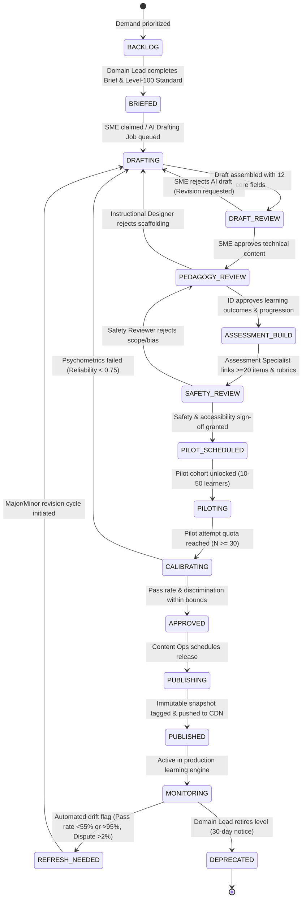
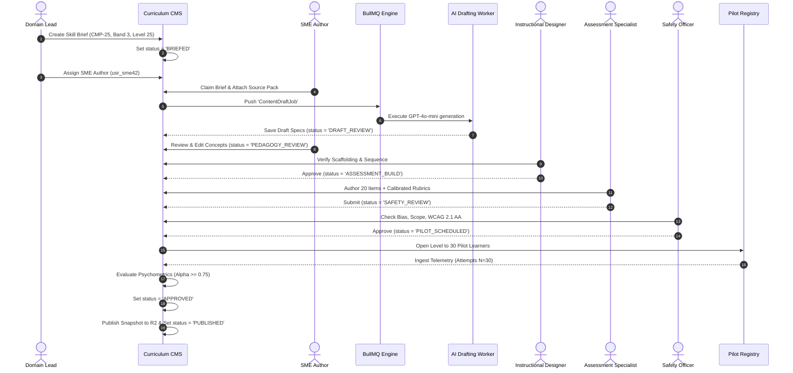
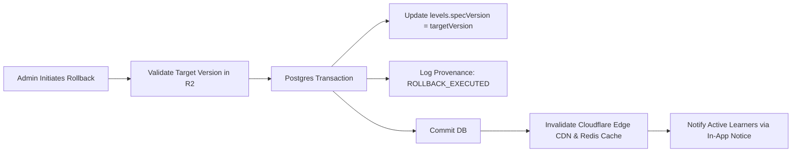
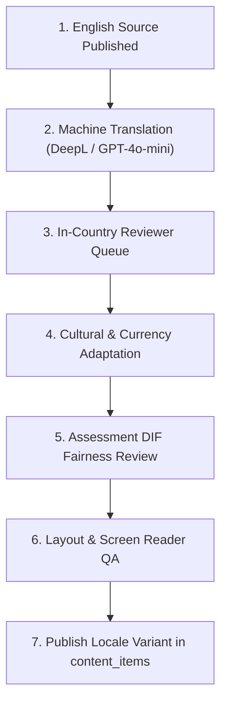

# Low-Level Design: Content Management System (CMS) & Curriculum Engine

- **Document Path:** `docs/15-lld/10-content-cms.md`
- **Version:** `1.0.0`
- **Last Updated:** `2026-11-21`
- **Status:** Approved for Implementation
- **Related Documents:**
  - [Content Pipeline](../02-skills/05-content-pipeline.md)
  - [Level Authoring Standard](../02-skills/03-level-authoring-standard.md)
  - [Assessment Authoring Standard](../02-skills/04-assessment-authoring-standard.md)
  - [AI Architecture](../10-data-ai/02-ai-architecture.md)
  - [Content Generation](../10-data-ai/03-content-generation.md)
  - [Evaluation & Experimentation](../10-data-ai/04-evaluation.md)

---

## Table of Contents
1. [Section 1: Content Workflow States & Lifecycle Machine](#section-1-content-workflow-states--lifecycle-machine)
2. [Section 2: Database Schema (Drizzle ORM)](#section-2-database-schema-drizzle-orm)
3. [Section 3: Authoring Workflow Sequence & Orchestration](#section-3-authoring-workflow-sequence--orchestration)
4. [Section 4: AI Drafting Job Design & Worker Execution](#section-4-ai-drafting-job-design--worker-execution)
5. [Section 5: Semantic Versioning, Immutability & Rollback Engine](#section-5-semantic-versioning-immutability--rollback-engine)
6. [Section 6: Localization & Cultural Adaptation Pipeline](#section-6-localization--cultural-adaptation-pipeline)
7. [Section 7: Automated Content Health & Refresh Monitoring](#section-7-automated-content-health--refresh-monitoring)

---

## Section 1: Content Workflow States & Lifecycle Machine

### 1.1 Purpose
The Curriculum CMS manages the lifecycle of 50,000 skill levels across 500 domain skills. Because level specifications directly determine learning outcomes and trigger real economic credit emissions ($EC$), no content can reach learners without strict pedagogical, psychometric, and safety gates. This section establishes the finite state machine governing every level specification.

### 1.2 State Machine Diagram


### 1.3 State Transition Matrix & Gate Conditions
| Current State | Target State | Permitted Actor | Guard Condition / Exit Gate |
|---|---|---|---|
| `BACKLOG` | `BRIEFED` | Domain Lead | Skill brief validated; level-100 world-class outcome and archetype defined |
| `BRIEFED` | `DRAFTING` | Content Ops / System | Author assigned; vetted source pack attached with >=3 authoritative citations |
| `DRAFTING` | `DRAFT_REVIEW` | System / AI Worker | All 12 required level fields populated; concept text >= 800 words |
| `DRAFT_REVIEW` | `PEDAGOGY_REVIEW`| SME Author | SME certifies factual accuracy, absence of hallucinations, real-world examples |
| `PEDAGOGY_REVIEW` | `ASSESSMENT_BUILD`| Instructional Designer | Cognitive load sequenced; guided-to-independent practice verified |
| `ASSESSMENT_BUILD`| `SAFETY_REVIEW` | Assessment Lead | Blueprint covers all band outcomes; >=20 items authored; rubric anchors calibrated |
| `SAFETY_REVIEW` | `PILOT_SCHEDULED` | Safety Officer | WCAG 2.1 AA accessibility signed off; no safety/legal overreach |
| `PILOT_SCHEDULED`| `PILOTING` | System Scheduler | Pilot learner cohort invited (10–50 users); telemetry tracking enabled |
| `PILOTING` | `CALIBRATING` | Ingestion Worker | Minimum pilot attempts achieved ($N \ge 30$ attempts) |
| `CALIBRATING` | `APPROVED` | Psychometrician | Cronbach's $\alpha \ge 0.75$; Item difficulty $p \in [0.40, 0.85]$; Point-biserial $r_{pb} \ge 0.25$ |
| `APPROVED` | `PUBLISHING` | Content Ops Lead | Final checklist verified; checksum generated; release window scheduled |
| `PUBLISHING` | `PUBLISHED` | Release Pipeline | Assets synced to Cloudflare R2; Postgres materialized caches invalidated |
| `PUBLISHED` | `MONITORING` | System | Live traffic receiving production learners |
| `MONITORING` | `REFRESH_NEEDED` | Health Cron Job | Trigger condition met: Pass rate $< 55\%$ or $> 95\%$, dispute $> 2\%$, age $> 18$ mo |
| `MONITORING` | `DEPRECATED` | Curriculum Council | Curriculum replaced; 30-day learner transition window executed |

### 1.4 Edge Cases & Failure Recovery
| ID | Scenario | Detection | Automated Handling | Recovery / Operational Action | Prevention |
|---|---|---|---|---|---|
| EC-CMS-001 | Reviewer assigned to level goes inactive (> 7 days) | Review timeout worker detects `assignedAt < now() - 7d` | Unassigns reviewer, emits notification to Domain Lead, re-queues to review pool | Domain Lead manually assigns secondary reviewer | Enforce 72-hour review SLAs with daily Slack/email reminders |
| EC-CMS-002 | Assessment pilot fails reliability threshold ($\alpha < 0.70$) | Pilot calibration worker evaluates items | Level state reverted to `DRAFTING`; bad discrimination items flagged | Assessment specialist replaces low-performing distractors | Require pre-pilot item peer review by two assessment authors |
| EC-CMS-003 | Author attempts unauthorized state skip via API | State transition validation middleware | Request rejected with HTTP 403 Forbidden; audit alert logged | Security team reviews user permissions | Strict RBAC state transition rules enforced at ORM schema layer |
| EC-CMS-004 | Emergency safety hazard identified in published level | Safety incident logged (SEV1) | Level immediately placed in `REFRESH_NEEDED`; gate exams blocked | Content ops freezes level awards; hotfix draft created within 2h | Automated safety filter runs against all submitted drafts |

### 1.5 Error Handling Architecture
- **Transition Atomicity:** All state changes execute within an isolated Postgres transaction. If review assignment or provenance logging fails, the state transition rolls back.
- **Rollback Triggers:** Any rejection during `DRAFT_REVIEW`, `PEDAGOGY_REVIEW`, or `SAFETY_REVIEW` forces state return to `DRAFTING` with an immutable feedback comment record.

### 1.6 Requirements
- `FR-CNT-001`: No level may transition to `PUBLISHED` without passing all preceding quality, pedagogy, safety, and pilot calibration gates.
- `FR-CNT-004`: Every AI-assisted level draft must be explicitly signed off by a human SME.
- `NFR-CNT-001`: State transition evaluation and permission validation must complete in < 50ms.

### 1.7 Success Metrics
- **Pipeline Velocity:** Median duration from `BRIEFED` to `PUBLISHED` $\le 28$ business days.
- **First-Pass Review Yield:** $\ge 70\%$ of SME drafts accepted without structural pedagogy revisions.
- **Defect Leakage:** $0.0\%$ safety or factual errors in published levels.

---

## Section 2: Database Schema (Drizzle ORM)

### 2.1 Schema Definition (`schema/curriculum.ts`)
The schema uses Drizzle ORM configured for Neon PostgreSQL. It enforces strict referential integrity, jsonb structures for polymorphic content blocks, and audit provenance logging.

```typescript
import { 
  pgTable, text, varchar, integer, timestamp, 
  boolean, jsonb, real, pgEnum, uuid, index, uniqueIndex 
} from 'drizzle-orm/pg-core';
import { relations } from 'drizzle-orm';

// Enums
export const skillArchetypeEnum = pgEnum('skill_archetype', [
  'COGNITIVE',
  'CREATIVE',
  'PHYSICAL',
  'TECHNICAL',
  'SOCIAL',
  'PROCEDURAL'
]);

export const workflowStatusEnum = pgEnum('workflow_status', [
  'BACKLOG',
  'BRIEFED',
  'DRAFTING',
  'DRAFT_REVIEW',
  'PEDAGOGY_REVIEW',
  'ASSESSMENT_BUILD',
  'SAFETY_REVIEW',
  'PILOT_SCHEDULED',
  'PILOTING',
  'CALIBRATING',
  'APPROVED',
  'PUBLISHING',
  'PUBLISHED',
  'MONITORING',
  'REFRESH_NEEDED',
  'DEPRECATED'
]);

export const contentTypeEnum = pgEnum('content_type', [
  'TEXT_LESSON',
  'VIDEO_INTERACTIVE',
  'QUIZ_EXERCISE',
  'ROLEPLAY_SCENARIO',
  'SIMULATOR_TASK'
]);

export const actorTypeEnum = pgEnum('actor_type', [
  'HUMAN',
  'AI',
  'SYSTEM'
]);

export const reviewTypeEnum = pgEnum('review_type', [
  'SME_TECHNICAL',
  'INSTRUCTIONAL_PEDAGOGY',
  'ASSESSMENT_PSYCHOMETRIC',
  'SAFETY_ACCESSIBILITY',
  'EDITORIAL'
]);

// 1. Skills Table
export const skills = pgTable('skills', {
  id: varchar('id', { length: 32 }).primaryKey(), // e.g. 'CMP-25'
  domain: varchar('domain', { length: 64 }).notNull(), // e.g. 'Computer Systems'
  name: varchar('name', { length: 128 }).notNull(),
  description: text('description').notNull(),
  domainMultiplier: real('domain_multiplier').notNull().default(1.0), // m_d
  archetype: skillArchetypeEnum('archetype').notNull(),
  createdAt: timestamp('created_at', { withTimezone: true }).defaultNow().notNull(),
  updatedAt: timestamp('updated_at', { withTimezone: true }).defaultNow().notNull(),
}, (table) => ({
  domainIdx: index('idx_skills_domain').on(table.domain),
}));

// 2. Levels Table
export const levels = pgTable('levels', {
  id: uuid('id').defaultRandom().primaryKey(),
  skillId: varchar('skill_id', { length: 32 }).notNull().references(() => skills.id),
  levelNumber: integer('level_number').notNull(), // 1 to 100
  specVersion: varchar('spec_version', { length: 16 }).notNull().default('1.0.0'),
  status: workflowStatusEnum('status').notNull().default('BACKLOG'),
  outcomeStatement: text('outcome_statement').notNull(),
  prerequisites: jsonb('prerequisites').$type<{ skillId: string; minLevel: number }[]>().notNull().default([]),
  coreConceptsJson: jsonb('core_concepts_json').$type<{ title: string; content: string; keyPoints: string[] }[]>().notNull(),
  practiceExercisesJson: jsonb('practice_exercises_json').$type<{ id: string; prompt: string; scaffoldType: string }[]>().notNull(),
  safetyNotes: text('safety_notes').notNull().default(''),
  localizationNotes: text('localization_notes').notNull().default(''),
  createdBy: varchar('created_by', { length: 64 }).notNull(), // user_id or 'ai_assistant'
  reviewedBy: varchar('reviewed_by', { length: 64 }),
  publishedAt: timestamp('published_at', { withTimezone: true }),
  createdAt: timestamp('created_at', { withTimezone: true }).defaultNow().notNull(),
  updatedAt: timestamp('updated_at', { withTimezone: true }).defaultNow().notNull(),
}, (table) => ({
  skillLevelIdx: uniqueIndex('idx_levels_skill_level_ver').on(table.skillId, table.levelNumber, table.specVersion),
  statusIdx: index('idx_levels_status').on(table.status),
}));

// 3. Content Items Table
export const contentItems = pgTable('content_items', {
  id: uuid('id').defaultRandom().primaryKey(),
  levelId: uuid('level_id').notNull().references(() => levels.id, { onDelete: 'cascade' }),
  type: contentTypeEnum('type').notNull(),
  locale: varchar('locale', { length: 10 }).notNull().default('en-US'),
  canonicalItemId: uuid('canonical_item_id'), // Self-reference for localization
  contentVersion: integer('content_version').notNull().default(1),
  body: jsonb('body').notNull(), // Polymorphic payload based on contentType
  provenance: jsonb('provenance').$type<{
    model?: string;
    promptHash?: string;
    authorId: string;
    timestamp: string;
    tokensUsed?: number;
  }>().notNull(),
  publishedAt: timestamp('published_at', { withTimezone: true }),
  createdAt: timestamp('created_at', { withTimezone: true }).defaultNow().notNull(),
}, (table) => ({
  levelLocaleIdx: index('idx_content_items_level_locale').on(table.levelId, table.locale),
  canonicalIdx: index('idx_content_items_canonical').on(table.canonicalItemId),
}));

// 4. Assessment Items Table
export const assessmentItems = pgTable('assessment_items', {
  id: uuid('id').defaultRandom().primaryKey(),
  levelId: uuid('level_id').notNull().references(() => levels.id, { onDelete: 'cascade' }),
  itemType: varchar('item_type', { length: 32 }).notNull(), // 'MCQ', 'CODE_RUN', 'SIM_TASK'
  difficulty: real('difficulty').notNull().default(0.50), // IRT parameter b (0.0 to 1.0)
  discrimination: real('discrimination').notNull().default(1.0), // IRT parameter a
  body: jsonb('body').notNull(), // Stem, options, stimuli
  correctAnswer: text('correct_answer_encrypted').notNull(), // AES-256-GCM encrypted
  rubricJson: jsonb('rubric_json').$type<{ criteria: string; points: number; anchors: Record<string, string> }[]>(),
  exposureCount: integer('exposure_count').notNull().default(0),
  lastCalibrationAt: timestamp('last_calibration_at', { withTimezone: true }),
  createdAt: timestamp('created_at', { withTimezone: true }).defaultNow().notNull(),
}, (table) => ({
  levelDifficultyIdx: index('idx_assessment_items_level_diff').on(table.levelId, table.difficulty),
}));

// 5. Review Assignments Table
export const reviewAssignments = pgTable('review_assignments', {
  id: uuid('id').defaultRandom().primaryKey(),
  contentId: uuid('content_id').notNull(), // Polymorphic ref: levelId or contentItemId
  reviewerUserId: varchar('reviewer_user_id', { length: 64 }).notNull(),
  reviewType: reviewTypeEnum('review_type').notNull(),
  status: varchar('status', { length: 24 }).notNull().default('PENDING'), // 'PENDING' | 'ACCEPTED' | 'REJECTED'
  notes: text('notes'),
  assignedAt: timestamp('assigned_at', { withTimezone: true }).defaultNow().notNull(),
  completedAt: timestamp('completed_at', { withTimezone: true }),
}, (table) => ({
  reviewerStatusIdx: index('idx_review_assignments_rev_stat').on(table.reviewerUserId, table.status),
}));

// 6. Provenance Log Table
export const provenanceLog = pgTable('provenance_log', {
  id: uuid('id').defaultRandom().primaryKey(),
  contentId: uuid('content_id').notNull(),
  action: varchar('action', { length: 64 }).notNull(), // 'DRAFT_GENERATED', 'SME_EDITED', 'SAFETY_APPROVED'
  actorType: actorTypeEnum('actor_type').notNull(),
  actorId: varchar('actor_id', { length: 64 }).notNull(),
  modelVersion: varchar('model_version', { length: 64 }),
  promptHash: varchar('prompt_hash', { length: 64 }),
  deltaDiff: jsonb('delta_diff'),
  createdAt: timestamp('created_at', { withTimezone: true }).defaultNow().notNull(),
}, (table) => ({
  contentActionIdx: index('idx_provenance_content_action').on(table.contentId, table.createdAt),
}));
```

---

## Section 3: Authoring Workflow Sequence & Orchestration

### 3.1 Sequence Flow


---

## Section 4: AI Drafting Job Design & Worker Execution

### 4.1 BullMQ Job Specification
```typescript
export interface ContentDraftJobData {
  levelId: string;
  sourcePackId: string;        // UUID of verified source pack
  targetOutcome: string;       // Precise behavioral outcome
  bandNumber: number;          // 1 to 10
  domainMultiplier: number;    // m_d
  locale: string;              // default 'en-US'
  correlationId: string;
}

export interface ContentDraftJobResult {
  levelId: string;
  conceptsGenerated: number;
  exercisesGenerated: number;
  promptTokens: number;
  completionTokens: number;
  estimatedCostUsd: number;
  promptHash: string;
}
```

### 4.2 Worker Implementation (`workers/content-draft.worker.ts`)
The worker integrates with OpenAI GPT-4o-mini using JSON Schema structured output mode. It enforces zero hallucination by injecting verified source pack text into the system prompt.

```typescript
import { Worker, Job } from 'bullmq';
import OpenAI from 'openai';
import { db } from '../db';
import { levels, provenanceLog } from '../schema/curriculum';
import { eq } from 'drizzle-orm';
import crypto from 'crypto';

const openai = new OpenAI({ apiKey: process.env.OPENAI_API_KEY });

export const contentDraftWorker = new Worker<ContentDraftJobData, ContentDraftJobResult>(
  'content-draft-queue',
  async (job: Job<ContentDraftJobData>) => {
    const { levelId, targetOutcome, bandNumber, sourcePackId, locale } = job.data;

    // 1. Fetch Source Pack Text
    const sourcePack = await fetchSourcePack(sourcePackId);
    if (!sourcePack || sourcePack.citations.length < 3) {
      throw new Error(`Source pack ${sourcePackId} invalid or missing required citations.`);
    }

    // 2. Formulate Prompt & Hash
    const systemPrompt = `You are a Senior Instructional Designer in the Education Economy.
Generate curriculum content strictly grounded in the provided SOURCE PACK.
Target Outcome: "${targetOutcome}".
Cognitive Band: ${bandNumber} of 10.
Locale: ${locale}.
Do NOT invent citations, figures, or ungrounded facts.`;

    const userPrompt = `SOURCE PACK TEXT:
${sourcePack.fullText}

Generate exactly 3 core concepts and 3 sequenced practice exercises conforming to the schema.`;

    const promptHash = crypto
      .createHash('sha256')
      .update(systemPrompt + userPrompt)
      .digest('hex');

    // 3. Invoke OpenAI GPT-4o-mini Structured Outputs
    const completion = await openai.chat.completions.create({
      model: 'gpt-4o-mini',
      response_format: { type: 'json_object' },
      messages: [
        { role: 'system', content: systemPrompt },
        { role: 'user', content: userPrompt }
      ],
      temperature: 0.2, // Low variance for high factual fidelity
      max_tokens: 3000,
    });

    const outputContent = JSON.parse(completion.choices[0].message.content || '{}');
    const usage = completion.usage;

    // Cost Model: Input $0.15/1M, Output $0.60/1M
    const promptTokens = usage?.prompt_tokens || 0;
    const completionTokens = usage?.completion_tokens || 0;
    const costUsd = (promptTokens * 0.15 + completionTokens * 0.60) / 1_000_000;

    // 4. Update Level in Transaction
    await db.transaction(async (tx) => {
      await tx.update(levels)
        .set({
          coreConceptsJson: outputContent.coreConcepts,
          practiceExercisesJson: outputContent.practiceExercises,
          status: 'DRAFT_REVIEW',
          updatedAt: new Date(),
        })
        .where(eq(levels.id, levelId));

      await tx.insert(provenanceLog).values({
        contentId: levelId,
        action: 'DRAFT_GENERATED',
        actorType: 'AI',
        actorId: 'openai-gpt-4o-mini',
        modelVersion: completion.model,
        promptHash,
        deltaDiff: { costUsd, promptTokens, completionTokens },
      });
    });

    return {
      levelId,
      conceptsGenerated: outputContent.coreConcepts.length,
      exercisesGenerated: outputContent.practiceExercises.length,
      promptTokens,
      completionTokens,
      estimatedCostUsd: costUsd,
      promptHash,
    };
  },
  {
    connection: { host: process.env.REDIS_HOST, port: Number(process.env.REDIS_PORT) },
    concurrency: 4,
    limiter: { max: 50, duration: 60000 }, // Stay well within OpenAI rate limits
  }
);

async function fetchSourcePack(id: string): Promise<{ fullText: string; citations: string[] }> {
  // Database retrieval of verified source material
  return {
    fullText: 'Standard operating principles and empirical benchmarks...',
    citations: ['IEEE 1012-2016', 'ACM Computing Curricula 2020', 'NIST SP 800-53'],
  };
}
```

---

## Section 5: Semantic Versioning, Immutability & Rollback Engine

### 5.1 Semantic Versioning Rules for Curriculum
All level specifications adhere to SemVer (`MAJOR.MINOR.PATCH`):
- **PATCH (`x.y.Z`):** Typographical corrections, markdown formatting fixes, broken hyperlink repairs. Does **not** alter learning objectives or assessment difficulty. Requires no pilot re-calibration.
- **MINOR (`x.Y.0`):** New illustrative examples, clarification of ambiguous concept text, addition of alternate assessment items to bank. Does **not** change prerequisites or core outcome statement. Requires small automated spot-check ($N=10$).
- **MAJOR (`X.0.0`):** Change to `outcomeStatement`, addition/removal of `prerequisites`, or restructuring of gate exam rubrics. Requires a mandatory **30-day learner notice**, deprecation grace period, and a **complete re-pilot calibration ($N \ge 30$)**.

### 5.2 Snapshot Storage & One-Click Rollback
Published levels are immutable. Every publication exports a signed JSON artifact to Cloudflare R2: `r2://ee-curriculum-artifacts/skills/{skillId}/levels/{levelNumber}@{specVersion}.json`.



```typescript
export async function rollbackLevelVersion(
  levelId: string, 
  targetVersion: string, 
  operatorUserId: string
): Promise<void> {
  await db.transaction(async (tx) => {
    const existing = await tx.select().from(levels).where(eq(levels.id, levelId)).limit(1);
    if (!existing.length) throw new Error('Level not found');

    const previousSpec = existing[0];

    // Record provenance audit
    await tx.insert(provenanceLog).values({
      contentId: levelId,
      action: 'ROLLBACK_EXECUTED',
      actorType: 'HUMAN',
      actorId: operatorUserId,
      deltaDiff: {
        fromVersion: previousSpec.specVersion,
        toVersion: targetVersion,
        timestamp: new Date().toISOString(),
      },
    });

    // Reset current version
    await tx.update(levels)
      .set({
        specVersion: targetVersion,
        status: 'PUBLISHED',
        updatedAt: new Date(),
      })
      .where(eq(levels.id, levelId));
  });

  // Purge CDN edge caches
  await invalidateCdnCache(`https://cdn.education-economy.org/levels/${levelId}`);
}
```

---

## Section 6: Localization & Cultural Adaptation Pipeline

### 6.1 The 7-Step Localization Flow


### 6.2 Implementation Details
1. **Source Lock:** Localization jobs are only triggered when source content reaches `PUBLISHED` status.
2. **Translation Engine:** OpenAI GPT-4o-mini is combined with DeepL (using the 500,000 char/month free API tier) with custom domain glossaries to ensure technical vocabulary consistency.
3. **Cultural Adaptation:** Currencies, units of measurement (metric vs imperial), and contextual examples (e.g. local grocery items in economy examples) are adapted by native regional reviewers.
4. **Differential Item Functioning (DIF):** Assessment questions translated into the target locale undergo Mantel-Haenszel DIF checks during pilot testing to verify that item difficulty does not diverge by $> 0.15$ logits compared to the canonical version.

---

## Section 7: Automated Content Health & Refresh Monitoring

### 7.1 Automated Refresh Triggers (Weekly Health Monitor)
A scheduled BullMQ cron job runs every Sunday at midnight to evaluate all `PUBLISHED` levels against production performance metrics in the Neon analytical warehouse.

```typescript
export async function evaluateCurriculumHealth(warehouseDb: any, cmsDb: any): Promise<void> {
  const healthQuery = `
    SELECT 
      payload->>'skill_id' AS skill_id,
      (payload->>'level_number')::int AS level_number,
      COUNT(*) AS total_attempts,
      AVG(CASE WHEN event_type = 'assessment.gate_passed' THEN 1.0 ELSE 0.0 END) AS pass_rate,
      AVG(CASE WHEN event_type = 'marketplace.dispute_opened' THEN 1.0 ELSE 0.0 END) AS dispute_rate,
      MAX(occurred_at) AS last_attempt_at
    FROM warehouse.events
    WHERE event_type IN ('assessment.gate_passed', 'assessment.gate_failed', 'marketplace.dispute_opened')
      AND occurred_at > NOW() - INTERVAL '30 days'
    GROUP BY 1, 2
    HAVING COUNT(*) >= 20;
  `;

  const { rows } = await warehouseDb.query(healthQuery);

  for (const row of rows) {
    const isAnomalousPassRate = row.pass_rate < 0.55 || row.pass_rate > 0.95;
    const isHighDispute = row.dispute_rate > 0.02;

    if (isAnomalousPassRate || isHighDispute) {
      // Transition Level in CMS to REFRESH_NEEDED
      await cmsDb
        .update(levels)
        .set({
          status: 'REFRESH_NEEDED',
          updatedAt: new Date(),
        })
        .where(
          and(
            eq(levels.skillId, row.skill_id),
            eq(levels.levelNumber, row.level_number)
          )
        );

      // Log alert
      await cmsDb.insert(provenanceLog).values({
        contentId: `${row.skill_id}-L${row.level_number}`,
        action: 'AUTOMATED_REFRESH_FLAGGED',
        actorType: 'SYSTEM',
        actorId: 'health-monitor-cron',
        deltaDiff: {
          passRate: row.pass_rate,
          disputeRate: row.dispute_rate,
          attempts: row.total_attempts,
        },
      });
    }
  }
}
```

### 7.2 Requirements
- `FR-CNT-001`: Levels failing psychometric bounds must transition to `REFRESH_NEEDED` automatically.
- `FR-CNT-006`: Levels older than 18 months in fast-moving fields must be flagged for review.
- `NFR-CNT-002`: The weekly health evaluation job must process 50,000 level summaries in < 15 minutes.

### 7.3 Success Metrics
- **Curriculum Calibration Rate:** $\ge 90\%$ of live levels maintain pass rates within the target $55\% \le p \le 95\%$ window.
- **Refresh Turnaround:** Levels flagged with `REFRESH_NEEDED` are remediated within 21 days.
