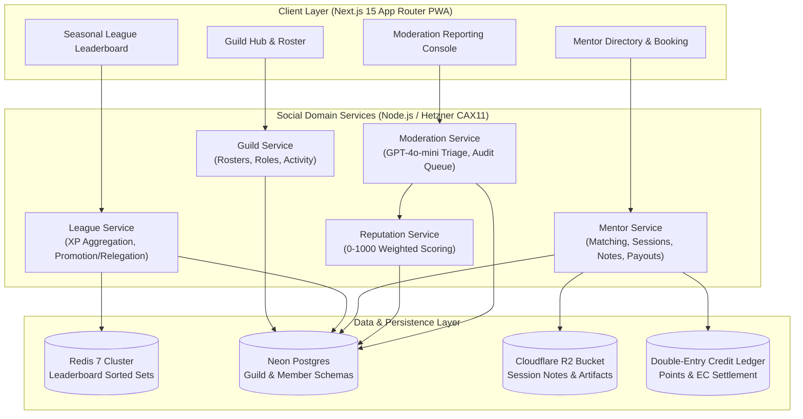
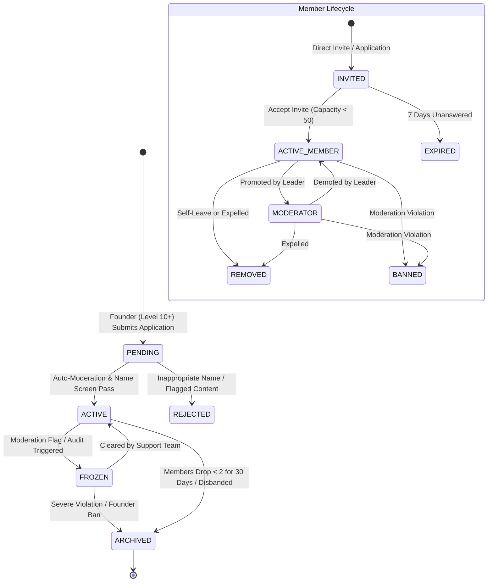
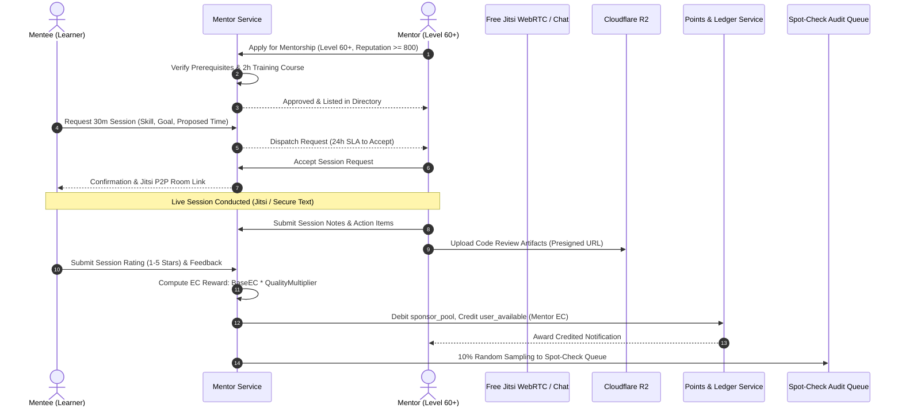
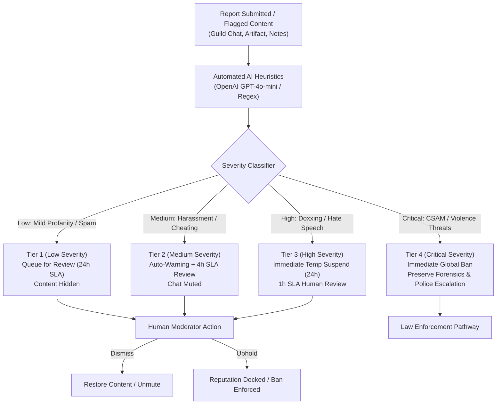

# Social, Guilds & Mentorship System — Low-Level Design (LLD)

**Title:** Social Architecture, Guild Lifecycle, Real-Time Leagues, and Mentorship Protocol  
**Section Path:** `docs/15-lld/11-social-guilds.md`  
**Version:** 1.0.0  
**Last Updated:** 2026-11-21  
**Status:** Approved for Implementation  
**Related Documents:**
- `docs/01-economy/02-points-ledger.md` (Double-entry credit ledger and mentor payouts)
- `docs/01-economy/03-scoring-model.md` (Mastery XP formulas and power-law scaling)
- `docs/07-experience/03-social-guilds.md` (Social UX, study cohorts, and community norms)
- `docs/09-trust-safety/01-integrity.md` (Reputation scores, anti-gaming, and moderation)

---

## Table of Contents
1. [Free-Tier Infrastructure Constraints & Topology](#free-tier-infrastructure-constraints--topology)
2. [Section 1: Social Architecture](#section-1-social-architecture)
   - 1.1 Purpose
   - 1.2 Component Topology Diagram
   - 1.3 Service Responsibilities & Domain Contracts
   - 1.4 Edge Cases & Failure Modes
   - 1.5 Error Handling Strategy
   - 1.6 Requirements
   - 1.7 Success Metrics
3. [Section 2: Guild State Machine & Schema](#section-2-guild-state-machine--schema)
   - 2.1 Purpose
   - 2.2 Guild & Member State Machines
   - 2.3 Full Drizzle ORM Database Schema
   - 2.4 Membership Lifecycle & Quota Validations
   - 2.5 Edge Cases
   - 2.6 Error Handling & Invariants
   - 2.7 Requirements
   - 2.8 Success Metrics
4. [Section 3: League & Real-Time Leaderboard Design](#section-3-league--real-time-leaderboard-design)
   - 3.1 Purpose
   - 3.2 Seasonal Tier Mechanics (12-Week Cadence)
   - 3.3 Redis Sorted Set Architecture & Key Space
   - 3.4 Promotion / Relegation Batch Execution Algorithm
   - 3.5 Privacy-Preserving Pseudonymity & Anti-Gaming Controls
   - 3.6 Edge Cases
   - 3.7 Error Handling
   - 3.8 Requirements
   - 3.9 Success Metrics
5. [Section 4: Mentor Protocol & Peer Review Flow](#section-4-mentor-protocol--peer-review-flow)
   - 4.1 Purpose
   - 4.2 End-to-End Mentorship Lifecycle
   - 4.3 Mentor Compensation & Quality Multiplier Algorithm
   - 4.4 Free-Tier Video Integration (Jitsi Meet & Text Channels)
   - 4.5 Spot-Check & Audit Pipeline
   - 4.6 Edge Cases
   - 4.7 Error Handling
   - 4.8 Requirements
   - 4.9 Success Metrics
6. [Section 5: Multi-Tier Moderation System](#section-5-multi-tier-moderation-system)
   - 5.1 Purpose
   - 5.2 Content Moderation Pipeline Flow
   - 5.3 Automated Severity Triage Rules
   - 5.4 Escalation Pathways & Law Enforcement Protocol
   - 5.5 Edge Cases
   - 5.6 Error Handling
   - 5.7 Requirements
   - 5.8 Success Metrics
7. [Section 6: Reputation Score Engine](#section-6-reputation-score-engine)
   - 6.1 Purpose
   - 6.2 Mathematical Formula & Component Weighting
   - 6.3 TypeScript Reputation Calculation Service
   - 6.4 System-Wide Privileges & Downstream Gating
   - 6.5 Edge Cases
   - 6.6 Error Handling
   - 6.7 Requirements
   - 6.8 Success Metrics
8. [Section 7: Exhaustive Edge Cases & Failure Resiliency Matrix](#section-7-exhaustive-edge-cases--failure-resiliency-matrix)

---

## Free-Tier Infrastructure Constraints & Topology

The Social, Guilds, and Mentorship subsystem operates strictly within the platform's $100/mo infrastructure envelope across Phase 0 and Phase 1 (1,000 active learners). Resource allocation is mapped to zero-cost open-source and free tiers:

| Service / Resource | Infrastructure Allocation | Architectural Optimization & Constraint |
|---|---|---|
| **Leaderboard Storage** | Redis 7 on Hetzner CAX11 (256 MB memory cap) | Real-time ranks stored in compact Redis Sorted Sets (`ZADD`). Key memory footprint: ~150 bytes per user entry. Total 10,000 active league entries consumes $< 2\text{ MB}$. |
| **Relational Data Store** | Neon Postgres Serverless (0.5 GB Free Tier) | Guild rosters, mentor profiles, activity logs, and moderation flags. Inactive guild chat messages $>60$ days old are archived to Cloudflare R2 cold storage. |
| **Synchronous Video / Voice** | Jitsi Meet (Self-hosted or Public Free Instance) | Mentorship video office hours run peer-to-peer (P2P) via Jitsi WebRTC room tokens. Zero video media relay server bandwidth or egress cost. Text sessions hosted via WebSocket. |
| **Artifact & Notes Storage** | Cloudflare R2 (10 GB Free Tier, zero egress) | Mentor review recordings, unboxing proof, session code snapshots, and guild avatar graphics. Images converted to WebP format $\le 500\text{ KB}$. |
| **Moderation Classification** | OpenAI GPT-4o-mini | Async content screening ($0.15/1M input tokens). Applied selectively to flagged content and spot-checks. Strict 800-token ceiling per moderation check. |

---

## Section 1: Social Architecture

### 1.1 Purpose
The Social Architecture provides community structure, peer accountability, and senior guidance without introducing toxic social mechanics or pay-to-win dynamics. **Foundational Rule:** Social participation is strictly optional and never gates individual skill advancement or baseline EC earning.

### 1.2 Component Topology Diagram



### 1.3 Service Responsibilities & Domain Contracts
1. **Guild Service**: Governs small-group formation (5–50 members), role transitions (Leader, Moderator, Member), and cooperative study challenges.
2. **League Service**: Tracks verified XP gains, maintains real-time 12-week seasonal leaderboards via Redis, and executes end-of-season tier promotions and relegations.
3. **Mentor Service**: Handles mentor qualification vetting (Level 60+), booking workflows, session note submissions, mentee ratings, and EC reward disbursement.
4. **Reputation Service**: Continuously aggregates multi-dimensional integrity signals into an immutable 0–1,000 reputation score.
5. **Moderation Service**: Evaluates reported behavior, executes automated content safety scans via GPT-4o-mini heuristics, and enforces account suspensions.

### 1.4 Edge Cases & Failure Modes
- **Redis Node Failover**: If Redis drops during a live session, the League Service falls back to querying the Neon Postgres mastery ledger to rebuild the sorted set on restart.
- **Concurrent Guild Invites**: Two moderators invite members simultaneously when guild has 49 members. Neon Postgres serializable transactions prevent rosters from exceeding the hard 50-member limit.

### 1.5 Error Handling Strategy
- All social mutations are isolated from core learning paths. A catastrophic failure of the Guild or League service will never prevent a student from completing an assessment gate.

### 1.6 Requirements
- `FR-SOC-101`: Social and guild features must remain 100% opt-in; no learning curriculum or EC earning is conditional on social participation.
- `FR-SOC-102`: Leaderboards must only count verified mastery XP from approved assessment gates; synthetic XP injection is prohibited.
- `NFR-SOC-101`: Leaderboard rank queries must return in P95 $< 50\text{ ms}$ via Redis sorted sets.

### 1.7 Success Metrics
- Social service uptime: $\ge 99.9\%$.
- Involuntary guild limit breaches (> 50 members): 0.

---

## Section 2: Guild State Machine & Schema

### 2.1 Purpose
Guilds are structured micro-communities (5 to 50 members) designed to foster peer support, study cohorts, and collective accountability. This section defines guild states, membership lifecycles, and relational constraints.

### 2.2 Guild & Member State Machines



### 2.3 Full Drizzle ORM Database Schema

```typescript
import {
  pgTable,
  uuid,
  varchar,
  text,
  integer,
  boolean,
  timestamp,
  pgEnum,
  index,
  uniqueIndex,
} from 'drizzle-orm/pg-core';
import { relations } from 'drizzle-orm';

// Enums
export const guildStatusEnum = pgEnum('guild_status', [
  'PENDING',
  'ACTIVE',
  'FROZEN',
  'ARCHIVED',
]);

export const guildMemberRoleEnum = pgEnum('guild_member_role', [
  'FOUNDER',
  'LEADER',
  'MODERATOR',
  'MEMBER',
]);

export const guildMemberStatusEnum = pgEnum('guild_member_status', [
  'INVITED',
  'ACTIVE',
  'REMOVED',
  'BANNED',
]);

// 1. Guilds Table
export const guilds = pgTable(
  'guilds',
  {
    guildId: uuid('guild_id').defaultRandom().primaryKey(),
    name: varchar('name', { length: 64 }).notNull(),
    slug: varchar('slug', { length: 64 }).notNull(),
    description: text('description').notNull(),
    founderId: uuid('founder_id').notNull(),
    domainFocus: varchar('domain_focus', { length: 64 }).notNull(), // e.g. 'COMPUTER_SCIENCE', 'HEALTHCARE'
    status: guildStatusEnum('status').default('PENDING').notNull(),
    memberCount: integer('member_count').default(1).notNull(),
    maxMembers: integer('max_members').default(50).notNull(),
    isPublic: boolean('is_public').default(true).notNull(),
    avatarUrl: text('avatar_url'),
    bannerUrl: text('banner_url'),
    weeklyXpGoal: integer('weekly_xp_goal').default(10000).notNull(),
    currentWeeklyXp: integer('current_weekly_xp').default(0).notNull(),
    createdAt: timestamp('created_at', { withTimezone: true }).defaultNow().notNull(),
    updatedAt: timestamp('updated_at', { withTimezone: true }).defaultNow().notNull(),
  },
  (table) => ({
    slugUnique: uniqueIndex('guild_slug_unique_idx').on(table.slug),
    nameUnique: uniqueIndex('guild_name_unique_idx').on(table.name),
    statusIdx: index('guild_status_idx').on(table.status),
    domainIdx: index('guild_domain_idx').on(table.domainFocus),
  })
);

// 2. Guild Members Table
export const guildMembers = pgTable(
  'guild_members',
  {
    membershipId: uuid('membership_id').defaultRandom().primaryKey(),
    guildId: uuid('guild_id').notNull().references(() => guilds.guildId),
    userId: uuid('user_id').notNull(),
    role: guildMemberRoleEnum('role').default('MEMBER').notNull(),
    status: guildMemberStatusEnum('status').default('ACTIVE').notNull(),
    xpContributedLifetime: integer('xp_contributed_lifetime').default(0).notNull(),
    invitedByUserId: uuid('invited_by_user_id'),
    joinedAt: timestamp('joined_at', { withTimezone: true }).defaultNow().notNull(),
    updatedAt: timestamp('updated_at', { withTimezone: true }).defaultNow().notNull(),
  },
  (table) => ({
    guildUserUnique: uniqueIndex('guild_member_unique_idx').on(table.guildId, table.userId),
    userGuildIdx: index('guild_member_user_idx').on(table.userId),
    roleIdx: index('guild_member_role_idx').on(table.role),
  })
);

// 3. Guild Activity Table (Audited actions & milestone achievements)
export const guildActivity = pgTable(
  'guild_activity',
  {
    activityId: uuid('activity_id').defaultRandom().primaryKey(),
    guildId: uuid('guild_id').notNull().references(() => guilds.guildId),
    actorId: uuid('actor_id').notNull(),
    activityType: varchar('activity_type', { length: 64 }).notNull(), // 'MEMBER_JOINED', 'LEVEL_CLEARED', 'STUDY_SESSION', 'ROLE_CHANGED'
    description: text('description').notNull(),
    xpGained: integer('xp_gained').default(0).notNull(),
    metadata: text('metadata'), // JSON serialized context
    createdAt: timestamp('created_at', { withTimezone: true }).defaultNow().notNull(),
  },
  (table) => ({
    guildActivityIdx: index('guild_activity_guild_idx').on(table.guildId),
    createdAtIdx: index('guild_activity_created_idx').on(table.createdAt),
  })
);
```

### 2.4 Membership Lifecycle & Quota Validations
- **Founder Eligibility**: Only learners with **Level 10+** in at least one skill domain and a Reputation Score $\ge 700$ can establish a new guild.
- **Capacity Cap**: Hard ceiling of **50 active members**. Inviting or accepting when `memberCount >= 50` is blocked by database constraints.
- **Minor Safety Safeguard**: Minors under 16 years of age can only join guilds tagged with `minor_safe_mode: true` (moderated chat, no private DMs, profanity masking active).

### 2.5 Edge Cases
- **Guild Reaches 50 Members While Invites Pending**: An open invite expires if the 50th member accepts before them. The invited learner receives: *"Guild has reached maximum capacity (50 members). You have been placed on the cohort waitlist."*
- **Founder Deletes Account or Banned**: Automated protocol executes:
  1. Leadership passes to the most senior Moderator by tenure.
  2. If no Moderator exists, leadership passes to the Member with highest lifetime contributed XP.
  3. If all members abandon guild, status transitions to `ARCHIVED`.

### 2.6 Error Handling & Invariants
- `guilds.member_count` is updated exclusively via atomic increment/decrement triggers tied to `guild_members` mutations, guaranteeing strict synchronization.

### 2.7 Requirements
- `FR-SOC-201`: Guild creation must require minimum Level 10 mastery and clean reputation standing.
- `FR-SOC-202`: Guild capacity must be strictly capped at 50 members to protect intimate peer dynamics.

### 2.8 Success Metrics
- Guild roster state synchronization consistency: 100%.
- Average guild member retention over 12-week season: $\ge 70\%$.

---

## Section 3: League & Real-Time Leaderboard Design

### 3.1 Purpose
Leagues provide seasonal, mastery-driven motivation across 12-week cycles. Unlike traditional toxic gaming leaderboards that reward mindless screen time, Education Economy leagues reward **verified mastery XP** earned through rigorous gate evaluations.

### 3.2 Seasonal Tier Mechanics (12-Week Cadence)

Every 12 weeks, the seasonal leaderboard snapshots ranks, issues tier badges, and resets seasonal league points. Mastery levels and lifetime XP **never reset**.

$$\text{Tier Breakdown (By Percentile of Active Season Learners)}$$

```
┌────────────────────────────────────────────────────────┐
│ Diamond League   (Top 1% Percentile)                   │
├────────────────────────────────────────────────────────┤
│ Platinum League  (Top 5% — 95th to 99th Percentile)    │
├────────────────────────────────────────────────────────┤
│ Gold League      (Top 20% — 80th to 95th Percentile)   │
├────────────────────────────────────────────────────────┤
│ Silver League    (Top 50% — 50th to 80th Percentile)   │
├────────────────────────────────────────────────────────┤
│ Bronze League    (Base Tier — 1st to 50th Percentile)  │
└────────────────────────────────────────────────────────┘
```

- **Promotion / Relegation Rules**:
  - **Top 20%** of any non-Diamond tier are **promoted** to the next higher tier at season end.
  - **Bottom 20%** of any non-Bronze tier are **relegated** to the next lower tier at season end.
  - Intermediate 60% maintain their tier status.

### 3.3 Redis Sorted Set Architecture & Key Space

Leaderboards leverage Redis 7 Sorted Sets (`ZSET`), allowing $O(\log(N))$ score updates and $O(\log(N) + M)$ range extractions:

```
// Key Schema
leaderboard:{season}:{skillId}:{band}  -> ZSET (Member: userId, Score: seasonXp)
league:{season}:{userId}               -> STRING (Current League Tier e.g. "GOLD")
user:optin:leaderboard:{userId}        -> BOOLEAN ("1" = visible, "0" = anonymous/hidden)
```

Where:
- `{season}`: Format `2026-S1`
- `{skillId}`: e.g. `CMP-025` or `GLOBAL`
- `{band}`: Level Bands `1-25`, `26-50`, `51-75`, `76-100+`

### 3.4 Promotion / Relegation Batch Execution Algorithm

```typescript
import { redisConnection } from '@/server/redis';
import { db } from '@/server/db';
import { sql } from 'drizzle-orm';

export type LeagueTier = 'BRONZE' | 'SILVER' | 'GOLD' | 'PLATINUM' | 'DIAMOND';

export const TIER_ORDER: LeagueTier[] = ['BRONZE', 'SILVER', 'GOLD', 'PLATINUM', 'DIAMOND'];

export async function processSeasonPromotionRelegation(season: string): Promise<void> {
  const tiers: LeagueTier[] = ['BRONZE', 'SILVER', 'GOLD', 'PLATINUM', 'DIAMOND'];

  for (const tier of tiers) {
    const tierKey = `leaderboard:${season}:GLOBAL:${tier}`;
    const totalMembers = await redisConnection.zcard(tierKey);

    if (totalMembers === 0) continue;

    const promoCutoff = Math.floor(totalMembers * 0.20);
    const relegateCutoff = Math.floor(totalMembers * 0.80);

    // 1. Fetch Top 20% for Promotion (High to Low)
    if (tier !== 'DIAMOND' && promoCutoff > 0) {
      const promotedUsers = await redisConnection.zrevrange(tierKey, 0, promoCutoff - 1);
      const nextTierIndex = Math.min(TIER_ORDER.indexOf(tier) + 1, TIER_ORDER.length - 1);
      const nextTier = TIER_ORDER[nextTierIndex];

      for (const userId of promotedUsers) {
        await redisConnection.set(`league:${season}:next:${userId}`, nextTier);
      }
    }

    // 2. Fetch Bottom 20% for Relegation (Low to High)
    if (tier !== 'BRONZE' && relegateCutoff < totalMembers) {
      const relegatedUsers = await redisConnection.zrange(tierKey, relegateCutoff, -1);
      const prevTierIndex = Math.max(TIER_ORDER.indexOf(tier) - 1, 0);
      const prevTier = TIER_ORDER[prevTierIndex];

      for (const userId of relegatedUsers) {
        await redisConnection.set(`league:${season}:next:${userId}`, prevTier);
      }
    }
  }
}
```

### 3.5 Privacy-Preserving Pseudonymity & Anti-Gaming Controls
1. **Opt-In Visibility**: Learner participation on public leaderboards is strictly opt-in.
2. **Anonymous Default**: When enabled, the default display name is an anonymized animal moniker (e.g., `Anonymous Pangolin #412`), concealing real names and profile handles unless the student explicitly toggles "Display Real Handle".
3. **Anti-Gaming Mastery Gate**: XP can only be earned via verified gate completions governed by the mathematical scaling formula:
   $$XP(L) = 100 \times L^{1.5} \times m_d$$
   Repetitive drill quizzes or UI clicks grant zero league score.

### 3.6 Edge Cases
- **Tie Scores at Promotion Threshold**: If 5 learners share identical XP at the 20% cutoff boundary, all tied learners are promoted to the next tier (favoring student progress).
- **Gate Cleared Exactly at Season Midnight**: Assessment gate submitted at 23:59:58 UTC and verified at 00:00:05 UTC. The XP award is credited to the new season, based on transaction timestamp.

### 3.7 Error Handling
- Redis write failures during score submission are queued in BullMQ (`leaderboard-sync-queue`) and retried with backoff, ensuring no verified XP is dropped.

### 3.8 Requirements
- `FR-SOC-301`: Leaderboards must calculate solely from verified assessment gate XP awards.
- `FR-SOC-302`: All leaderboard displays must support full pseudonymity by default.

### 3.9 Success Metrics
- Leaderboard ranking calculation latency: P99 $< 20\text{ ms}$.
- Seasonal tier recalculation execution time: $< 60\text{ seconds}$ for 10,000 learners on CAX11.

---

## Section 4: Mentor Protocol & Peer Review Flow

### 4.1 Purpose
Mentorship empowers senior learners (Level 60+) to guide apprentices, review practical portfolio artifacts, and provide 1-on-1 office hours, creating a self-sustaining educational economy where teaching earns real-world credits.

### 4.2 End-to-End Mentorship Lifecycle



### 4.3 Mentor Compensation & Quality Multiplier Algorithm

Mentors receive EC from the community education funding pool upon verified session completion and mentee feedback:

$$\text{Mentor Award (EC)} = \text{BaseEC} \times m_{\text{quality}} \times m_{\text{level}}$$

Where:
- $\text{BaseEC} = 250\text{ EC}$ (for a standard 30-minute verified session)
- $m_{\text{quality}}$: Rating multiplier based on mentee review:
  $$m_{\text{quality}} = \begin{cases} 
    1.25 & \text{if 5 Stars} \\
    1.00 & \text{if 4 Stars} \\
    0.75 & \text{if 3 Stars} \\
    0.00 & \text{if 1–2 Stars (Triggers mandatory review)}
  \end{cases}$$
- $m_{\text{level}}$: Domain seniority bonus ($1.0$ at L60, scaling to $1.5$ at L100+):
  $$m_{\text{level}} = 1.0 + \left(\frac{L - 60}{80}\right)$$

```typescript
export interface MentorPayoutCalculation {
  mentorId: string;
  sessionId: string;
  mentorSkillLevel: number; // e.g. 75
  menteeStarRating: number; // 1 to 5
}

export function computeMentorEcPayout(input: MentorPayoutCalculation): {
  payoutEc: number;
  qualityMultiplier: number;
  levelMultiplier: number;
  requiresReview: boolean;
} {
  const baseEc = 250;

  // 1. Quality Multiplier
  let qualityMultiplier = 1.0;
  let requiresReview = false;

  switch (input.menteeStarRating) {
    case 5: qualityMultiplier = 1.25; break;
    case 4: qualityMultiplier = 1.00; break;
    case 3: qualityMultiplier = 0.75; break;
    case 2:
    case 1:
      qualityMultiplier = 0.0;
      requiresReview = true;
      break;
    default:
      qualityMultiplier = 1.0;
  }

  // 2. Level Seniority Multiplier
  const levelBonus = Math.max(0, (input.mentorSkillLevel - 60) / 80);
  const levelMultiplier = parseFloat((1.0 + levelBonus).toFixed(2));

  // 3. Final Payout
  const payoutEc = Math.round(baseEc * qualityMultiplier * levelMultiplier);

  return {
    payoutEc,
    qualityMultiplier,
    levelMultiplier,
    requiresReview,
  };
}
```

### 4.4 Free-Tier Video Integration (Jitsi Meet & Text Channels)
- To eliminate expensive Twilio or Agora WebRTC charges, video office hours generate short-lived, encrypted **Jitsi Meet rooms** hosted on the public Jitsi service (`meet.jit.si`) using HMAC-signed JWT tokens.
- For learners with low bandwidth or mobile data constraints, a lightweight real-time text-and-code workspace is provided natively in the Next.js PWA.

### 4.5 Spot-Check & Audit Pipeline
- Exactly **10% of all concluded sessions** are randomly enqueued into `mentor-audit-queue` via BullMQ.
- Senior staff evaluate session notes and mentee ratings to safeguard against rating trading, fraud, or inappropriate conduct.

### 4.6 Edge Cases
- **Mentee No-Show**: Mentor waits in room for 15 minutes and clicks "Log Mentee No-Show". System verifies room heartbeat. Mentor receives 50% base EC (125 EC) to compensate for scheduled time. Mentee is docked 50 reputation points.
- **Mentor No-Show**: Mentor fails to enter room within 10 minutes of scheduled start. Session auto-cancels. Mentee is unblocked to book another mentor immediately. Mentor is penalized 100 reputation points; 3 occurrences revoke mentor badge.

### 4.7 Error Handling
- If ledger payout fails during session closure, the session is marked `PENDING_SETTLEMENT` and retried automatically by the background worker.

### 4.8 Requirements
- `FR-SOC-401`: Mentors must possess minimum verified Level 60 mastery and maintain a Reputation Score $\ge 800$.
- `FR-SOC-402`: A minimum 10% sampling of all completed mentorship sessions must undergo quality audits.

### 4.9 Success Metrics
- Mentee satisfaction rating (CSAT): $\ge 4.6 / 5.0$.
- Mentor SLA adherence (request accept/decline within 24h): $\ge 95\%$.

---

## Section 5: Multi-Tier Moderation System

### 5.1 Purpose
The platform protects students, minors, and mentors from harassment, hate speech, gate answer collusion, and predatory behavior through automated heuristic classification and strict human escalation tiers.

### 5.2 Content Moderation Pipeline Flow



### 5.3 Automated Severity Triage Rules

| Severity Tier | Trigger Examples | Automated Immediate Action | Human SLA | Penalty Upon Confirmation |
|---|---|---|---|---|
| **Tier 1: Low** | Repeated spam links, minor profanity, off-topic guild chatter | Message hidden; user warned in-app | 24 Hours | 25 Reputation points deduction |
| **Tier 2: Medium** | Target harassment, sharing gate assessment answers, commercial ads | 24h chat mute in guild; content removed | 4 Hours | 150 Reputation points; 7-day social ban |
| **Tier 3: High** | Hate speech, doxxing, intentional fraud collusion, impersonation | Immediate temporary account suspension | 1 Hour | 500 Reputation points; 30-day platform ban |
| **Tier 4: Critical**| Child Sexual Abuse Material (CSAM), terror threats, violence incitement | Immediate permanent ban; forensic lock | Immediate | Account terminated; evidence packaged for NCMEC / Law Enforcement |

### 5.4 Escalation Pathways & Law Enforcement Protocol
In accordance with international child safety laws:
1. Any Tier 4 hit locks database rows, hashing all associated IP logs, uploaded media, and device fingerprints.
2. System dispatches high-priority alert to the designated Platform Safety Officer.
3. Official report generated and transmitted to the National Center for Missing & Exploited Children (NCMEC) or relevant regional jurisdictional authorities.

### 5.5 Edge Cases
- **False Positive Spam Trigger on Code Snippets**: A student posting valid C++ code containing pointer arithmetic (`*ptr`) triggers regex profanity heuristics. Student clicks "Appeal Flag". Content reviewed by Tier 1 support within 24h; reputation restored.

### 5.6 Error Handling
- If OpenAI moderation endpoint is unreachable, all unclassified reports default to Tier 2 human review queues to ensure safety is never compromised.

### 5.7 Requirements
- `FR-SOC-501`: High-severity moderation alerts must be queued with a maximum 1-hour human review SLA.
- `FR-SOC-502`: Critical child-safety and threat incidents must trigger immediate automated session suspension and forensic preservation.

### 5.8 Success Metrics
- Tier 3/4 response time: $< 30\text{ minutes}$.
- False-positive moderation rate on academic artifacts: $< 1.0\%$.

---

## Section 6: Reputation Score Engine

### 6.1 Purpose
The Reputation Score is an objective, non-monetary 0–1,000 index reflecting a user's verified integrity, peer reliability, and community contribution across the platform.

### 6.2 Mathematical Formula & Component Weighting

The composite score $R_{\text{total}}$ is calculated as:

$$R_{\text{total}} = \min\left(1000, \max\left(0, \sum_{i=1}^{5} (w_i \times C_i) - D_{\text{penalties}}\right)\right)$$

Where components $C_i \in [0, 1000]$ and weights $w_i$ are:

| Component ($C_i$) | Weight ($w_i$) | Source Data Signals |
|---|:---:|---|
| **Assessment Integrity** | $0.30$ | Verified gate submissions without proctoring flags, keystroke anomaly score |
| **Mentor Quality** | $0.25$ | Mentee star ratings, session fulfillment SLA adherence (defaults to 750 if non-mentor) |
| **Community Contribution**| $0.20$ | Peer reviews submitted, guild activity participation, study cohort guidance |
| **Examiner Agreement** | $0.15$ | Consistency of blind peer reviews relative to master expert rubrics |
| **Content Contribution** | $0.10$ | Open-source curriculum improvements, approved simulator bug reports |

**Penalty Deductions ($D_{\text{penalties}}$)**:
$$D_{\text{penalties}} = \sum (\text{PenaltyPoints} \times e^{-\lambda t})$$
Where penalties decay over time with half-life $\lambda$ corresponding to 90 days.

### 6.3 TypeScript Reputation Calculation Service

```typescript
export interface ReputationComponents {
  assessmentIntegrity: number;   // 0-1000 (Weight: 0.30)
  mentorQuality: number;         // 0-1000 (Weight: 0.25)
  communityContribution: number; // 0-1000 (Weight: 0.20)
  examinerAgreement: number;     // 0-1000 (Weight: 0.15)
  contentContribution: number;   // 0-1000 (Weight: 0.10)
}

export interface ReputationEvent {
  pointsDeducted: number;
  occurredAt: Date;
}

export function calculateReputationScore(
  components: ReputationComponents,
  negativeEvents: ReputationEvent[]
): number {
  // 1. Calculate weighted baseline
  const baseline =
    components.assessmentIntegrity * 0.30 +
    components.mentorQuality * 0.25 +
    components.communityContribution * 0.20 +
    components.examinerAgreement * 0.15 +
    components.contentContribution * 0.10;

  // 2. Compute decayed penalties (Half-life = 90 days)
  const now = Date.now();
  const decayConstant = Math.LN2 / (90 * 24 * 60 * 60 * 1000); // Lambda per millisecond

  let totalDecayedPenalties = 0;
  for (const event of negativeEvents) {
    const ageMs = Math.max(0, now - event.occurredAt.getTime());
    const retentionFactor = Math.exp(-decayConstant * ageMs);
    totalDecayedPenalties += event.pointsDeducted * retentionFactor;
  }

  // 3. Final clamped score (0 to 1000)
  const finalScore = Math.round(baseline - totalDecayedPenalties);
  return Math.max(0, Math.min(1000, finalScore));
}
```

### 6.4 System-Wide Privileges & Downstream Gating

A learner's reputation dynamically unlocks high-trust protocol responsibilities:

```
┌────────────────────────────────────────────────────────────────┐
│ Score >= 900: Master Examiner / Senior Appeal Arbitrator       │
├────────────────────────────────────────────────────────────────┤
│ Score >= 800: Approved Mentor / Peer Review Calibrator         │
├────────────────────────────────────────────────────────────────┤
│ Score >= 700: Guild Founder Eligibility                        │
├────────────────────────────────────────────────────────────────┤
│ Score 400 - 699: Standard Learner Privileges                   │
├────────────────────────────────────────────────────────────────┤
│ Score < 400: Restricted (No Guild Creation, Mentoring Revoked) │
├────────────────────────────────────────────────────────────────┤
│ Score < 200: Account Probation (All Submissions Human Audited) │
└────────────────────────────────────────────────────────────────┘
```

### 6.5 Edge Cases
- **New Account Cold Start**: New learners initialize with a baseline score of **500 / 1000**, granting standard learning and participation rights without unearned high-tier privileges.
- **Score Drops Below Mentor Threshold Mid-Session**: If a mentor’s score drops below 800 due to an integrity flag while they have active bookings, pending bookings are safely cancelled, and mentees are reassigned.

### 6.6 Error Handling
- Reputation calculation jobs run asynchronously in BullMQ. Computation failures leave the previously cached score intact until recomputed.

### 6.7 Requirements
- `FR-SOC-601`: The reputation score must continuously synthesize all 5 objective integrity dimensions.
- `FR-SOC-602`: Negative reputation events must decay predictably with a 90-day mathematical half-life.

### 6.8 Success Metrics
- Correlation between high reputation ($\ge 800$) and zero assessment integrity violations: $\ge 99.0\%$.

---

## Section 7: Exhaustive Edge Cases & Failure Resiliency Matrix

The following table documents **18 explicit edge cases** across guilds, leagues, mentorship, and moderation:

| # | Edge Case Scenario | Root Cause | Handling Mechanism & System Behavior | Final State / Impact |
|---|---|---|---|---|
| **1** | **Guild Founder Banned for Cheating** | Founder banned by Trust & Safety after fraud investigation. | Founder role stripped. System evaluates roster; highest-tenured Moderator promoted to Leader. If no mods exist, senior member promoted. | Guild survives intact; founder ejected permanently. |
| **2** | **Mentor Session Learner No-Show** | Mentee books 30m slot but never joins Jitsi room. | Mentor waits 15 minutes; clicks "Log No-Show". Room heartbeat confirms mentor presence. System credits 50% base EC (125 EC) to mentor. | Mentee docked 50 reputation points; mentor partially compensated. |
| **3** | **Guild Reaches 50 Members Concurrently** | Two applicants accept invites at the same second. | Postgres serializable transaction lock on `guilds.member_count`. First transaction succeeds; second aborts with HTTP 409 Conflict. | Roster hard ceiling strictly maintained at 50. |
| **4** | **Season Ends During Active Assessment Gate** | Learner starts Level 50 gate at 23:45 UTC; finishes at 00:15 UTC. | Season snapshot locks at 23:59:59 UTC. XP award is timestamped in ledger at 00:15 UTC and credits toward the *new* season. | Transparent, predictable seasonal cutoff. |
| **5** | **Mentor-Mentee Conflict of Interest** | Mentee and Mentor share identical residential IP or employer domain. | Graph correlation check flags session. Mentor review is routed to platform proctor; automated EC payout is held pending audit. | Prevents collusive self-dealing and EC farming. |
| **6** | **Mentor Collusion / Rating Trading** | Two senior students book each other repeatedly, awarding 5-star reviews. | Collusion detector flags mutual closed-loop bookings. Maximum 1 rewarded session per mentor-mentee pair every 30 days. | Repeated sessions grant 0 EC; accounts flagged for review. |
| **7** | **Anonymous User Doxxing in Guild Chat** | Malicious member posts another student's real-world identity. | AI moderation heuristics detect telephone/address patterns. Tier 3 trigger immediately suppresses message and mutes offender. | Rapid victim protection; incident audited within 1h. |
| **8** | **Rapid Guild Spam Invite Flooding** | Disgruntled member scripts automated invites to 100 users. | Redis sliding-window rate limit caps guild invites to 5 per hour per user. Exceeding triggers 24h invite lock. | Spam contained; zero network strain on Neon database. |
| **9** | **Tie Scores at Promotion Threshold** | 10 learners tied for 20th percentile promotion spot. | Tie-break policy favors learners: all tied participants are promoted to the next league tier. | Positive reinforcement; avoids arbitrary exclusion. |
| **10**| **Negative Reputation Floor Attempt** | Repeated severe violations threaten to push score below 0. | Score calculation explicitly clamps using `Math.max(0, score)`. Score cannot drop below 0. | Database integrity preserved; account flagged for probation. |
| **11**| **Minor Scheduled with Adult Mentor** | Under-18 learner books 1-on-1 video mentorship. | Mandatory safeguarding: Session recorded to Cloudflare R2; guardian receives notification email; chat profanity filter strictly locked. | COPPA/GDPR-K compliance; safeguarding audit trail preserved. |
| **12**| **Jitsi Public Video Service Outage** | Public Jitsi Meet infrastructure experiences downtime. | Mentor console detects WebRTC connection failure and prompts "Switch to PWA Secure Text Mode". Session proceeds via WebSocket. | Session completed without cancellation. |
| **13**| **Guild Inactivity Abandonment** | All guild members cease logging in for 60 consecutive days. | Automated monthly cron detects zero activity. Guild marked `ARCHIVED`. Roster released; guild slug freed for reuse. | Database bloat minimized; dead cohorts cleaned up. |
| **14**| **Dispute on Mentor Session Rating** | Mentor claims mentee gave 1-star maliciously out of spite. | Mentor submits rating appeal within 48h. Audit team reviews session notes and R2 code artifacts. If vindicated, rating scrubbed. | Protects mentor reputation from retaliation. |
| **15**| **Redis Leaderboard Crash During Season Rollover** | Hetzner CAX11 restarts during midnight promotion batch. | BullMQ job resumes automatically upon Docker restart using Redis AOF. Batch execution is idempotent. | Zero duplicate promotions; consistent league state. |
| **16**| **Guild Leader Demotes All Moderators Spitefully** | Rogue guild leader strips moderator powers before leaving. | Guild history logs action in `guild_activity`. Founder or support team can execute one-click role rollback via audit log. | Quick administrative recovery from vandalism. |
| **17**| **Mentee Demands Refund for Completed Session** | Mentee unhappy with honest critical academic feedback. | Policy states mentorship awards cannot be clawed back from mentor once completed in good faith. Platform offers free second session. | Mentor labor protected; mentee supported. |
| **18**| **Corrupt Artifact Upload During Review** | Mentee uploads malware-laden ZIP file for mentor review. | Cloudflare R2 upload pipeline triggers automated ClamAV container scan before making download URL active. Infected files purged. | Mentor workstation safeguarded from malicious payloads. |

---
