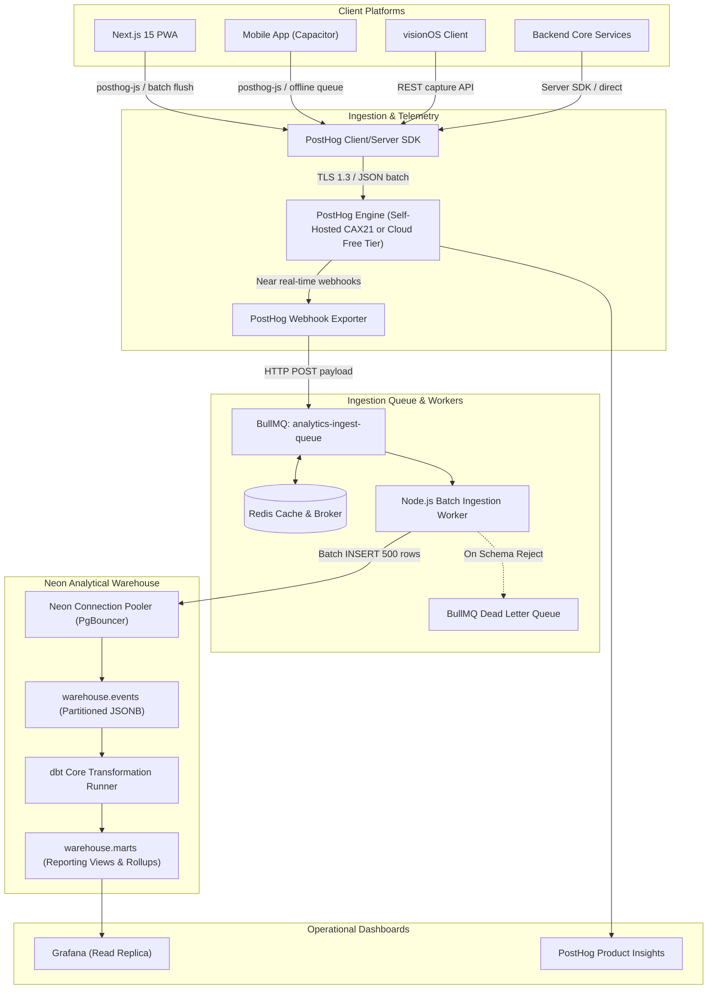
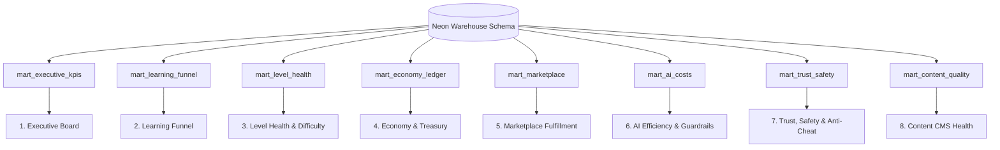
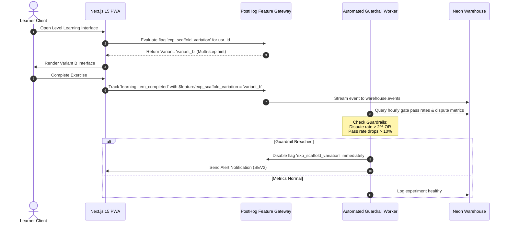
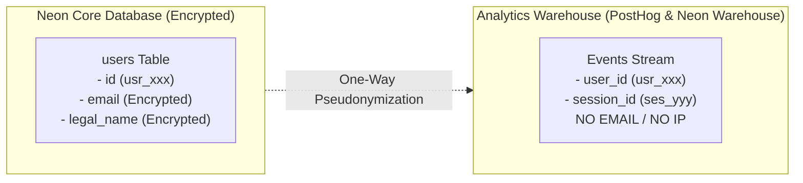

# Low-Level Design: Analytics Pipeline & Event Infrastructure

- **Document Path:** `docs/15-lld/12-analytics-pipeline.md`
- **Version:** `1.0.0`
- **Last Updated:** `2026-11-21`
- **Status:** Approved for Implementation
- **Related Documents:**
  - [System Architecture](../06-platforms/01-architecture.md)
  - [High-Level Analytics](../10-data-ai/05-analytics.md)
  - [Points & Ledger](../01-economy/02-points-ledger.md)
  - [Scoring Model](../01-economy/03-scoring-model.md)
  - [Privacy & Data Security](../09-trust-safety/03-privacy-data.md)
  - [Evaluation & Experimentation](../10-data-ai/04-evaluation.md)

---

## Table of Contents
1. [Section 1: Event Architecture & Ingestion Pipeline](#section-1-event-architecture--ingestion-pipeline)
2. [Section 2: Complete Event Catalog & Schemas](#section-2-complete-event-catalog--schemas)
3. [Section 3: PostHog Setup & Infrastructure Sizing](#section-3-posthog-setup--infrastructure-sizing)
4. [Section 4: Operational Dashboard Specifications](#section-4-operational-dashboard-specifications)
5. [Section 5: Experimentation & Feature Flag Framework](#section-5-experimentation--feature-flag-framework)
6. [Section 6: Privacy-Preserving Analytics & Governance](#section-6-privacy-preserving-analytics--governance)
7. [Section 7: Neon Warehouse Setup & dbt Transformations](#section-7-neon-warehouse-setup--dbt-transformations)

---

## Section 1: Event Architecture & Ingestion Pipeline

### 1.1 Purpose
The Analytics Pipeline captures every pedagogical, financial, and behavioral interaction across the Education Economy platform without compromising application latency, ledger integrity, or learner privacy. It ingests events at client and edge boundaries, fans out into real-time product telemetry (PostHog), buffers through a resilient BullMQ queue on Redis, and loads into a serverless PostgreSQL analytical warehouse (Neon) for dbt-modeled reporting and Grafana operational dashboards.

### 1.2 Pipeline Architecture Flow


### 1.3 Ingestion Worker Algorithm
The batch ingestion worker dequeues incoming PostHog webhook payloads from BullMQ, validates conformance against the base event schema, strips forbidden metadata, and executes micro-batched multi-row inserts into the analytical database.

```typescript
import { Worker, Job } from 'bullmq';
import { Pool } from 'pg';
import { z } from 'zod';

interface RawWebhookPayload {
  event: string;
  properties: Record<string, unknown>;
  timestamp: string;
  distinct_id: string;
  elements?: unknown[];
}

const BaseEventSchema = z.object({
  event_id: z.string().uuid(),
  event_type: z.string().min(3),
  occurred_at: z.string().datetime(),
  user_id: z.string().regex(/^usr_[a-zA-Z0-9_-]+$/),
  session_id: z.string().regex(/^ses_[a-zA-Z0-9_-]+$/),
  platform: z.enum(['web', 'ios', 'android', 'visionos']),
  app_version: z.string(),
  schema_version: z.number().int().positive(),
  payload: z.record(z.unknown()),
});

export type ValidatedEvent = z.infer<typeof BaseEventSchema>;

export class AnalyticsIngestWorker {
  private worker: Worker;
  private dbPool: Pool;
  private batchBuffer: ValidatedEvent[] = [];
  private flushTimeout: NodeJS.Timeout | null = null;
  private readonly BATCH_SIZE = 500;
  private readonly FLUSH_INTERVAL_MS = 2000;

  constructor(redisConnection: { host: string; port: number }, neonConnectionString: string) {
    this.dbPool = new Pool({
      connectionString: neonConnectionString,
      max: 10,
      idleTimeoutMillis: 30000,
    });

    this.worker = new Worker(
      'analytics-ingest-queue',
      async (job: Job<RawWebhookPayload>) => {
        await this.handleJob(job);
      },
      {
        connection: redisConnection,
        concurrency: 5,
      }
    );
  }

  private async handleJob(job: Job<RawWebhookPayload>): Promise<void> {
    const raw = job.data;
    const validated = this.normalizeAndValidate(raw);

    if (!validated) {
      throw new Error(`Invalid schema for event: ${raw.event}`);
    }

    this.batchBuffer.push(validated);

    if (this.batchBuffer.length >= this.BATCH_SIZE) {
      await this.flushBuffer();
    } else if (!this.flushTimeout) {
      this.flushTimeout = setTimeout(async () => {
        await this.flushBuffer();
      }, this.FLUSH_INTERVAL_MS);
    }
  }

  private normalizeAndValidate(raw: RawWebhookPayload): ValidatedEvent | null {
    try {
      const parsed = BaseEventSchema.parse({
        event_id: (raw.properties.$event_id as string) || crypto.randomUUID(),
        event_type: raw.event,
        occurred_at: raw.timestamp,
        user_id: raw.distinct_id,
        session_id: (raw.properties.$session_id as string) || 'ses_unknown',
        platform: (raw.properties.$platform as 'web') || 'web',
        app_version: (raw.properties.$app_version as string) || '1.0.0',
        schema_version: (raw.properties.$schema_version as number) || 1,
        payload: raw.properties,
      });
      return parsed;
    } catch {
      return null;
    }
  }

  private async flushBuffer(): Promise<void> {
    if (this.flushTimeout) {
      clearTimeout(this.flushTimeout);
      this.flushTimeout = null;
    }

    if (this.batchBuffer.length === 0) return;

    const toInsert = [...this.batchBuffer];
    this.batchBuffer = [];

    const query = `
      INSERT INTO warehouse.events (
        event_id, event_type, occurred_at, user_id,
        session_id, platform, app_version, schema_version, payload
      )
      SELECT 
        x.event_id, x.event_type, x.occurred_at::timestamptz, x.user_id,
        x.session_id, x.platform, x.app_version, x.schema_version, x.payload::jsonb
      FROM jsonb_to_recordset($1::jsonb) AS x(
        event_id uuid, event_type text, occurred_at text, user_id text,
        session_id text, platform text, app_version text, schema_version int, payload jsonb
      )
      ON CONFLICT (event_id) DO NOTHING;
    `;

    const client = await this.dbPool.connect();
    try {
      await client.query(query, [JSON.stringify(toInsert)]);
    } catch (err) {
      // Re-queue or route failed batch to dead-letter queue
      throw err;
    } finally {
      client.release();
    }
  }
}
```

### 1.4 Edge Cases & Failure Recovery
| ID | Scenario | Detection | Automated Handling | Recovery / Operational Action | Prevention |
|---|---|---|---|---|---|
| EC-ANL-001 | High ingestion burst exhausts Node heap memory | PostHog webhook latency > 2s; BullMQ buffer growth | Worker limits buffer size to 500 items; immediately flushes to Postgres pool | Scale BullMQ worker concurrency; trigger ephemeral backpressure HTTP 429 | Enforce client-side SDK throttling and batch windowing (5s) |
| EC-ANL-002 | Neon connection pooler (PgBouncer) saturation | `ECONNREFUSED` or `timeout` on pool.connect() | Worker backs off using exponential jitter (500ms, 1s, 2s) up to 5 retries | Check active query list in Neon console; terminate stuck dbt jobs | Restrict ingestion pool to 10 connections; pooler handles max 10,000 backend links |
| EC-ANL-003 | Malformed or poisoned JSON payload in queue | Zod validation failure in worker | Offloaded to `analytics-dlq` queue with rejection reason | Operator reviews payload in DLQ viewer; patches client or schema | Client SDK type contracts enforced via TypeScript shared monorepo packages |
| EC-ANL-004 | Clock skew on offline mobile client (> 30 days) | `occurred_at` > `now() + 1h` or `< now() - 30d` | Tagged with `flag_time_skew=true`; server timestamp preserved as `ingested_at` | dbt staging macro re-anchors session using server ingest anchor | Mobile client synchronizes clock against `/api/v1/health` NTP timestamp |

### 1.5 Error Handling Architecture
- **At-Least-Once Guarantee:** PostHog webhook retries delivery 3 times upon HTTP 5xx responses. BullMQ retains unacknowledged jobs for 10 minutes before triggering automatic retry.
- **Idempotency:** The database table `warehouse.events` applies a primary key constraint on `event_id`. Duplicate webhook emissions execute `ON CONFLICT (event_id) DO NOTHING`.
- **Dead Letter Queue (DLQ):** Unparseable payloads are diverted to `analytics-dlq` after 3 failed attempts, alerting on-call engineers via a webhook to the alert channel.

### 1.6 Requirements
- `FR-ANL-001`: System must record all learning, assessment, economic, and social events using standard typed envelopes.
- `FR-ANL-003`: Ingestion must guarantee deduplication via UUIDv7 primary keys.
- `NFR-ANL-001`: Ingestion pipeline must support sustained throughput of 2,000 events/sec with p99 latency < 250ms.
- `NFR-ANL-002`: Data must be queryable in the Neon warehouse within 60 seconds of client generation.

### 1.7 Success Metrics
- **Pipeline Availability:** 99.95% uptime across all ingestion components.
- **Ingestion Drop Rate:** < 0.001% of total captured events discarded to DLQ.
- **End-to-End Latency:** Time from client emission to `warehouse.events` insert < 5 seconds p95.

---

## Section 2: Complete Event Catalog & Schemas

### 2.1 Base Event Envelope
All events emitted by client runtimes and internal microservices conform strictly to the immutable base envelope.

```typescript
export interface BaseEvent {
  event_id: string;         // UUID v7 (time-ordered)
  event_type: string;       // Strict dot-notation name
  occurred_at: string;      // ISO 8601 UTC timestamp
  user_id: string;          // Pseudonymous identifier ('usr_' + nanoId)
  session_id: string;       // Ephemeral session identifier ('ses_' + nanoId)
  platform: 'web' | 'ios' | 'android' | 'visionos';
  app_version: string;      // Semantic versioning (e.g. '1.4.2')
  schema_version: number;   // Incremental schema version (default 1)
}
```

### 2.2 Event Registry (32 Core Event Payloads)

| # | Event Type | Description | Key Payload Fields |
|---|---|---|---|
| 1 | `user.registered` | New identity created | `auth_provider: 'email'\|'passkey'\|'oauth'`, `referrer_code?: string`, `locale: string` |
| 2 | `user.verified` | Identity verification passed | `verification_tier: 1\|2\|3`, `method: 'email'\|'sms'\|'manual'`, `duration_ms: number` |
| 3 | `user.deleted` | Account deleted / GDPR purge | `reason: string`, `requested_at: string`, `purge_deadline: string` |
| 4 | `onboarding.step_completed` | Learner completes onboarding step | `step_index: number`, `step_name: string`, `time_spent_ms: number` |
| 5 | `onboarding.completed` | Full onboarding sequence finished | `selected_archetype: string`, `primary_goal: string`, `total_duration_s: number` |
| 6 | `onboarding.abandoned` | Learner drops off during flow | `last_step_index: number`, `exit_trigger: string`, `time_spent_ms: number` |
| 7 | `session.started` | Learning or browsing session opened | `entry_point: string`, `network_type: 'wifi'\|'cellular'\|'offline'`, `battery_level?: number` |
| 8 | `session.ended` | Session terminated or timed out | `duration_s: number`, `items_attempted: number`, `levels_completed: number`, `exit_reason: string` |
| 9 | `learning.item_attempted` | Practice or concept item entered | `skill_id: string`, `level_number: number`, `item_id: string`, `item_type: 'text'\|'quiz'\|'sim'` |
| 10 | `learning.item_completed` | Single exercise completed | `skill_id: string`, `level_number: number`, `item_id: string`, `score: number`, `latency_ms: number` |
| 11 | `learning.review_completed` | Spaced repetition interval finished | `item_id: string`, `repetition_count: number`, `recall_score: number`, `next_interval_days: number` |
| 12 | `assessment.gate_started` | Formal level gate initiated | `skill_id: string`, `level_number: number`, `gate_attempt_id: string`, `proctor_mode: 'none'\|'browser'` |
| 13 | `assessment.gate_submitted` | Gate submitted for scoring | `gate_attempt_id: string`, `duration_ms: number`, `items_submitted: number`, `hash_signature: string` |
| 14 | `assessment.gate_passed` | Gate passed criteria met | `skill_id: string`, `level_number: number`, `final_score: number`, `distinction: boolean` |
| 15 | `assessment.gate_failed` | Gate score below threshold | `skill_id: string`, `level_number: number`, `final_score: number`, `cooldown_until: string` |
| 16 | `economy.award_posted` | Ledger posts XP and/or EC | `award_id: string`, `skill_id: string`, `level: number`, `xp_amount: number`, `ec_amount: number`, `domain_mult: number`, `q_score: number`, `eval_mode_mult: number`, `retention_mult: number`, `pool_id: string` |
| 17 | `economy.redemption_initiated` | Learner requests order | `order_id: string`, `listing_id: string`, `ec_debited: number`, `escrow_address: string` |
| 18 | `economy.redemption_completed` | Merchant confirms fulfillment | `order_id: string`, `settlement_id: string`, `fiat_value_usd: number`, `fulfillment_days: number` |
| 19 | `economy.redemption_reversed` | Order canceled / refund posted | `order_id: string`, `ec_refunded: number`, `reversal_reason: string` |
| 20 | `marketplace.item_viewed` | Catalog item viewed | `listing_id: string`, `category: string`, `price_ec: number`, `in_stock: boolean` |
| 21 | `marketplace.order_placed` | Escrow locked for purchase | `order_id: string`, `listing_id: string`, `merchant_id: string`, `ec_total: number` |
| 22 | `marketplace.order_fulfilled` | Order shipped or delivered | `order_id: string`, `tracking_carrier?: string`, `delivery_timestamp: string` |
| 23 | `marketplace.dispute_opened` | Dispute submitted by buyer | `order_id: string`, `dispute_category: string`, `evidence_doc_count: number` |
| 24 | `integrity.flag_raised` | Anti-cheat / anomaly flagged | `flag_id: string`, `rule_code: string`, `confidence_score: number`, `severity: 'low'\|'med'\|'high'` |
| 25 | `integrity.review_completed` | Human auditor resolves flag | `flag_id: string`, `verdict: 'cleared'\|'confirmed_fraud'`, `penalty_applied?: string` |
| 26 | `social.guild_joined` | Learner joins a guild | `guild_id: string`, `role: 'member'\|'mentor'`, `guild_size: number` |
| 27 | `social.mentor_session_completed`| Tutoring session finished | `session_id: string`, `mentor_id: string`, `duration_minutes: number`, `rating: number` |
| 28 | `social.peer_review_submitted` | Review submitted for peer work | `submission_id: string`, `rubric_score: number`, `feedback_char_count: number` |
| 29 | `ai.tutor_turn` | Chat turn with GPT-4o-mini | `conversation_id: string`, `prompt_tokens: number`, `completion_tokens: number`, `latency_ms: number`, `cached: boolean` |
| 30 | `ai.safety_blocked` | Guardrail halted LLM generation | `trigger_category: string`, `input_snippet_hash: string`, `filter_confidence: number` |
| 31 | `content.revision_published` | CMS releases new level spec | `skill_id: string`, `level_number: number`, `version: string`, `change_type: 'patch'\|'minor'\|'major'` |
| 32 | `system.performance_sampled` | Client Web Vitals telemetry | `ttfb_ms: number`, `fcp_ms: number`, `lcp_ms: number`, `cls: number`, `fid_ms: number` |

### 2.3 Economic Award Payload Detail
To maintain cross-verification between analytical marts and the double-entry financial ledger, the `economy.award_posted` event payload stores all exact formula factors:

$$\text{EC}(L) = 10 \times L^{1.2} \times m_d \times Q \times E \times M \times R$$
$$\text{XP}(L) = 100 \times L^{1.5} \times m_d$$

```typescript
export interface EconomyAwardPayload {
  award_id: string;               // awd_uuid
  pool_id: string;                // spon_pool_uuid
  rule_version: string;           // '2026.1'
  skill_id: string;               // e.g. 'CMP-25'
  level_number: number;           // 1 to 100
  domain_multiplier: number;      // m_d (e.g. 1.25)
  quality_multiplier: number;     // Q (0.80 to 1.20)
  eval_mode_multiplier: number;   // E (e.g. 1.0 for gate, 1.5 for panel)
  mission_multiplier: number;     // M (default 1.0)
  repeat_decay: number;           // R (1.0 -> 0.2 -> 0.05 -> 0.0)
  calculated_ec: number;          // Evaluated value
  calculated_xp: number;          // Evaluated value
  ledger_tx_id: string;           // tx_uuid referencing double-entry journal
}
```

---

## Section 3: PostHog Setup & Infrastructure Sizing

### 3.1 VPS Host & Memory Allocation Strategy
The primary infrastructure host is a **Hetzner CAX21 VPS** (€7.49/mo) providing 4 vCPU (Ampere Altra ARM64) and 8 GB ECC RAM. 

Memory contention between the application runtime and self-hosted PostHog containers requires strict resource ceilings.

```
Total Host Memory: 8,192 MB (8 GB)
├─ OS & Kernel Overhead:         512 MB
├─ App Engine & Services:      4,680 MB (Next.js PWA, BullMQ, Redis, Caddy)
└─ PostHog Container Stack:    3,000 MB (Enforced Docker Memory Limits)
```

> [!IMPORTANT]
> **Phase 0–1 Recommended Architecture:** For the Alpha deployment (up to 1,000 learners), use the **PostHog Cloud Free Tier** (1,000,000 events/month, unlimited feature flags, 5,000 session recordings). This frees the entire 7.5 GB RAM on the CAX21 VPS for core application tasks and avoids ClickHouse I/O bottlenecking. 
> 
> The Docker Compose configuration below defines the self-hosted alternative when crossing 1M monthly events in Phase 2.

### 3.2 Docker Compose Configuration (`docker-compose.posthog.yml`)
```yaml
version: '3.8'

services:
  caddy:
    image: caddy:2.8-alpine
    container_name: ee-caddy
    restart: unless-stopped
    ports:
      - "80:80"
      - "443:443"
    volumes:
      - ./Caddyfile:/etc/caddy/Caddyfile:ro
      - caddy_data:/data
      - caddy_config:/config
    networks:
      - ee_network

  redis:
    image: redis:7.2-alpine
    container_name: ee-redis
    restart: unless-stopped
    command: redis-server --appendonly yes --maxmemory 768mb --maxmemory-policy allkeys-lru
    mem_limit: 800m
    volumes:
      - redis_data:/data
    networks:
      - ee_network

  posthog-clickhouse:
    image: clickhouse/clickhouse-server:24.3-alpine
    container_name: ee-posthog-clickhouse
    restart: unless-stopped
    mem_limit: 1400m
    mem_reservation: 1000m
    ulimits:
      nofile:
        soft: 262144
        hard: 262144
    volumes:
      - clickhouse_data:/var/lib/clickhouse
    networks:
      - ee_network

  posthog-web:
    image: posthog/posthog:latest
    container_name: ee-posthog-web
    restart: unless-stopped
    mem_limit: 800m
    environment:
      - SITE_URL=https://telemetry.education-economy.org
      - SECRET_KEY=${POSTHOG_SECRET_KEY}
      - CLICKHOUSE_HOST=posthog-clickhouse
      - CLICKHOUSE_PORT=9000
      - DATABASE_URL=${NEON_POSTHOG_DATABASE_URL}
      - REDIS_URL=redis://redis:6379/1
      - CAPTURE_INTERNAL_METRICS=0
      - DISABLE_ASYNC_MIGRATIONS=1
    depends_on:
      - posthog-clickhouse
      - redis
    networks:
      - ee_network

  posthog-worker:
    image: posthog/posthog:latest
    container_name: ee-posthog-worker
    restart: unless-stopped
    mem_limit: 800m
    command: /compose/start-worker
    environment:
      - SITE_URL=https://telemetry.education-economy.org
      - SECRET_KEY=${POSTHOG_SECRET_KEY}
      - CLICKHOUSE_HOST=posthog-clickhouse
      - DATABASE_URL=${NEON_POSTHOG_DATABASE_URL}
      - REDIS_URL=redis://redis:6379/1
    depends_on:
      - posthog-web
    networks:
      - ee_network

volumes:
  caddy_data:
  caddy_config:
  redis_data:
  clickhouse_data:

networks:
  ee_network:
    name: ee_network
    driver: bridge
```

### 3.3 PostHog Client Initialization
```typescript
import posthog from 'posthog-js';

export function initializeTelemetry(): void {
  if (typeof window === 'undefined') return;

  const telemetryEndpoint = process.env.NEXT_PUBLIC_POSTHOG_HOST || 'https://telemetry.education-economy.org';
  const apiKey = process.env.NEXT_PUBLIC_POSTHOG_KEY;

  if (!apiKey) {
    console.warn('[Telemetry] Missing NEXT_PUBLIC_POSTHOG_KEY; analytics disabled');
    return;
  }

  posthog.init(apiKey, {
    api_host: telemetryEndpoint,
    ui_host: 'https://telemetry.education-economy.org',
    autocapture: false, // Explicit tracking only (no DOM noise)
    capture_pageview: true,
    capture_pageleave: true,
    disable_session_recording: false, // Enabled for user-session UX analysis
    session_recording: {
      maskAllInputs: true,
      maskTextSelector: '.pii-mask, [data-pii="true"], input, textarea',
      blockSelector: '.payment-form, .kyc-document',
    },
    persistence: 'localStorage+cookie',
    bootstrap: {
      distinctId: 'anonymous',
      isIdentifiedId: false,
    },
    sanitize_properties: (properties) => {
      // Data minimization filter
      delete properties['$ip'];
      delete properties['email'];
      delete properties['legal_name'];
      return properties;
    },
  });
}
```

---

## Section 4: Operational Dashboard Specifications

Eight specialized dashboards serve key functional teams, querying materialized reporting views on the Neon Postgres warehouse replica and PostHog metrics.



### 4.1 Dashboard 1: Executive North Star
- **Audience:** Leadership, Founders, Board of Directors.
- **Refresh Interval:** Every 1 hour.
- **Filters:** Date Range, Sponsor Cohort, Region.
- **Panels & Queries:**
  1. **Weekly Active Learners (WAL):** Distinct `user_id` submitting >= 1 learning attempt in trailing 7 days.
  2. **Cumulative Education Credits (EC) Issued vs Redeemed:** Dual-axis area chart comparing gross minted EC against redeemed EC.
  3. **Verified Mastery Count:** Total gate exams passed across all 25 alpha skills.
  4. **Treasury Reserve Ratio:** Total fiat reserves in USD divided by outstanding EC liabilities (target: >= 1.00).
  5. **Fraud Incidents Ratio:** Confirmed fraud volume / total award count (target: < 0.2%).

### 4.2 Dashboard 2: Learning Funnel & Retention
- **Audience:** Growth, Product Managers, Instructional Designers.
- **Refresh Interval:** Hourly.
- **Filters:** Skill Archetype, Acquisition Channel, Country.
- **Panels & Queries:**
  1. **Onboarding Funnel:** Conversion from `user.registered` -> `onboarding.step_completed` -> `onboarding.completed` -> First Level Pass.
  2. **Cohort Retention Matrix:** D1, D7, D14, D30, D60 retention cohorts visualized via heatmap.
  3. **Time to First Gate:** Median duration in minutes from registration to `assessment.gate_passed`.
  4. **Drop-off Heatmap by Band:** Distribution of learners dropping off across Bands 1 to 10.

### 4.3 Dashboard 3: Level Health & Difficulty
- **Audience:** Assessment Specialists, Psychometricians, Curriculum Authors.
- **Refresh Interval:** 4 hours.
- **Filters:** Domain, Skill ID, Band Number.
- **Panels & Queries:**
  1. **Pass Rate by Level:** Bar chart showing pass rate per level. Levels with pass rate < 55% or > 95% highlighted in red.
  2. **Item Latency Distribution:** Median time spent per practice exercise vs gate exam.
  3. **Attempt Retry Distribution:** Histogram of retries before passing level gate (1, 2, 3, 4+).
  4. **Differential Item Functioning (DIF) Drift:** Item discrimination coefficient variance over time.

### 4.4 Dashboard 4: Economy & Currency Reserves
- **Audience:** Treasury Ops, Financial Analysts, Economy Council.
- **Refresh Interval:** 15 minutes.
- **Filters:** Sponsor Pool ID, Region Anchor Currency.
- **Panels & Queries:**
  1. **Double-Entry Reconciliation Delta:** Difference between `warehouse.events` award sum and core ledger balance (must equal 0.00).
  2. **Velocity of EC:** Transaction volume of EC / Average wallet balances.
  3. **Sink Distribution Breakdown:** Pie chart of redemptions: Essentials (Target 35%), Tools (20%), Services (20%), Experiences (10%), Upgrades (8%), Cosmetic (5%), Fees (2%).
  4. **Sponsor Pool Burn Rate:** Days of runway remaining per sponsor pool based on trailing 7-day emission.

### 4.5 Dashboard 5: Marketplace & Logistics
- **Audience:** Merchant Partners, Operations, Customer Success.
- **Refresh Interval:** 30 minutes.
- **Filters:** Merchant ID, Product Category, Order Status.
- **Panels & Queries:**
  1. **Order Volume & Fulfillment Lead Time:** Mean duration from `economy.redemption_initiated` to `marketplace.order_fulfilled`.
  2. **Escrow Lock Balance:** Total EC currently locked in unfulfilled escrows.
  3. **Dispute Rate by Merchant:** Open disputes / fulfilled orders (threshold alert > 1.5%).
  4. **Catalog Inventory Depth:** Number of SKUs with stock < 5 units.

### 4.6 Dashboard 6: AI Cost & Efficiency
- **Audience:** Engineering, Platform Architecture.
- **Refresh Interval:** 15 minutes.
- **Filters:** Service Subsystem (Tutor vs CMS Drafting), Model Name.
- **Panels & Queries:**
  1. **Daily Token Consumption:** Input tokens vs output tokens for GPT-4o-mini.
  2. **Cost per Active Learner:** Total OpenAI invoice cost / WAL (target: < $0.05 per learner/month).
  3. **Semantic Cache Hit Ratio:** Redis semantic cache hit rate for repetitive tutor queries (target: > 40%).
  4. **Safety Block Rate:** Number of `ai.safety_blocked` events per 10,000 queries.

### 4.7 Dashboard 7: Trust, Safety & Anti-Cheat
- **Audience:** Trust & Safety Officers, Fraud Analysts.
- **Refresh Interval:** Real-time (5 minutes).
- **Filters:** Severity, Skill Domain, Suspicion Rule.
- **Panels & Queries:**
  1. **Active Integrity Flags Queue:** Unreviewed flags grouped by heuristic: rapid-fire submissions, telemetry botting, answer-hash collusion.
  2. **Human Audit Resolution Velocity:** Mean time to resolve integrity flags (SLA: < 24h).
  3. **Clawback Execution Volume:** Total EC clawed back and reversed to sponsor pools.
  4. **Appeals Inversion Rate:** Percentage of flagged decisions overturned on appeal.

### 4.8 Dashboard 8: Content Quality & Authoring
- **Audience:** Content Ops, Domain Leads, Editors.
- **Refresh Interval:** Daily.
- **Filters:** Domain, Reviewer User ID, Author ID.
- **Panels & Queries:**
  1. **Levels in Workflow Stages:** Pipeline count across BACKLOG through PUBLISHED.
  2. **Editorial Turnaround Time:** Average days per level from SME draft to final publication.
  3. **Learner Dispute Rate:** Percentage of learners submitting item ambiguity complaints.
  4. **Stale Content Backlog:** Published levels older than 18 months in fast-moving domains.

---

## Section 5: Experimentation & Feature Flag Framework

### 5.1 Architecture & PostHog Assignment
A/B experiments and feature rollouts use PostHog's deterministic hash-based feature flags (`posthog.isFeatureEnabled('flag_key')`). This ensures sticky variant assignment across web and mobile without storing state on the client.



### 5.2 Sample Size Calculator & Power Analysis
Prior to launching any A/B test, the minimum sample size per variant is calculated to ensure statistical power $(1 - \beta \ge 0.80)$ at significance $(\alpha = 0.05)$.

```typescript
export interface ExperimentPowerConfig {
  baselineRate: number;      // e.g. 0.65 (65% pass rate)
  minimumDetectableEffect: number; // e.g. 0.05 (5% absolute lift)
  alpha?: number;            // Type I error rate (default 0.05)
  power?: number;            // Statistical power (default 0.80)
}

export function calculateRequiredSampleSize(config: ExperimentPowerConfig): number {
  const alpha = config.alpha ?? 0.05;
  const power = config.power ?? 0.80;
  
  // Z-scores for two-tailed standard normal distribution
  const zAlpha = alpha === 0.05 ? 1.96 : 2.576; // 95% vs 99%
  const zBeta = power === 0.80 ? 0.842 : 1.282; // 80% vs 90%

  const p1 = config.baselineRate;
  const p2 = p1 + config.minimumDetectableEffect;
  const pBar = (p1 + p2) / 2;

  const numerator = Math.pow(
    zAlpha * Math.sqrt(2 * pBar * (1 - pBar)) +
    zBeta * Math.sqrt(p1 * (1 - p1) + p2 * (1 - p2)),
    2
  );
  
  const denominator = Math.pow(p1 - p2, 2);
  const samplePerVariant = Math.ceil(numerator / denominator);

  return samplePerVariant;
}
```

### 5.3 Automated Guardrail Rules & Circuit Breakers
Any experiment that breaches pre-configured safety guardrails is terminated automatically by a BullMQ scheduled worker.

```typescript
export async function evaluateExperimentGuardrails(
  experimentKey: string,
  warehouseDb: Pool,
  posthogApiKey: string
): Promise<void> {
  const query = `
    SELECT 
      variant,
      COUNT(DISTINCT user_id) as samples,
      AVG(CASE WHEN event_type = 'assessment.gate_passed' THEN 1.0 ELSE 0.0 END) as pass_rate,
      AVG(CASE WHEN event_type = 'marketplace.dispute_opened' THEN 1.0 ELSE 0.0 END) as dispute_rate
    FROM warehouse.events
    WHERE payload->>'$feature/' || $1 IS NOT NULL
      AND occurred_at > NOW() - INTERVAL '24 hours'
    GROUP BY variant;
  `;

  const { rows } = await warehouseDb.query(query, [experimentKey]);
  const control = rows.find(r => r.variant === 'control');
  const treatment = rows.find(r => r.variant !== 'control');

  if (!control || !treatment || treatment.samples < 100) return;

  const passRateDrop = control.pass_rate - treatment.pass_rate;
  const disputeRateSpike = treatment.dispute_rate - control.dispute_rate;

  // Circuit breaker conditions
  const shouldHalt = passRateDrop > 0.10 || disputeRateSpike > 0.02;

  if (shouldHalt) {
    // 1. Immediately disable flag via PostHog API
    await fetch(`https://app.posthog.com/api/projects/@current/feature_flags/${experimentKey}/`, {
      method: 'PATCH',
      headers: {
        Authorization: `Bearer ${posthogApiKey}`,
        'Content-Type': 'application/json',
      },
      body: JSON.stringify({ active: false }),
    });

    // 2. Insert incident audit event
    await warehouseDb.query(`
      INSERT INTO warehouse.system_alerts (severity, component, message)
      VALUES ('SEV2', 'experiment_guardrail', 'Experiment ' || $1 || ' automatically terminated due to safety breach.')
    `, [experimentKey]);
  }
}
```

---

## Section 6: Privacy-Preserving Analytics & Governance

### 6.1 Anonymization & Identifier Separation
Personal Identifiable Information (PII) such as legal names, email addresses, IP addresses, and bank credentials are never stored in or sent to the telemetry pipeline.



1. **Pseudonymous IDs:** All telemetry uses an opaque `usr_` prefix followed by 16 URL-safe characters (e.g. `usr_8fK92mQxL10p`).
2. **IP Scrubbing:** PostHog client configuration explicitly strips `$ip` and enforces geo-lookup truncation to Country level only.
3. **Identity Vault:** The mapping table between email and `user_id` is restricted to the core identity service database and protected with AES-256-GCM field encryption.

### 6.2 Data Retention & GDPR Erasure Flow
- **Standard Telemetry Retention:** Rolling 24 months. Events older than 730 days are automatically dropped by Neon database partition pruning.
- **Right to Erasure (GDPR Art. 17):** When a user requests account deletion, a BullMQ job purges all matching rows from PostHog and the analytical warehouse within 72 hours.

```typescript
export async function executeGdprPurge(userId: string, neonWarehouse: Pool, posthogSecret: string): Promise<void> {
  // 1. Delete events from PostHog
  await fetch(`https://app.posthog.com/api/person/${userId}/`, {
    method: 'DELETE',
    headers: { Authorization: `Bearer ${posthogSecret}` },
  });

  // 2. Anonymize/delete records from warehouse.events
  const client = await neonWarehouse.connect();
  try {
    await client.query('BEGIN');
    await client.query(
      `DELETE FROM warehouse.events WHERE user_id = $1;`,
      [userId]
    );
    await client.query(
      `UPDATE warehouse.user_daily_metrics SET user_id = 'usr_erased_gdpr' WHERE user_id = $1;`,
      [userId]
    );
    await client.query('COMMIT');
  } catch (err) {
    await client.query('ROLLBACK');
    throw err;
  } finally {
    client.release();
  }
}
```

---

## Section 7: Neon Warehouse Setup & dbt Transformations

### 7.1 Database Schema Definition (DDL)
```sql
CREATE SCHEMA IF NOT EXISTS warehouse;

-- 1. Raw Events Ingestion Table (Partitioned by Month)
CREATE TABLE warehouse.events (
    event_id UUID NOT NULL,
    event_type VARCHAR(64) NOT NULL,
    occurred_at TIMESTAMPTZ NOT NULL,
    ingested_at TIMESTAMPTZ NOT NULL DEFAULT NOW(),
    user_id VARCHAR(64) NOT NULL,
    session_id VARCHAR(64) NOT NULL,
    platform VARCHAR(16) NOT NULL,
    app_version VARCHAR(32) NOT NULL,
    schema_version INT NOT NULL DEFAULT 1,
    payload JSONB NOT NULL,
    PRIMARY KEY (occurred_at, event_id)
) PARTITION BY RANGE (occurred_at);

-- Partition examples
CREATE TABLE warehouse.events_y2026m11 PARTITION OF warehouse.events
    FOR VALUES FROM ('2026-11-01 00:00:00+00') TO ('2026-12-01 00:00:00+00');
CREATE TABLE warehouse.events_y2026m12 PARTITION OF warehouse.events
    FOR VALUES FROM ('2026-12-01 00:00:00+00') TO ('2027-01-01 00:00:00+00');

-- Performance Indexes
CREATE INDEX idx_events_user_time ON warehouse.events (user_id, occurred_at DESC);
CREATE INDEX idx_events_type_time ON warehouse.events (event_type, occurred_at DESC);
CREATE INDEX idx_events_payload_gin ON warehouse.events USING GIN (payload);

-- 2. Materialized View: User Daily Learning Metrics
CREATE MATERIALIZED VIEW warehouse.user_daily_metrics AS
SELECT 
    date_trunc('day', occurred_at) AS metric_date,
    user_id,
    COUNT(CASE WHEN event_type = 'learning.item_completed' THEN 1 END) AS items_completed,
    COUNT(CASE WHEN event_type = 'assessment.gate_passed' THEN 1 END) AS gates_passed,
    SUM(COALESCE((payload->>'calculated_ec')::numeric, 0)) AS total_ec_earned,
    SUM(COALESCE((payload->>'calculated_xp')::numeric, 0)) AS total_xp_earned
FROM warehouse.events
GROUP BY 1, 2;

CREATE UNIQUE INDEX idx_udm_date_user ON warehouse.user_daily_metrics (metric_date, user_id);
```

### 7.2 dbt Core Transformation Models
dbt executes against the Neon warehouse to build validated dimension tables and dimensional data marts.

#### `models/staging/stg_learning_attempts.sql`
```sql
{{ config(materialized='view') }}

SELECT
    event_id AS attempt_event_id,
    occurred_at AS attempted_at,
    user_id,
    payload->>'skill_id' AS skill_id,
    (payload->>'level_number')::int AS level_number,
    payload->>'item_id' AS item_id,
    (payload->>'score')::numeric AS score,
    (payload->>'latency_ms')::int AS latency_ms,
    CASE WHEN (payload->>'score')::numeric >= 0.80 THEN TRUE ELSE FALSE END AS is_passed
FROM {{ source('warehouse', 'events') }}
WHERE event_type = 'learning.item_completed'
```

#### `models/marts/mart_level_health.sql`
```sql
{{ config(materialized='table') }}

WITH attempts AS (
    SELECT * FROM {{ ref('stg_learning_attempts') }}
)

SELECT
    skill_id,
    level_number,
    COUNT(*) AS total_attempts,
    COUNT(DISTINCT user_id) AS unique_learners,
    ROUND(AVG(score), 4) AS mean_score,
    ROUND(COUNT(CASE WHEN is_passed THEN 1 END)::numeric / COUNT(*), 4) AS pass_rate,
    ROUND(PERCENTILE_CONT(0.50) WITHIN GROUP (ORDER BY latency_ms), 0) AS median_latency_ms,
    CASE 
        WHEN COUNT(*)::numeric / COUNT(DISTINCT user_id) > 4.0 THEN 'HIGH_FRUSTRATION'
        WHEN (COUNT(CASE WHEN is_passed THEN 1 END)::numeric / COUNT(*)) < 0.55 THEN 'EXCESSIVE_DIFFICULTY'
        WHEN (COUNT(CASE WHEN is_passed THEN 1 END)::numeric / COUNT(*)) > 0.95 THEN 'TRIVIAL_DIFFICULTY'
        ELSE 'BALANCED'
    END AS health_flag
FROM attempts
GROUP BY skill_id, level_number
```

### 7.3 Grafana Connection Specification
Grafana connects directly to the Neon PostgreSQL connection pooler (PgBouncer mode) using a restricted read-only service role.

```ini
# /etc/grafana/provisioning/datasources/neon_warehouse.yaml
apiVersion: 1
datasources:
  - name: Neon Analytics Warehouse
    type: postgres
    access: proxy
    url: ep-cool-lake-123456-pooler.us-east-2.aws.neon.tech:5432
    database: education_economy
    user: grafana_reader
    secureJsonData:
      password: "${GRAFANA_NEON_PASSWORD}"
    jsonData:
      sslmode: "require"
      maxOpenConns: 5
      maxIdleConns: 2
      connMaxLifetime: 14400
      postgresVersion: 1600
      timescaledb: false
```
