# Entity, ER & State Diagrams — Rust Implementation

> Entity-relationship (ER) and per-entity state machines for every table in `migrations/*.sql`, mirroring the SQLx schema. Render with any Mermaid viewer. Companion to [16-data-flows.md](16-data-flows.md) (flows) and [16-rust-implementation.md](16-rust-implementation.md) (module map).

## 1. Entity-Relationship diagram

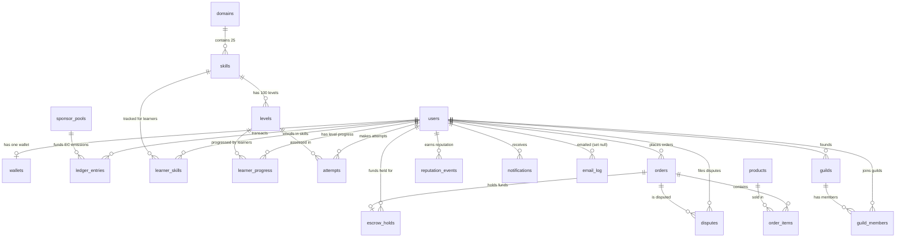

> **Standalone (no foreign key):** `sessions` (opaque `BYTEA` payload via `tower-sessions`) and `login_attempts` (keyed by `email` string, not `users.id`).

## 2. Identity entities

### `users`
| Field | Type | Notes |
|---|---|---|
| id | uuid PK | gen_random_uuid() |
| email | text UNIQUE | |
| username | text UNIQUE | |
| password_hash | text NULL | NULL for OAuth-only accounts |
| role | text | `learner` \| `mentor` \| `admin` \| `sponsor` |
| created_at / updated_at | timestamptz | |

No lifecycle `status` column — `role` is a classification. Account **access** state is governed by `login_attempts`:

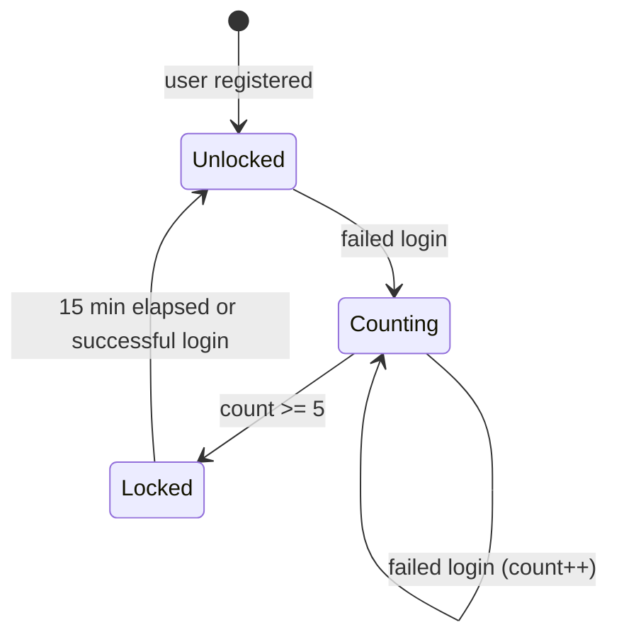

### `sessions`
| Field | Type | Notes |
|---|---|---|
| id | text PK | session id |
| data | bytea | opaque tower-sessions payload |
| expiry_date | timestamptz | |

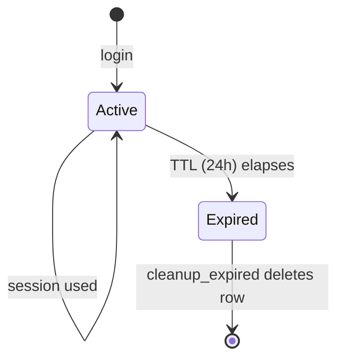

### `login_attempts`
| Field | Type | Notes |
|---|---|---|
| email | text PK | brute-force tracking (not FK) |
| failed_count | int | |
| locked_until | timestamptz NULL | |
| updated_at | timestamptz | |

Row lifecycle mirrors the account-access machine above: `failed_count` 0→5, `locked_until` set at 5, cleared on success.

## 3. Economy entities

### `wallets`
| Field | Type | Notes |
|---|---|---|
| user_id | uuid PK → users | |
| xp_balance | bigint | monotonically non-decreasing (XP debits rejected) |
| ec_balance | bigint | spendable; non-negative guard |
| updated_at | timestamptz | |

No state machine — balances are numbers. XP only grows; EC moves through the award lifecycle (see [16-data-flows.md §5.3](16-data-flows.md)).

### `ledger_entries`
| Field | Type | Notes |
|---|---|---|
| id | uuid PK | |
| user_id | uuid → users | |
| entry_type | text | `CREDIT` \| `DEBIT` |
| currency | text | `XP` \| `EC` |
| amount / balance_after | bigint | |
| reason | text | e.g. `GATE_PASS`, `ESCROW_HOLD` |
| reference_id | uuid | links level/order |
| funding_pool_id | uuid NULL → sponsor_pools | EC emissions only |
| prev_hash / entry_hash | text | SHA-256 chain |
| created_at | timestamptz | |

**Append-only / immutable** — no `UPDATE`/`DELETE`; corrections and clawbacks are new compensating entries. Each row chains `entry_hash = SHA256(prev | user | currency | amount | reason)`.

### `sponsor_pools`
| Field | Type | Notes |
|---|---|---|
| id | uuid PK | |
| name / purpose / region | text | |
| budget_fiat / anchor_rate | bigint / numeric | reserve & redemption value |
| reserved_ec / emitted_ec / redeemed_ec | bigint | emission accounting |
| status | text | `active` (default) |
| expires_at | timestamptz NULL | |

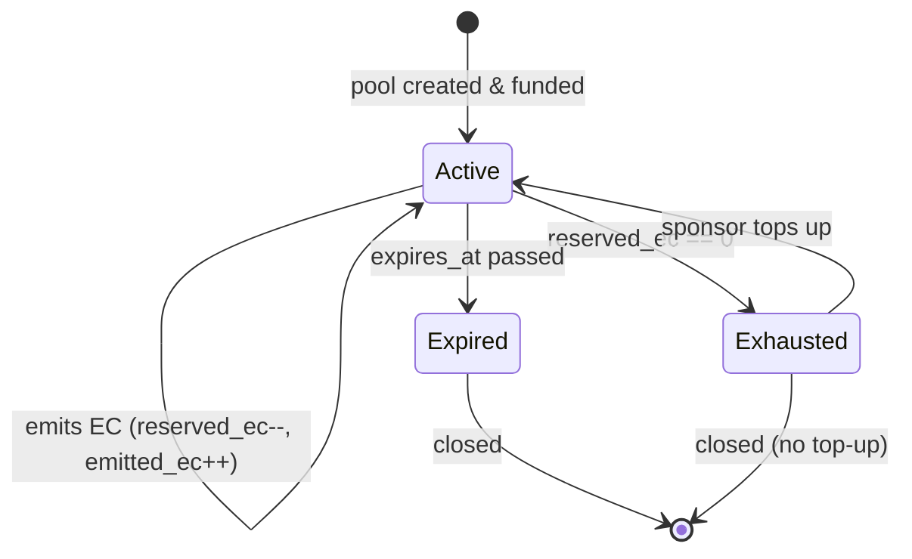

## 4. Learning entities

### `domains`
| Field | Type | Notes |
|---|---|---|
| code | text PK | e.g. `CMP` |
| name | text | e.g. "Computing & Software" |
| multiplier | numeric(5,2) | domain reward multiplier (0.9–1.3) |

No lifecycle — static dimension table (20 rows).

### `skills`
| Field | Type | Notes |
|---|---|---|
| id | text PK | e.g. `CMP-06` |
| domain_code | text → domains | |
| name | text | |
| archetype | text | foundation / craft / analytical / relational … |
| level_100_outcome | text | world-class proof |
| safety_class | text | `standard` \| `caution` \| `high-risk` |
| version | text | semver |
| created_at | timestamptz | |

No status column — content is **versioned** (semver), not stateful. Add/deprecate is a governance operation.

### `levels`
| Field | Type | Notes |
|---|---|---|
| id | uuid PK | |
| skill_id | text → skills | |
| level | int | 1–100 (CHECK) |
| title / outcome | text | |
| expected_hours / difficulty | numeric | `H(L)` / `D(L)` |
| version | text | semver |
| UNIQUE(skill_id, level) | | |

Static per skill; 100 rows each.

### `learner_skills`  (user ↔ skill enrollment)
| Field | Type | Notes |
|---|---|---|
| user_id | uuid → users | |
| skill_id | text → skills | |
| current_level | int | highest passed level (default 0) |
| mastery | numeric | BKT posterior 0..1 |
| status | text | `active` |
| updated_at | timestamptz | |
| PK (user_id, skill_id) | | |

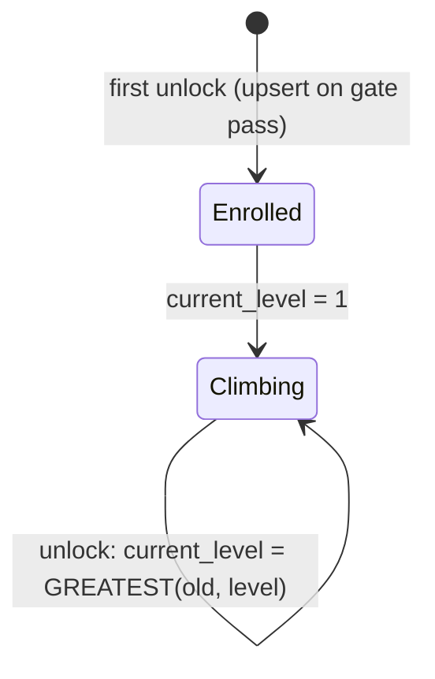

### `learner_progress`  (per-level state)
| Field | Type | Notes |
|---|---|---|
| user_id | uuid → users | |
| level_id | uuid → levels | |
| status | text | `not_started` (default) → `passed` on unlock |
| mastery | numeric | 0..1 |
| attempts | int | counter |
| gate_passed_at | timestamptz NULL | |
| updated_at | timestamptz | |
| PK (user_id, level_id) | | |

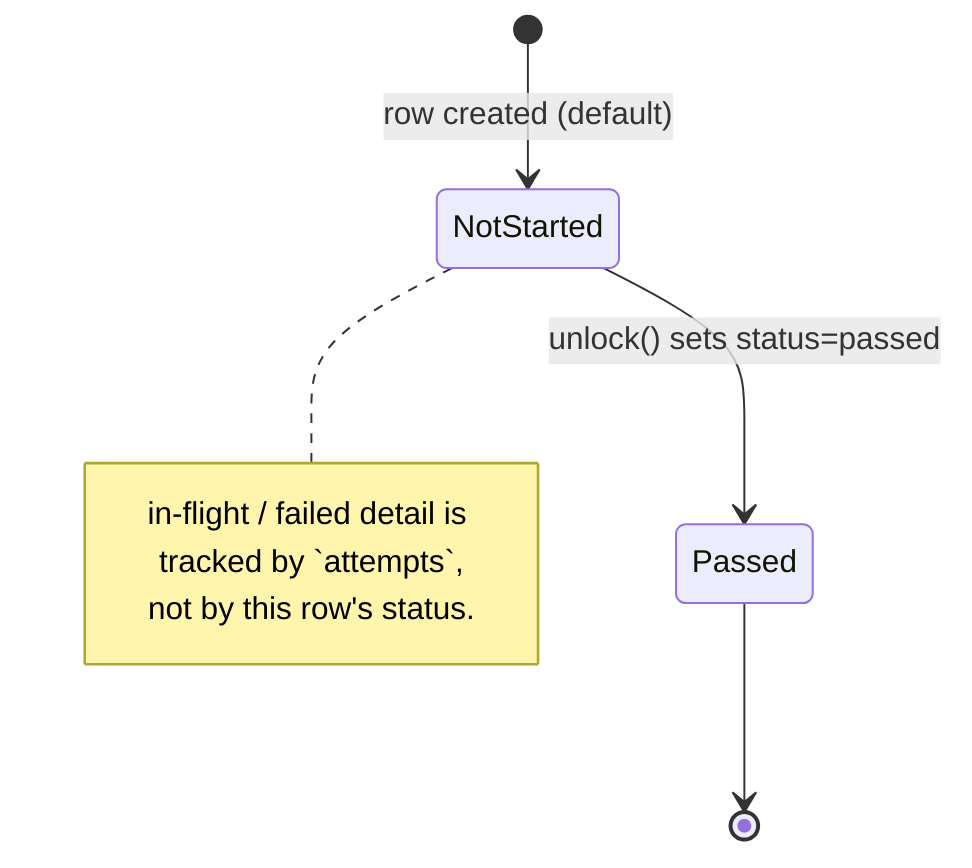

### `attempts`
| Field | Type | Notes |
|---|---|---|
| id | uuid PK | |
| user_id | uuid → users | |
| level_id | uuid → levels | |
| kind | text | `practice` \| `gate` \| `diagnostic` |
| score | numeric NULL | |
| integrity_score | numeric | default 1.0 |
| status | text | `pending` → `passed` \| `failed` |
| rule_version | text | `score-2026.1` |
| started_at / submitted_at | timestamptz | |

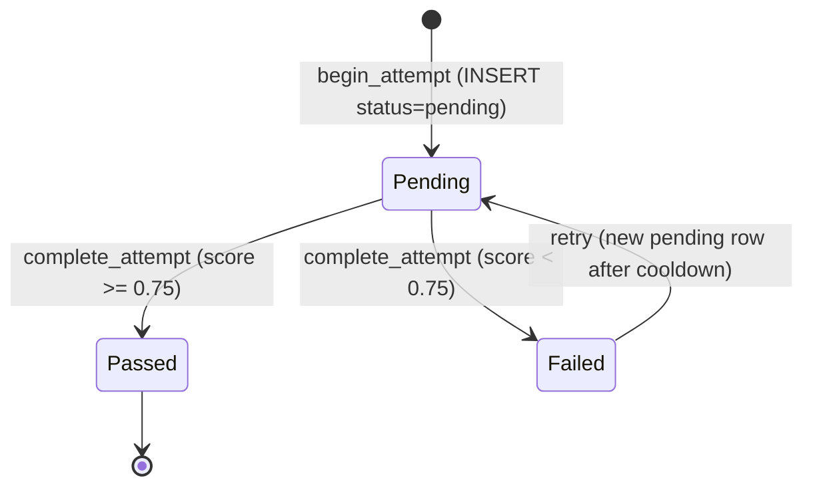

## 5. Marketplace entities

### `products`
| Field | Type | Notes |
|---|---|---|
| id | uuid PK | |
| name / description | text | |
| category | text | `essentials` \| `tools` \| … |
| price_ec / stock | bigint / int | |
| active | bool | listing on/off |
| merchant_id / created_at | uuid / timestamptz | |

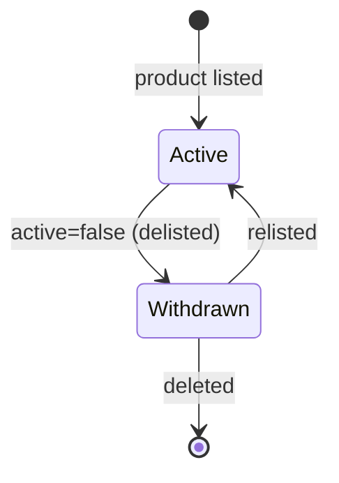

### `orders`
| Field | Type | Notes |
|---|---|---|
| id | uuid PK | |
| user_id | uuid → users | |
| status | text | `pending` → `escrowed` → `fulfilled` \| `refunded` |
| ec_total | bigint | |
| created_at / updated_at | timestamptz | |

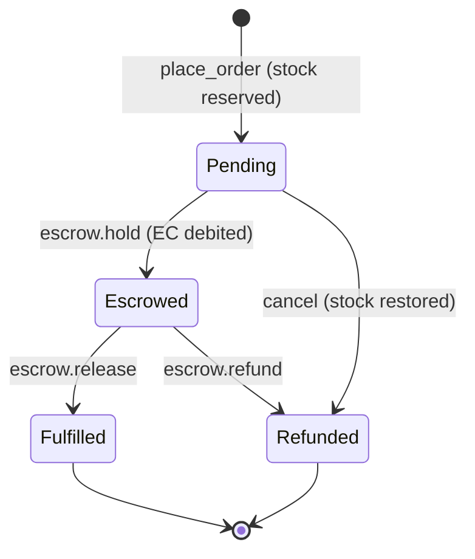

### `order_items`
| Field | Type | Notes |
|---|---|---|
| id | uuid PK | |
| order_id | uuid → orders | |
| product_id | uuid → products | |
| quantity / price_ec | int / bigint | |

No lifecycle — immutable line items.

### `escrow_holds`
| Field | Type | Notes |
|---|---|---|
| id | uuid PK | |
| order_id | uuid → orders | |
| user_id | uuid → users | |
| amount | bigint | held EC |
| status | text | `held` → `released` \| `refunded` |
| released_at / created_at | timestamptz | |

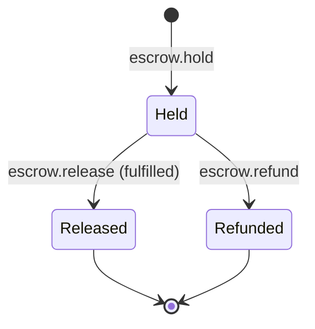

### `disputes`
| Field | Type | Notes |
|---|---|---|
| id | uuid PK | |
| order_id | uuid → orders | |
| user_id | uuid → users | |
| reason / resolution | text | |
| status | text | `open` → `resolved_restitution` \| `resolved_refund` \| `rejected` |
| created_at / resolved_at | timestamptz | |

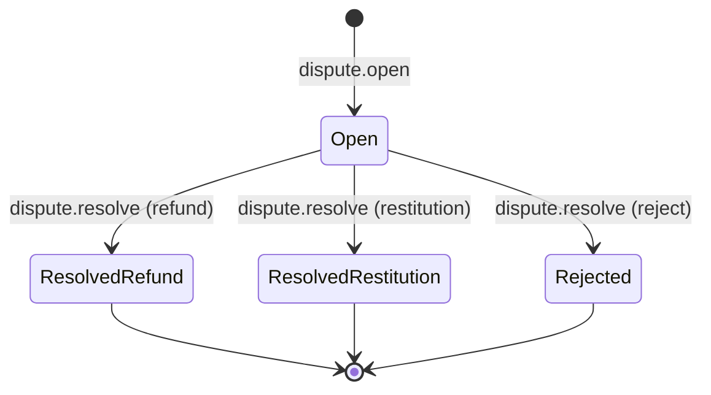

## 6. Social entities

### `guilds`
| Field | Type | Notes |
|---|---|---|
| id | uuid PK | |
| name | text UNIQUE | |
| description | text NULL | |
| founder_id | uuid → users | |
| created_at | timestamptz | |

No lifecycle — membership state lives in `guild_members`.

### `guild_members`
| Field | Type | Notes |
|---|---|---|
| guild_id | uuid → guilds | |
| user_id | uuid → users | |
| role | text | `founder` \| `officer` \| `member` |
| joined_at | timestamptz | |
| PK (guild_id, user_id) | | |

Role is a classification; membership is add-only (join is idempotent `ON CONFLICT DO NOTHING`).

### `reputation_events`
| Field | Type | Notes |
|---|---|---|
| id | uuid PK | |
| user_id | uuid → users | |
| event_type | text | `peer_review` \| `mentoring` \| `integrity` \| `bounty` |
| weight | numeric | +/− contribution |
| source_id | uuid | |
| created_at | timestamptz | |

Append-only; score = Σ weight × 0.5^(age/30d) — decayed, never stored.

### `league_seasons`
| Field | Type | Notes |
|---|---|---|
| id | uuid PK | |
| season | int UNIQUE | week‑of‑epoch / 12 |
| started_at / ended_at | timestamptz | |

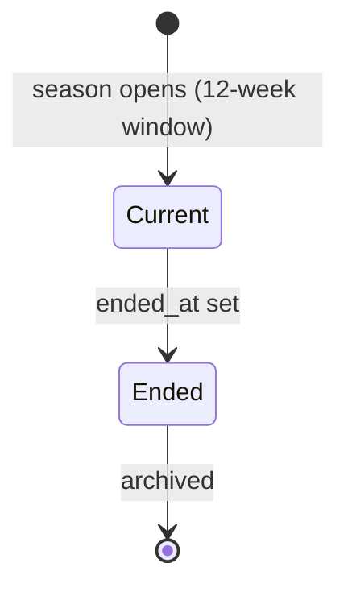

## 7. Notification entities

### `notifications`
| Field | Type | Notes |
|---|---|---|
| id | uuid PK | |
| user_id | uuid → users | |
| kind / title / body | text | |
| read | bool | default false |
| created_at | timestamptz | |

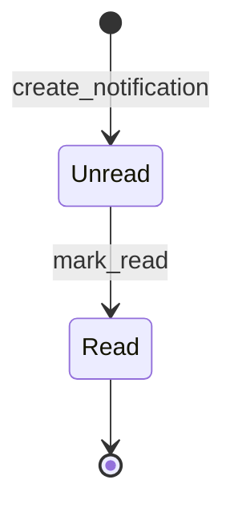

### `email_log`
| Field | Type | Notes |
|---|---|---|
| id | uuid PK | |
| user_id | uuid → users (SET NULL) | |
| to_email / subject | text | |
| status | text | `sent` \| `failed` \| `bounced` |
| created_at | timestamptz | |

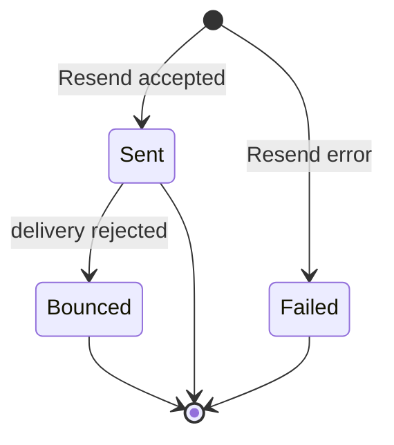

> Related: [16-data-flows.md](16-data-flows.md) (flows) · [16-rust-implementation.md](16-rust-implementation.md) (module map) · [SETUP.md](../SETUP.md).